# MkIII base, Rev 3: gas strut balance

The collective's pivot base. The lever runs on two 6006-2RS bearings and is printed as two halves, and an adjustable friction knob sets the drag. An AS5600 magnetic sensor reads the lever angle, and the USB cable leaves on the knob side.

A small gas strut, centred under the tube and the hub, holds the lever up. Its lower end is bolted into a gusseted clevis on the base, just ahead of the pivot. Its upper end sits on a collar clamped to the tube. Rev 1 balanced the lever with a ballast bucket and about a kilogram of ballast, and Rev 2 with a clock spring.

Rev 3 also changes four other things from Rev 1:
- **Tube:** the whole 500 mm carbon tube, uncut (470 mm, plus the 12.7 mm the head's boss takes, plus 17.3 mm down in the socket).
- **Up-stop:** a boss on the back of the lever lands on a pedestal on the frame at 32°, instead of Rev 1's adjustable quadrant and striker.
- **Lever:** the hub is 60 mm across all the way.
- **Pivot height:** 58 mm above the desk, on an 8 mm (5/16 in) base plate.

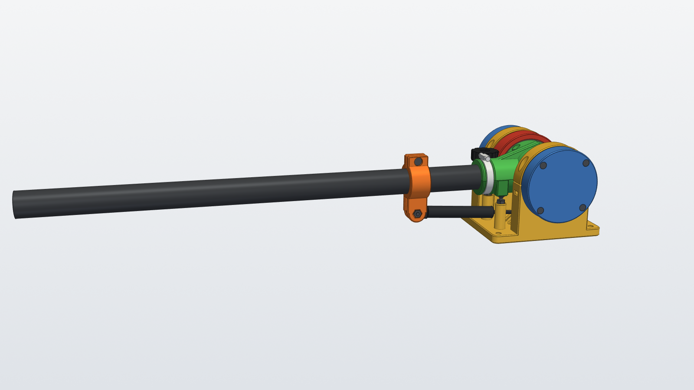

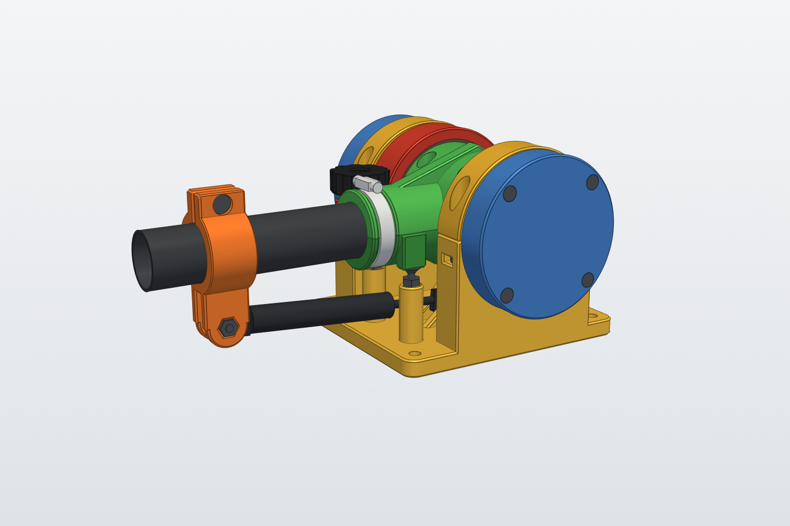

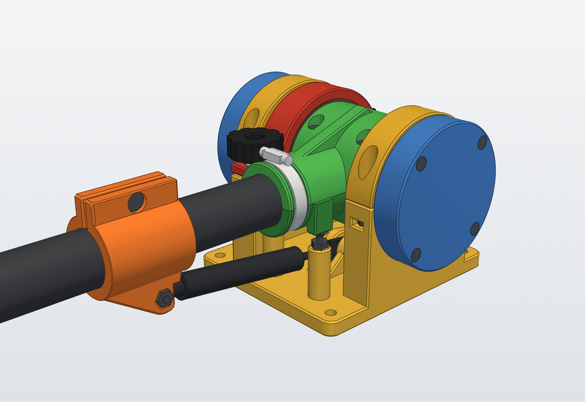

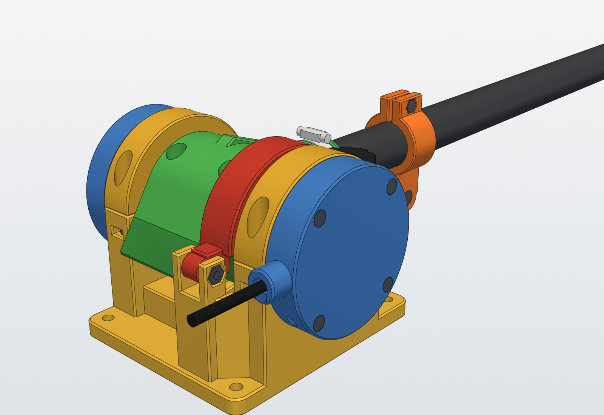

`renders/MkIII_Rev3_Assembly.glb` is the whole base in 3D at the down-stop: every printed part in its colour, plus the bearings, strut, tube, clamp, hardware and sensor stand-ins. It opens in Windows 3D Viewer or any glTF viewer. The complete collective, base and head Rev 4 together, is in [`../renders`](../renders): `HeliCollective_Assembly.glb`, and pictures at 0° and at the 32° stop.

`mk3_rev3.py` builds the base. It imports Rev 1's model, `mk3_pivot.py`, for every part the two share, and for the fit parameters you tune with the coupons below.

```bash
python mk3_rev3.py
```

That writes the complete print set to `stl/`, the bought and reference parts to `stl/ref/`, and `step/MkIII_Rev3_assembly.step`.

```bash
python mk3_rev3.py --curve
```

That prints the balance table and redraws `renders/strut_balance.png`.

```bash
python mk3_pivot.py
```

That writes only the fit-test coupons, to `stl/coupons/`.

## Fit-test coupons: print these before the big parts

None of the base's printed fits has been tested yet. The coupons are short slices of the three critical fits, so you can tune the tolerances on a few small prints instead of a failed lever or frame.

Each file is one plate holding three variants side by side. The number engraved in front of each variant is its step in mm, taken from `COUPON_STEPS = (-0.2, 0.0, 0.2)` in `mk3_pivot.py`. A step changes the fitted **diameter**. `0` is exactly what the current parameters would print.

| File | What it is | Printed as | Plate size |
|---|---|---|---|
| `coupon_trunnion.stl` | 8 mm trunnion stubs (`TRUN_OD`) on a 2 mm inner-race shoulder, with the ½" cable bore, each one solid ring | standing on the shoulder | 116 × 45 mm |
| `coupon_bearing_seat.stl` | pillow-block seat (`BRG_SEAT_D`) plus the retaining lip (`LIP_R`), 7 mm deep | lip down | 197 × 72 mm |
| `coupon_tube_socket.stl` | 20 mm of the socket bore (`SOCK_BORE_R`), each one a single closed ring | rings standing on end | 102 × 40 mm |

**How to print them:** use the same printer, filament and slicer profile as the real parts: walls, line width, layer height, flow and elephant-foot compensation. The STLs are already oriented, so don't rotate them.

The trunnion variants are one-piece rings standing on their shoulder, which keeps the first layers and any elephant foot off the stub. They keep the lever's ½" bore, so the stub's wall is as thick as the lever's and gives under the race the same way.

The socket variants are one-piece rings standing on end, so the tube slides in from the top.

Standing up, the round faces build up layer by layer with no overhangs.

### Reading them

Try the real part on each variant and pick the one that fits best. If the best fit falls between two variants, use the value halfway between them. Then change the parameter at the top of `mk3_pivot.py` and re-export:

| Coupon | Test with | Good fit | Change |
|---|---|---|---|
| trunnion | 6006-2RS inner race pushed down onto the stub | firm push by hand, or a light press in a vise; no wobble, and the race does not turn on the stub. The race is wider than the stub, so it stops on the shoulder with its top standing 5 mm proud. On the lever the race is what holds the two half-trunnions together, so err on the firm side. To get a tight race off, press the stub down out of it with something under 30 mm across, such as a socket | `TRUN_OD += step` |
| bearing seat | 6006-2RS outer race | goes in with thumb pressure and does not drop out upside down. Leave it slightly free rather than tight: the cap clamps the race, and a tight seat distorts it | `BRG_SEAT_D += step` |
| tube socket | the carbon tube slid into each ring | slides in by hand with no rattle or rocking | `SOCK_BORE_R += step / 2` (radius) |

Examples:
- (The base's trunnion is now locked at +0.2: `TRUN_OD = 30.2`.) The `0` trunnion is too tight but `-0.2` is right: set `TRUN_OD = 29.8`. If `-0.2` is now a bit loose, use `29.9`.
- The `+0.2` socket is the first one that closes fully around the tube: set `SOCK_BORE_R = 12.8`.

If even the end variant is wrong, move the whole range, e.g. `COUPON_STEPS = (0.2, 0.4, 0.6)`, and print again. After you change a parameter, the new value becomes `0`, so reprint the coupon to confirm it. Then run `python mk3_rev3.py` to rebuild the parts.

### Notes

- **Joint-face elephant foot:** the lever halves print on the joint face. Elephant foot there makes the trunnion oval (wide across the joint) and keeps the halves from closing. Use elephant-foot compensation, or scrape the first-layer edge. The coupons stand on end, so they won't show this.
- **Arch tops:** on the lever, the half-trunnions, half-socket and cable channels print as arches. Their crowns are the last, least accurate layers. The upright coupons don't have them, so if the lever's fit is tight only along the crown, scrape it rather than going up a step.
- **Frame bearing seat:** the frame's lower half-seat prints with its axis horizontal. The ring coupon checks the diameter in the XY plane, which sets the width across the split line, and that is what matters there.

## Length and travel

| | |
|---|---|
| Tube | 25 × 23 mm carbon fibre, **500 mm**, uncut: 470 mm plus the 12.7 mm (1/2 in) the head's boss takes, plus the 17.3 mm the socket takes |
| Grip centre / grip top from the pivot | 387 mm / 445 mm: two-thirds of the real UH-1's 26.25" (667 mm) |
| Travel | 0° (level) to a fixed **32°** |
| Hand rise | the head's lower front corner rises **9.4"**, against the real Huey's 9.25" |
| Pivot above the desk | 58 mm (Rev 1: 40), on an 8 mm (5/16 in) plate (Rev 1: 6 mm) |

The real collective starts about 30° above level and swings about 30–40°. Our lever starts level, so a lever two-thirds as long swinging 32° gives the same hand travel as the real one. Program the AS5600's range across 0–32°.

## How it balances

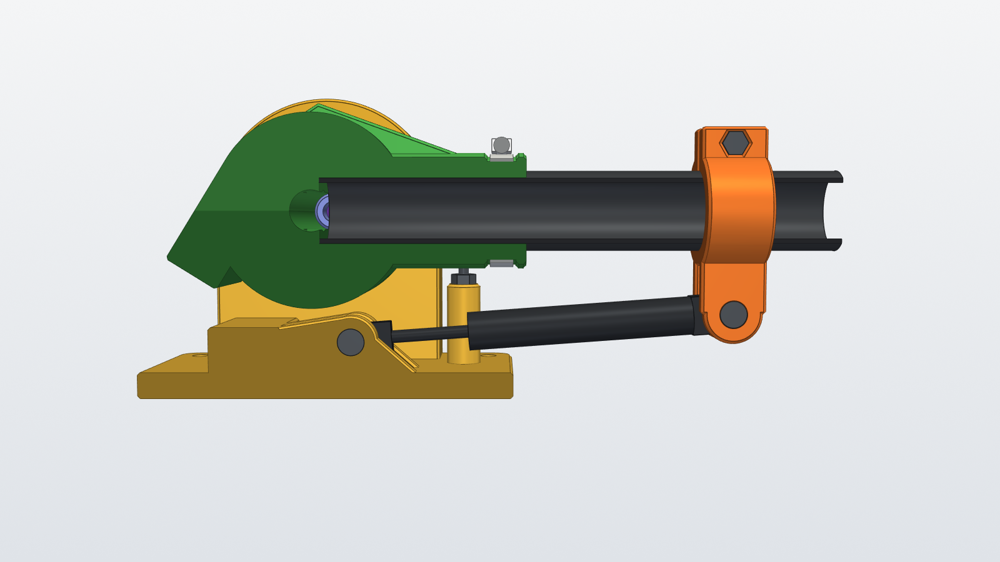

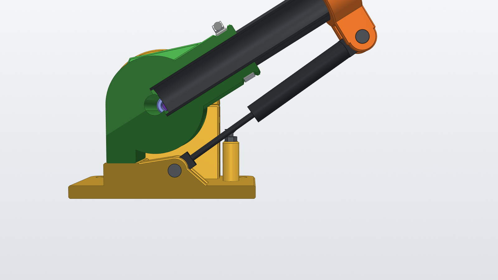

At the down-stop the strut lies almost flat under the socket boss, and its line passes about 40 mm below the pivot. As the tube lifts, the collar rises and the strut swings up toward the pivot. Its leverage shrinks in step with the head's weight, which also gets easier to hold as the tube rises. The strut also loses a little force as it extends, from 117 mm at the bottom to 140 mm at 32°, out of its 102–152 mm stroke.

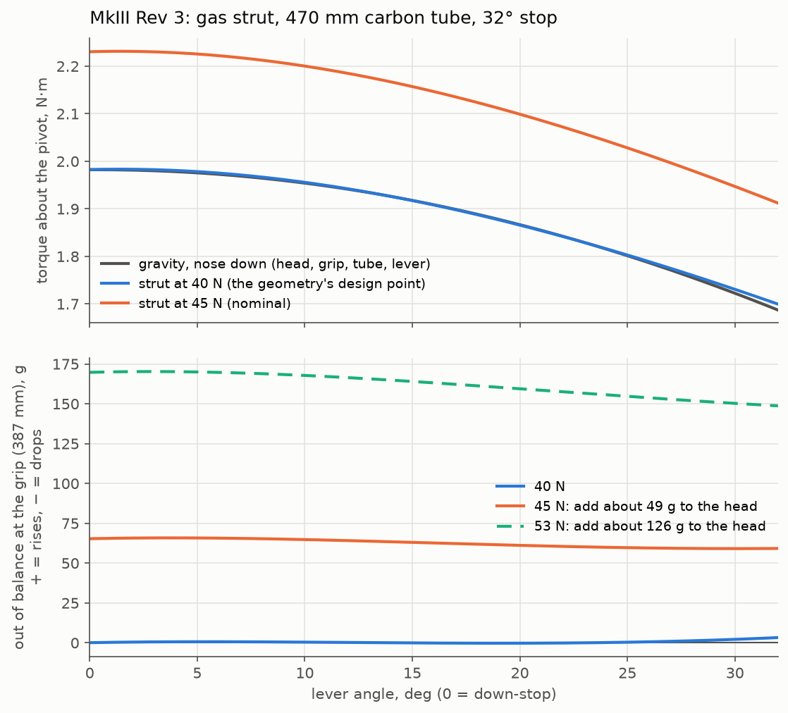

The geometry is set so a **40 N strut balances to within 5 g at the grip**. That's the bottom of the range the 45 N strut is sold as. A stronger strut lifts a little too much, nearly the same amount at every angle, so a fixed weight in the head cancels it:

| Strut force | Out of balance at the grip | Ballast in the head to even it out |
|---|---|---|
| 40 N | −4 to +5 g | none |
| 45 N (nominal) | +53 to +72 g (rises) | about **48 g** |
| 53 N (top of the range) | +141 to +178 g | about 125 g |

The collar does the fine tuning. Sliding it 8 mm toward the pivot adds about 24 g of lift at the grip, and 8 mm away takes 24 g off. For comparison, Rev 1's bucket was out by ±130 g at the ends of its travel.

The figures assume the strut gains 30 % in force from fully extended to fully compressed. The listing doesn't give this, so the real curve may differ by a few grams. Ballast and the collar take up any offset.

## The strut

**X AUTOHAUX 6" 10 lb / 45 N gas strut**, [Amazon B0CY267GFY](https://www.amazon.com/dp/B0CY267GFY), $13.69 for two (one spare).

| | |
|---|---|
| Length | 152.4 mm eye to eye extended, 101.6 mm compressed (51 mm stroke) |
| Force | 45 N, sold as 9–12 lb (40–53 N) |
| Ends | flat eyelet tabs. The 40 N strut's collar end, measured: a steel tab 3.94 mm thick and 8 mm wide, a 4.45 mm eye, then a Ø8 mm boss whose face is 5.72 mm from the eye's centre and which runs about 7 mm |

A 40 N cabinet strut ([QLXHBOT](https://www.amazon.com/dp/B0C8DJ8W9H)) was considered and rejected: its ends are snap-on sockets, which pop off if the strut ever pulls. This strut has eyelets that bolt through.

**Measure yours** before printing the frame and collar. The listing gives the eye holes as 4 mm, the body as 12.1 mm and the rod as 4 mm, and the script uses those (`PIN_R` is the M4 screw's 4.4 mm clearance in the printed cheeks). The collar end's tab and boss are measured (`BODY_TAB_T`, `BODY_TAB_W`, `BODY_BOSS_D`, `BODY_BOSS_AT`, `BODY_BOSS_L`). The anchor end's tab is still a guess: `ROD_TAB_T`, `ROD_TAB_W`. The clevis slots are the tab thickness plus 0.6 mm.

## Anchor: a fixed, gusseted clevis

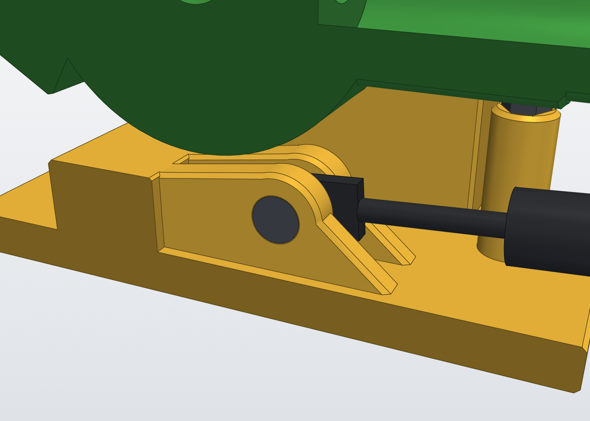

Two 6 mm cheeks rise from the plate either side of the strut's steel tab, printed into the frame. An M4 × 16 countersunk screw goes through both cheeks and the tab into an M4 nut in a pocket in the far cheek, so the joint holds whether the strut pushes or pulls.

Each cheek is a round boss over the eye, standing on a block down to the plate. A triangular gusset runs 20 mm forward, from the top of the boss down to the plate. Behind the eye, each cheek carries on as a wall straight back into the stop pedestal, 22 mm away. The wall's top runs from the top of the boss to the pedestal's front edge, 4 mm under the hub, so the clevis and the pedestal brace each other. A web between the cheeks, behind the tab, ties them together.

The front gussets are 3.8 mm thick, so they stop 1 mm short of the strut's rod on each side and the rod swings up between them. Their outer faces are flush with the cheeks, so the screw's head and the nut seat flat. The screw goes in from the knob side, which has about 35 mm of room. Nothing at the anchor adjusts.

## Up-stop: a boss on the lever, a pedestal on the frame

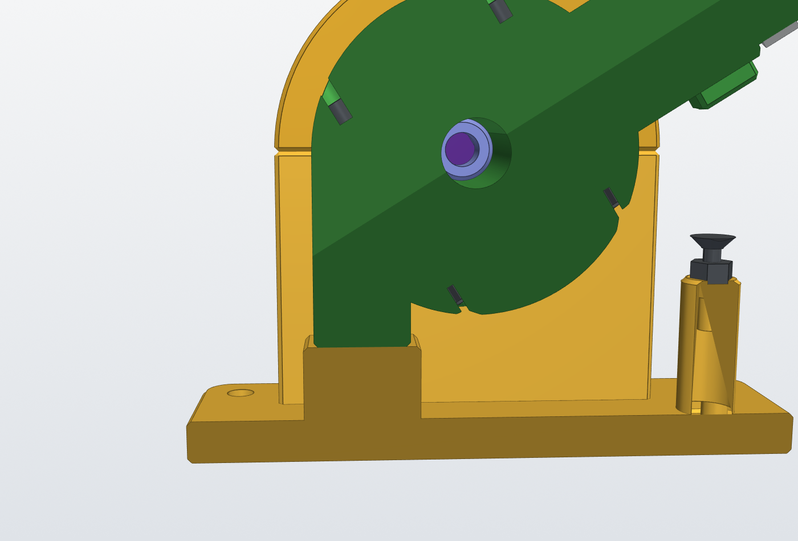

There's no quadrant, stop block, thumb knob or striker, and no bucket pad on the lever. The plate is a plain 116 × 100 mm rectangle.

Instead, a block grows from the back of the hub's underside. A pedestal stands on the frame between the pillow blocks, under the hub, and runs into the sensor-side block. At exactly 32° the block's flat face lands squarely on the pedestal's top.

The block is 43 mm wide. It runs from the hub's sensor-side end to 1 mm short of the friction drum. The last 20 mm of the hub, on the knob side, can't carry it, because the drum's shoe, felt and hinge lugs sit right under it. The pedestal and the upper half's wedge are the same width.

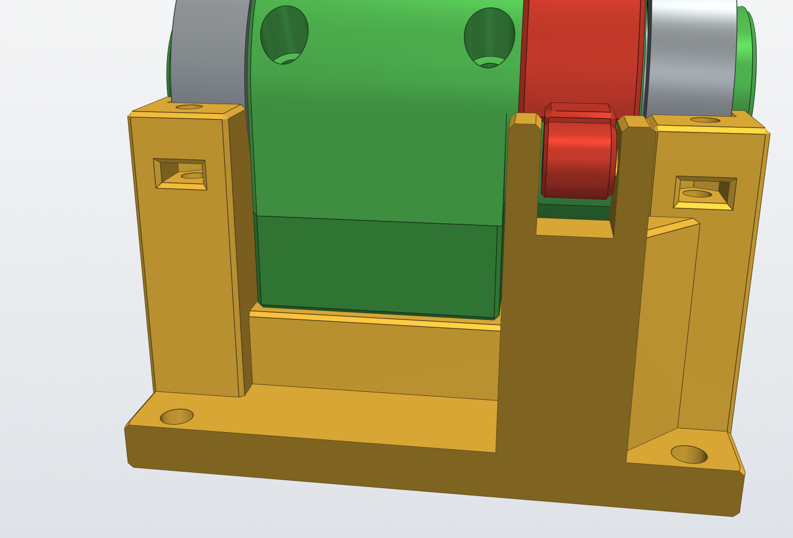

The block's back face runs straight up and meets the hub tangentially, so there's no notch between block and hub. The lever's split line crosses the block:
- **Lower half:** carries the stop face and most of the block.
- **Upper half:** carries a small wedge that fills the corner up to the tangent.

At the stop the pedestal pushes the lower half's block up into that wedge, so the joint between the halves is in compression.

The contact is about 40 mm from the pivot, so a hard push on the grip loads it roughly ten times over: about 450 N for a 50 N push. That's in compression, and spread over an 18 × 43 mm face, under 0.6 MPa.

To change the angle, set `STOP_DEG` and reprint the lever's lower half and the frame.

## The lever

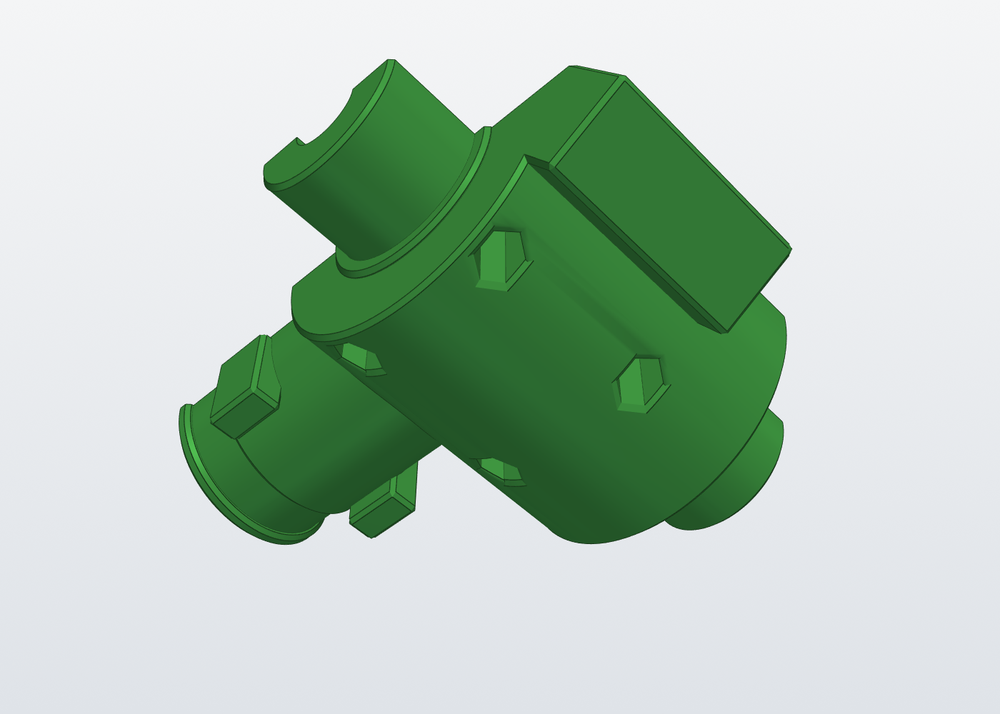

- **Hub:** 60 mm across all the way, the friction drum's diameter, where Rev 1 stepped down to 56 mm on the sensor side. The step had no purpose; the felt still only runs on the drum section.
- **Removed:** Rev 1's bucket pad and its inserts, and the bottom gusset under the socket boss, which sat in the strut's path. The top gusset is unchanged.
- **Down-stop pads:** two flat pads stand on the sides of the socket boss. They start 13.5 mm off the tube's centre line and are added before the bores are cut, so they stay clear of the 25.4 mm tube bore.

### Split lever

The lever is two prints, `lever_upper.stl` and `lever_lower.stl`, split at z = 0 through the pivot axis and the tube axis. Print both flat on the joint face; they need no supports.

- **Joint:** four M4 × 40 socket head cap screws (from the HELIFOUNER M4 × 30–50 kit, with its nuts) go in from the top, into M4 hex nuts in hex pockets in the bottom half. 40 mm is the longest that fits: each head sits flush in an 8 mm counterbore at the top of the lever, level with the hub's surface at the counterbore's lowest edge, and each nut sits as far out as the underside allows, level with the hub's curve at its flats (the hex has its corners along y, so the flats face fore and aft). The seats are about 40 mm apart (16.5 mm before) and no tip sticks out. The nut pockets leave only about 0.2 mm of wall at their fore and aft flats where they meet the hub's curve, so slice them as they are and push each nut up to the top of its pocket with a screwdriver. A 3 mm hex key reaches the heads; the counterbores are only as deep as the heads. Tighten the four evenly. The four screws form a rectangle centred on the socket's axis (16.75 mm either side of it) and on the pivot axis (17 mm fore and aft of it), which leaves 1.85 mm of wall beside the socket.
- **Cables:** both ½" cable bores are half-round channels in each half. Lay the USB cable and the sensor lead (4 cores for I²C, 3 for analog) into the lower half, then close the upper half over them. Nothing has to be threaded through a hole.
- **Trunnions:** each bearing's inner race holds the two half-trunnions together. Press the bearings on after the screws are tight, and before the sensor carrier and module: neither passes through a bearing. Lay the sensor lead in bare and solder the module on afterwards.
- **Socket depth:** the tube socket runs 63.3 mm in from the mouth, to 2.7 mm from the pivot axis, so it opens into the axial cable bore (Rev 1: 46 mm). The tube is 500 mm, uncut, so the head sits where it did. The tube's end sits 3.8 mm into the axial bore: file a notch in each side of the tube, 13 mm wide (centred on the tube's horizontal midline) and at least 4 mm deep from its end, where the axial bore crosses the tube's wall, so the cables can get in.
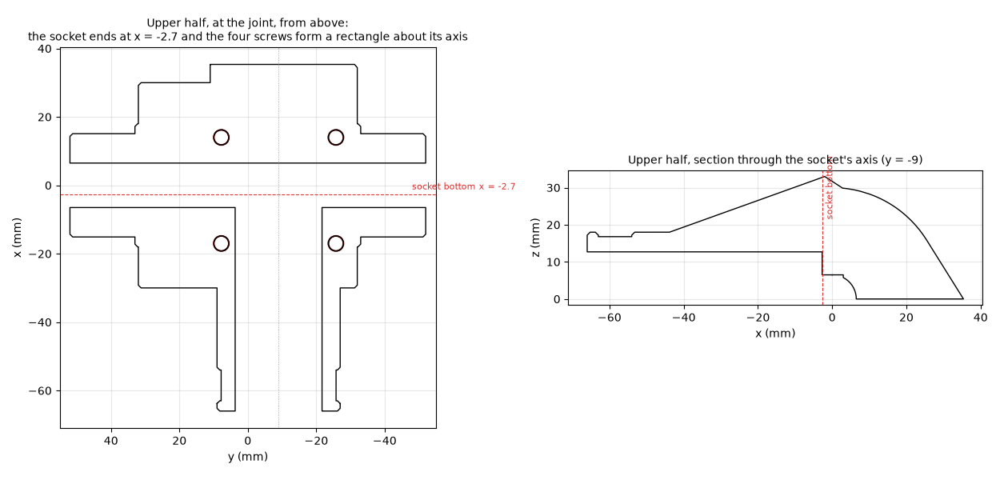

- **Socket mouth:** the halves meet face to face all the way to the mouth. The hose clamp in the groove holds them together there. There is no tube lock screw: the hose clamp and the press fit hold the tube.

## Down-stop

Two posts stand either side of the strut, 16.75 mm off its centre line. In each post an M4 × 16 countersunk screw stands head up: an M4 nut pressed into a pocket in the post's top takes its thread, and a second nut on top locks the height. The flat top of the head stops one of the lever's pads, so the screws can level the tube at the bottom of travel. (Rev 1 had one post under the socket boss, right where the strut now runs.)

## Hinge-lug gusset

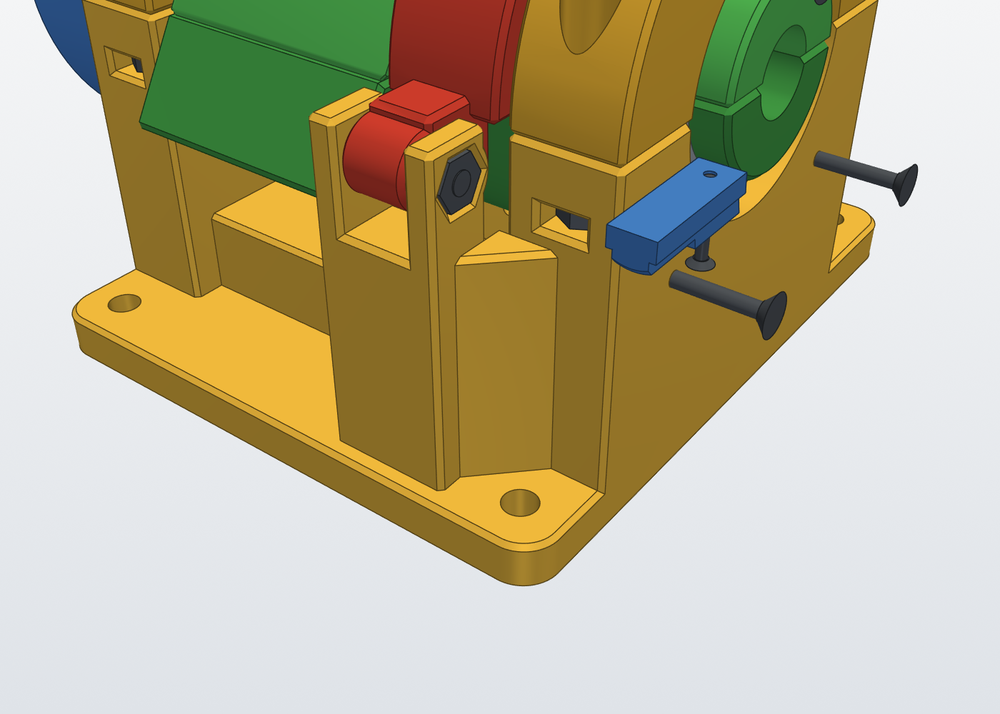

A corner gusset braces the knob tower to the knob-side pillow block, as in Rev 1. Rev 3 adds one at the back corner too, from the shoe's outer hinge lug to the same pillow block.

It stands 36 mm off the plate, level with the web between the hinge lugs. That leaves the shoe's hinge pin and its end 8 mm clear above it.

Its sloping face stops 6.5 mm from the centre of the desk screw in that corner, so the screw's head still fits.

## Friction knob

An M5 × 25 hex-head bolt (ISO 4017 / DIN 933, 8 mm across flats), its head in a hex pocket moulded into the printed knob (`stl/friction_knob.stl`), runs down through the spring and the shoe's front tab into an M5 nut. The nut slides into a slot in the tower from the front, at the same depth as the pillow-block caps' nuts (its top face 8.3 mm below the pivot axis), so the plastic over it is thick enough to take the spring's load. The bolt's tip ends 3.7 mm past the nut. The spring sits in a 2 mm recess in the shoe's tab, so it is still 6.5 mm long when fitted. Turning the knob screws it down and loads the spring.

Press the bolt's head into the pocket from the top: the hex walls turn it with the knob, so nothing has to be glued, and a spanner or socket still reaches the head through the open top. The spring pushes the knob up against the head. The bolt isn't in the screw kits (they have only countersunk heads): buy an M5 × 25 hex-head bolt, zinc or stainless, from any hardware store.

## Sensor

The AS5600 module (WWZMDiB, Amazon B0CM3C8KFT, 23 × 23 mm) sits on the sensor side (−Y), in a carrier that plugs into the trunnion bore and turns with the lever. Its ~4 × 2 mm diametric magnet (in a 4.2 mm pocket, the same as the head axle's) sits on the axis in the fixed cover, about 1.0 mm from the chip. The lead runs under the board, through the carrier and up the tube to **AX1** on the HeliSR board.

The module has no header, and its pads are in two columns of through-holes, 4.7 mm in from opposite edges: **VCC, OUT, GND** along one, **DIR, SCL, SDA, GPO** along the other. Solder the wires straight in from the back. The carrier's channel under the board spans both columns and the centre hole, so the module fits either way up and the DIR jumper lies in the channel too. The pad positions are measured from the product photos (±0.3 mm), so check them against yours.

**With HeliSR Rev 4.0 (I²C):** four wires, **VCC, GND, SDA and SCL**, to the AX1 port (pin 1 SDA, 2 GND, 3 VCC, 4 SCL).
- **5 V:** remove the module's 0 Ω R1. It ties VDD3V3 to VDD5V, and the 3V3 pin is rated 4 V max.
- **DIR to VCC:** a short jumper across the back of the board, from DIR to VCC. DIR floats on this module. The chip turns with the lever and the magnet is fixed, so DIR = VCC makes the angle rise as the lever lifts.
- **Remove R4**, the 1 kΩ from PGO (labelled GPO) to GND. PGO low selects the OUT-pin programming used with Rev 3.0; without R4 the chip's own pull-up holds it high.
- **Pull-ups:** measure the module's SDA→VCC and SCL→VCC resistance before you fit it (see `PCB/HeliSR_Rev4.0`).
- The range is set by the firmware over I²C, not burnt into the chip, so it can be changed at any time.

**With HeliSR Rev 3.0 (analog):** three wires, **VCC, OUT and GND**, to AX1. Remove R1 and jumper DIR to VCC as above, but keep R4. The range is programmed once through the OUT pin (datasheet option B) with the board's **PROG1** button:
1. Hold the lever on its down-stop and press PROG1 for about a second.
2. Lift it to the 32° stop and press PROG1 again.

It can't be checked beforehand: until programming is done, AX1 reads full scale whatever the lever does.

## The carbon tube

- **Buy roll-wrapped, not pultruded.** Pultruded tubes have all their fibres running lengthwise and split easily when clamped or drilled. Roll-wrapped tubes have cross plies and take both.
- **Check the fits.** The lever's socket and the head's tube bore were tuned on the 25 mm aluminium tube with the coupons. Check them with the carbon tube, and re-run the socket and bearing coupons if its outside diameter differs.
- **Drilling and notching:** you drill the head's 5.2 mm cross hole (10 mm below the top end). Use a sharp bit and back the tube with wood, or wrap the spot with tape so it doesn't splinter.
- **Clamping:** do the collar's two M4 clamp screws and the hose clamp up firmly, but don't crush the tube.

## Setting it

1. Back the friction knob right off.
2. Let go of the grip at the bottom of the travel and near the stop.
3. If it climbs, add ballast inside the head's box, close to its middle: about 48 g for a 45 N strut. Steel or lead weights work.
4. Finish with the collar.
5. Set the friction to taste.

## Printing

- **Frame:** prints plate-down. It carries the gusseted anchor clevis, its walls back to the stop pedestal, the pedestal itself, the two down-stop posts and the hinge-lug gusset, all built straight up from the plate. The clevis screw hole is horizontal.
- **Lever halves:** print on their joint faces, with no supports (see [Split lever](#split-lever)).
  - **Lower half:** the stop block and the down-stop pads stand on the bed with the joint face. The block's back face leans about 32° from vertical, within normal overhang limits.
  - **Upper half:** the stop wedge sits on the bed at the back of the hub, with its sloping face leaning in toward the hub.
- **Strut collar** (`strut_collar.stl`): 40 mm long, with a web tapering from the ring down to the strut's eye, solid behind the eye where the strut pushes and split into two cheeks round the tab. Stand it on the end away from the strut (the end without the boss notch), so the bore builds straight up, the web's slope is under 30° and the notch opens at the top.
- **Friction knob** (`friction_knob.stl`): top face down.
- **Cable plug** (`cable_plug.stl`): on one of its long flat faces.
- **Caps, shoe, covers and sensor carrier:** no special notes.

## Assembly

1. **Frame:** tap the eight M3 cover holes, in the pillow blocks and the caps, 11 mm deep. Press an M4 nut into the pocket in each down-stop post's top, and slide an M4 nut into each of the four slots in the pillow blocks' front and back faces (the knob-side block's front one opens on the tower gusset's sloping face).
2. **Lever:** press the four M4 nuts into the lower half's pockets, lay the USB cable and the sensor lead into the lower half, close the upper half and fit the four M4 cap screws (all M4 × 40; see [Split lever](#split-lever)). Press the bearings onto the trunnions.
3. **Into the frame:** seat the lever's bearings in the frame and fit the caps (M4 × 20, into the slotted nuts). Fit the shoe and felt on their hinge (M4 × 20 from the sensor side, nut in the knob-side lug's pocket; snug, then thread-lock, so the shoe still swings). Slide the M5 nut into the knob tower, press the M5 × 16 hex bolt's head into the knob's hex pocket, and screw it down through the spring and the shoe. Fit the side covers (M3 × 25, from the M3 countersunk set). On the knob side, the USB cable drops into the cable cover's spout through the slot underneath. Then slide the cable plug in from the spout's outer end, under the cable, until its hole lines up with the one coming up through the underside of the cover's rim. The slot is T-shaped, 5 mm at the mouth and 6.8 mm under the cable, so the plug's head rests on the cover either side of the mouth: pressing on the cable loads the cover. The plug's top is flat (it prints better than a curve), level with where the bore meets the slot's sides, 1.58 mm under the bore's axis. Tap the plug's 1.6 mm hole M2 through the cover's hole from below, and fit the M2 × 12 countersunk up from under the rim: tightening it pulls the plug's head down onto those shoulders. The head sits in a counterbore, flush with the rim's curve; there's 40 mm under it to the desk, so use a short hex key.
4. **Sensor:** solder the module to the lead, fit it in its carrier, and fit the cover with the magnet (see [Sensor](#sensor)).
5. **Tube:** don't cut it. Drill its head cross hole and notch its bottom end's sides for the cables. Slide it into the socket and tighten the hose clamp, with the head on top.
6. **Collar:** clamp it on the tube with its notched end (the end the strut's boss sits in, toward the pivot) 52 mm out from the front face of the socket boss. The collar is 40 mm long and the strut's eye is 10 mm in from that end, so the eye is 128 mm from the pivot.
7. **Strut, collar end:** fit the steel tab into the collar's clevis, up to the shoulder of its Ø8 boss, which sits in the notch at the clevis's end, with an M4 × 16 countersunk screw from the knob side and an M4 nut in the far cheek's pocket. Snug it and thread-lock it; don't clamp the tab.
8. **Strut, rod end:** hold the lever on its down-stop and push the strut in to about 117 mm. Fit the steel tab into the anchor clevis with the other M4 × 16 from the knob side, nut in the far cheek, as at the body end.
9. **Down-stops:** screw the M4 × 16s, head up, through a lock nut into the nuts in the posts. Set them so the tube is level at the bottom, then lock the nuts.
10. Balance it as above.

## Screws

Every screw and nut is from three kits and one pack: the AvrestYPT countersunk kit ([Amazon B0FMD5TMSH](https://www.amazon.com/dp/B0FMD5TMSH): M2–M4 × 8, 12, 16, 20 and M5 × 10, 12, 16, 20, with nuts and washers) and the HIQTRADEBYJJ set-screw kit ([Amazon B0DG33R714](https://www.amazon.com/dp/B0DG33R714)). The side covers' eight M3 × 25s are the exception: they come from the NIULUNBAO M3 countersunk set ([Amazon B0BYXS4BTF](https://www.amazon.com/dp/B0BYXS4BTF): M3 × 20, 25, 30, 35 and 40, 20 of each), because the kit stops at 20 mm and the longer thread holds three times as much plastic. The lever halves' four screws are the exception to the countersunk heads: they are M4 socket head cap screws (40 and 45 mm) from the HELIFOUNER M4 × 30–50 kit ([Amazon B0CDSKK7V1](https://www.amazon.com/dp/B0CDSKK7V1), with nuts), because only a kit like that has screws long enough to hold the halves far apart. Every other head is 90° countersunk, so it sits in a countersink; there are no heat-set inserts. Each hole takes a nut in a printed pocket, or a thread you tap into the print. The renders call out every hole, with the kit hardware in red.

| Where | Screw | Into | Qty |
|---|---|---|---|
| Lever halves | M4 × 40 socket head cap, from the top | M4 nut in a pocket in the lower half | 4 |
| Pillow-block caps | M4 × 20 countersunk, from the top | M4 nut slid into a slot in the block's front or back face | 4 |
| Side covers | M3 × 25 countersunk (the NIULUNBAO M3 set), from the cover's outer face | M3 thread tapped 11 mm deep in the block or cap | 8 |
| Cable plug | M2 × 12 countersunk, up from under the cable cover's rim | M2 thread tapped in the plug | 1 |
| Friction knob | **M5 × 25 hex-head bolt (bought; not in the kits)**, head in the knob's moulded hex pocket | M5 nut slid into the knob tower from the front | 1 |
| Shoe hinge | M4 × 20 countersunk, head in the sensor-side lug | M4 nut in the knob-side lug's pocket | 1 |
| Strut eyes | M4 × 16 countersunk, head on the knob side | M4 nut in the far cheek's pocket | 2 |
| Strut collar clamp | M4 × 12 countersunk, head 2 mm into the sensor-side ear | M4 nut in the other ear's pocket | 2 |
| Down-stops | M4 × 16 countersunk, head up | M4 nut in the post's top pocket, plus an M4 lock nut | 2 |

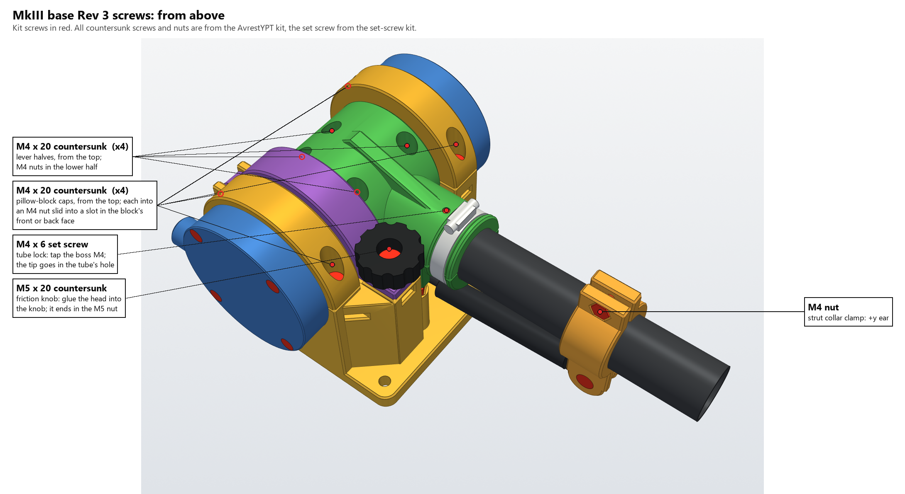

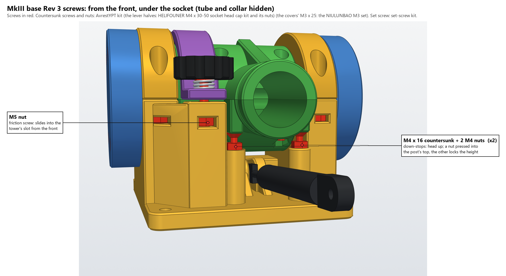

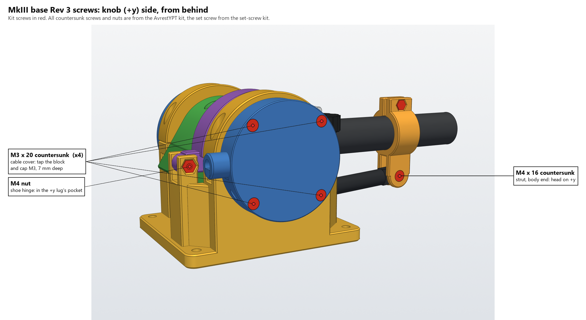

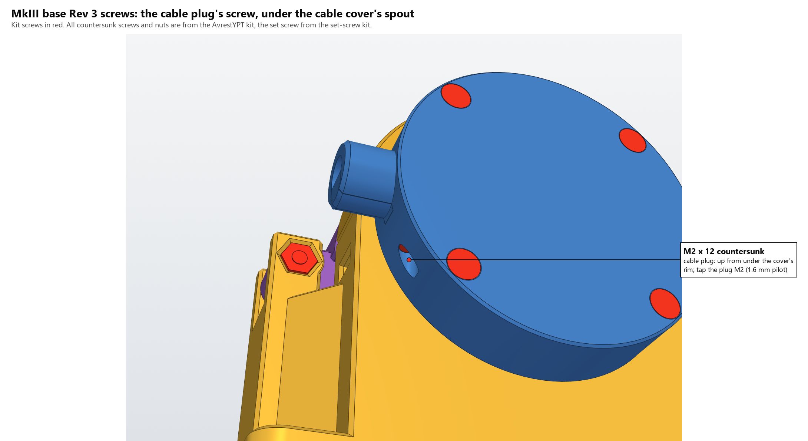

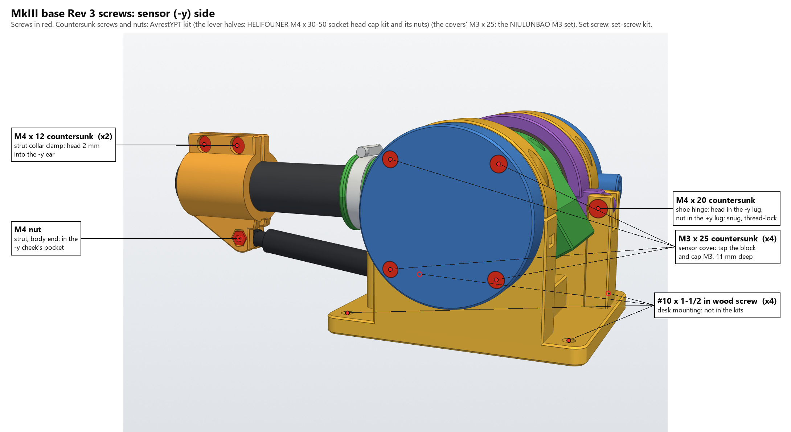

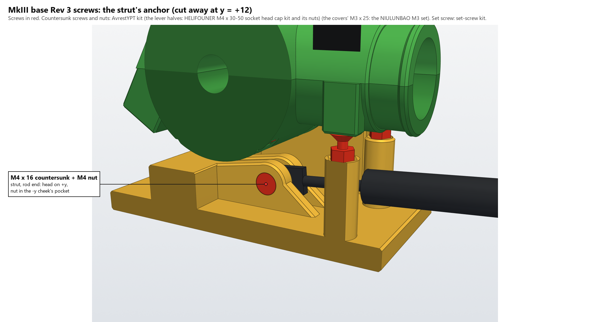

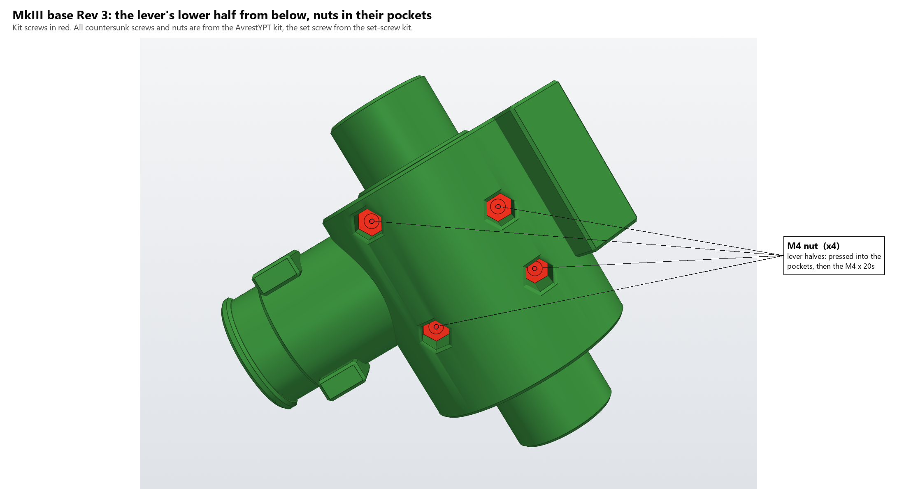

## Bought parts

| Part | Qty | Notes |
|---|---|---|
| 6006-2RS deep-groove ball bearing (30 × 55 × 13) | 2 | |
| X AUTOHAUX 6" 45 N gas strut | 1 | pack of 2, $13.69 |
| 25 × 23 mm carbon tube, 500 mm | 1 | roll-wrapped; used uncut. It slides into a 63.3 mm deep socket |
| Worm-drive hose clamp, about 25–40 mm | 1 | on the socket mouth |
| Screws and nuts | | from the two kits and the M3 set: see [Screws](#screws) |
| Compression spring, 10 mm OD | 1 | friction knob |
| AS5600 module (WWZMDiB, Amazon B0CM3C8KFT) | 1 | with its ~4 × 2 mm diametric magnet |
| Ballast for the head | ~50 g | steel or lead, only if the strut lifts too much |
| #10 × 1-1/2 in wood screws | 4 | desk mounting, not in the kits |

The screw lengths, the felt and the cables are sized from the CAD. The complete list for the whole collective is in [`../BOM`](../BOM).

## Notes

- This is a concept and nothing has been printed. Print the fit-test coupons first, with the carbon tube.
- The balance figures come from an estimate of the Huey head (368 g), on the 470 mm tube, with the carbon tube at about 0.12 g per mm. That gives a forward moment of 195 g·m. The figures include the collar and half the strut's weight, about 55 g, which hang on the tube.
- Gas struts have seal friction, and some are oil-damped. Neither figure is published. Expect a little built-in friction, and some drag if you move the lever fast.
- Gas strut force changes about 3 % per 10 °C and fades slowly over the years. The collar or a few grams of ballast correct it.
- The interference check covers the strut, collar, lever, frame and stops at 0°, 8°, 16°, 24°, 31.5° and 32°, with the strut's tabs in both clevises. It also checks the frame against the shoe, felt, caps, covers, bearings and bolts. It's clean. The lever's stop block first touches the pedestal at 32.00°, and the upper half's wedge never reaches the frame. The lever halves have no material inside the tube bore.
