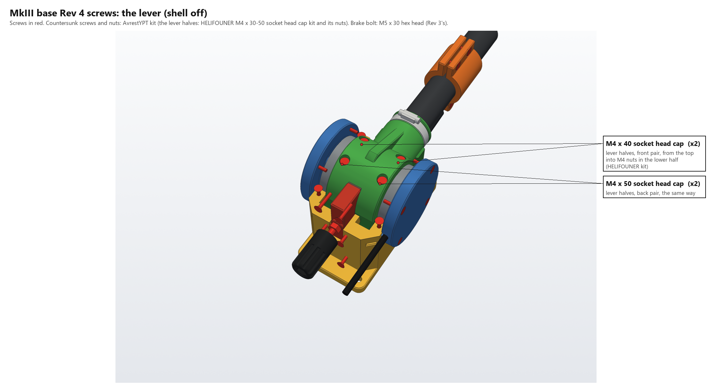
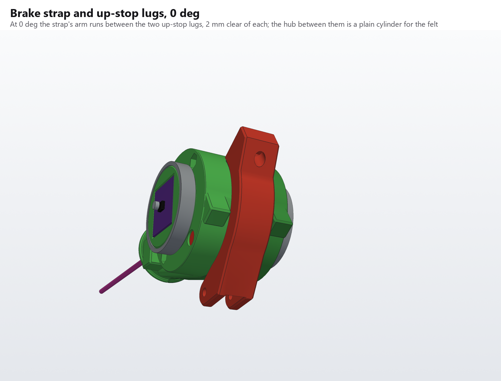
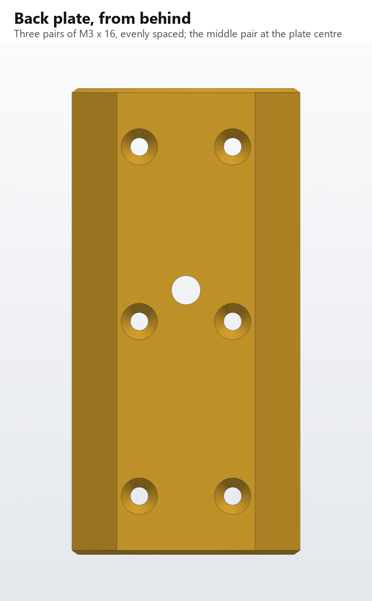
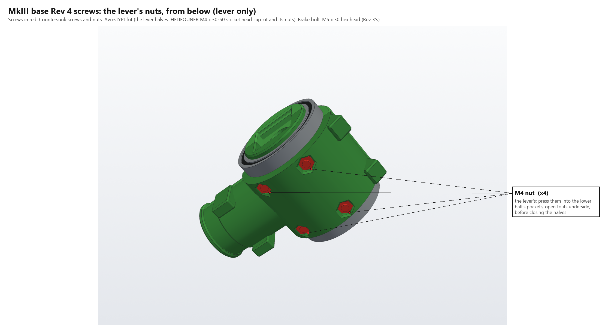
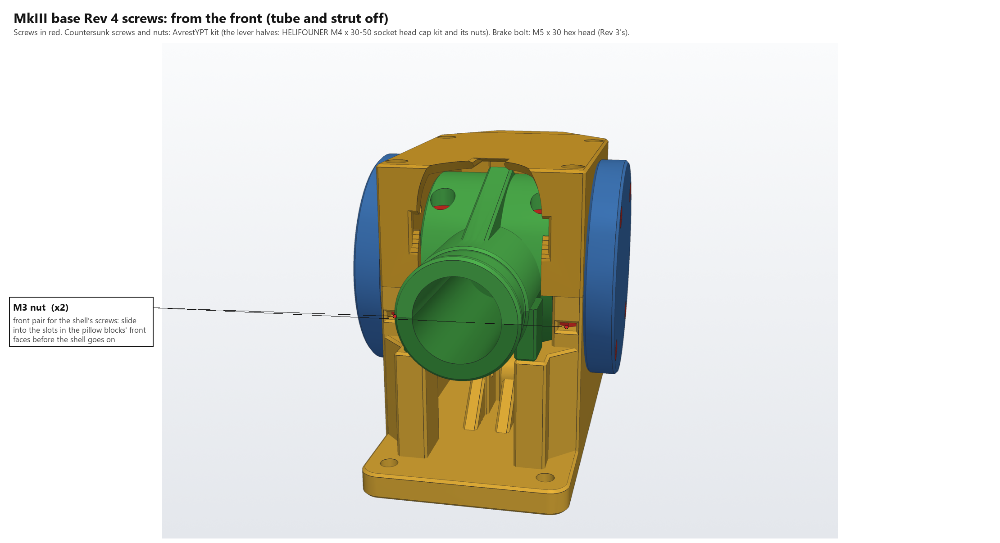

# MkIII base, Rev 4: narrow

Rev 4 is Rev 3 cut down to **82 mm (3.25 in)** wide along the pivot axis, against Rev 3's 130 mm, with the lever symmetrical about the tube. One shell over the top encloses the lever, in place of Rev 3's two bearing caps. The strut, collar, tube, socket, down-stops and fits are Rev 3's. What changes is everything along the pivot axis, the enclosure, and the brake, which moves behind the hub.

This is the current base. It hasn't been printed yet: print the [fit-test coupons](#fit-test-coupons) first.

## What changes from Rev 3

- **Lever:** the hub is 43 mm long (Rev 3: 64), centred on the tube. The tube's plane moves from 9 mm off-centre to the middle. Rev 3's friction drum is gone.
- **Bearings:** 6808-2RS thin-section bearings, 40 × 52 × 7 mm, in place of the 6006-2RS (30 × 55 × 13). The trunnions grow to 40 mm across to suit.
- **Frame:** 9 mm pillow blocks (Rev 3: 17). The base plate stops at their outer faces, so it's 63 × 127 mm (Rev 3: 100 × 116), with no wings or gussets out beside it.
- **Shell:** one box over the lever, bolted to both pillow blocks, in place of the two caps. It's slotted for the tube.
- **Sensor:** the AS5600 board sits inside the sensor trunnion's end, so the side covers are 9.5 mm deep (Rev 3: 15).
- **USB cable:** it leaves through a notch in the cable cover's rim instead of a spout.
- **Brake:** a narrow, tall shoe presses on the back of the hub. Its pocket is split between the frame and the shell, and holds it with no slop.
- **Up-stop:** two lugs under the back of the hub, one each side of the shoe, land on a pad further back than Rev 3's.
- **Frame gussets:** 45° gussets at all four corners of both pillow blocks.
- **Strut anchor:** moved up and back, so the 45 N strut as bought balances the lever. Rev 3's first anchor was sized for a 40 N strut, so the 45 N strut pushed the lever up. Rev 3 now has the same anchor.

The knob stands 31 mm out behind the plate.

## Files

| | |
|---|---|
| `mk3_rev4.py` | the model. `python mk3_rev4.py` writes `stl/`, `stl/ref/` and `step/`; `--check` runs the interference and assembly checks; `--coupons` writes `stl/coupons/` |
| `make_renders_r4.py` | the renders, screw maps, exploded view and screw chart, `renders/MkIII_Rev4_Assembly.glb`, and the complete collective with head Rev 5 in [`../../renders`](../../renders) |
| `stl/` | the printed parts |
| `stl/ref/` | bought parts and hardware, for reference |
| `step/MkIII_Rev4_assembly.step` | the whole base |

Both scripts import Rev 3's (`../mk3_rev3.py`, `../make_renders_r3.py`) and need CadQuery; the renders also need trimesh, manifold3d and pyvista.

## Fit-test coupons

The trunnion, bearing seat and shoe pocket are new, so print these before the big parts. They're made and read like [Rev 3's coupons](../README.md#fit-test-coupons-print-these-before-the-big-parts).

| File | What it is | Good fit | Change |
|---|---|---|---|
| `stl/coupons/coupon_trunnion_6808.stl` | 8 mm trunnion stubs on the inner-race shoulder, 39.9 / 40.1 / 40.3 mm | the race presses on firmly, no wobble | `TRUN_OD += step` |
| `stl/coupons/coupon_bearing_seat_6808.stl` | the seat and 2 mm lip, 51.9 / 52.1 / 52.3 mm | the race goes in with thumb pressure | `BRG_SEAT_D += step` |
| `stl/coupons/coupon_shoe_pocket.stl` | 10 mm of the shoe's pocket, 0 / 0.1 / 0.2 mm clear a side, printed as the frame prints it | the printed shoe slides through under a finger, with no rattle and no rocking | `SHOE_CLR += step / 2` |

The bearing coupons' `0` comes from how Rev 3's bearings fitted as built:
- **Seat:** +0.1 on the race's outside was a perfect fit, so it stays.
- **Trunnion:** +0.2 on the race's bore pressed on a hair too tight, so Rev 4 uses +0.1 (40.1 mm).

The tube socket is unchanged, so Rev 3's socket fit stands.

## Across the pivot axis

From the middle out, each side:

| | \|y\|, mm | |
|---|---|---|
| Hub | 0 – 21.5 | 60 mm across; 3.5 mm past the socket boss |
| Bearing | 22.5 – 29.5 | 6808-2RS |
| Retaining lip | 29.5 – 31.5 | the pillow blocks' and the shell's outer faces, and the plate's edge, are at 31.5 |
| Trunnion end | 32.0 | 40.1 mm across |
| Side cover | 31.5 – 41.0 | 2.5 mm floor; it overhangs the plate |

## Shell

The shell is a box over the lever: 75 mm long, 63 mm wide and 38 mm tall, from the pillow blocks' tops. It replaces Rev 3's two caps.

- **Side walls:** solid, 9 mm thick. These are the caps. Each holds the bearing's upper half-seat and lip, and two of the cover's screw holes. Two M3 × 20 countersunk screws per side go down counterbores into M3 nuts in the pillow blocks, as the caps' did.
- **Front, back and top walls:** 3 mm thick.
- **Tube slot:** the front and top are slotted just wide enough for the socket boss, the tube, the top gusset and the down-stop pads to swing from 0° to 32°, with 1 mm all round. The slot is cut from the lever's actual sweep, 2° at a time.
- **Brake housing:** its upper half runs on out of the back wall (see [Brake](#brake)). Either side of it, the shell is solid back to the housing's back face, with the same outline as the frame below, up to its top.
- **Assembly:** it drops straight down over the lever, the slot and the shoe's pocket both open at the bottom.

## Lever

Two halves split at the pivot axis, as Rev 3, joined by four M4 socket head cap screws from the top into nuts in the lower half. The screws are 16.25 mm either side of the tube:
- **Front pair, x = −17:** M4 × 40, as Rev 3. Each hole is 1.35 mm from the socket.
- **Back pair, x = +10** (Rev 3: +17): M4 × 50, so their nut pockets clear the up-stop lugs. Each hole is 1.3 mm from the axial cable bore.

Each counterbore is 1.25 mm from the hub's end. The bores, the down-stop pads, the hose-clamp groove and the socket for the uncut 500 mm tube are all Rev 3's. The top gusset over the socket stops at x = 2 (Rev 3: 8), so it clears the brake at 32°.

## Sensor

The AS5600 module (WWZMDiB) sits in a square pocket in the sensor trunnion's end, chip facing out, its front face level with the trunnion's end. There's no carrier.

- **The pocket:** 23.54 mm square (the board is 0.915 in, 23.24 mm, as measured, plus 0.15 mm a side) and 1.6 mm deep for the board. The board rests on two 1.6 mm ledges along its top and bottom edges, clear of both pad columns.
- **Behind the board:** 3.5 mm of space for the wires soldered in from the back and the DIR jumper. It opens into the axial bore, which takes the lead to the tube.
- **Orientation:** set it in with the pad columns vertical. It fits either way up.
- **Holding it:** a dot of hot glue in two corners. Nothing else holds it in.

The magnet (4 × 2 mm, in Rev 3's 4.2 mm pocket) is on a post from the sensor cover's floor, 1.0 mm off the chip, as in Rev 3. The wiring and the module's changes (R1 off, DIR to VCC, R4 off for I²C) are exactly as in [Rev 3](../README.md#sensor).

## USB cable

The cable comes out of the trunnion on the axis and turns toward the back inside the cable cover, on a 4 mm radius (Rev 3: 6). It leaves through a hole in the cover's rim. A 4.8 mm notch runs from that hole to the face that seats on the block, so the cover goes on over a cable that's already through the lever, as Rev 3's does.

## Brake

The shoe is 12 mm wide and 44 mm tall (Rev 3's was 30 wide), with felt on its curved face. It presses on the hub's own cylinder from behind, ±44° either side of the axis.

**No slop.** The friction pulls the shoe up or down, whichever way the lever moves, so any play in its pocket would be felt every time the lever changes direction. The pocket holds it 0.1 mm clear all round, along its whole length: tune that with the shoe-pocket coupon.

- **The housing:** the pocket is split at the axis like a bearing seat. Its lower half is in the frame, its upper half in the shell, and the shell's bolts close it. Both halves come right up to the hub, 0.8 mm off it, from just behind the shoe's front corners (x = 24) back to x = 47.5.
- **The back plate:** a plate across both halves' back faces closes the pocket and ties the halves together at the back. It runs from just over the base plate up to the shell's top. It covers the whole back face, 43 mm wide, and tapers to 26 mm at its back along the [back chamfer](#the-back).
- **The knob:** the M5 nut sits in a pocket in the back plate's front face. The MkII knob, behind the plate, turns Rev 3's M5 × 30 hex bolt through it. The knob is reprinted with its hex pocket's floor raised to 18 mm (Rev 3's: 4), so the M5 × 30 just reaches.
- **The spring:** the bolt's tip pushes a printed spring cap in the shoe's back. Rev 3's 10 mm spring sits under it, 6.5 mm long when fitted, and pushes the shoe.
- **Using it:** screw the knob in for more drag. There's 3 mm between the knob and the back plate.

## Up-stop

Two lugs under the back of the hub land on a pad on the frame at 32°. Each lug is 10 mm wide (|y| 11 to 21), with 22 mm between them for the shoe and the brake housing.

**Where the pad is:** x = 14 to 29.5, the full width between the pillow blocks, with the brake housing running on from its back middle. Its top is at z = −28.5, 2 mm under the hub at its front edge.

**Where the lugs land:** x = 15 to 24.4. They can't land further back: the further back a lug lands, the further back it swings at 0°. These come to x = 35.8 at 0°, 1.2 mm off the webs behind the pillow blocks.

At 0°, the shoe's lower end and the brake housing sit between the lugs. As the lever lifts, the lugs swing down either side of the housing onto the pad. Between them, the hub is a plain cylinder for the felt to run on.

The anchor clevis's back wall runs level, at the cheeks' top, into the pad's front face.

## Frame

The plate is 63 mm wide, the pillow blocks' outer faces, and 127 mm long. The desk screws are 24 mm either side of the middle, past the blocks' ends and the down-stop pillars.

Behind each pillow block, the frame is solid back to the brake housing's back face, out to the [back chamfer](#the-back). The cap screws' nut slots run out through the chamfer.

Each pillow block also has a 45° gusset at three of its corners, 8 mm along each wall:
- **Behind, inside:** the block's inner face to the web's front face. Its top is cut back to stay 1.5 mm outside the up-stop lugs' swing.
- **In front, inside:** the block's inner face to the down-stop pillar's back face, up to the pillar's top, 3 mm clear of the hub.
- **In front, outside:** the block's front face to the pillar's outer face, up to the pillar's top.

The down-stop and strut are unchanged from Rev 3: pads on the socket boss land on two pillars at 0°, and the gas strut runs from a clevis on the frame to the collar on the tube. Everything is on the new centre line. Each pillar runs on into its pillow block.

## The back

The frame, the shell and the back plate share one 45° chamfer plane each side. It runs from the pillow blocks' outer back corners to the back plate's back face (|y| + x = 69 mm), so from behind the three read as one block. The edges where they meet aren't chamfered, so no groove shows at the seams, and none runs along the inside of the shoe's pocket at the split.

**The back plate's screws:** six M3 × 16 countersunk, from its back face into M3 threads tapped 7.5 mm deep. They're in three evenly spaced pairs down the plate:
- **Middle pair:** at the plate's centre height (z = −5.9), into the frame.
- **Top pair:** 32.9 mm above that (z = +27), into the shell.
- **Bottom pair:** 32.9 mm below that (z = −38.8), into the frame.

The columns are 8.8 mm either side of the middle. The shoe's pocket runs out through the back face 6.1 mm either side of the middle. At 7 mm the middle pair's pilot holes would break into it, and at 8.8 they keep 1.45 mm of wall. The heads are still 0.75 mm inside the plate's 13 mm back face. Take the knob off to reach the middle pair: it's in front of them.

## Balance

Rev 3 was first built with the anchor at x = −12, z = −40.5, sized for a 40 N strut: the bottom of the range the 45 N strut is sold as. The 45 N strut as bought lifted the lever, by about 50 to 70 g at the grip.

The anchor is now at x = −9.5, z = −36.5, in Rev 4 and in Rev 3's updated frame: 4 mm up and 2.5 mm back. The strut's line passes closer to the pivot, so it has less leverage. It now balances 45 N to within 3 g at the grip over the whole travel. The strut is 119 mm long at 0° and 140 mm at 32°, inside its 102–152 mm stroke.

| Strut force | Out of balance at the grip | Fix |
|---|---|---|
| 40 N | −58 to −50 g (drops) | — |
| **45 N (as bought)** | **−3 to +2 g** | none |
| 50 N | +49 to +60 g (rises) | about 42 g of ballast in the head |
| 53 N (top of the range) | +79 to +95 g | about 68 g of ballast |

The collar still fine-tunes: 8 mm toward the pivot adds about 21 g of lift at the grip, and 8 mm away takes 21 g off.

**The clevis:**
- **Cheeks:** they're 6.5 mm round the eye (Rev 3: 8), so they stay 1.5 mm under the hub.
- **Back walls:** they run 2 mm under the hub into the up-stop pad. Behind the tab, from 1 mm past its round end, the gap between them is filled, so they print as one solid block with proper infill.
- **Screw:** the strut's M4 × 16 still fits.

`python mk3_rev4.py --balance` prints the table and redraws the plot. It uses Rev 3's model: Rev 4's lever halves and Rev 3's estimate of the head (368 g). If your head is lighter than that, the strut will still lift a little. Slide the collar away from the pivot, or add ballast.

## Printing

- **Frame:** plate down, as Rev 3. The shoe's half-pocket is an open channel.
- **Shell:** top down. The bearing half-seats, the slot and the shoe's half-pocket all open upward.
- **Lever halves:** on their joint faces, as Rev 3. The sensor pocket's roof bridges 23 mm in each half.
- **Shoe:** stand it on its back face. The spring's bore opens on the bed, and the curved face is on top.
- **Spring cap:** on its flat front face, dimple up.
- **Back plate:** on its front face, the nut pocket on the bed.
- **Side covers:** outer face down. The magnet's post and pocket, and the cable cover's notch, open upward.
- **Knob:** as Rev 3's, floor down. Reprint it: its floor is higher.
- **Strut collar:** Rev 3's, unchanged. Reuse it.

## Assembly

1. **Frame and shell:** tap the eight cover-screw holes M3, four in the pillow blocks and four in the shell's side walls. The pilot holes go right through the 9 mm walls. Tap the six back-plate holes, four in the frame and two in the shell, 7.5 mm deep. Slide an M3 nut into each of the four slots in the blocks' front and back faces.
2. **Lever:** press the four M4 nuts into the lower half's pockets. Lay the USB cable and the sensor lead into its channels, close the upper half, and fit the cap screws: M4 × 40 at the front, M4 × 50 at the back. Press the bearings onto the trunnions.
3. **Sensor:** solder the module to the lead, as in Rev 3, and set it in the trunnion's pocket, chip out, with a dot of hot glue.
4. **Lever in:** lower the lever's bearings straight down into the frame's seats.
5. **Shoe in:** glue the felt onto the shoe's face. Drop the spring into the shoe's bore, then the spring cap. Set the shoe down into the frame's half of its pocket about 10 mm back from the hub, hanging out of the open back, and slide it forward onto the hub. The shoe can't go straight down into place, because its face wraps round the hub.
6. **Shell on:** lower it straight down over the lever and the shoe, and fit its four M3 × 20s into the slotted nuts.
7. **Back plate:** press the M5 nut into its pocket and screw the plate on (six M3 × 16). Drop the M5 × 30 bolt into the knob's hex pocket, head down, and screw it in through the nut until it meets the spring cap, then set the drag.
8. **Covers:** fit the sensor cover, with the magnet in its post. Lay the USB cable into the cable cover's notch, push the cover onto the block and shell, and screw both down (M3 × 16).
9. **Strut and tube:** as Rev 3.

## Screws

All from the same kits as Rev 3: the AvrestYPT countersunk kit (M3 and M4 × 8, 12, 16, 20, with nuts) and the HELIFOUNER M4 × 30–50 socket head kit. The NIULUNBAO M3 set isn't needed.

| Where | Screw | Into | Qty |
|---|---|---|---|
| Lever halves, front | M4 × 40 socket head cap, from the top | M4 nut in a pocket in the lower half | 2 |
| Lever halves, back | M4 × 50 socket head cap, from the top | M4 nut in a pocket in the lower half | 2 |
| Shell | M3 × 20 countersunk, down counterbores from the top | M3 nut slid into a slot in the block's front or back face | 4 |
| Side covers | M3 × 16 countersunk, from the cover's outer face | M3 thread tapped through the block or the shell's side wall | 8 |
| Back plate | M3 × 16 countersunk, from its back face | M3 thread tapped 7.5 mm deep in the frame (4) and the shell (2) | 6 |
| Brake | **M5 × 30 hex-head bolt (Rev 3's)**, head on the floor of the knob's hex pocket | M5 nut in the back plate's pocket | 1 |
| Strut eyes | M4 × 16 countersunk, head on the +y side | M4 nut in the far cheek's pocket | 2 |
| Strut collar clamp | M4 × 12 countersunk | M4 nut in the other ear's pocket | 2 |

Rev 3's shoe hinge screw is gone.

Every screw and nut, to scale:

Between them, these label every screw and nut in the base:

## Bought parts

| Part | Qty | Notes |
|---|---|---|
| **6808-2RS thin-section ball bearing (40 × 52 × 7)** | 2 | new for Rev 4 |
| X AUTOHAUX 6" 45 N gas strut | 1 | Rev 3's |
| 25 × 23 mm carbon tube, 500 mm | 1 | Rev 3's, uncut |
| Worm-drive hose clamp, about 25–40 mm | 1 | Rev 3's |
| Compression spring, 10 mm OD | 1 | Rev 3's |
| M5 × 30 hex-head bolt | 1 | Rev 3's |
| Felt, 1.5 mm, about 11 × 48 mm | 1 | on the shoe |
| AS5600 module (WWZMDiB) | 1 | Rev 3's, with its magnet |
| #10 × 1-1/2 in wood screws | 4 | desk mounting |

## Notes

- **The checks:** `python mk3_rev4.py --check` runs two checks, and both are clean.
  - **Every pair of parts** at 0°, 8°, 16°, 24°, 31.5° and 32°. The overlaps it allows are the intended ones: screws in their holes, the bearings' inner races on the trunnions, the felt on the shoe, the spring and cap, the strut's tabs in their clevises, and the hose clamp in its groove. Just past each stop, the lever meets the frame where it should: the pads on the pillars below 0°, both lugs on the up-stop pad above 32°.
  - **The assembly order:** the lever lowered into the frame; the shoe set down standing back and slid onto the hub; the shell lowered over both.
- **Chamfers:** Rev 3's chamfer step once returned a valid frame with the down-stop pillars missing. Rev 4's version refuses any set of chamfers that takes off more than chamfers could. Rev 3's parts were checked, and none of them lost anything.
- **Brake feel:** the felt patch is about 11 × 48 mm (Rev 3's drum shoe was wider and shorter). The spring is the same, so the range of drag should be similar, but it's untested.
- **Balance:** see [Balance](#balance). The lever is about 68 cm³ lighter than Rev 3's, mostly near the pivot, and that makes almost no difference: its load at 0° is 1.998 N·m against Rev 3's 1.996.
