# MkIII base, Rev 4: narrow

Rev 4 is Rev 3 cut down to **73 mm (2.87 in)** wide along the pivot axis, against Rev 3's 130 mm, with the lever symmetrical about the tube. One shell over the top encloses the lever, in place of Rev 3's two bearing caps. The strut, collar, tube, socket, down-stops and fits are Rev 3's. What changes is everything along the pivot axis, the enclosure, and the brake, which moves behind the hub.

This is the current base. It hasn't been printed yet: print the [fit-test coupons](#fit-test-coupons) first.

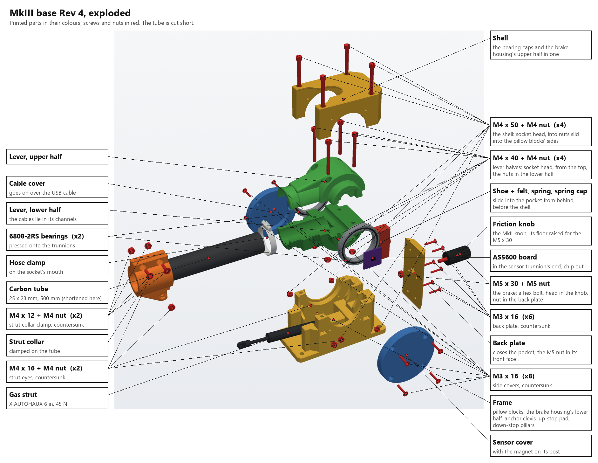

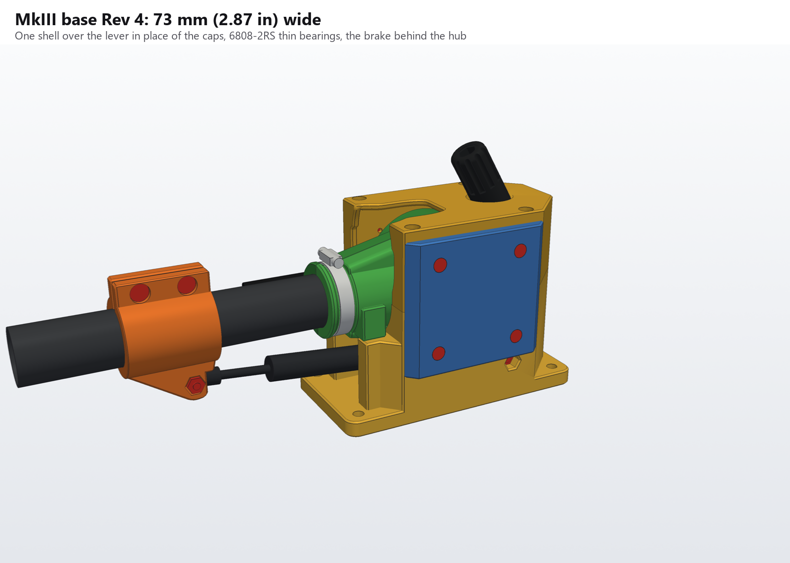

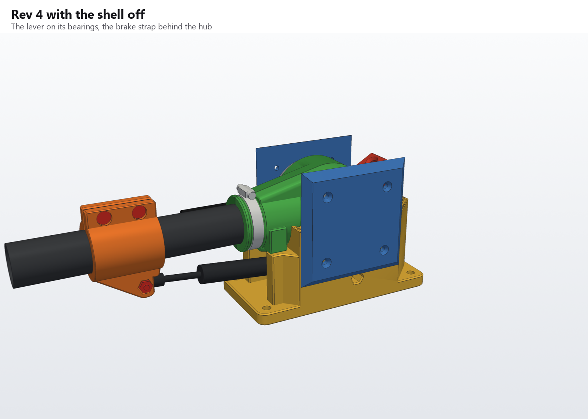

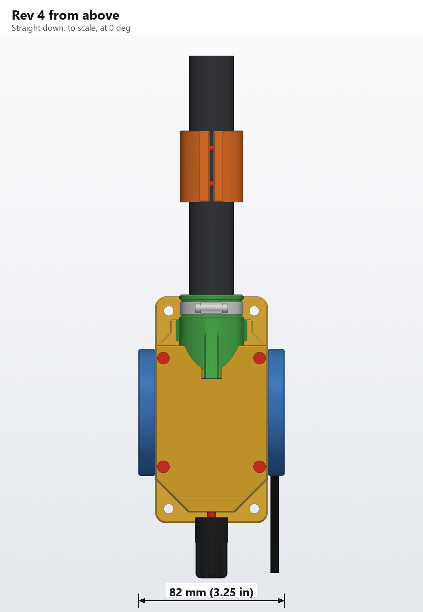

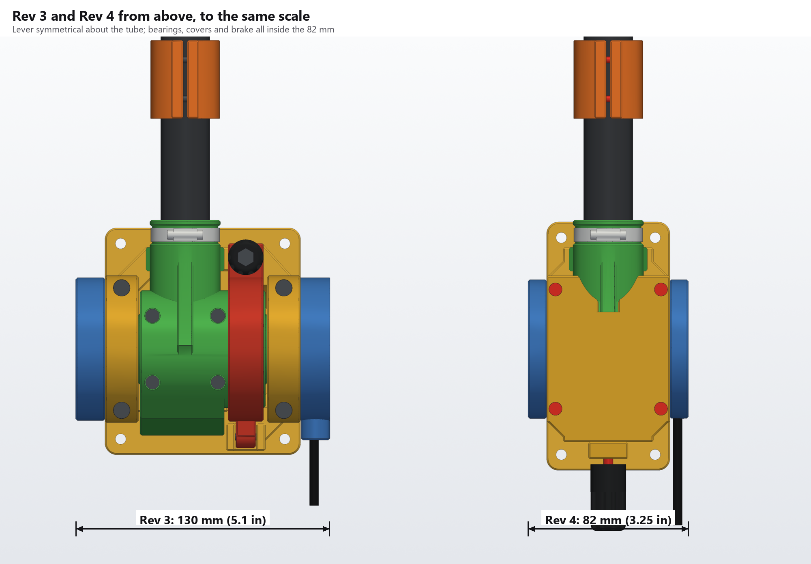

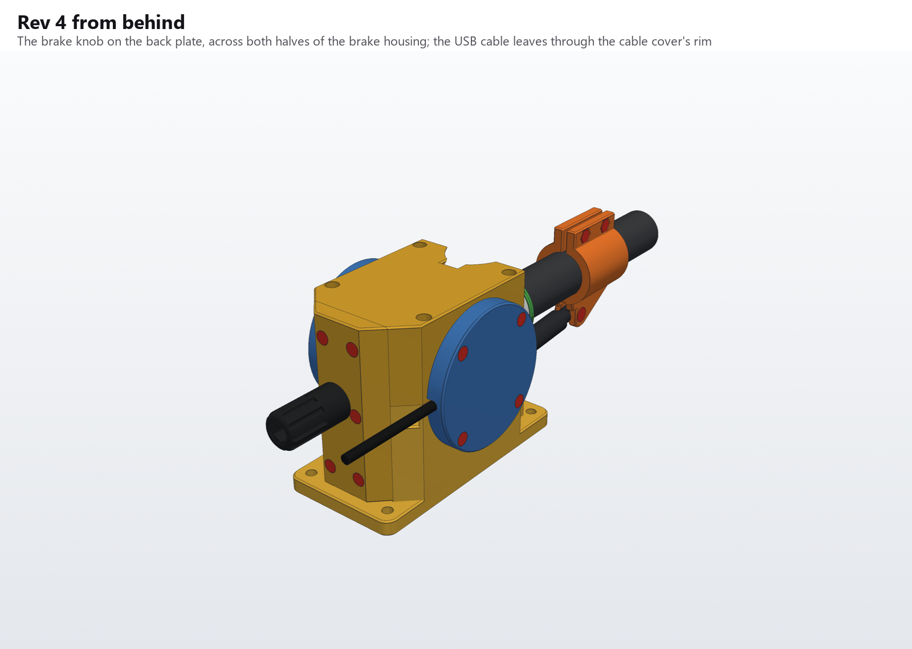

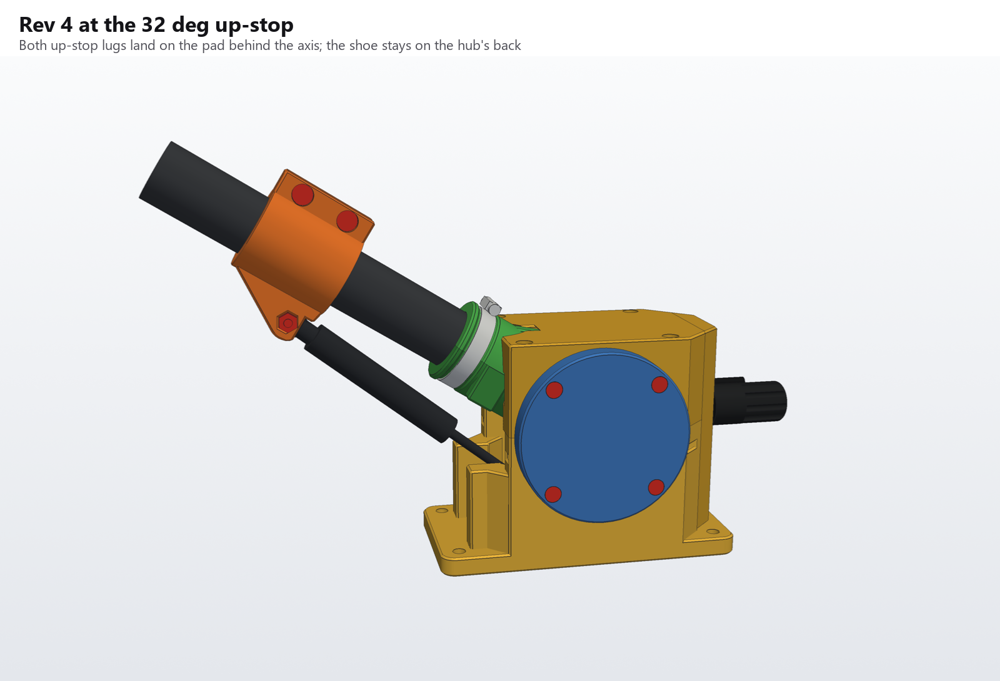

## What changes from Rev 3

- **Lever:** the hub is 43 mm long (Rev 3: 64), centred on the tube. The tube's plane moves from 9 mm off-centre to the middle. Rev 3's friction drum is gone. The halves split on the tube's plane instead of at the pivot axis, so each trunnion prints round, in one piece.
- **Bearings:** 6808-2RS thin-section bearings, 40 × 52 × 7 mm, in place of the 6006-2RS (30 × 55 × 13). The trunnions grow to 40 mm across to suit.
- **Frame:** 9 mm pillow blocks (Rev 3: 17). The base plate stops at their outer faces, so it's 63 × 127 mm (Rev 3: 100 × 116), with no wings or gussets out beside it. A front wall under the shell's carries its cut for the lever on down, so the two read as one piece.
- **Shell:** one box over the lever, in place of the two caps, slotted for the tube. Four M4 × 50 socket head screws hold it to the pillow blocks, and a diamond grid in the joint locates it.
- **Sensor:** the AS5600 board sits inside the sensor trunnion's end, flush with the bearing, so the side covers are 5 mm plates (Rev 3's are 15 mm deep).
- **USB cable:** it turns toward the front on an 18 mm bend, through a pie-shaped relief in the cable trunnion's end, and runs forward in a tunnel under the cable cover, instead of Rev 3's spout.
- **Brake:** a felt-lined strap wraps the back of the hub, hinged at its bottom in the up-stop pad. A knob on top of the shell pulls it on, through a bolt that leans 30° forward.
- **Up-stop:** two lugs under the back of the hub, one each side of the strap, land on a pad further back than Rev 3's.
- **Frame gussets:** 45° gussets at all four corners of both pillow blocks.
- **Strut anchor:** moved up and back, so the 45 N strut as bought balances the lever. Rev 3's first anchor was sized for a 40 N strut, so the 45 N strut pushed the lever up. Rev 3 now has the same anchor.

The knob stands on top of the shell, leaning 30° forward; nothing sticks out behind the back face.

## Files

| | |
|---|---|
| `mk3_rev4.py` | the model. `python mk3_rev4.py` writes `stl/`, `stl/ref/` and `step/`; `--check` runs the interference, assembly and opening-clearance checks; `--coupons` writes `stl/coupons/` |
| `make_renders_r4.py` | the renders, screw maps, exploded view and screw chart, `renders/MkIII_Rev4_Assembly.glb`, and the complete collective with head Rev 5 in [`../../renders`](../../renders) |
| `stl/` | the printed parts |
| `stl/ref/` | bought parts and hardware, for reference |
| `step/MkIII_Rev4_assembly.step` | the whole base |

Both scripts import Rev 3's (`../mk3_rev3.py`, `../make_renders_r3.py`) and need CadQuery; the renders also need trimesh, manifold3d and pyvista.

## Fit-test coupons

The trunnion's and the bearing seat's coupons have been printed and fitted (below). The lever's dowel holes are new, so print their coupon before the lever halves. They're made and read like [Rev 3's coupons](../README.md#fit-test-coupons-print-these-before-the-big-parts).

| File | What it is | Good fit | Change |
|---|---|---|---|
| `stl/coupons/coupon_trunnion_6808.stl` | 8 mm trunnion stubs on the inner-race shoulder, 39.9 / 40.1 / 40.3 mm | the race presses on firmly, no wobble | `TRUN_OD += step` |
| `stl/coupons/coupon_bearing_seat_6808.stl` | the seat and 2 mm lip, 51.8 / 52.0 / 52.2 mm | the race goes in with thumb pressure | `BRG_SEAT_D += step` |
| `stl/coupons/coupon_dowel_hole.stl` | one of the lever's dowel holes, 7.4 / 7.6 / 7.8 mm, 4.2 mm deep, opening on the bed with its lead-in, as the halves print it | a printed dowel (`lever_dowel.stl`) pushes in by hand, with no play | `DOWEL_CLR += step / 2` |

The bearing coupons' `0` comes from how the bearings fitted as built:
- **Seat:** +0.1 on the race's outside was a perfect fit in Rev 3's one-piece blocks. In Rev 4's seat, split between the frame and the shell, it left the bearing a little play, so the seat is now 52.0 mm, the race's own size. The seat coupon is one piece, so it can't show the split: check the play in the frame and shell themselves.
- **Trunnion:** +0.2 on the race's bore pressed on a hair too tight, so Rev 4 uses +0.1 (40.1 mm).

The tube socket is unchanged, so Rev 3's socket fit stands.

## Across the pivot axis

From the middle out, each side:

| | \|y\|, mm | |
|---|---|---|
| Hub | 0 – 21.5 | 60 mm across; 3.5 mm past the socket boss |
| Bearing | 22.5 – 29.5 | 6808-2RS |
| Retaining lip | 29.5 – 31.5 | the pillow blocks' and the shell's outer faces, and the plate's edge, are at 31.5 |
| Trunnion end | 29.5 | 40.1 mm across, flush with the bearing's outer face |
| Side cover | 31.5 – 36.5 | a 5 mm plate; it overhangs the base plate by 5 mm |

## Shell

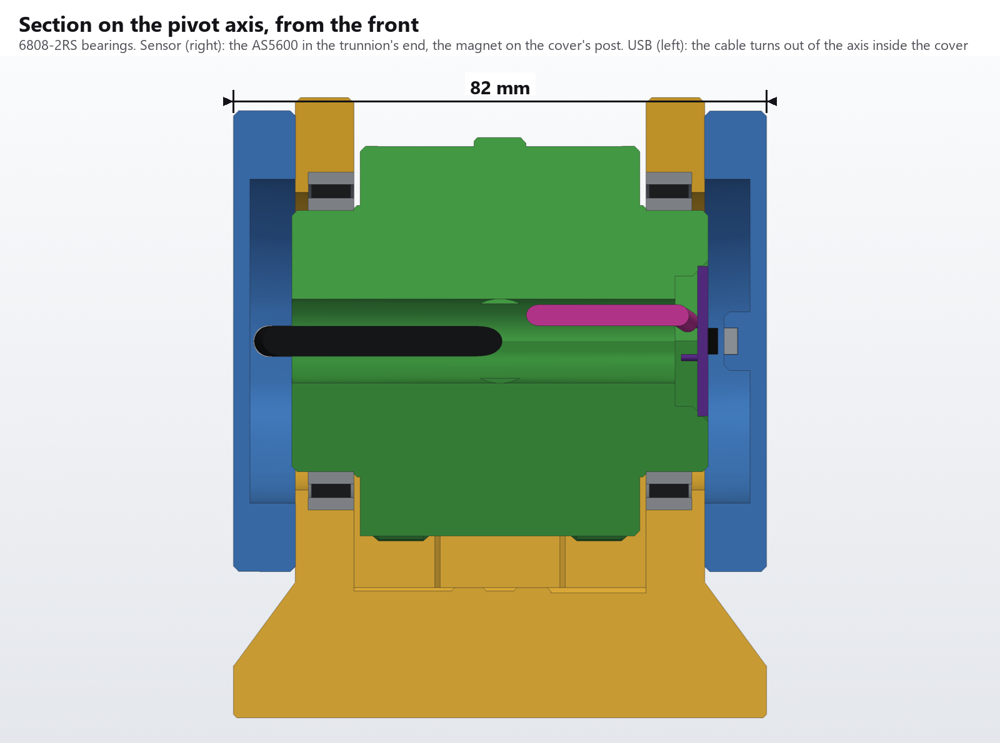

The shell is a box over the lever: 75 mm long, 63 mm wide and 38 mm tall, from the pillow blocks' tops. It replaces Rev 3's two caps.

- **Side walls:** solid, 9 mm thick. These are the caps. Each holds the bearing's upper half-seat and lip, and two of the cover's screw holes. Two M4 × 50 socket head screws per side go down through them from the top, each centred on the joint, heads down 13 mm counterbores, into M4 nuts in the pillow blocks (see [The joint](#the-joint)).
- **Front, back and top walls:** 3 mm thick.
- **Tube slot:** one clean opening in the front and top, the same outline as the frame's front wall below it (see [The joint](#the-joint)). It fits the lever closely: 2 mm clear of the socket boss, the lever's fairings, the down-stop pads and the hose clamp, measured in 3D, through their whole swing, 0° to 32°.
- **Behind the hub:** solid, from 2 mm off the hub out to the side walls, the top and the back face, so the brake knob's seat, sunk into the top, bears straight into the walls. The brake strap's bay is under the seat (see [Brake](#brake)).
- **Assembly:** it drops straight down over the lever and the strap, the slot and the strap's bay both open at the bottom.

## Side covers

Square plates, 5 mm thick, on the pillow blocks' and the shell's side faces: 65.5 mm tall, centred on the pivot axis, over the bearing and the shell screws' nut slots. Their ends are bevelled 45°, the back one on the plane of the frame's and shell's [back chamfer](#the-back) and the front one on the plane of the 0.8 mm chamfer on the pillow blocks' front corners, so both run on flush. Each is held by four M3 × 12 countersunk screws, where the round covers had them, into M3 threads tapped right through the block's and the shell's 9 mm walls. The strut's hex-key hole is 2 mm below the USB-side cover's bottom edge.

- **Sensor cover:** the magnet sits in a pocket in its inside face (see [Sensor](#sensor)).
- **Cable cover:** half of the USB cable's tunnel is a channel in its inside face (see [USB cable](#usb-cable)).

The edges against the block and shell aren't chamfered, so no groove shows at the seams.

## The joint

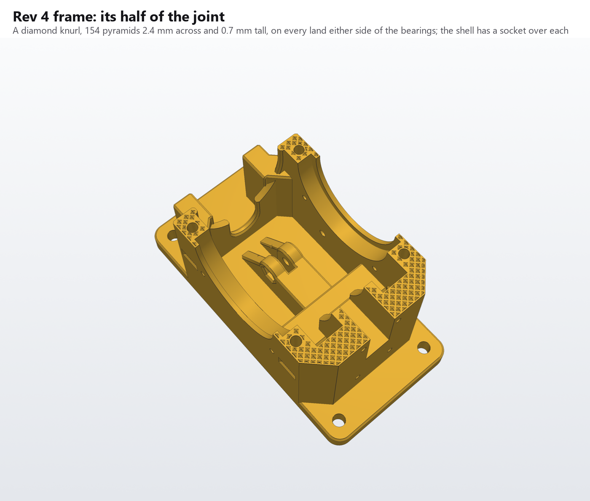

The frame and the shell meet on one flat plane through the pivot axis, which also splits the bearing seats.

- **Screws:** four M4 × 50 socket head cap screws from the lever's HELIFOUNER kit, two per side, 30.5 mm either side of the axis, down the middle of the shell's 9 mm side walls (y = ±27). Each is centred on the joint: its head seats 25 mm above it, at the floor of a 13 mm counterbore, and its tip is 25 mm below. Each goes into an M4 nut slid into a slot in the pillow block's outer face, about 21–24 mm under the joint. The slots open on the blocks' outer faces, under the side covers. The nut sits flats-in: its inner flat stops it turning when you tighten the screw. The counterbore leaves 0.9 mm of shell either side, and the nut's slot leaves 0.9 mm of block to its inside face.
- **Diamond knurl:** the whole face the frame and the shell share is knurled.
  - **Shape:** square pyramids 2.4 mm across their corners and 0.7 mm tall with flat tops, on a diamond grid with 0.6 mm flat lanes. They stand on the frame's half and fit into sockets in the shell's half, 0.1 mm clear on their 45° flanks and 0.2 mm deeper than the pyramids. The flat faces still close on each other, so the bearing seats close, and the knurl stops the shell sliding fore and aft or sideways as the screws pull it down.
  - **Coverage:** it runs over every land, in front of the bearings and behind them, and on across the solid frame behind the pillow blocks. It stops 0.5 mm short of every edge and hole: pyramids at its edge are cut off square, and any piece smaller than a third of a pyramid is left out. The grid is the same mirror image either side of the tube, and fore and aft on the pillow blocks.
  - **Printing:** neither half needs supports: the pyramids point up on the frame, and the sockets open upward on the shell, which prints top down.
- **Front opening:** the frame has a 3 mm front wall between the pillow blocks, under the shell's, and one clean opening runs through both. It follows the lever 2 mm clear (2.0 to 2.4 mm wherever the lever passes close), measured in 3D from the down-stop to the up-stop: `python mk3_rev4.py --openings` measures it. It's drawn in lines, arcs and ellipse arcs, with no facets. From the bottom up:
  - **Lower fairing:** a tab 12.55 mm either side of the tube, its bottom 24.7 mm under the axis, its corners rounded to follow the fairing's 3 mm rounds.
  - **Socket boss:** a circle 20.05 mm about the axis up to the joint, then straight sides. Where the tab meets it, the corners are rounded 3 mm.
  - **Pads' reliefs:** from about 20° on, the down-stop pads' back corners swing up through the shell's wall. Each side bows out on one long arc to 22.05 mm and runs straight up to the pads' tops at the stop, then turns back in.
  - **Boss at the stop:** an ellipse, the boss's own section in the front face at 32°, narrows up to the top. It meets the top slot's sides through the top wall's 3 mm.
  
  On top it carries on as one slot. At the front it follows the boss's footprint as it crosses the wall at the stop, an ellipse, and is rounded into straight sides 12.55 mm either side of the tube over the upper fairing. It ends square 3.15 mm in front of the axis, where the fairing's top passes under the wall at the stop, with corners that follow the fairing's rounds. Below the opening, a smooth round-ended slot lets the strut's cylinder through, 1.5 mm clear over the whole travel. It's cut by the cylinder swung about its anchor pin, so it has no facets.
- **Hex-key hole:** a 3.5 mm hole through the USB-side (+y) pillow block, on the strut anchor screw's axis, 2 mm below the side cover's bottom edge. A 2.5 mm hex key goes straight in to the M4 × 16's head.

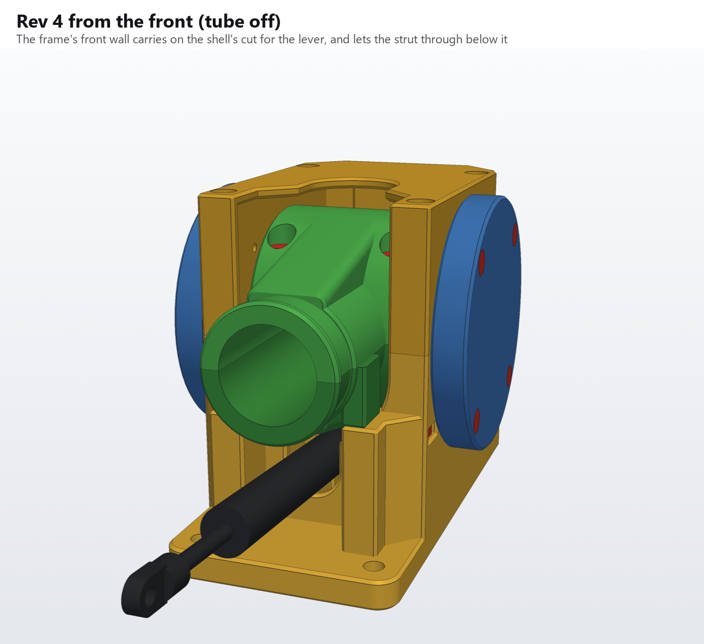

## Lever

Two halves, split on the tube's plane (y = 0) rather than at the pivot axis as Rev 3: `lever_sensor` (−y) and `lever_cable` (+y). Each prints on its joint face with its trunnion up, so each trunnion is one round piece, printed the same way as the trunnion coupon that fitted the 6808.

- **Screws:** four M4 × 35 socket head cap screws run along the pivot axis through the hub, behind the bearings, on a 24.7 mm circle at ±50° from fore and aft. Each half has two heads and two nuts, diagonally opposite: the sensor half has the front-top and back-bottom heads, the cable half the other two. The heads sit in 7.5 mm counterbores 5 mm deep in the hub's end face, and the nuts in hex pockets in the other half's end face, a flat toward the axis. Each tip stands 1 mm past its nut, 3 mm inside the far end face.
- **Walls:** the counterbores leave 1.55 mm of hub over them and the nut pockets 1.6 mm. The counterbores come within 0.05 mm of the bearing's shoulder without breaking into it.
- **Behind the bearings:** the 6808s cover the heads and nuts. Screw the halves up before pressing the bearings on. To split the lever again, pull a bearing first.
- **Dowels:** a printed hollow dowel sits round each screw at the joint, half in each half, like the dowels between an engine and its gearbox. Each is 7.5 mm across with a 4.5 mm bore, and 8 mm long (`lever_dowel.stl`, print four).
  - **Holes:** 7.6 mm across and 4.2 mm deep each side, so the joint faces close on each other, with a 0.4 mm 45° lead-in at the mouth that takes the first layer's squish.
  - **Shear:** the steel screw inside each dowel carries the load across the dowel's layers.
  - **Fit:** tune it with the dowel-hole coupon.
  - **Walls:** the front pair's holes are 2.4 mm from the socket, and the back pair's 1.5 mm under the hub's surface.
- **Seam:** a 0.3 mm chamfer runs round the joint face's outside edge, against elephant's foot at the seam. The bores have none.
- **Down-stop pads:** each runs in to the lower fairing. It's filled from the pad's inner face to the fairing's side over its whole length, and from its bottom up into the boss, so pad and fairing are one piece. With the lever split on the tube's plane, the pad's inner face would otherwise print as a flat overhang.
- **Strength:** up and down at the grip, the main load, the two halves sit side by side, each carrying its share, and nothing crosses the joint. With Rev 3's split at the axis, each half alone had only about a fifth of the section's stiffness, and the joint had to carry the shear between them, about 3 N/mm at 100 N on the grip. A side load crosses the joint now instead: 20 N at the grip puts about 0.7 N/mm across it, which the dowels and the screws' clamp carry easily.
- **Unchanged:** the outside, the bores, the fairings, the strut relief, the hose-clamp groove, the trunnions and the socket for the uncut 500 mm tube. The halves are mirror images, except the sensor's pocket in the sensor half's trunnion and the USB cable's relief in the cable half's (see [USB cable](#usb-cable)).

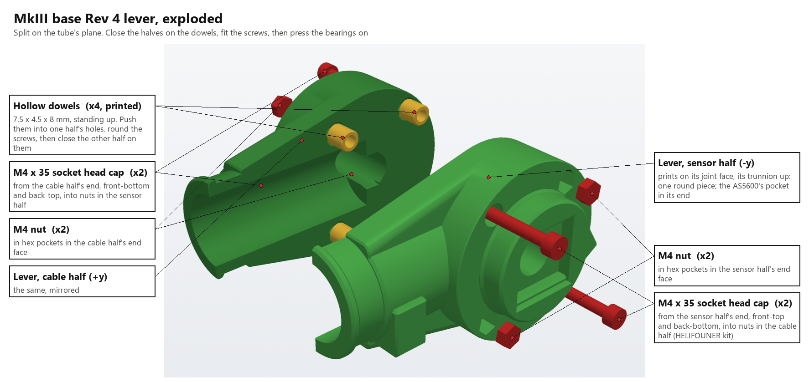

**Fairing:** in place of Rev 3's 8 mm top gusset, a fairing 21 mm wide runs over the socket boss, and the same one mirrored runs under it. It starts at the hose-clamp groove's back edge. Its top is one straight line from the boss's top there to the hub, tangent to the hub's circle, so it runs into the hub without a corner. Its long top edges are rounded 3 mm.

**Strut relief:** the strut's cylinder sits on the base end, and from 28° up its end comes in under the front of the hub. A shallow relief in the hub's underside lets it by, 1.5 mm clear all the way to the stop: 2.65 mm deep at most, 11.6 mm wide, centred on the tube's plane. It's cut by the cylinder swung about the collar's pin as the lever sees it, so it's smooth, with no facets. It's under the lever, away from the brake's felt.

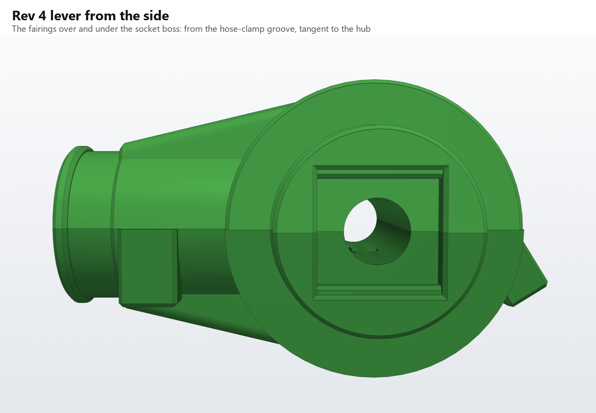

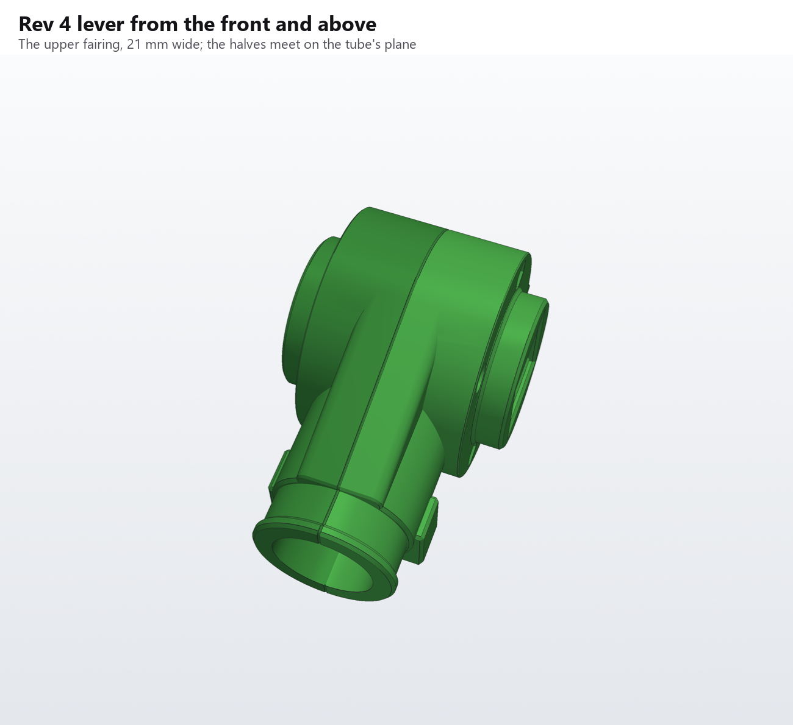

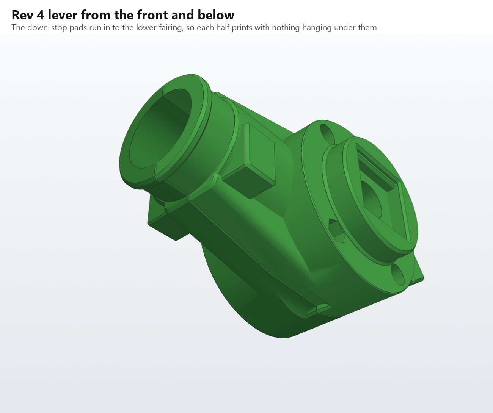

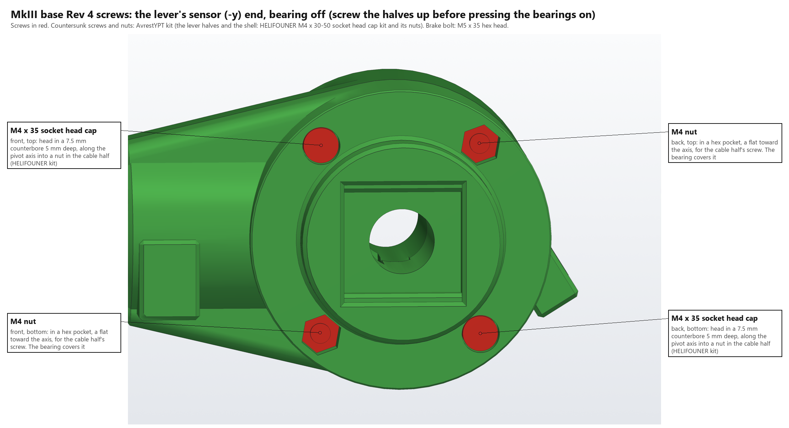

## Sensor

The AS5600 module (WWZMDiB) sits in a square pocket in the sensor trunnion's end, chip facing out, its front face level with the trunnion's end, which is flush with the bearing's outer face. There's no carrier.

- **The pocket:** 23.54 mm square (the board is 0.915 in, 23.24 mm, as measured, plus 0.15 mm a side) and 1.6 mm deep for the board. The board rests on two 1.6 mm ledges along its top and bottom edges, clear of both pad columns.
- **Behind the board:** 3.5 mm of space for the wires soldered in from the back and the DIR jumper. It opens into the axial bore, which takes the lead to the tube.
- **Orientation:** set it in with the pad columns vertical. It fits either way up.
- **Holding it:** a dot of hot glue in two corners. Nothing else holds it in.

The chip stands inside the bearing's retaining lip. The magnet (4 × 2 mm, in Rev 3's 4.2 mm pocket) sits in a pocket in the sensor cover's inside face, its face 0.5 mm below the cover's and 1.0 mm off the chip, as in Rev 3. The wiring and the module's changes (R1 off, DIR to VCC, R4 off for I²C) are exactly as in [Rev 3](../README.md#sensor).

## USB cable

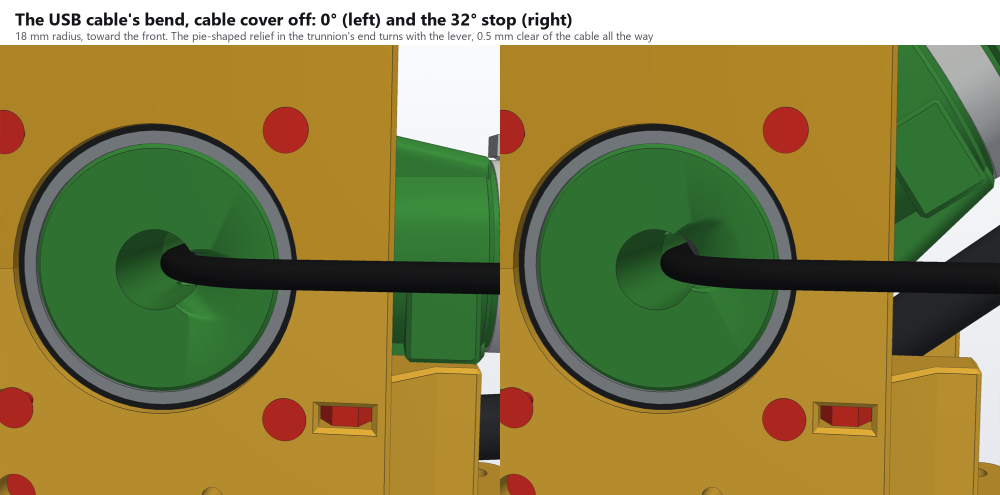

The cable leaves on the right-hand (USB) side and faces the front.

- **The bend:** it comes along the axis and turns toward the front on an 18 mm radius, about four times its 4.6 mm thickness (Rev 3: 6 mm). The bend starts inside the axial bore and ends just past the trunnion, inside the bearing's retaining lip.
- **The relief:** where the bend would rub the trunnion's end, a pie-shaped relief flares the bore's mouth. It's 4.8 mm deep at the bore and runs out 14 mm from the axis, well inside the bearing. The bend stays put while the trunnion turns under it, so the relief spans the cable's way out over the whole travel, 0° to 32°, and 1° past each end. Its sides are round, the cable's own section. The cable clears the turning trunnion by 0.5 mm all the way.
- **The tunnel:** from the lip, the cable runs straight forward in a round tunnel 5 mm across, 1.3 mm out from the pillow block's face. Half of it is a groove in the block's and the shell's outer faces, half a channel in the cable cover. It leaves through the cover's front bevel. Lay the cable in the groove and the cover goes on over it, so it can go on over a cable that's already through the lever, as Rev 3's does. The groove leaves 1.1 mm of block to the nearest shell screw's hole, and the cover 1.2 mm over the channel.

The trunnions end flush with the bearings so the cable can turn inside the lip: that's what lets the covers be 5 mm.

## Brake

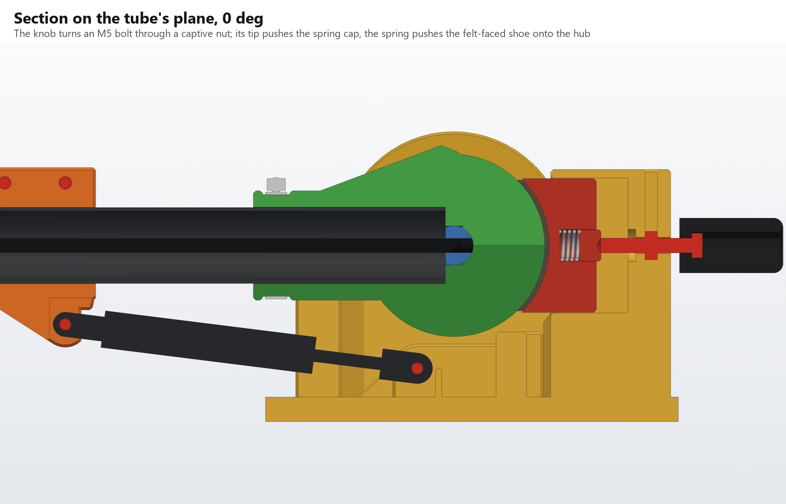

A rigid printed strap wraps the back of the hub between the up-stop lugs, from 54° below the axis to 42° above it, and its felt from 52° below to 40° above. It's 18 mm wide and 8 mm deep, lined with 1.5 mm felt, and hinged at its bottom end in the up-stop pad, just behind the strut's clevis. At the bottom the band runs on down into the pad's slot and into the knuckle. At the top it runs on under the head, its end cut off level with the head's face, 3 mm under the bay's ceiling. The head is solid, with an M5 nut in it. The knob sits on top of the shell and draws the head up and forward, so the strap swings about its hinge and the felt clamps the hub.

- **The pull:** the knob's M5 × 35 bolt leans 30° forward from vertical, which gives it 41 mm of leverage about the hinge. A vertical bolt there would get 12 mm, and would mostly stretch and bend the strap instead of closing it. 30° is as far as it can lean with the seat sunk into the shell's top and 2 mm or more of shell between the seat and the hub.
- **Gussets:** the head is one solid gusset, from the band 12° above the axis up to its top end, front and back, out to where the bolt pulls. Another runs from the band's bottom 12° down to the hinge's knuckle. Neither end is a thin tab.
- **The hinge:** the knuckle sits in a slot through the up-stop pad, 0.5 mm clear either side. The slot guides it, so the strap stays at least 1.5 mm off each lug (2 mm when centred). The pin, an M4 × 50 socket head, goes through both pillow blocks and the pad, head in a counterbore on the USB (+y) side, nut in a hex pocket on the sensor (−y) side.
- **The nut:** it drops into a slot in the head from the strap's +y side. The bolt holds it there, and its pull bears it on the slot's face. A lead-in in the head's face guides the bolt's tip onto it.
- **The knob's seat:** sunk into the shell's top, square to the bolt. There's 4 mm of shell under it, then the strap's bay.
- **The spring, if you want one:** the knob has a 10.6 mm pocket, 7 mm deep, in its underside. Without a spring, the knob sits on its seat and pulls the strap directly. With one (10 mm OD, 10 to 15 mm free length, such as Rev 3's), the spring holds the knob off its seat and the knob sets the brake through it. The M5 × 35 keeps its full thread in the nut either way.
- **The bay:** 22 mm wide, out to the lugs' inner faces, in the frame and the shell. In the frame, the strap leans back on its own onto the bay's back wall, at 8°: far enough for the lever's hub to drop past the felt's top end, 1.0 mm clear. In the shell, the back of the bay is a ramp parallel to the bolt, 1 mm behind the head. As the shell goes on, the ramp meets the leaning strap's head and swings it forward onto the hub, so its nut lands on the bolt's axis.

**Drag:** about 9.3 N·mm per newton of bolt tension with the lever moving up, and 11.1 moving down; the strap is self-energising by about 19%. 26 N of tension gives the old shoe's 270 N·mm. The felt is 92° long, but its bottom end, close to the line from the axis to the hinge, carries little: the strap's swing hardly presses it there. The felt below 38° under the axis takes about 5% of the grip, and the felt above 22° over it about 28%. The longer patch also brings the felt's peak pressure at 400 N down from 1.1 MPa to 0.8.
- **With the spring:** the brake's range is spread over about 10 turns of the knob, up to the spring's 20 N or so. Past that, the knob is down on its seat and the brake firms up.
- **Without it:** the felt is the only give, so the brake goes from free to firm within about a turn.

**Strength:** checked at 400 N of bolt tension, more than a hand gets out of an 18 mm knob (about 130–210 N at 0.3–0.5 N·m).
- **Strap:** it prints on its side, so all its bending runs along its layers (35 MPa allowed). The band peaks at 17 MPa, where it runs into the arm, the neck under the head at 21, and the arm to the hinge at 8.
- **Hinge:** the knuckle bears 7.9 MPa on its pin. The pin carries 570 N, at 227 MPa in its 12.9 steel.
- **Shell:** the 4 mm floor under the seat bends at 17.5 MPa, along its layers. The shell is solid behind the hub, out to its side walls, top and back, so the seat's load goes straight into the walls.

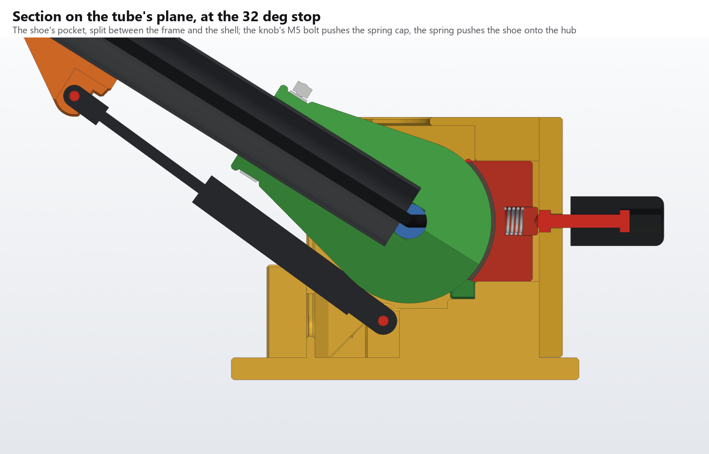

## Up-stop

Two lugs under the back of the hub land on a pad on the frame at 32°. Each lug is 10 mm wide (|y| 11 to 21), with 22 mm between them for the brake strap.

**Where the pad is:** x = 14 to 29.5, the full width between the pillow blocks, with a slot in its middle for the brake strap's knuckle. Its top is at z = −28.5, 2 mm under the hub at its front edge.

**Where the lugs land:** x = 15 to 24.4. They can't land further back: the further back a lug lands, the further back it swings at 0°. These come to x = 35.8 at 0°. Behind them the frame is cut away on a 39 mm radius round the axis, 1.5 mm clear of their swing.

At 0°, the strap's arm and knuckle sit between the lugs, 2 mm clear of each. As the lever lifts, the lugs swing down either side of the strap onto the pad. Between them, the hub is a plain cylinder for the felt to run on.

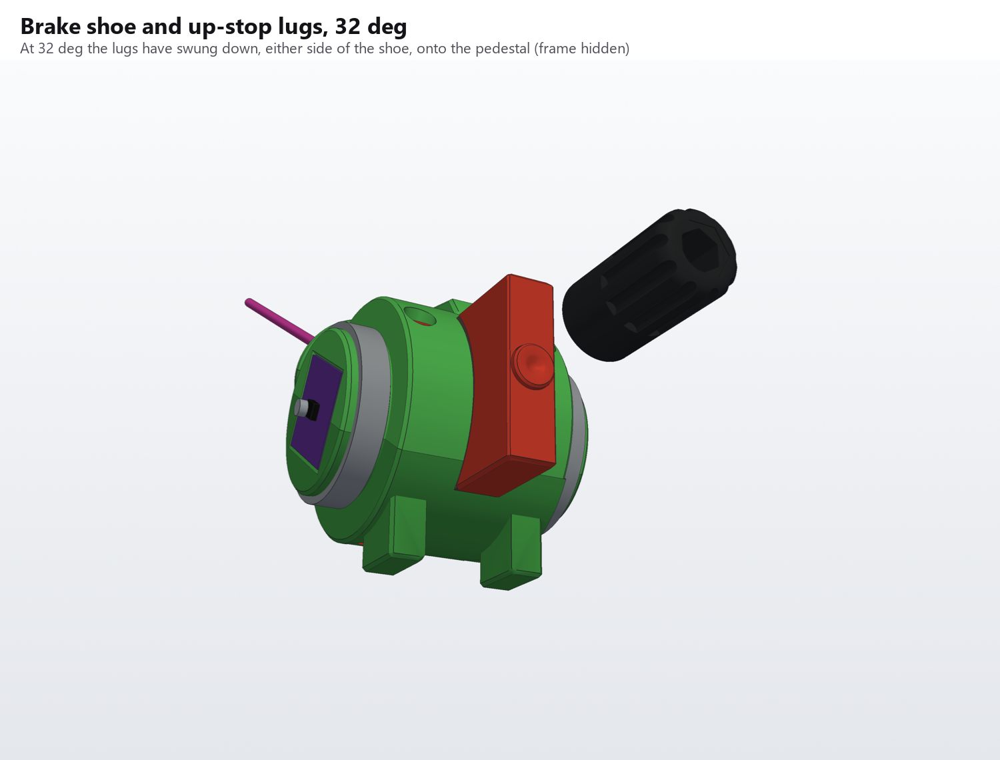

The anchor clevis's back wall runs level, at the cheeks' top, into the pad's front face.

## Frame

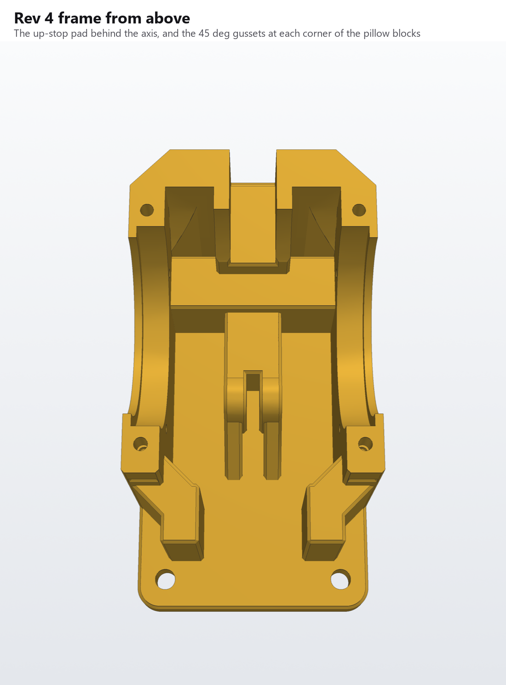

The plate is 63 mm wide, the pillow blocks' outer faces, and 127 mm long. The desk screws are 24 mm either side of the middle, past the blocks' ends and the down-stop pillars.

Behind the up-stop pad, the frame is solid back to its back face and out to the [back chamfer](#the-back), except for a 39 mm radius round the axis between the pillow blocks, 1.5 mm clear of the up-stop lugs' swing, and the brake strap's bay in the middle.

Each pillow block also has a 45° gusset at its front corners, 8 mm along each wall:
- **In front, inside:** the block's inner face to the down-stop pillar's back face, up to the pillar's top, 3 mm clear of the hub.
- **In front, outside:** the block's front face to the pillar's outer face, up to the pillar's top.

The down-stop and strut are unchanged from Rev 3: pads on the socket boss land on two pillars at 0°, and the gas strut runs from a clevis on the frame to the collar on the tube. Everything is on the new centre line. Each pillar runs on into its pillow block.

## The back

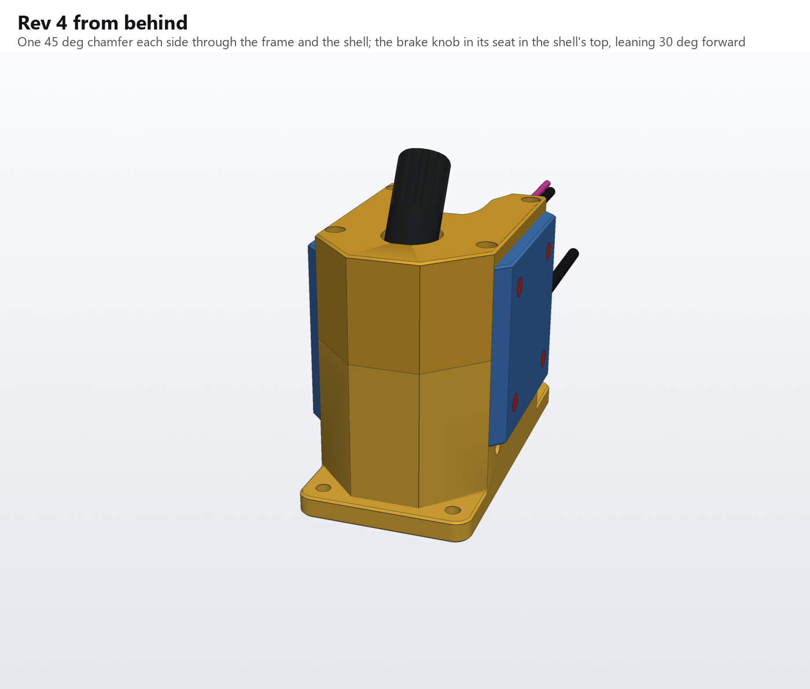

The frame and the shell share one 45° chamfer plane each side. It runs from the pillow blocks' outer back corners to the back face, at x = 56.5 (|y| + x = 69 mm), so from behind the two read as one block. The back face is 25 mm wide. It's that far back so the shell's bay has room for the brake strap's head when the strap leans back 8°. The edges in the joint aren't chamfered, so no groove shows at the seam.

## Balance

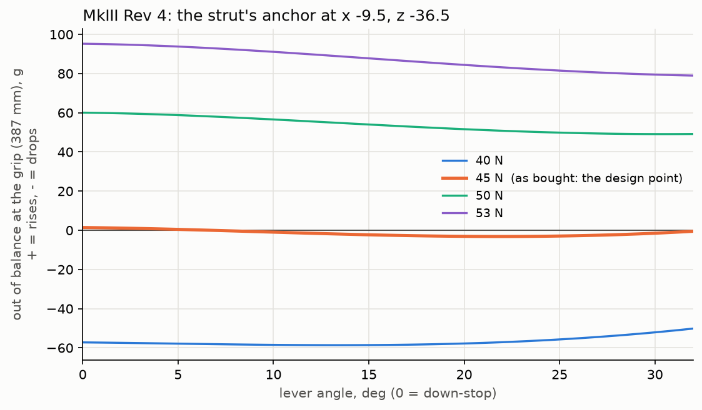

Rev 3 was first built with the anchor at x = −12, z = −40.5, sized for a 40 N strut: the bottom of the range the 45 N strut is sold as. The 45 N strut as bought lifted the lever, by about 50 to 70 g at the grip.

The anchor is now at x = −9.5, z = −36.5, in Rev 4 and in Rev 3's updated frame: 4 mm up and 2.5 mm back. The strut's line passes closer to the pivot, so it has less leverage. It now balances 45 N to within 3 g at the grip over the whole travel. The strut is 119 mm long at 0° and 140 mm at 32°, inside its 102–152 mm stroke.

The strut is fitted cylinder down, as built: its cylinder (0.475 in, 12.07 mm, measured) on the anchor clevis, and its rod on the collar. The frame is cut 1.5 mm clear of the cylinder's sweep, through the front wall and over the clevis's front gussets.

| Strut force | Out of balance at the grip | Fix |
|---|---|---|
| 40 N | −58 to −50 g (drops) | — |
| **45 N (as bought)** | **−3 to +2 g** | none |
| 50 N | +49 to +60 g (rises) | about 42 g of ballast in the head |
| 53 N (top of the range) | +79 to +95 g | about 68 g of ballast |

The collar still fine-tunes: 8 mm toward the pivot adds about 21 g of lift at the grip, and 8 mm away takes 21 g off.

**The clevis:**
- **Cheeks:** they're 6.5 mm round the eye (Rev 3: 8), so they stay 1.5 mm under the hub.
- **Back walls:** they run 2 mm under the hub into the up-stop pad. Behind the tab, from 1 mm past its round end, the gap between them is filled, so they print as one solid block with proper infill.
- **Screw:** the strut's M4 × 16 still fits.

`python mk3_rev4.py --balance` prints the table and redraws the plot. It uses Rev 3's model: Rev 4's lever halves and Rev 3's estimate of the head (368 g). If your head is lighter than that, the strut will still lift a little. Slide the collar away from the pivot, or add ballast.

## Printing

- **Frame:** plate down, as Rev 3. The brake strap's slot and bay open at the top, the grid's pyramids point up, and the front wall builds straight up.
- **Shell:** top down. The bearing half-seats, the slot, the strap's bay and the grid's sockets all open upward. The knob's seat is on the bed, and its floor slopes at 30°: support it from the bed, in the seat only.
- **Lever halves:** each on its joint face, trunnion up, so the trunnion prints round, axis up, like its coupon.
  - **Opening upward:** the sensor's pocket, the counterbores and the nut pockets.
  - **Arches:** the socket and the radial cable bore print as arches in the joint face, as in Rev 3. The dowel holes' roofs bridge 1.6 mm.
  - **Supports:** the up-stop lugs' inner faces need a small support each. Each is a flat overhang about 40 mm² across, 11 mm above the bed, and the brake runs between the lugs, so they can't be filled. Nothing else needs support: the down-stop pads run in to the fairing.
  - **Seam:** turn on the slicer's elephant's-foot compensation. The seam's 0.3 mm chamfer takes the rest.
- **Lever dowels:** four, standing on end.
- **Brake strap:** on its side, the nut's slot up. Its bending then runs along the layers. No supports.
- **Side covers:** outer face down. The magnet's pocket and the cable's channel open upward, and the 45° ends lean out at 45°, so no supports.
- **Knob:** as Rev 3's, underside down. Reprint it: its floor is now 11 mm up, and it has a pocket underneath for the spring.
- **Strut collar:** Rev 3's, unchanged. Reuse it.

## Assembly

1. **Frame and shell:** tap the eight cover-screw holes M3, four in the pillow blocks and four in the shell's side walls. The pilot holes go right through the 9 mm walls. Slide an M4 nut into each of the four slots in the blocks' outer faces, two per side, and push it home over the screw hole.
2. **Lever:**
   - **Dowels:** push the four dowels into one half's holes.
   - **Cables:** poke the USB cable through the cable half's axial bore from its joint face, and the sensor lead through the sensor half's. Lay both along the radial channel.
   - **Close:** close the halves on the dowels. Drop an M4 nut into each of the four hex pockets, two in each end face. Fit the four M4 × 35 cap screws, two from each end, and tighten them evenly.
   - **Bearings:** press the bearings onto the trunnions. They cover the screws, so to split the lever again, pull a bearing first.
3. **Sensor:** solder the module to the lead, as in Rev 3, and set it in the trunnion's pocket, chip out, with a dot of hot glue.
4. **Brake strap in:** stick the felt (16 × 51 mm) on the strap's face, and drop the M5 nut into the slot in its head. Set the strap down into the frame with its knuckle in the up-stop pad's slot. Push an M4 × 50 socket head through from the USB (+y) side, through the pillow block, the pad and the knuckle, into an M4 nut in the sensor side's hex pocket. Tighten it: the strap still swings freely on it. Let the strap lean back onto its bay's back wall.
5. **Lever in:** lower the lever's bearings straight down into the frame's seats. The hub drops past the top of the leaning strap's felt 1.0 mm clear, and ends 0.85 mm off the felt's bottom end; the strap itself stays 1.8 mm clear. Tip the strap forward onto the hub.

   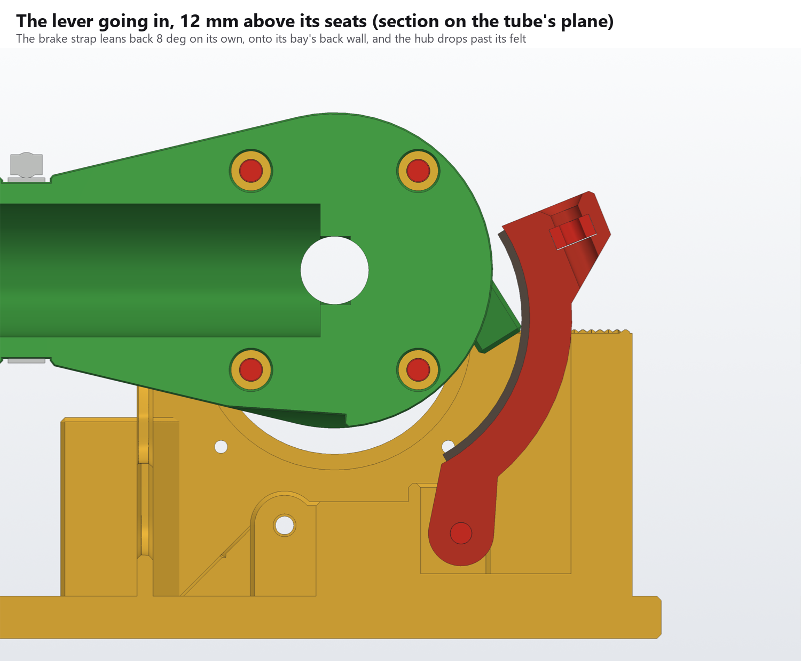

6. **Shell on:** lower it straight down over the lever and the strap, so the grid's pyramids drop into their sockets. If the strap has leaned back, the ramp at the back of the shell's bay meets its head 10 mm before the shell is down and swings it forward. Fit the shell's four M4 × 50 socket head screws into the nuts and tighten them evenly.
7. **Knob:** if you're using the spring, drop it into the pocket in the knob's underside. Drop the M5 × 35 bolt into the knob's hex pocket, head down. Set the knob in its seat and screw the bolt down into the strap's nut. With the shell on, the strap can lean back only 1.0°, which leaves its nut 0.8 mm off the bolt's axis, and the lead-in in the head takes up 2 mm. Then set the drag.
8. **Covers:** glue the magnet into the sensor cover's pocket, pushed to the bottom. Lay the USB cable into its groove in the USB-side pillow block and shell, push the cable cover on over it, and screw both covers down (M3 × 12).
9. **Strut and tube:** as Rev 3.

## Screws

All from the same kits as Rev 3: the AvrestYPT countersunk kit (M3 and M4 × 8, 12, 16, 20, with nuts) and the HELIFOUNER M4 × 30–50 socket head kit. The NIULUNBAO M3 set isn't needed.

| Where | Screw | Into | Qty |
|---|---|---|---|
| Lever halves | M4 × 35 socket head cap, along the pivot axis through the hub, two from each end, heads in 7.5 mm counterbores | M4 nut in a hex pocket in the other half's end face | 4 |
| Shell | M4 × 50 socket head cap, from the top, down 13 mm counterbores, centred on the joint | M4 nut slid into a slot in the block's outer face, under the side cover | 4 |
| Side covers | M3 × 12 countersunk, from the cover's outer face | M3 thread tapped through the block or the shell's side wall | 8 |
| Brake | **M5 × 35 hex-head bolt**, head on the floor of the knob's hex pocket | M5 nut in the slot in the brake strap's head | 1 |
| Brake strap's hinge | M4 × 50 socket head cap, from the +y side, head in a counterbore | M4 nut in a hex pocket on the −y side | 1 |
| Strut eyes | M4 × 16 countersunk, head on the +y side | M4 nut in the far cheek's pocket | 2 |
| Strut collar clamp | M4 × 12 countersunk | M4 nut in the other ear's pocket | 2 |

The hinge pin is a fifth M4 × 50 from the HELIFOUNER kit.

Every screw and nut, to scale:

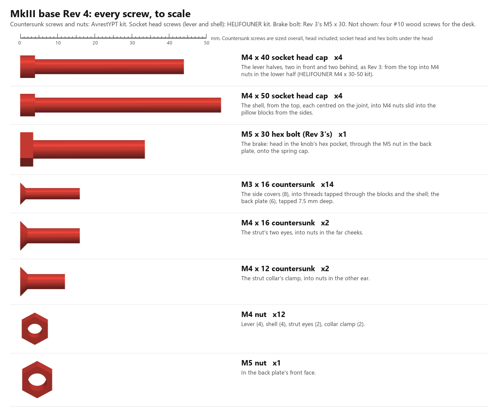

Between them, these label every screw and nut in the base:

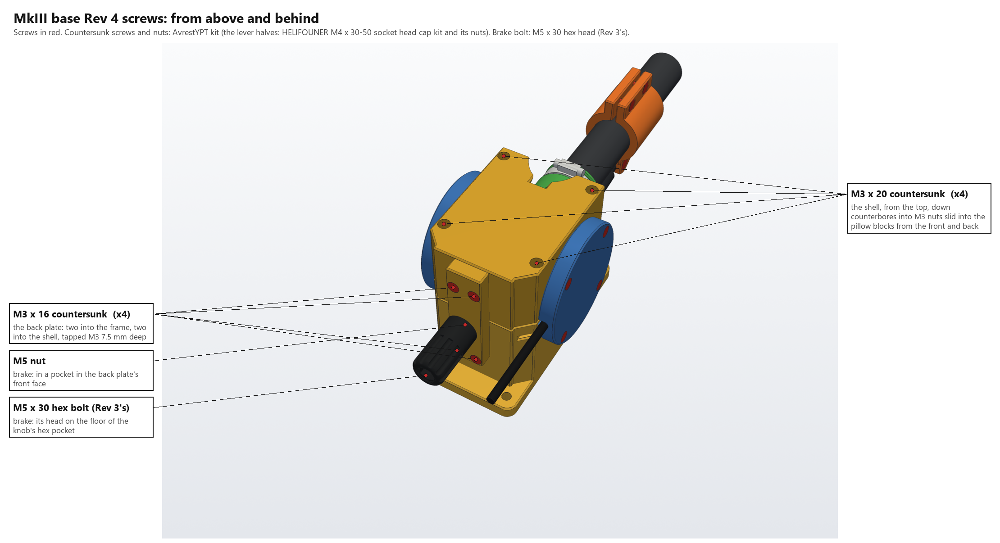

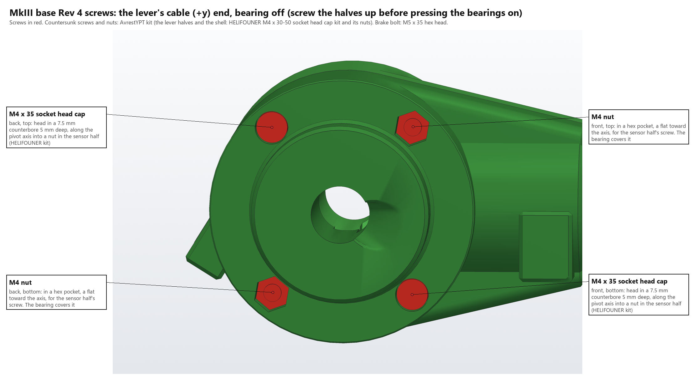

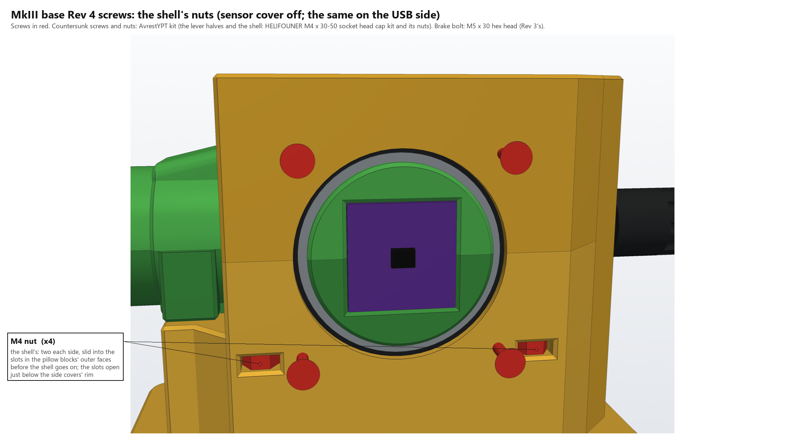

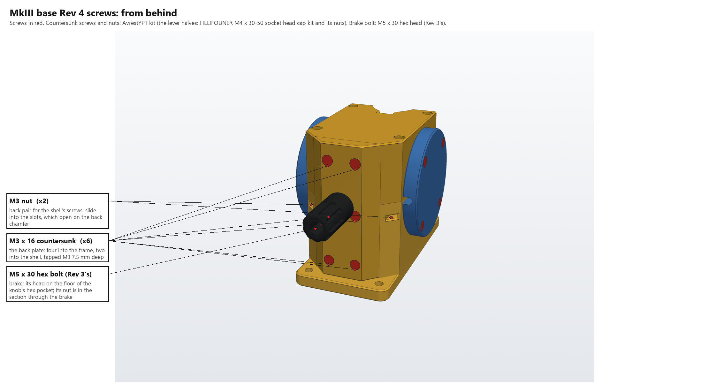

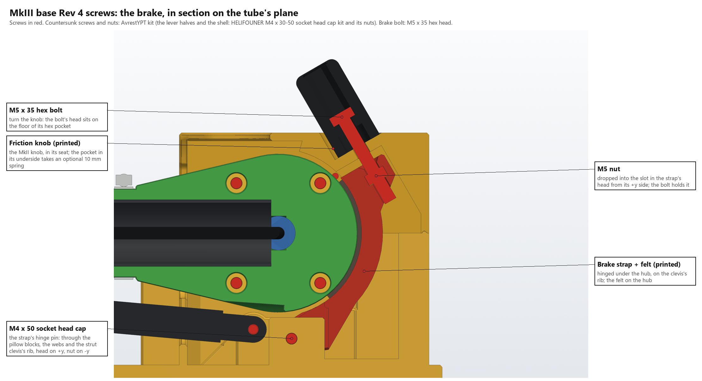

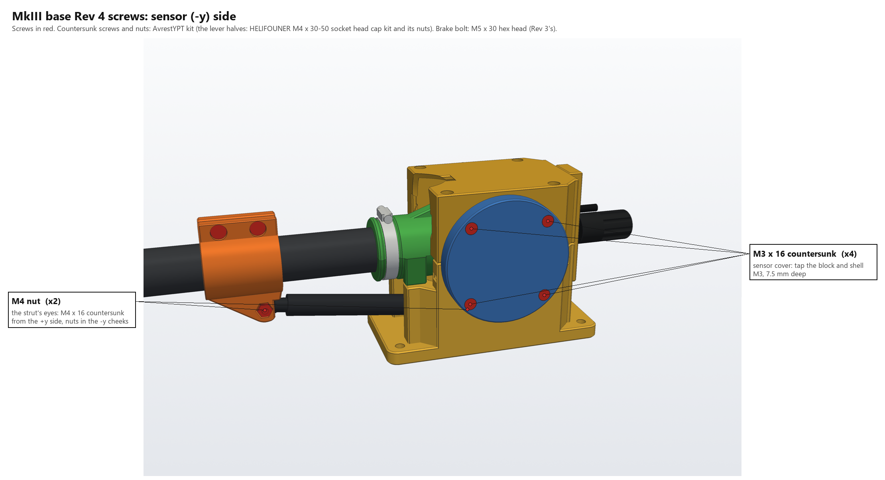

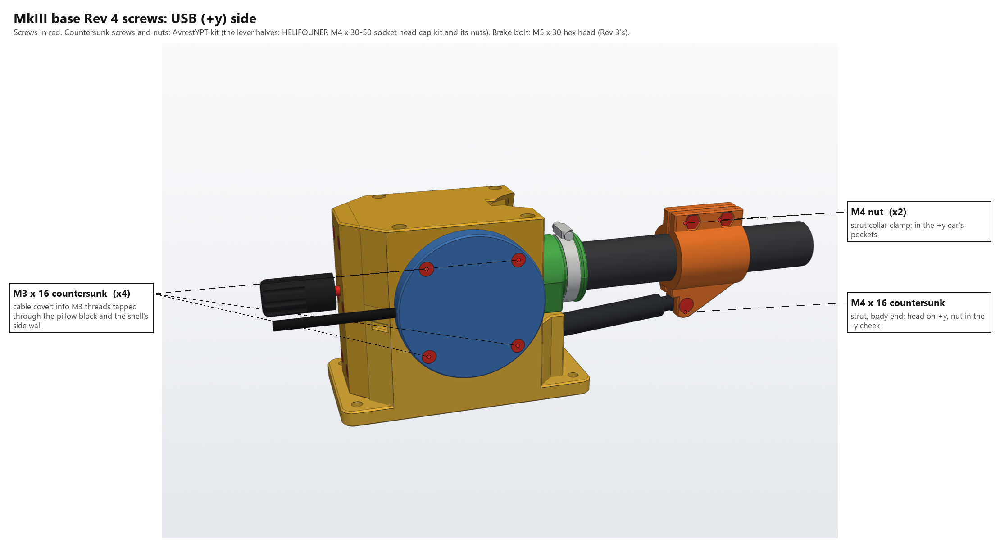

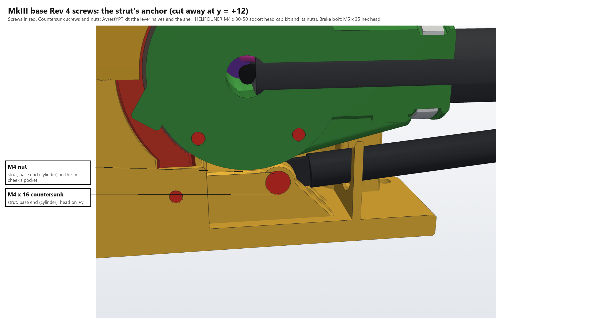

## Bought parts

| Part | Qty | Notes |
|---|---|---|
| **6808-2RS thin-section ball bearing (40 × 52 × 7)** | 2 | new for Rev 4 |
| X AUTOHAUX 6" 45 N gas strut | 1 | Rev 3's |
| 25 × 23 mm carbon tube, 500 mm | 1 | Rev 3's, uncut |
| Worm-drive hose clamp, about 25–40 mm | 1 | Rev 3's |
| Compression spring, 10 mm OD, 10–15 mm free length | 1 | optional: Rev 3's fits |
| M5 × 35 hex-head bolt | 1 | any hardware store |
| Felt, 1.5 mm, 16 × 51 mm | 1 | on the brake strap |
| AS5600 module (WWZMDiB) | 1 | Rev 3's, with its magnet |
| #10 × 1-1/2 in wood screws | 4 | desk mounting |

## Notes

- **The checks:** `python mk3_rev4.py --check` runs four checks, and all are clean.
  - **Every pair of parts** at 0°, 8°, 16°, 24°, 31.5° and 32°. The overlaps it allows are the intended ones: screws in their holes, the bearings' inner races on the trunnions, the felt on the strap, the strut's tabs in their clevises, and the hose clamp in its groove. Just past each stop, the lever meets the frame where it should: the pads on the pillars below 0°, both lugs on the up-stop pad above 32°.
  - **The brake's clearances,** measured as distances, not overlaps: through the whole travel, the strap stays 1.5 mm off the lever, the felt 0.02 mm off the hub, and the knob 6.4 mm or more off the lever; the strap is 0.5 mm off the pad's slot either side, and 1 mm off the shell's ramp.
  - **The assembly order:** the strap set down into the frame, leaning back; the lever lowered past it; the strap swung onto the hub; the shell lowered over both, its ramp swinging the strap forward.
  - **The openings' clearance:** the true 3D distance from the frame's front wall and the shell's front and top walls to the lever's halves, the hose clamp and the tube, every 0.25° from 0° to 32°, then every 0.02° round each wall's closest passes. None is under 2 mm. `--openings` runs this one alone.
- **Chamfers:** Rev 3's chamfer step once returned a valid frame with the down-stop pillars missing. Rev 4's version refuses any set of chamfers that takes off more than chamfers could. Rev 3's parts were checked, and none of them lost anything.
- **Brake feel:** untested. The felt patch is 16 × 51 mm, and the drag per newton of bolt tension is worked out for felt on PETG at μ = 0.3. Fit the spring if the knob is too touchy without it.
- **Balance:** see [Balance](#balance). The lever is about 68 cm³ lighter than Rev 3's, mostly near the pivot, and that makes almost no difference: its load at 0° is 1.998 N·m against Rev 3's 1.996.
