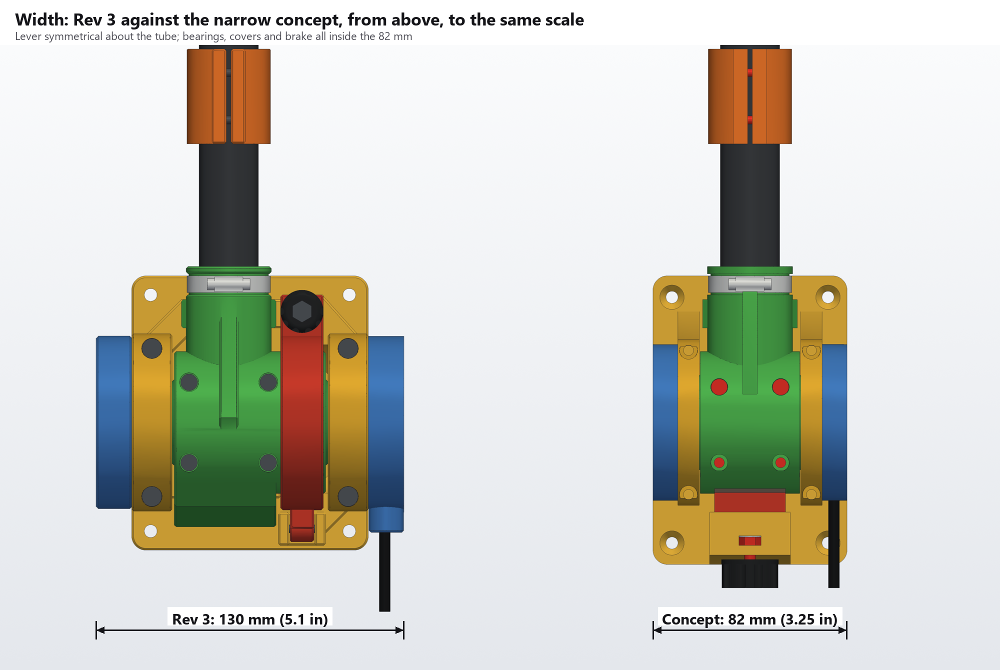
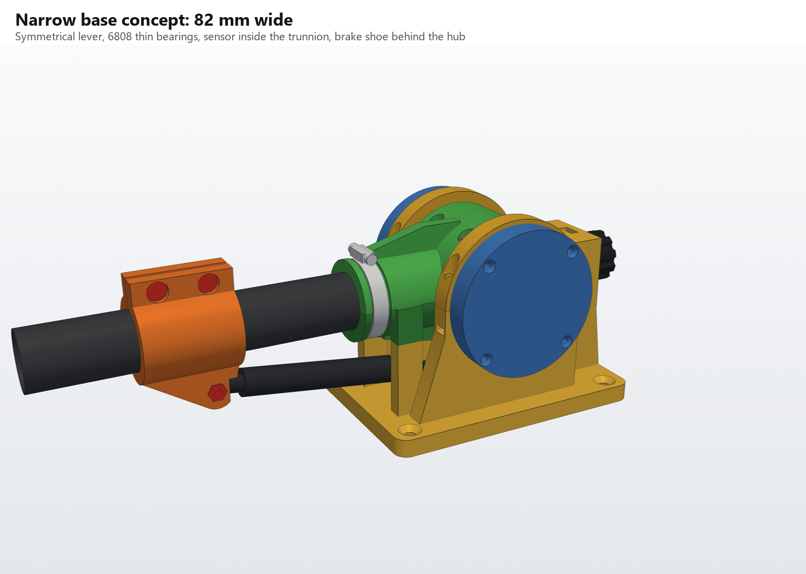
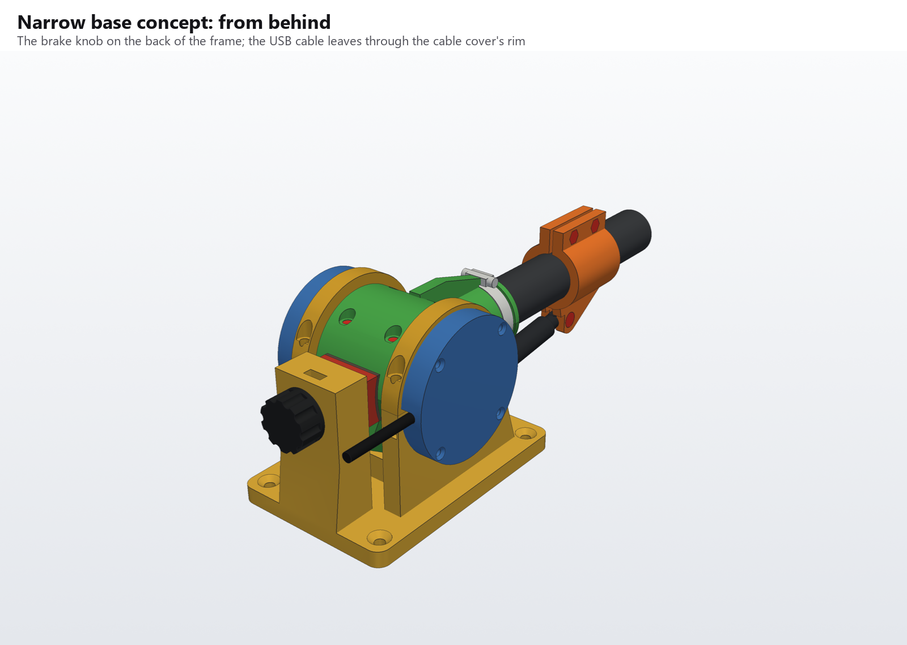
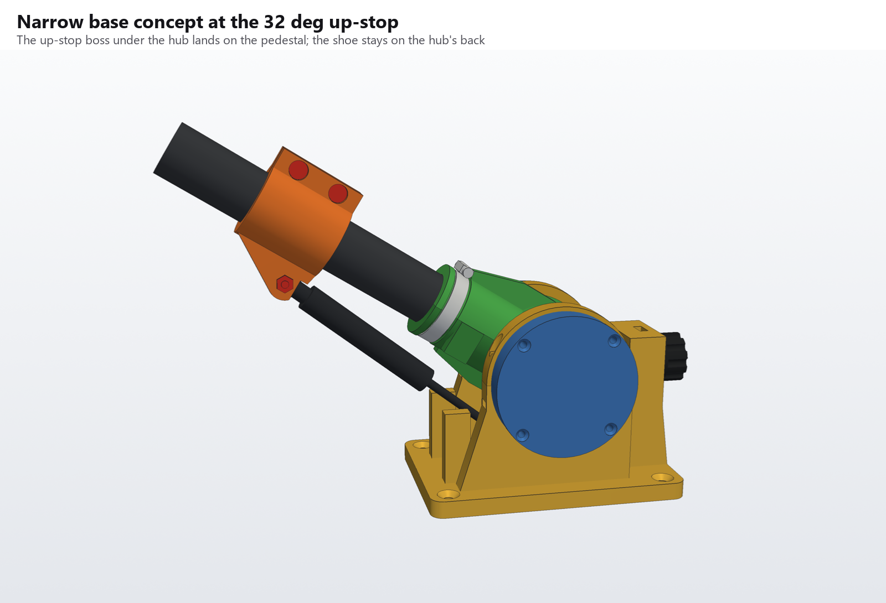
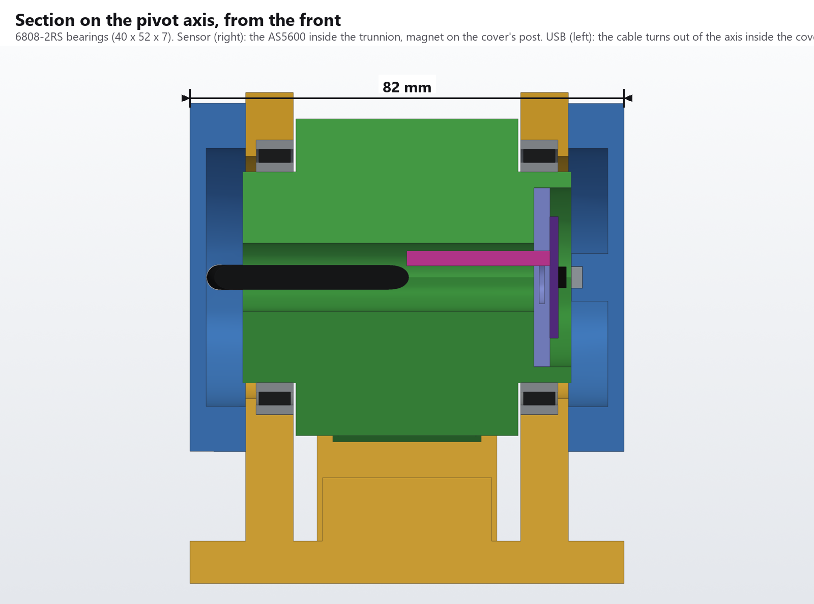
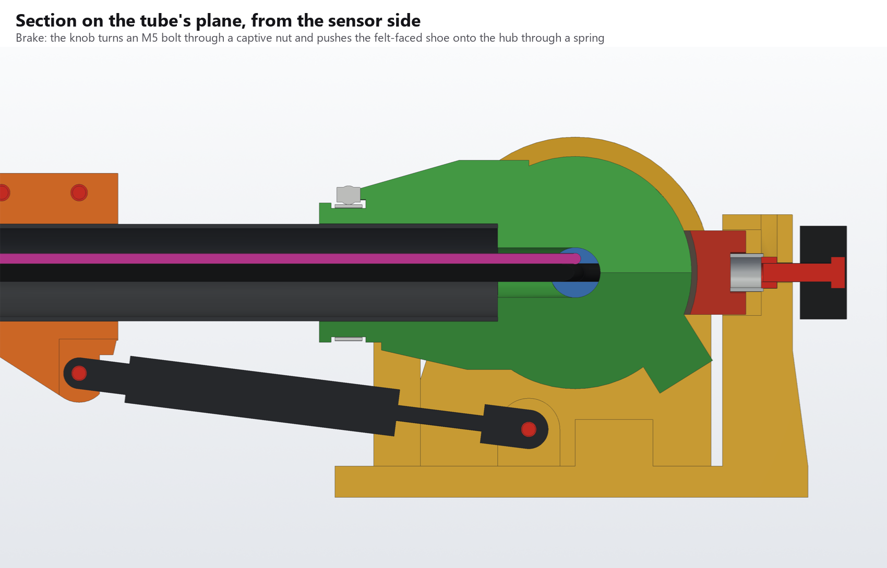

# MkIII base: narrow concept

A concept only. It isn't meant to be printed, and nothing in Rev 3 changes. The goal is a base no wider than 3.25 in (82.6 mm) along the pivot axis, against Rev 3's 130 mm, with the lever symmetrical about the tube.

## What changes

- **Lever:** the hub is cut back to 42 mm long (Rev 3: 64), centred on the tube, 3 mm past the socket boss at each end. The tube's plane moves from y = −9 to the middle. Rev 3's friction drum is gone.
- **Bearings:** 6808-2RS thin-section, 40 × 52 × 7 mm, in place of the 6006-2RS (30 × 55 × 13). The trunnions grow to 40 mm across to suit.
- **Pillow blocks and caps:** 9 mm wide (Rev 3: 17): a 7 mm bearing seat and a 2 mm lip.
- **Sensor:** the AS5600 board (23 mm square, 32.5 mm across its corners) sits inside the sensor trunnion's 34 mm bore, chip facing out. The magnet is on a post from the cover, 1 mm off the chip. Rev 3 stacks the board and magnet outside the trunnion end, which is why its cover is 15 mm deep. Here both covers are 10.5 mm deep.
- **USB cable:** the cable bends out of the axis inside the cable cover (4 mm radius) and leaves through a notch in its rim, toward the back. The notch means the cover goes on over a cable that's already fitted, like Rev 3's cover.
- **Brake:** there's no room for Rev 3's drum, shoe and knob tower beside the hub, so the brake moves behind it. A curved shoe with felt on its face slides in a pocket in a tower on the frame's back edge and presses on the hub's own 60 mm cylinder, level with the axis. The knob on the back of the tower turns an M5 bolt through a captive nut and pushes the shoe through a spring, the way Rev 3's knob loads its shoe.
- **Up-stop:** the boss moves round under the hub (contact at x 2–18 mm), so it stays clear of the shoe over the whole travel. The gas strut, collar, down-stop pillars and anchor clevis are Rev 3's, moved onto the new centre line.

The lever clears every fixed part from 0° to 32°, and meets only the up-stop pedestal past 32° (`python narrow_concept.py --check`).

## Open questions

- **Brake feel:** the shoe presses on a 30 mm radius, as Rev 3's does, but over a smaller patch (30 × 22 mm). It may need more spring force for the same drag.
- **Knob position:** the knob is at the back of the base, away from the pilot. Moving it to the side would need a right-angle drive or a cam.
- **USB bend:** the bend is 4 mm in radius, tighter than Rev 3's 6 mm. Check your cable will take it.
- **Board fit:** the board's corners clear the trunnion's bore by 0.75 mm. Measure your module first.
- **Pillow-block nuts:** the M4 nuts for the cap screws sit in 9 mm wide blocks, which leaves thin walls.

## Renders

`python narrow_concept.py` (needs cadquery, trimesh, manifold3d and pyvista) writes these to `renders/`:

