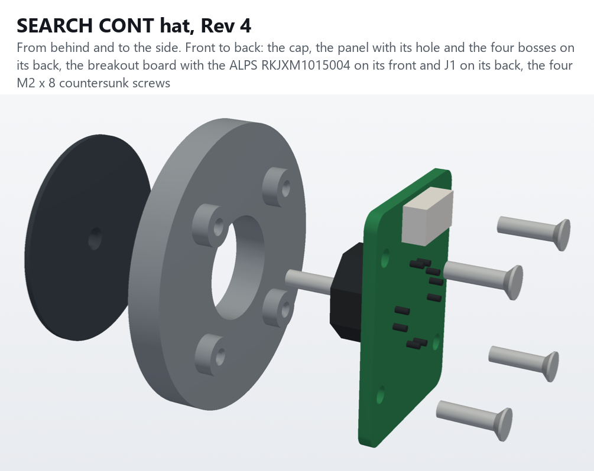
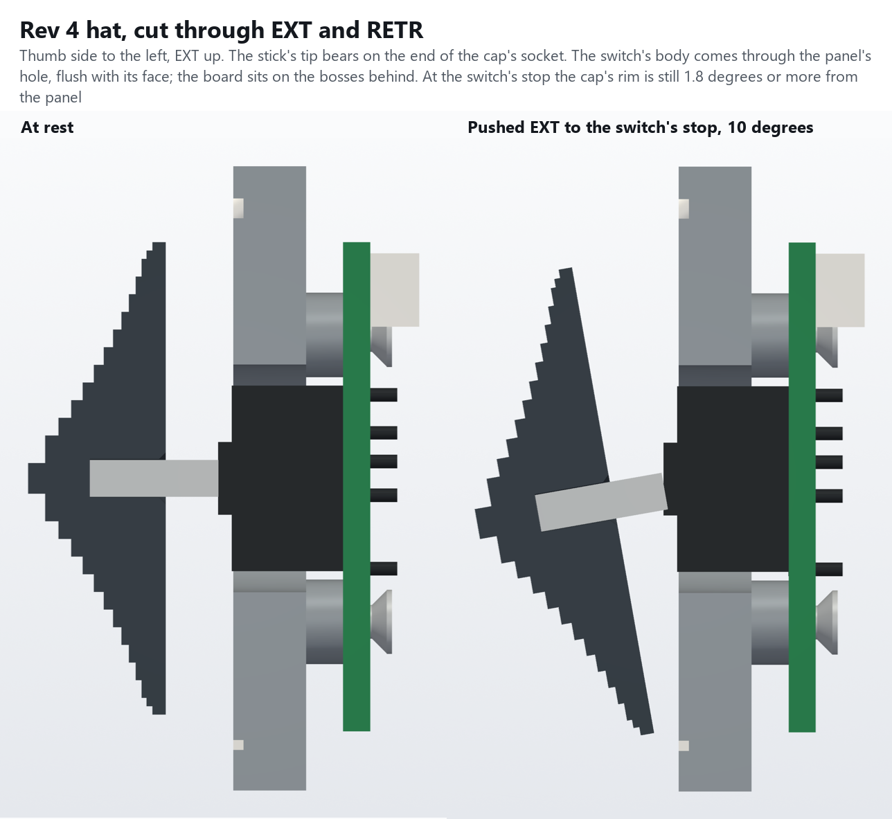
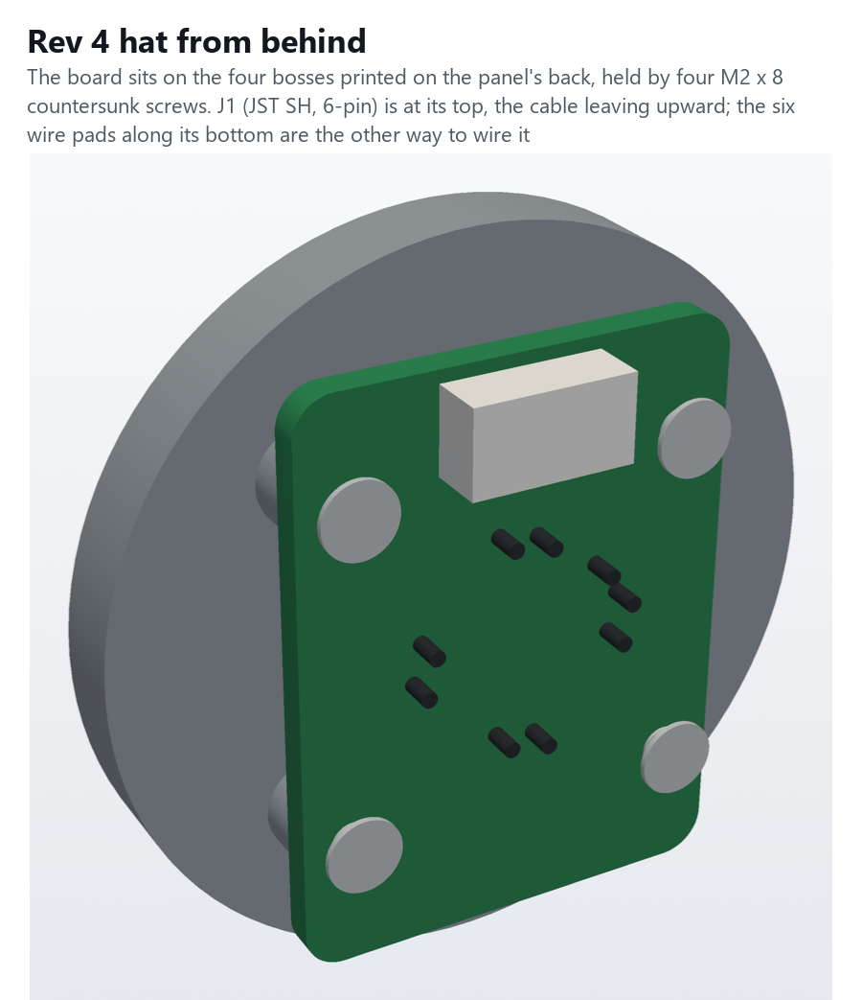

# SEARCH CONT hat: an ALPS 8-way stick on a breakout board

`python hat4_r5.py ../stl` writes the lower panel and the cap (`python ../huey_head_r5.py ../stl` writes them too, with the rest of the head). `python hat4_r5.py --check` runs the checks below, and `python render_hat4.py renders` draws the pictures. `../check_r5.py` checks the whole head with this panel and the board.

This is the head's fourth search hat, so the scripts and pictures call it hat Rev 4. The first three made the action from four tact switches with a printed rocker; they're no longer in the repository. This one buys the action. The **ALPS RKJXM1015004** is a sealed 8-direction stick switch with its own stops: 10° toward a side, 12° toward a diagonal. It also has a centre push. It sits on a small breakout board, [**SearchHat Rev 1.0**](../../PCB/SearchHat/README.md), which screws to four bosses printed on the lower panel's back. Nothing is glued. The panel prints face down without supports, because the bosses grow straight up off its back. The cap is the only other printed part.

- **8-way:** a push toward a side joins one direction, a push toward a diagonal joins its two neighbours. Opposite sides can't go in together, and nor can three: the switch can't lean two ways at once.
- **No slop:** the stick is metal, in the switch's own bearing. The board is held by four screws, and the switch's peg places it on the board.
- **Feel:** from the catalog, it takes 30 ± 20 mN·m to tilt toward a side (25 ± 20 toward a diagonal). That is about 3 N with your thumb 10 mm out from the middle, with a click. The centre push takes 3 ± 1.5 N.
- **Strength:** the stick takes 0.3 N·m. That's about 20 N on the cap's rim, so press it, don't lean on it.

## How it fits

Measured from the panel's back (its face is 2.5 mm in front):

| | |
|---|---|
| Cap | A 28 mm terraced knob after the real one, its underside 4.0 mm in front of the panel's face. Its socket is 2.3 mm across and 4.5 mm deep, and the stick's tip bears on its end |
| Stick | 2.2 mm, its tip 11.0 mm in front of the panel's back. The catalog gives 15 ± 0.4 mm from the switch's mounting face, so the cap sits 3.6–4.4 mm off the face |
| Switch | Its 11 mm body comes through the panel's 13.5 mm hole, its front flush with the face (0.1 mm proud) |
| Board | Its front on the four bosses, 4.0 mm behind the panel's back; its back at 5.6. J1 ends at 8.5 and the switch's pins at 7.2. The neck is cut to 13.5 there (`HAT_DEPTH` in `../huey_head_r5.py`) |
| Bosses | Four, 5 mm across, on the board's 17 mm square, part of the panel. Each has a 1.6 mm pilot down to 1 mm short of the face |
| Screws | M2 × 8 countersunk, from behind through the board. Each has 5.1 mm of thread in its boss and the panel |

The board's outline, holes and parts come from `PCB/SearchHat/SearchHat_Rev1.0_mech.json`, which the board's generator writes, so the panel's bosses always match the board.

## Parts

| Part | Print |
|---|---|
| `HueyHeadR5-LowerPanel-Black` / `-WhiteText` | Face down, as the upper panel (Arachne, 0.42 mm first layer: see the head's [README](../README.md#white-labels-on-a-p1s-with-ams)); no supports |
| `HueyHeadR5-Hat-Cap.stl` | Base down, as it comes: the stick's socket opens on the bed, with a lead-in for the first layer's squash |

To buy:
- **ALPS RKJXM1015004** (Mouser 688-RKJXM1015004).
- **The SearchHat Rev 1.0 board**: `PCB/SearchHat/SearchHat_Rev1.0_Gerbers.zip`. Its own README covers building it.
- **JST SM06B-SRSS-TB** for J1, and a 6-pin JST SH jumper to cut in half for the lead. Or leave J1 off and solder the wires to the board's J2 pads.
- **4 × M2 × 8 countersunk** (the AvrestYPT kit).

Wiring: the same inputs as the head's earlier tact-switch hats, so the profiles don't change. The centre push is extra.

| Signal | Board J1 pin | HeliSR J2 pin | Input |
|---|---|---|---|
| EXT (up) | 5 | 2 | IN9 |
| RETR (down) | 3 | 3 | IN10 |
| L | 6 | 4 | IN11 |
| R | 1 | 5 | IN12 |
| GND | 2 | 1 or 10 | |
| CTR (centre push) | 4 | 8 | IN15 (spare; optional) |

## Fitting it

1. Build the board ([its README](../../PCB/SearchHat/README.md#building-it)) and check it with a meter.
2. Run an M2 × 8 into each boss's pilot and back it out, to cut the thread.
3. Plug the lead into J1. Lay the board on the bosses, switch first through the panel's hole, with the "EXT" arrow on its front pointing up toward the SEARCH CONT label. Put the four screws in, and tighten them gently: they're in plastic.
4. With the panel on, route the lead straight back over the board's top edge and up into the slot to the upper box. The end of the plug is 2.2 mm below the lower box's top wall.
5. Push the cap onto the stick until the stick bottoms in the socket. If it's too tight, open the socket with a 2.2 mm drill, by hand. If it's loose, use a drop of CA glue, but then the cap won't come off again.
6. In the Configurator, check each direction, each diagonal (two buttons at once) and the centre push.

## Checked in CAD

`hat4_r5.py --check` puts the panel, the board, the switch, J1, the screws and the cap in place.
- **At rest:** nothing overlaps. The M2s overlap only their pilots, where they cut the thread.
- **Tipping:** the drawing doesn't say where the stick's pivot is. So it tries three places: the body's front, its middle and the mounting face. It also tries the stick at its shortest, 14.6 mm, which brings the cap 0.4 mm nearer the panel. For each, it tips the cap all 8 ways until its rim meets the panel's face:

| Pivot | Stick 15.0 | Stick 14.6 |
|---|---|---|
| The body's front | 16.1° | 14.5° |
| The body's middle | 15.6° | 14.1° |
| The mounting face | 15.2° | 13.8° |

The switch stops at 12° at most, so the rim never reaches the panel: there's 1.8° to spare at the worst. At 12° every way, the stick also clears the panel's hole and the cap clears the switch's body.

`../check_r5.py`: all clear, with the board, the switch, J1 and its plug and wires in place against the body, the toggles and the HeliSR board.

## Not checked

Nothing is printed or built yet. Still to check:
- the switch's real dimensions: everything here comes from the ALPS catalog's drawing, including the 0.8 mm collar in front of its body, which is read off the drawing;
- that A is EXT, as the catalog's lever drawing reads. If not, swap the inputs in the profile;
- the cap's socket on the stick: snug, loose or tight as printed;
- the M2s in the bosses' pilots.
