# UH-1 "Huey" head, Rev 5: the real panel dimensions

The collective's switch box, throttle and starter trigger. The box and both panels are cut to the real UH-1 panels' dimensions. The dimensions come from **dcval**'s scaled drawing of the panels, and the switch and label layout from **Kornskydiver**'s photos of a real UH-1 head. Both were posted in the ED Forums thread [Huey Collective Measurements](https://forum.dcs.world/topic/152333-huey-collective-measurements/); copies, with credits, are in [`reference`](reference/README.md). The switches are where the drawing has them, and everything is checked for collisions.

Rev 5 grew out of head Rev 4 (no longer in the repository), which it compares itself with below. Rev 4 had made the head one print again: the box, the neck block, the faux friction knob and the trigger mount are all one part. The throttle grip is built from the MkII grip of [DIY Helicopter Collective Hall Effect](https://www.thingiverse.com/thing:5226353) by **Gazmac52** ([CC BY 4.0](https://creativecommons.org/licenses/by/4.0/)). The friction knob's shape is measured off **hotpretzel**'s knob ([CC BY-NC](https://www.thingiverse.com/thing:4284120)): it and `HueyHeadR5-Body.stl` are for non-commercial use only. The SEARCH CONT hat is an ALPS 8-way stick switch on a small breakout board: see [`Hat/README.md`](Hat/README.md).

**Status:** designed and checked in CAD only. Nothing has been printed. The BOM in [`../BOM`](../BOM) lists Rev 5.

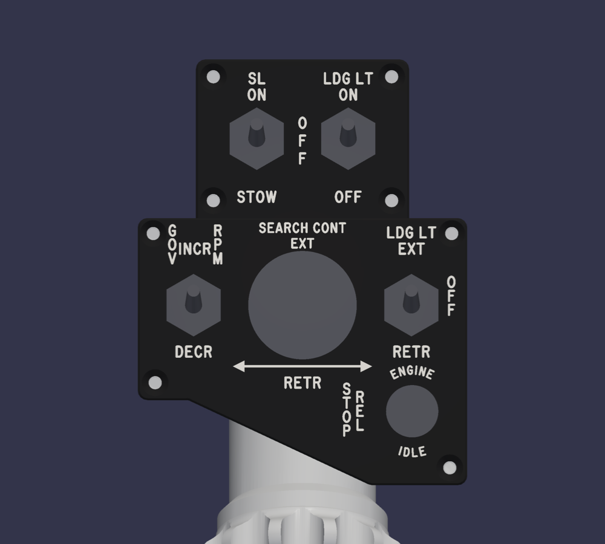

[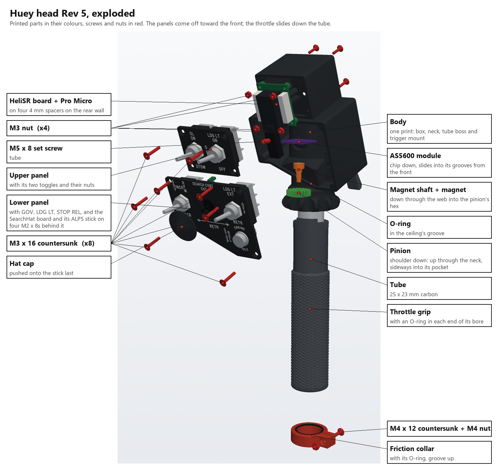](https://htmlpreview.github.io/?https://github.com/genbean/UH1-Collective/blob/main/Head/renders/HueyHeadR5_Exploded.html)

**[▶ Open the interactive version](https://htmlpreview.github.io/?https://github.com/genbean/UH1-Collective/blob/main/Head/renders/HueyHeadR5_Exploded.html)** (click the picture too): point at any part to see what it is ([the page](renders/HueyHeadR5_Exploded.html), to download and open locally).

[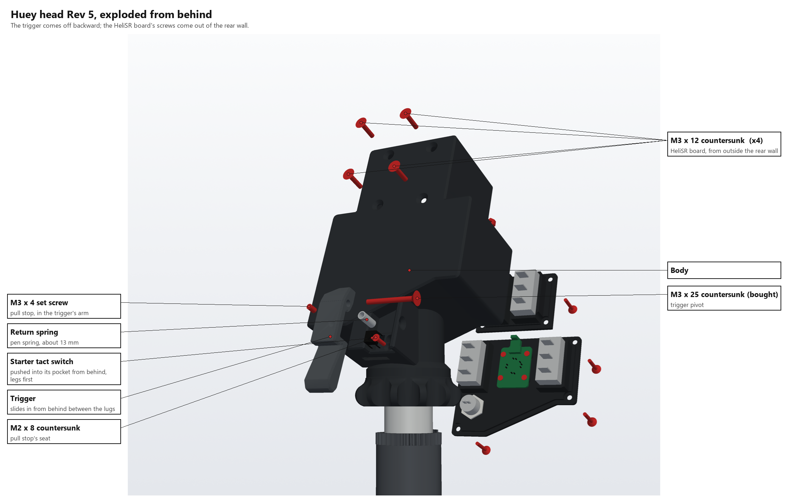](https://htmlpreview.github.io/?https://github.com/genbean/UH1-Collective/blob/main/Head/renders/HueyHeadR5_Exploded_Rear.html)

**[▶ Open the interactive version](https://htmlpreview.github.io/?https://github.com/genbean/UH1-Collective/blob/main/Head/renders/HueyHeadR5_Exploded_Rear.html)** (click the picture too): point at any part to see what it is ([the page](renders/HueyHeadR5_Exploded_Rear.html), to download and open locally).

## One piece

The box, the neck, the friction knob, the tube boss with its 25.2 mm press-fit bore and the threaded hole for the tube's set screw, the ceiling's O-ring groove, the stop groove, the pinion pocket, the AS5600 pod and the trigger mount are all one part, `HueyHeadR5-Body.stl`. Nothing holds a neck block or a trigger mount in the box: no ears, key, notch or screws.

- **Tube depth:** the tube bore is 32.7 mm deep (20 mm + 1/2 in), up a column that carries the boss on up. The tube is the whole 500 mm, uncut, as the base takes it. Its cross hole is 10 mm below its top end.
- **Tube set screw:** an M5 × 8 set screw, in a threaded hole in the boss's front, pins the tube through the front wall of its 5.2 mm cross hole. It goes in from the front with the lower panel off.
- **Printing:** the head prints on its rear wall. That leaves the neck, the knob and the tube bore about 20° off horizontal, so they need tree supports, and the press-fit bore needs a test fit (see [Printing](#printing)).

## Dimensions

| | Rev 4 | Rev 5 (real panels) |
|---|---|---|
| Lower panel | 107 × 75 mm, 50 mm on the left | **85 mm wide, 69.01 mm tall on the right, 47.03 mm on the left** |
| Its bottom edge | 15 mm flat, diagonal, 25 mm flat | **13 mm flat, a 51.8 mm diagonal, 25 mm flat** |
| Upper panel | 67 × 50 mm, 20 mm in from the left | **55 × 41 mm, 15 mm in from each side** |
| Upper box set back from the lower panel | 10 mm | 5 mm (see below) |
| Box depth | 55 mm | 55 mm |

The tube stays centred across the lower box, at the same x as in Rev 4. The box is set at the height that puts the diagonal bottom under the tube where Rev 4's was, within 0.16 mm. So the neck, the knob, the grip, the gears and the trigger keep their places on the tube.

## Switches

Positions are from the drawing, measured from each panel's top-left corner (u across, v down), in mm, with three rules:
- each panel's two toggles mirror each other about the panel's centre line: same height, same distance from each side;
- the search hat is centred between the lower two;
- the upper panel's screws are in its four corners.

| Switch | Drawn | Rev 5 | Why |
|---|---|---|---|
| GOV RPM INCR / DECR toggle | 13.4, 22.5 | 14.4, 22.5 | The drawing's 13.4 and 15.4 mm from the sides, averaged |
| LDG LT FWD / DOWN toggle | 69.6, 22.5 | 70.6, 22.5 | Its mirror image: 14.4 mm in from the right |
| SEARCH CONT hat | 42.7, 14.2 | 42.5, 22.5 | Centred between the two toggles: midway across, and at their height |
| STOP REL button (in the ENGINE IDLE ring) | 70.8, 49.9 | 70.8, 49.9 | |
| SL ON / STOW toggle (upper) | 11.2, 19.1 | 15.7, 20.5 | The LDG LT ON toggle's 15.7 mm from its side, mirrored. Nearer the side, its body hits the corner screws' columns: the bodies are 29.7 mm tall, the box is 36 mm inside, and a column fills each corner. Centred up and down the 41 mm panel, so the box round it gets 2 mm walls at the top too |
| LDG LT ON / OFF toggle (upper) | 39.3, 19.1 | 39.3, 20.5 | Centred up and down, as SL |

The labels are laid out as on the real head (the user's photo). Each one belongs to its switch, at a fixed offset from it, so it moves with the switch (`*_LABELS` in `huey_head_r5.py`):
- **GOV toggle:** GOV stacked, INCR, and RPM stacked, in a row across the top over the switch; DECR under it.
- **LDG LT toggle:** LDG LT and EXT over it, in line with GOV's row; OFF stacked down its outer side; RETR under it, level with DECR.
- **Search hat:** SEARCH CONT and EXT over its 28 mm cap; a double-headed arrow under it, from side to side; RETR below.
- **STOP REL button:** STOP and REL stacked to its left; ENGINE and IDLE round it, 0.6 mm outside the button's 17.6 mm bezel (Same Sky PB4 datasheet), so the bezel doesn't cover them.
- **Upper toggles:** SL / ON over the left one, STOW under it; LDG LT / ON over the right one, OFF under it. OFF is stacked on the centre line between them.

The labels are cut from Routed Gothic Narrow (bundled in `../fonts/routed-gothic`, SIL Open Font License 1.1), a digitized Leroy lettering template like the engraved lettering on the real panels. They are 3 mm tall (Rev 4: 3.6 mm). SEARCH CONT and EXT are 2.6 mm, and ENGINE IDLE is 2.3 mm. The font's strokes are only 0.13 × the letter height (0.31–0.40 mm), narrower than a 0.4 mm nozzle's line, and the slicer dropped pieces of them. So every letter is grown 0.1 mm all round (`STROKE_GROW`), which makes the strokes 0.5–0.6 mm, and spaced 0.2 mm further apart, so the gaps between letters stay the font's. To make room, INCR sits 0.25 mm and RPM 0.65 mm right of their old places, and GOV 0.1 mm. `check_r5.py` checks that every label clears the screw heads, the switches' nuts, the hat's cap, the STOP REL button's bezel and the panel's edge.

The lower panel's top two screws are 4 mm in from their corners (Rev 4: 4.5 mm), clear of GOV and LDG LT.

## What else changed to make it fit

| | |
|---|---|
| **Upper box** | Set back 5 mm instead of 10, so the upper toggles' 26 mm bodies end 2 mm in front of the HeliSR's Pro Micro. |
| **Upper panel screws** | In the four corners, as in Rev 4, on columns that run back to the rear wall either side of the HeliSR board. The toggles are spaced to clear them. |
| **Panel screws** | All eight are **M3 × 16 countersunk** (kit; an M3 × 20 fits too), in the same 6.4 mm columns, threaded M3 20 mm deep from the panel's back (`PANEL_THREAD`) and solid behind that. |
| **Printed threads** | Every hole a screw of M3 or larger threads into is printed with its ISO metric thread, opened 0.15 mm for FDM (`thread_cut`), so nothing needs tapping: the panel columns (M3), the tube's set screw (M5), the trigger pivot in the right lug and the pull stop in the trigger's arm (M3). The M2 holes (the SearchHat board's bosses, the pull stop's seat) are 1.6 mm pilots: the screw cuts its own thread, or tap them M2 by hand. The HeliSR's four M3 screws go through clearance holes into nuts. |
| **No air behind the neck** | The head prints on its rear wall, so any air between the neck block and that wall would print on supports, which are weaker than infill. Every piece of the neck block (the boss, the AS5600 pod, the flare, the neck and the tube's column) is carried straight back to the rear wall and capped again at its own top, square to the tube, and only then are the switches' room, the AS5600's way in, the pinion pocket's window and the leads' hole cut out of it. The USB cable goes into the tube through the 20 mm round opening in the column's lip, which is the tube's stop. |
| **HeliSR board** | The upper box is 38.5 mm tall inside, which is less than the board's 39.3 mm. The board's USB end sits 1.4 mm down in the wire slot through the floor. It is still centred across the upper box. |
| **AS5600 module** | It is square to the box (Rev 4 turned it 15°, with the pinion). Turned, its way in from the front would come out through the narrower box's right wall. The chip is still centred over the magnet. |
| **Search hat** | An ALPS RKJXM1015004 8-way stick switch on a small board ([`PCB/SearchHat`](../PCB/SearchHat/README.md)) that screws to four bosses printed on the lower panel's back, behind a 13.5 mm hole. Nothing is glued, and the panel prints without supports. Its labels sit round the 28 mm cap: SEARCH CONT and EXT over it, the arrow and RETR under it. See [`Hat/README.md`](Hat/README.md). |
| **Tube set screw** | Straight ahead, as in Rev 4: drill the tube's 5.2 mm hole through its front, 10 mm below its top end. The hat's recess in the neck opens in front of the screw's hole, so the screw goes in through it with the lower panel off. All 7.75 mm of its thread is in solid boss, with at least 2 mm of wall all round. |
| **Slot between the boxes** | 37.6 × 40.5 mm: across the upper box between its screw columns, and from the rear wall forward to 1.5 mm behind the rib the upper panel bears on (Rev 4: 25 mm deep). |
| **Lower box's upper-box joint** | The upper box reaches 1 mm down into the lower box's top wall, so the HeliSR's lower screw holes don't cut through a seam (that left the body's mesh open). |

## Room behind the switches

The neck block is cut back behind each lower-panel switch, so its body clears and its soldered wires have room. Measured from the back of the panel:

| Switch | Its body ends | Neck cut to | Room for the wires |
|---|---|---|---|
| GOV and LDG LT toggles | 26 mm (APEM 600H, lugs straight) | the rear wall: each cut runs straight back from the panel to the face the head prints on, 2.5 mm clear of the GOV toggle's sides and 1.5 mm of LDG LT's (`TOGGLE_CLR`) | all the way back. Behind LDG LT the cut starts 2 mm higher (`LDG_BACK_LIFT`), keeping 1.2 mm over the AS5600 module's hold-down tabs; at the front it takes the first 6 mm off those tabs, leaving 17 mm of their 23 |
| STOP REL (Same Sky PB4) | 15.6 mm (11.5 mm body, 4.1 mm terminals) | 17.0 mm (`PB4_DEPTH`) | 1.4 mm: any deeper comes within 1.2 mm of the pinion's pocket, right behind it. Bend the terminals over, or run the wires off them sideways |
| Search hat | 8.5 mm (the SearchHat board's J1; the switch's pins end at 7.2) | 13.5 mm (`HAT_DEPTH`) | 5.0 mm, for J1's plug and lead |

Every cut keeps at least 1.2 mm of wall to the tube bore, the set screw's hole and the AS5600 module.

**Window into the pinion pocket.** A 12 mm wide rectangular window (`POCKET_WINDOW_W`) runs from the bottom of the STOP REL recess back into the pinion's pocket, the pocket's full height. The head prints on its rear wall, so that wall is the pocket's roof on the bed. Through the window you can pick out the pocket's supports and see the pinion. It leaves the pocket's floor, its bearing hole and the web over the pinion untouched.

## Friction knob

The knob is modelled on the UH-1's throttle friction knob. Its wheel profile and flutes are measured off `throttle_friction_knob.stl` from [UH-1 Huey Helicopter Collective](https://www.thingiverse.com/thing:4284120) by **hotpretzel**, licensed under [Creative Commons Attribution-NonCommercial](https://creativecommons.org/licenses/by-nc/4.0/). So the knob, and `HueyHeadR5-Body.stl`, which carries it, are for non-commercial use only. From the bottom up:
- a 56 mm bulging wheel with 12 round flutes (11.2 mm wide, 22.35 mm radius at the bottom) cut straight down its side, leaving narrow lands between them;
- the wheel runs out into a plain 44 mm band, 4.7 mm tall, where the real one carries its THROTTLE INCREASE / FRICTION INCREASE label;
- a 45° chamfer up into the neck.

It is 22 mm tall and doesn't turn. Its top sits 1.5 mm under the sloping bottom where they come closest, at the front right. The trigger mount is solid with the knob where they meet.

## Starter trigger

**It prints with the head.** The head prints on its rear wall, so the trigger mount is laid out square to the rear wall:
- Its two lugs run back to the rear wall's plane and stand on the bed beside it.
- The faces the trigger works against are flat and bridge between the lugs.
- Nothing reaches past the rear wall, so the head lies flat.

Every edge round the rear wall's outside face, the face the body prints on, has a 1 mm chamfer (`REAR_CHAMFER`), corners included. It also relieves the first layers' elephant foot against the bed.

**How it works.** The TE 1825910-6 tact switch sits in a pocket in the mount's back face, button facing back, its cover flush with the face. The trigger hangs from its pivot just behind it.
- **Released:** the return spring holds the trigger's tail against the mount above the pivot. That's the return stop. The button is then 0.6 mm clear of the trigger's arm (`REST_GAP`), so the switch can't be held on.
- **Pulled:** the arm takes up that gap and presses the button. TE's drawing gives 0.25 mm of travel to the click, +0.20 / −0.10 mm, so anywhere from 0.15 to 0.45 mm.
- **The stop:** an M3 × 4 set screw through the arm then meets an M2 × 8 countersunk screw set flush in the mount's face (the pull stop's seat), so the stop's tip bears on steel, not plastic. It's adjustable, so it can be set to stop just after the click, whatever your switch's travel and however the print came out. A hard squeeze then bears on the mount, not on the switch.
- **At the finger:** the pad moves about 3 mm to the click and about 4.5 mm to the stop.

**Setting the stop.** Wire the switch to the HeliSR (or put a meter on its leads), then:
1. Turn the set screw in from behind the arm (1.5 mm hex key) until a full pull no longer clicks the switch.
2. Back it out until every pull clicks, then a quarter turn more (0.125 mm).

That leaves it about 0.4–0.7 mm proud of the arm. In CAD:

| Set screw out of the arm's front | Button pressed when the trigger stops | |
|---|---|---|
| 0.4 mm | 0.75 mm | every switch clicks |
| 0.6 mm | 0.58 mm | every switch clicks |
| 0.7 mm | 0.50 mm | every switch clicks, just (0.45 mm at most) |
| 0.9 mm | 0.33 mm | only switches that click by 0.28 mm |
| 1.1 mm or more | 0.16 mm or less | may never click |

Backed right out, the trigger stops on the switch itself, bottomed out.

If the starter reads on with the trigger released, the tail's front face has printed long: file it back a little.

**The leads.** The switch's legs go through two slots in the pocket's floor into a well behind it, and the well is open below. Under the mount, a groove, 3 mm wide at its mouth, runs from the well along to the right-hand lug. The groove is open along its length, and its roof slopes at 45° so it prints without supports. The right-hand lug is wider than the left to carry the hole. From the groove's end, one straight, round 4 mm hole goes up through the lug, the sloping bottom and the solid behind the boss, and comes out inside the box, beside the rear wall. It leans 8° toward the rear wall as it climbs, which keeps at least 1.2 mm of wall to the neck's bore, the AS5600 seat, the pinion pocket and the rear wall's outside all the way. It has no bends, so three 30 AWG silicone wires push straight through, and a 3.5 mm drill bit goes the whole way to clean it out (it lies nearly flat when the head prints, so its roof may sag a little).

The only bend in the route is in the open, where the leads turn from the groove into the hole. The leads can't go straight up behind the switch: the neck's bore is in front of it and the trigger behind.

## Controls, throttle and wiring

### Throttle

- **Travel:** 180° from the idle stop to full open, rolling the grip away from you (181° with the lug's 1° of slack). There is no idle return and no cutoff range: the grip stays where you leave it, held by the friction collar.
- **Stops:** the grip's 74° stop lug (15.35–17.15 mm out, 5.2 mm tall) runs in a 255° groove in the ceiling, and the groove's two ends are the hard stops.
- **Gears:** a 32-tooth grip gear drives a 20-tooth pinion, 1.6:1, so the grip's 180° is 288° at the AS5600's magnet.
- **Filled teeth:** the grip only ever turns 181°, so only about 221° of its 32 teeth can reach the pinion: the travel plus 22° either side. The other 139° is filled solid out to the tooth tips, and the stop lug stands on that. The filled part clears the pinion's tips by more than 1 mm at every angle.
- **Backlash:** each gear tooth is thinned by 0.1 mm (`BACKLASH` in `throttle_r5.py`), which leaves about 0.75° of play at the grip.

### Controls

| Panel | Control | Part | HeliSR input |
|---|---|---|---|
| Lower | GOV RPM INCR / DECR | APEM 637H/2 toggle, (ON)-OFF-(ON) | IN1 / IN2 |
| Lower | LDG LT EXT / OFF / RETR | APEM 639H/2 toggle, ON-OFF-ON | IN3 / IN4 |
| Lower | SEARCH CONT EXT / RETR / L / R | ALPS RKJXM1015004 8-way stick on the SearchHat board ([`Hat/README.md`](Hat/README.md)); a diagonal joins its two neighbours | IN9 – IN12 |
| Lower | SEARCH CONT centre push (optional) | the same switch | IN15 |
| Lower | STOP REL | Same Sky PB4-M-BK-D-67 push button | IN13 |
| Upper | SL ON / OFF / STOW | APEM 639H/2 toggle, ON-OFF-ON | IN5 / IN6 |
| Upper | LDG LT ON / OFF | APEM 636H/2 toggle, ON-ON | IN7 |
| Behind the grip | Starter trigger | TE 1825910-6 tact switch in the trigger mount | IN14 |
| Throttle | Twist grip | AS5600 module | AX4 |
| Base | Collective | AS5600 module in the MkIII base | AX1 |

IN8, IN16, AX2 and AX3 are spare, and IN15 too if the hat's centre push isn't wired.

### Wiring and programming

The throttle AS5600 goes on **AX4 (J14)** of the HeliSR Rev 4.0 board ([`PCB/HeliSR`](../PCB/HeliSR/README.md)), with **DIR to GND**. The module's pads are in two columns of through-holes on opposite edges: **VCC, OUT, GND** along one, **DIR, SCL, SDA, GPO** along the other. The pod is open above the whole board between its side rails, so wires from either column, and the DIR jumper across the back, go straight up and out of the top.

It takes four wires, **VCC, GND, SDA and SCL**, to the AX4 port (pin 1 SDA, 2 GND, 3 VCC, 4 SCL). Remove the module's R4 (1 kΩ from GPO to GND) so the chip isn't in its OUT-pin programming mode, and measure its SDA and SCL pull-ups first (see the board's README). The firmware sets the idle and full-open angles over I²C; nothing is burnt into the chip.

### The grip floats on O-rings

The grip doesn't touch the tube. It rides on four **24 mm ID × 2 mm** (28 mm OD) nitrile O-rings (FOCMKEAS, 50 for $6.89, [Amazon B0BWWBTL4N](https://www.amazon.com/dp/B0BWWBTL4N)), each stretched slightly onto the 25 mm tube:
- **Two bearings** in grooves inside the grip's bore: one 4 mm above its bottom face, one in the neck about 6 mm under the gear. The bore round them is 25.8 mm, clear of the tube (it prints about 0.25 mm under size), so the plastic only catches the grip if it's pushed hard sideways. That keeps the gear's centre within 0.2 mm of the pinion's, inside the gears' backlash. The grooves squeeze their rings 3–8 %, depending on how the bore prints. Each groove's roof is a 45° cone, so the grip still prints upright with no supports.
- **One face seal under the grip**, in the friction collar's top: it pushes the grip up.
- **One face seal over the grip**, in a groove in the head's ceiling round the tube: it pushes the grip down.

Every groove is 2.1 mm wide: at this squeeze a 2 mm ring only spreads to about 2.05 mm. The face grooves are 1.75 mm deep, so each ring stands 0.2 mm proud and is squeezed at most 11 %, when the grip's top meets the ceiling. The ceiling's ring sits in a plain pocket round the tube (r 15.6 mm, 1.75 mm deep), with no thin walls in the head, which prints on its side. What keeps the ring from spreading outward into the lug's path is a 0.8 mm rim on the grip's top face (r 14.6–15.4 mm, 1.4 mm tall) that stands up into the pocket between the ring and the lug: it prints upright, on the grip. It runs only along the gear's filled arc (139°), where the lug is: that arc never comes near the pinion, in use or as the grip slides up past it into mesh, and it stands square on the filled teeth with nothing overhanging. The stop lug grows out of the rim: r 15.35–17.15 mm (0.25 mm inside the neck bore, so the grip still goes up through it), 74° long and 5.2 mm tall, in a 255°, 5.5 mm deep groove at r 15.15–17.45. The groove's solid 105° still leaves about 4 mm of wall to the pinion pocket and pod. Grease the rings lightly with silicone grease.

## Collision check

`check_r5.py` builds every part in place and tests every pair that shouldn't touch:
- the body, both panels (the lower one with the hat's bosses), the trigger;
- the five toggles' and the STOP REL button's bodies, from their datasheets;
- the hat's board, its switch, J1 with a plug and its wires, and the four M2 screws;
- the HeliSR board, its spacers, the parts on its face, the Pro Micro and its USB-C plug.

It also checks these:
- no cut in the neck block breaks out through a wall (only the bores' open bottom and the AS5600's way in out of the open front leave the solid);
- the AS5600 module board clears every switch by 1 mm;
- every label clears the screw heads, the switches' nuts, the hat's cap and the panel's edge;
- the starter leads' 4 mm hole is open from the groove to the box, keeps 1.2 mm of wall all round, and comes out in the box's open inside;
- **the cables into the tube.** The USB-C plug (a 12 × 7 × 25 mm overmold) hangs from the Pro Micro through the wire slot, and its end goes 5.4 mm into the carbon tube's top end, through the lip's 20 mm opening.
  - Its cable (4.5 mm, a guess: Stewart doesn't publish it) bends the 20° into the tube's axis and runs down the 25 × 23 mm tube.
  - The base sensor's 3.6 mm lead comes up beside it, through the same opening 7.5 mm in front of the centre. Behind the plug works too; right beside its 12 mm sides doesn't.
  - Nothing touches, and the plug and cable keep 1 mm from the body, the tube and the HeliSR. Measured the same way, a USB-C overmold fits up to 38 mm long at 12 × 7 mm, or 35 mm at 14 × 8; measure yours.

All of it passes:

```
body x lower_panel                      0.00 mm3 OK
body x upper_panel                      0.00 mm3 OK
neck cuts outside the solid            -0.00 mm3 OK
lower panel labels clear                0.00 mm2 OK
upper panel labels clear                0.00 mm2 OK
leads hole open, groove to end     OK
leads hole 1.2 mm walls            OK
leads hole comes out in the box    OK
USB plug into the tube             OK
USB cable down the tube            OK
sensor lead beside them            OK
USB plug and cable, 1 mm clear     OK
USB-C overmold that fits           12 x 7 up to 38 mm; 14 x 8 up to 35 mm
all clear
```

The throttle grip, friction collar, pinion and magnet shaft don't overlap the body either. `Hat/hat4_r5.py --check` checks the hat's own parts and how far its cap can tip (see [`Hat/README.md`](Hat/README.md#checked-in-cad)).

Closest clearances:
- every toggle body to the box: at least 1.0 mm (to the panel screws' columns and the side walls); to the neck block: 2.5 mm for GOV, 1.5 mm for LDG LT, and 0.5 mm for the STOP REL button;
- the LDG LT FWD / DOWN toggle to the AS5600 module board: 1 mm (the module's wires are soldered straight into its holes, with no pins);
- the upper toggles to the HeliSR board and Pro Micro: 1.5 mm;
- the hat's J1 plug: its end 2.2 mm under the lower box's top wall.

The trigger, the mount and the throttle are Rev 4's, where a full mock assembly checked them:
- **The trigger's action**, turning it about its pivot: released, its tail rests on the mount and the button is clear of the arm; pulled, the arm meets the button after 0.5 mm and presses it 0.15, 0.25 and 0.45 mm at 4.0°, 4.6° and 5.6° of pull; the set screw stops it where the table under [Setting the stop](#starter-trigger) says; its top stays 1.1 mm or more under the sloping bottom up to the stop; even backed right off, it ends 5.9 mm short of the grip and the friction collar.
- **The throttle through its travel**, from the idle stop to full open (181°): the grip and pinion mesh without touching, the filled part of the grip stays clear of the pinion, and nothing touches the head or the AS5600. The lug stays inside the groove and meets the hard stops at 0° and 181°.
- **Each part goes in its own way without touching anything:** the pinion, up the neck and sideways into its pocket; the magnet shaft, in from the front and down into the pod; the AS5600 module, along its grooves; the tube's set screw, from the front; the tube, grip and collar; the trigger's pivot, from the left; the pull stop's set screw, out of the arm backward; the trigger with its spring, straight back out from between the lugs; the starter switch, back out of its pocket.

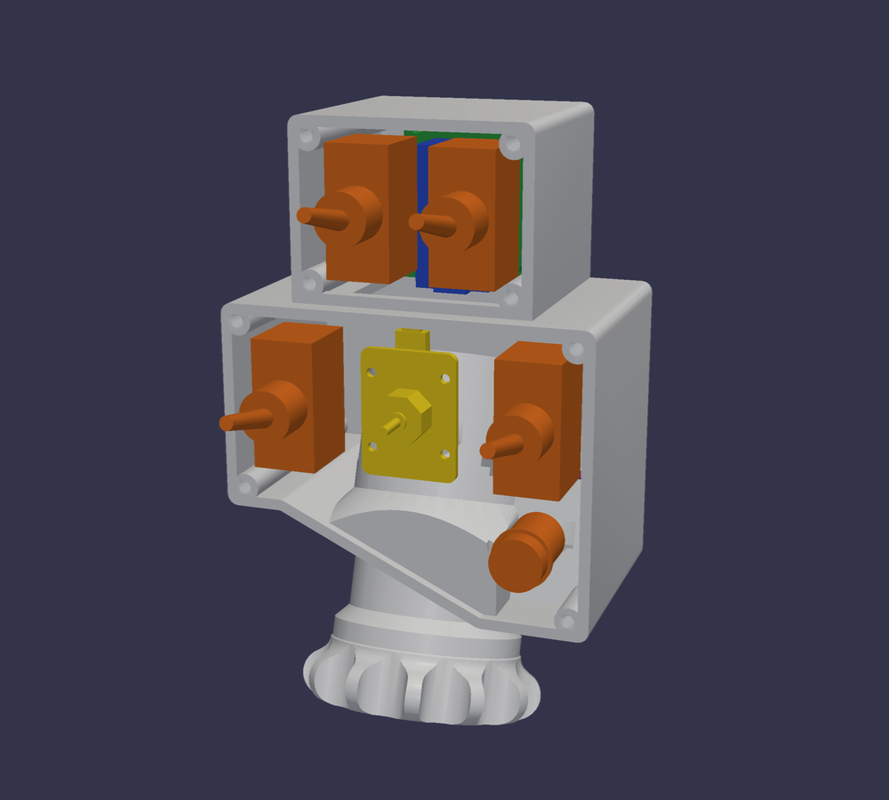

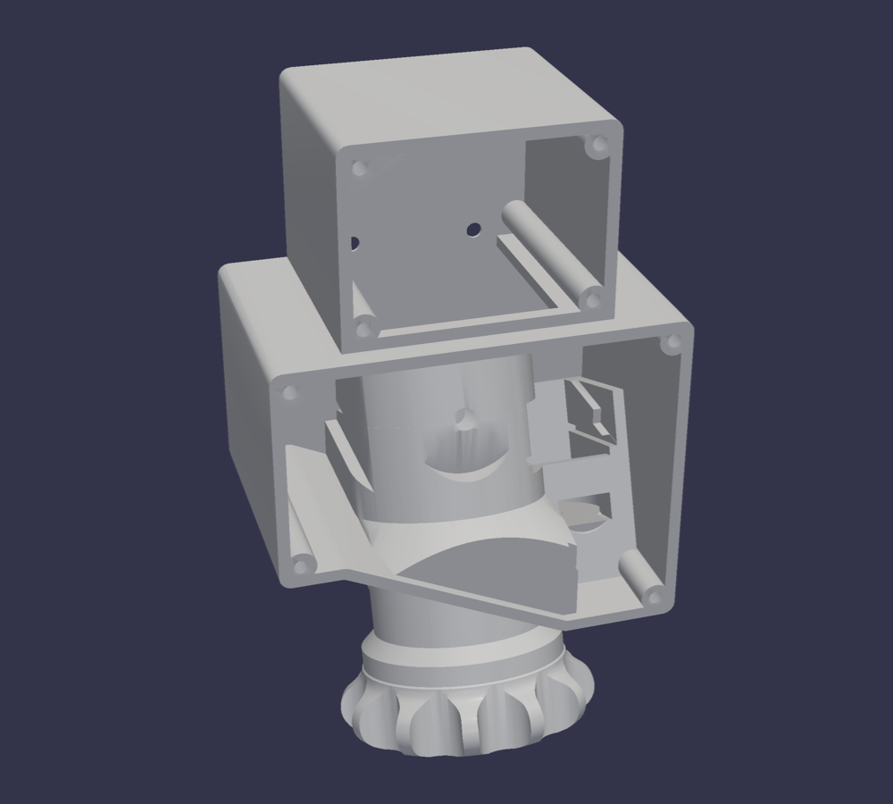

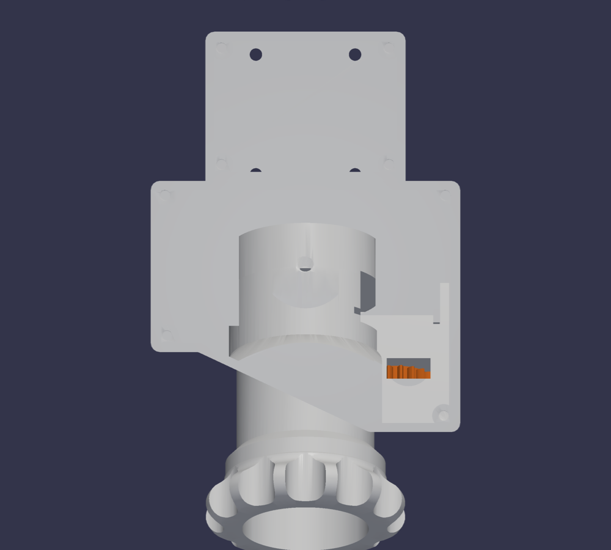

## Printing

All STLs except the hat's cap are in the head's own frame, so they open assembled. In the slicer, turn each one to its print orientation (Bambu Studio: select it, press F, and click the face named below). Use Bambu Studio's 0.20 mm Standard profile unless the table says otherwise.

| Part | File | Lay it on | Notes |
|---|---|---|---|
| **Head** | `HueyHeadR5-Body.stl` (145 cm³) | its **rear wall** (outside face) | **Tree supports**, on build plate and on the model, for the neck, the friction knob, the inside of the neck and the tube bore (they lie about 20° off horizontal), and the bridge over the wire slot. Paint them on with support enforcers if you'd rather leave the rest bare. The trigger mount needs none: its lugs stand on the bed and its faces are bridges. Keep supports out of the switch's pocket, the groove under the mount and the leads' hole. 4 walls, 25 % infill, in the filament you printed the grip bearing coupons with. |
| Lower panel | `HueyHeadR5-LowerPanel-Black.stl` + `-WhiteText.stl` (19.8 cm³, with the hat's bosses) | front face (labels) | White labels on a P1S with AMS (see below); no supports |
| Upper panel | `HueyHeadR5-UpperPanel-Black.stl` + `-WhiteText.stl` (9.2 cm³) | front face (labels) | As the lower panel |
| Hat cap | `HueyHeadR5-Hat-Cap.stl` | its flat base, as it comes | The stick's socket opens on the bed |
| Trigger | `HueyHeadR5-Trigger.stl` | either flat side | Its arm's M3 thread, for the pull stop, is printed |
| Throttle grip | `HueyHeadR5-ThrottleGrip.stl` | upright, bottom end down (gear and lug up) | Built from Gazmac52's MkII grip (`source/MkII-Grip-bore-relieved-25mm.stl`, [CC BY 4.0](https://creativecommons.org/licenses/by/4.0/)). 25.8 mm bore, clear of the tube, with two O-ring grooves inside. Their roofs are 45°, so it needs no supports |
| Friction collar | `HueyHeadR5-FrictionCollar.stl` | bottom face down (O-ring groove up) | |
| Pinion | `HueyHeadR5-Pinion.stl` | shoulder up, toothed face on the bed, as it comes | See [The pinion goes in one way up](#the-pinion-goes-in-one-way-up). The magnet shaft slides into its hex (4.6 mm across flats, 0.15 over the shaft) |
| Magnet shaft | `HueyHeadR5-MagnetShaft.stl` | cap face down | |
| Sensor seat coupon | `HueyHeadR5-SensorSeatCoupon.stl` | the same way round as it sits in the head printed on its rear wall | Optional: try your AS5600 module in it first |
| Grip bearing coupons | `HueyHeadR5-GripBearingCoupons.stl` | flat, labels up | Optional: the 25.2 ring checks the head's tube bore on the carbon tube |
| O-ring coupon | `HueyHeadR5-ORingCoupon.stl` | upright, like the grip | A 7 mm slice of the grip's bore with one O-ring groove, cut exactly as the grip's (about 2 g). Fit a greased O-ring and slide it on the carbon tube before printing the grip: it should turn with a light, even drag, with no plastic touching the tube |

`stl/ref/` holds stand-ins used by the scripts (tube, magnet, module, chip, M5 grub screw); they aren't printed.

### White labels on a P1S with AMS

The labels are recessed 0.6 mm into each panel's face. The `-WhiteText` file is a separate body that fills that recess exactly. Because the panels print face down, white is only needed for the first three layers.

1. In Bambu Studio, import the `-Black` and `-WhiteText` files for one panel together (select both files). When it asks whether to load them as a single object with multiple parts, choose **Yes**.
2. In the object list, right-click the text part and set its filament to the white slot. Leave the body on black.
3. Press **F** (lay on face) and click the panel's front face.
4. Use 0.2 mm layers with a 0.2 mm first layer. White then covers layers 1–3 and the rest is black. Leave the prime tower on.
5. The textured PEI plate gives the panels a crinkle finish like the real ones.
6. **Wall generator: Arachne** (Quality, with the Advanced switch on) and a **first-layer line width of 0.42 mm** (default 0.5). With the default Classic generator the slicer drops pieces of the letters and they print garbled. Arachne prints each stroke as one line. Confirmed on a P1S: with Arachne and these panels, whose letters are grown 0.1 mm (0.5–0.6 mm strokes), every label prints legibly.

**The tube bore.** It's drawn at 25.23 mm, the 25.2 coupon's size. The coupon printed with its axis vertical, but here the bore prints lying down, so it comes out less round and has support scars. Clean the supports out, then try the carbon tube. Ream or sand the bore until the tube presses in firmly. If it's loose, a wrap of tape on the tube's end takes up the play, and the M5 set screw holds it either way.

### The pinion goes in one way up

The pinion has full-width teeth (5.0 mm at every radius) over a plain 0.6 mm **shoulder** at one face, cut just under the root circle. (Rev 4's pinion had its tooth tips chamfered at 45° at both faces, so it fitted either way up, but those chamfers left only 3.2 mm of its 5.6 mm face at the pitch circle and 1.2 mm at the tips.) The shoulder is what clears the grip's neck, which rises 0.2 mm into the pinion's bottom face when the grip is pushed up to the ceiling. The other face has nothing near it.

- **Print it shoulder up**, toothed face on the bed, as the STL comes. The step is then on top and needs no support. The bed face has a 0.3 mm chamfer on the tips for the elephant's foot.
- **Fit it shoulder down**, toward the grip's neck, when you push it up the neck and sideways into its pocket. Fitted upside down, its teeth hit the grip's neck as the grip slides up into mesh.

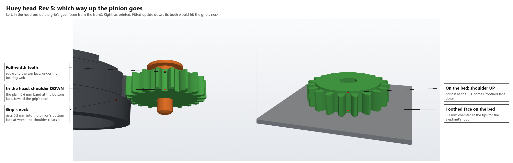

### Boxes round the toggles

Each toggle sits in a box on its panel's back, 10 mm tall (`TOGGLE_BOX_H`). The box's inside is the 15.0 × 30.4 mm recess the bodies already fit. With a box, you can drop a toggle down its bushing until its front nut is flush with the thread's end, and it can't turn as you tighten the nuts.

- **Wall thickness:** 2 mm all round (`TOGGLE_WALL`). The walls stay inside the plug's outline, so they clear the box's walls as the plug does, and they're cut back only where they meet a corner column's 7.2 mm relief. The upper toggles are centred up and down their panel (the drawing had them 1.4 mm high), so their top walls get the full 2 mm too.
- **How far each toggle drops:**
  - **Lower toggles:** they drop the full 1/4". Bend LDG LT's lugs: straight, they meet the head about 6.5 mm down.
  - **Upper toggles:** they drop 2 mm at most. Any lower and their bodies hit the Pro Micro.
- **Rear nut:** a nut on the bushing behind the panel goes in flats-to-the-long-walls. It fits if it's no more than about 14.6 mm across the flats.

STOP REL has no recess round it: its nut sits on the panel's plug. Behind the plug the head's cut leaves 1.5 mm for the nut.

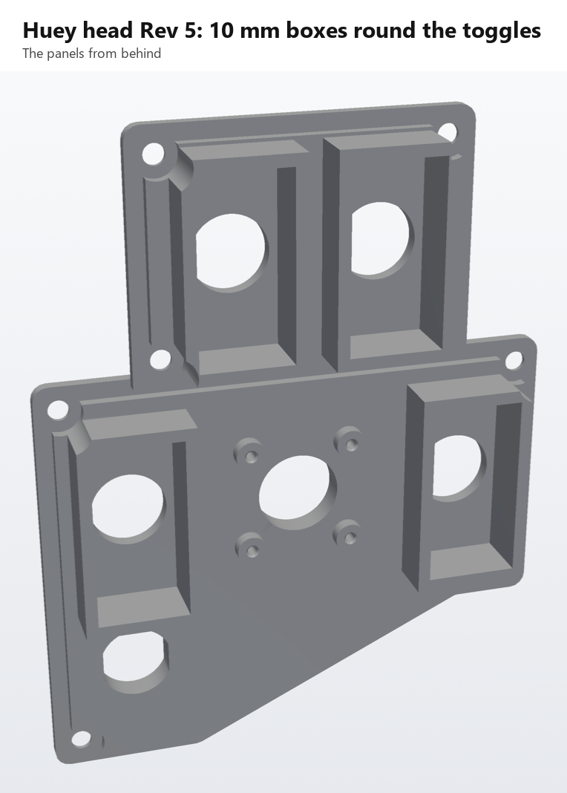

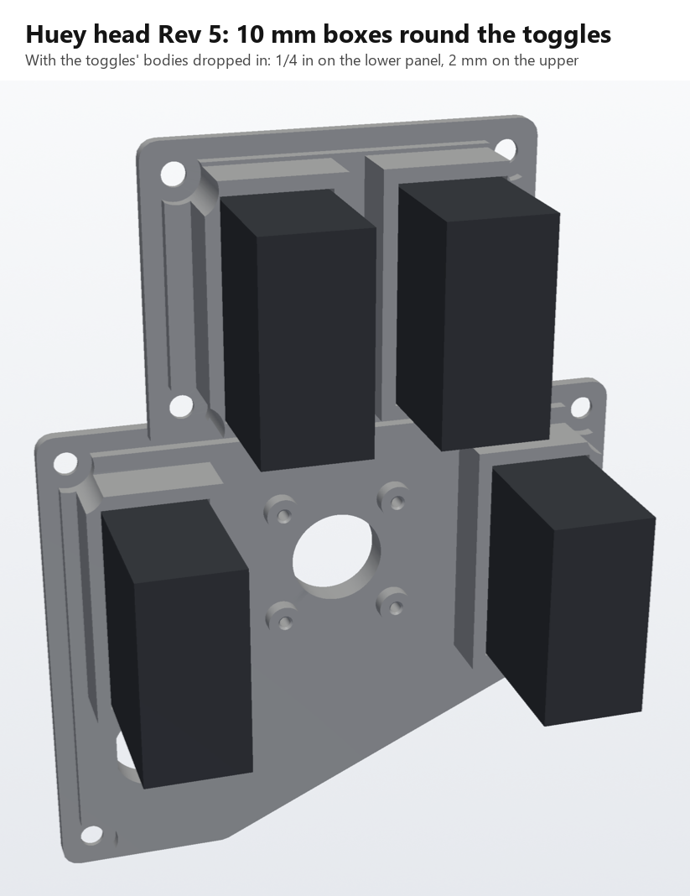

## Screws

Every screw and nut but one is from two kits: the AvrestYPT countersunk kit ([Amazon B0FMD5TMSH](https://www.amazon.com/dp/B0FMD5TMSH): M2–M4 × 8, 12, 16, 20 and M5 × 10, 12, 16, 20, with nuts) and the HIQTRADEBYJJ set-screw kit ([Amazon B0DG33R714](https://www.amazon.com/dp/B0DG33R714)). The exception is the trigger's pivot, an **M3 × 25 countersunk hex-socket screw (ISO 10642 / DIN 7991), bought separately**: the kits stop at 20 mm. The NIULUNBAO M3 countersunk set ([Amazon B0BYXS4BTF](https://www.amazon.com/dp/B0BYXS4BTF): M3 × 20–40) has it. Every M3 and M5 hole a screw threads into is printed with its thread; only the M2 holes are pilots.

| Where | Screw | Into | Qty |
|---|---|---|---|
| Lower and upper panels | M3 × 16 countersunk | the M3 thread printed in each corner column | 8 |
| HeliSR board | M3 × 12 countersunk, from outside the rear wall | through a 4 mm spacer and the board, M3 nut on the board's front | 4 |
| Tube | M5 × 8 set screw, from the boss's front | the boss's printed M5 thread; the tip goes into the tube's front hole | 1 |
| Trigger pivot | M3 × 25 countersunk (bought), from the left lug's countersink | through the trigger, 8 mm into the right lug's printed thread | 1 |
| Trigger pull stop | M3 × 4 set screw, from behind the trigger's arm | the arm's printed M3 thread; its tip meets the seat below (see [Setting the stop](#starter-trigger)) | 1 |
| Pull stop seat | M2 × 8 countersunk, head flush with the mount's face under the spring pocket | a 1.6 mm pilot (8.5 mm deep) behind a 90° countersink, tapped M2 by hand | 1 |
| SearchHat board | M2 × 8 countersunk, from behind through the board | the four bosses on the lower panel's back: 1.6 mm pilots, the screw cuts its thread | 4 |
| Friction collar | M4 × 12 countersunk, head 2 mm into one ear | M4 nut in the other ear's pocket | 1 |

Every screw and nut to scale (the ruler is 50 mm):

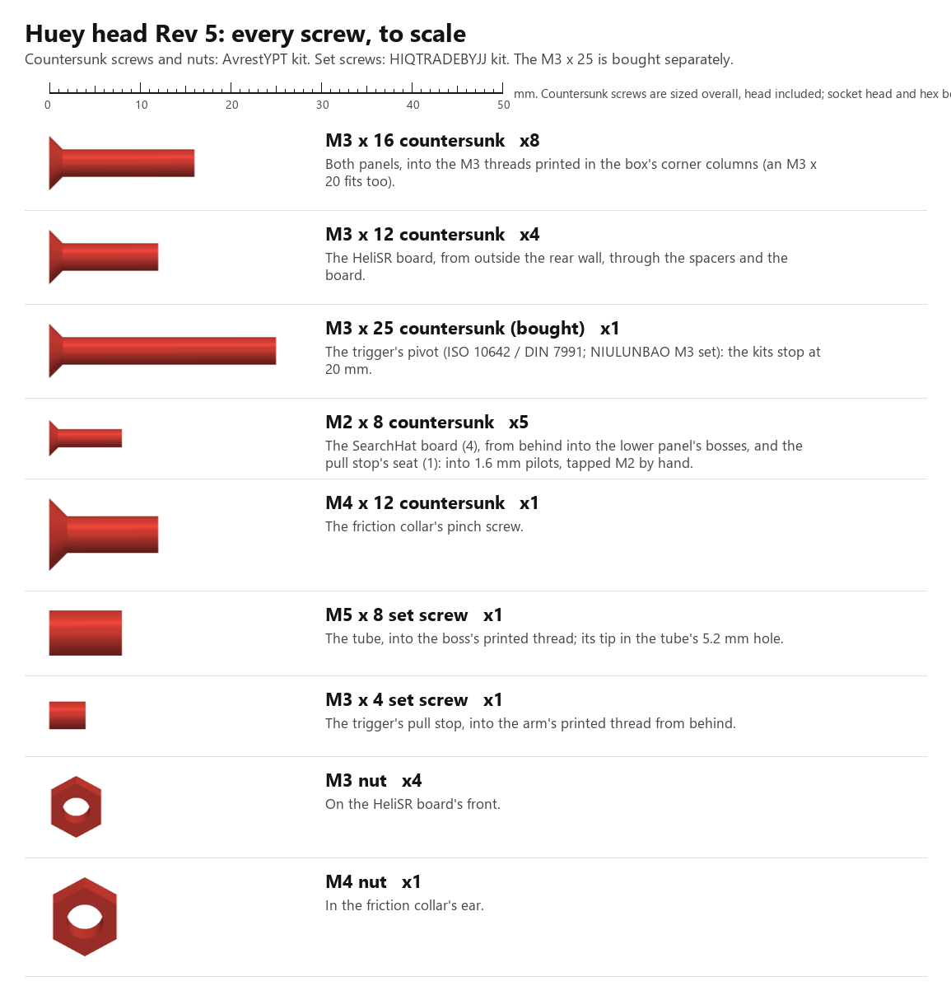

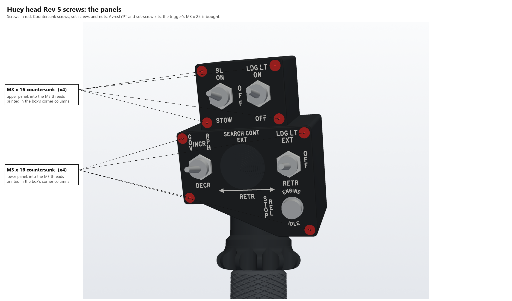

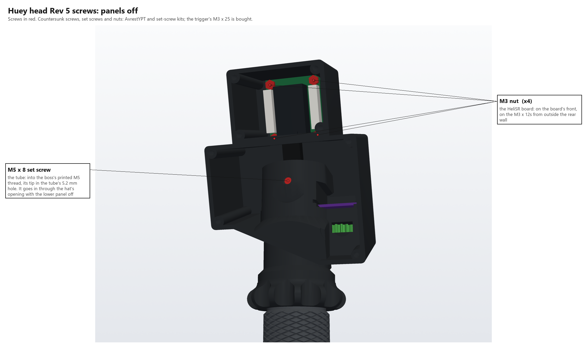

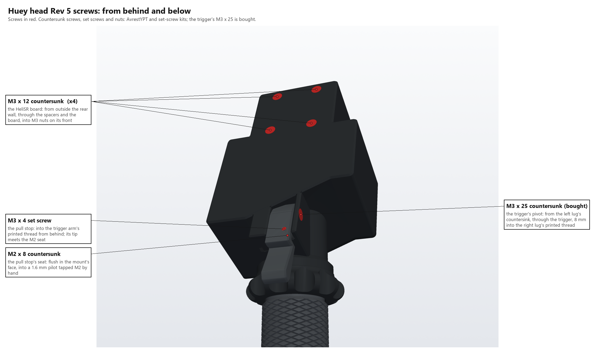

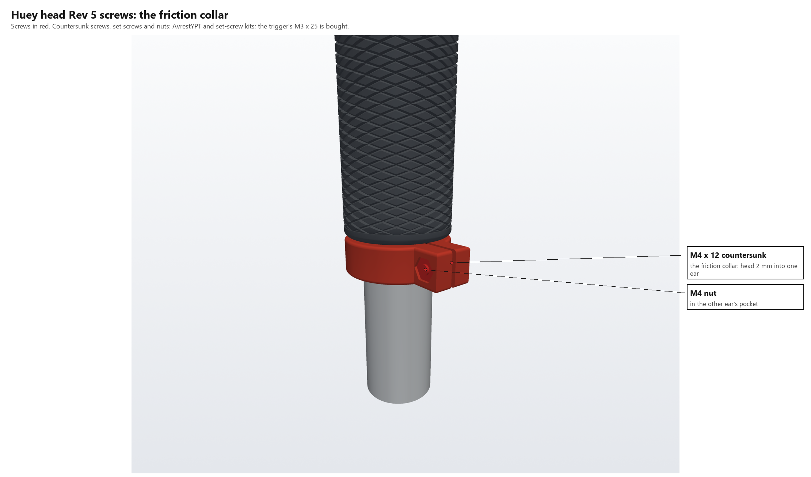

## Bought

The list for the whole collective, with part numbers and prices for the board, head and base, is in [`../BOM`](../BOM). Every screw and nut is from the two kits above, apart from the trigger's M3 × 25 countersunk pivot.

| Item | Qty | Notes |
|---|---|---|
| 25 × 23 mm carbon tube, **500 mm** | 1 | The MkIII base's tube ([`../Base`](../Base)). Use it whole, uncut, and drill a 5.2 mm hole through its **front wall only**, 10 mm below its top end, for the set screw's tip |
| Screws and nuts | | See [Screws](#screws) |
| O-ring, 24 mm ID × 2 mm (28 mm OD), nitrile (FOCMKEAS, [Amazon B0BWWBTL4N](https://www.amazon.com/dp/B0BWWBTL4N), 50 for $6.89) | 4 | Two in the grip's bore, one in the friction collar, one in the ceiling's groove. See [The grip floats on O-rings](#the-grip-floats-on-o-rings) |
| Bivar SRS-4-4MM spacers (Digi-Key SRS-4-4MM-ND) | 4 | Between the rear wall and the HeliSR board |
| Pen spring, up to 4 mm across | 1 | The trigger return (cut to about 13 mm) |
| AS5600 module (WWZMDiB, Amazon B0CM3C8KFT) | 1 | The throttle's; its ~4 × 2 mm magnet goes in the shaft's cap |
| APEM 639H/2 toggle, ON-OFF-ON (Digi-Key 679-1223-ND) | 2 | LDG LT EXT / RETR and SL ON / STOW (IN3–IN6) |
| APEM 637H/2 toggle, (ON)-OFF-(ON) (679-1219-ND) | 1 | GOV RPM INCR / DECR (IN1, IN2) |
| APEM 636H/2 toggle, ON-ON (679-1217-ND) | 1 | LDG LT ON (IN7) |
| Same Sky PB4-M-BK-D-67 push button (2223-PB4-M-BK-D-67-ND) | 1 | STOP REL (IN13) |
| TE 1825910-6 tact switch, 6 × 6 mm (450-1650-ND) | 1 | Starter trigger (IN14) |
| ALPS RKJXM1015004 8-way stick switch (Mouser 688-RKJXM1015004) | 1 | SEARCH CONT hat (IN9–IN12, centre push IN15) |
| SearchHat Rev 1.0 board, JST SM06B-SRSS-TB and a 6-pin JST SH lead | 1 | [`../PCB/SearchHat`](../PCB/SearchHat/README.md); see [`Hat/README.md`](Hat/README.md) |
| HeliSR Rev 4.0 board with its Pro Micro and JST cables | 1 | [`../PCB/HeliSR`](../PCB/HeliSR/README.md); the throttle module goes on AX4 (J14) |
| Hot glue | a dab | Holds the AS5600 module at the front of its grooves, and the starter switch in its pocket |
| Ballast, steel or lead | ~50 g | Only if the base's gas strut lifts too much |

## Assembly

With the lower panel off, everything inside the box goes in through its open front.

1. **Clean up and fit:**
   1. Remove the supports.
   2. Test-fit the tube in its bore and ream the bore to a press fit (see [Printing](#printing)).
   3. Tap the pull stop seat's 1.6 mm pilot M2 by hand. Every M3 and M5 thread is printed.
2. **Pinion:** shoulder down, put it up through the neck and slide it sideways into its pocket, toward the right and back, until its hex hole lines up under the web's bore.
3. **Magnet shaft:**
   1. Glue the magnet into its cap.
   2. Bring the shaft in through the front, over the pod.
   3. Lower it through the pod's open middle and the web. Its pin goes into the bearing hole below the pinion, and its hex slides into the pinion (a 0.15 mm clearance; a drop of glue or a wrap of tape takes up play).
4. **AS5600 module:**
   1. Remove the 0 Ω R1 and R4, tie DIR to GND with a jumper across the back of the board, and solder the four wires in from the back: VCC, GND, SDA and SCL (see [Wiring and programming](#wiring-and-programming)).
   2. Slide it chip-down into its grooves from the front of the pod, one pad column on the front edge and the other at the back, until it stops.
   3. Put a dab of hot glue at the front, and lead the wires up out of the top.
5. **Throttle stops:** nothing to fit. The grip's lug runs between the groove's two end walls, which are the idle and full-open stops.
6. **Starter trigger** (the mount is open at the back until the trigger goes on):
   1. Solder a 26–28 AWG lead, about 25 cm long, to the tips of two diagonally opposite legs of the tact switch. Diagonal legs are always the switched pair: 1 and 4, or 2 and 3, on TE's drawing. Leave the other two legs as they are.
   2. Push the switch into its pocket from behind, legs first, button out. The legs go through the slots in the pocket's floor. Draw the leads out through the open bottom of the well as it goes in. A dab of hot glue at the pocket's edge holds the switch.
   3. Lay the leads in the groove under the mount, along to the right-hand lug. Tin their ends so they're stiff, and push them up the hole at the groove's end. The hole runs straight into the box, about 60 mm. Run a 3.5 mm drill bit through it by hand first, from the groove's end, to clear any printing sag: its top end comes out right against the rear wall's inside, so a bit can't go in straight from the box side. The leads come out there and run up along the rear wall.
   4. Screw the M2 × 8 countersunk into the pull stop's seat, its head flush with the mount's face.
   5. Turn the M3 × 4 set screw into the trigger's arm from behind, until it's flush with the arm's front.
   6. Drop the return spring into its pocket in the mount. Any pen spring up to 4 mm across will do; trim it to about 13 mm if it's long.
   7. Slide the trigger in from behind between the lugs, pressing the spring in. Fit the M3 × 25 countersunk pivot from the left, through the trigger, into the right-hand lug.
   8. Set the stop: see [Setting the stop](#starter-trigger).
7. **Tube:**
   1. Use the carbon tube whole (500 mm, uncut) and drill its 5.2 mm cross hole.
   2. Grease the four O-rings lightly. Roll one into each groove inside the grip. Slide the friction collar on (groove up), roll an O-ring down the tube into the collar's groove, then slide the grip on (gear up). Roll the fourth O-ring onto the tube just above the grip: the groove in the head's ceiling takes it as the head goes on.
   3. Route the USB cable and the base sensor's lead up through the tube.
8. **Head onto the tube:**
   1. Thread the cables through the lip.
   2. Press the head down onto the tube until the tube stops at the lip, rocking the grip a few degrees so its gear meshes with the pinion. Turn it until the tube's cross hole lines up with the hole in the boss's front.
   3. Turn the M5 × 8 set screw into the boss's front until its tip is in the tube's hole, about 1.4 mm under the boss's surface. Keep the cables clear of the hole inside the tube.
9. **Friction:** push the grip up until it meets the head. It stops softly on the ceiling's O-ring. Slide the friction collar up until the O-rings give the feel you want, and tighten its M4 × 12.
10. **HeliSR board:**
    1. Plug the Pro Micro into its sockets.
    2. Fit the board upright in the upper box, components to the front, USB end down, on four M3 × 12 screws from outside the rear wall and through the spacers. The nuts go on the front.
    3. Bring the USB cable up through the wire slot and plug it in from below.
11. **Switches and wiring:**
    1. Fit the toggles into their boxes and the STOP REL button into the lower panel, and screw the SearchHat board to the lower panel's bosses (see [`Hat/README.md`](Hat/README.md#fitting-it)).
    2. Wire everything to the board (see [Controls](#controls)): the AS5600 to AX4 (J14), the hat's lead to J2, the starter to IN14.
12. **Panels:** screw them on, M3 × 16 countersunk into the corner columns, then push the hat's cap onto the stick.

## Regenerating

From this folder:

```
python huey_head_r5.py stl
python throttle_r5.py source/MkII-Grip-bore-relieved-25mm.stl stl
python check_r5.py
python Hat/hat4_r5.py --check
python Hat/render_hat4.py Hat/renders
```

`huey_head_r5.py` writes the body, both panels, the trigger, the sensor seat coupon and the hat's cap (the lower panel and the cap come from `Hat/hat4_r5.py`, which also reads the SearchHat board's outline from `../PCB/SearchHat/SearchHat_Rev1.0_mech.json`). It needs `numpy`, `trimesh`, `manifold3d` and `fonttools`; the labels use Routed Gothic Narrow from `../fonts`. `throttle_r5.py` writes the grip, collar, pinion, magnet shaft and the coupons, and also needs `cadquery`; the coupons' labels use Windows' Bahnschrift. The renders need `pyvista` and `pillow`.

Every image in `renders/` comes from [`../renders/make_diagrams.py`](../renders/make_diagrams.py), which reads the collective's assembly GLB (`../renders/HeliCollective_Assembly.glb`): the exploded views, screw maps, the pinion and toggle-box diagrams, and the assembled views on navy (`HueyHeadR5_Front`, `_Inside`, `_Body`, `_PocketWindow`, in `head_scenes()`). It builds the search hat (the lower panel, the board, the switch, its screws and the cap) from `Hat/hat4_r5.py` in place of the GLB's. When another part changes, put its new mesh into the GLB (head frame to the collective's: `TO_HEAD` in `make_diagrams.py`, inverted) and re-run the script.

Settings you're likely to change in `huey_head_r5.py`:
- the outline: `PANEL_W`, `PANEL_HR`, `PANEL_HL` and `DIAG_U`, and the upper box: `UX0`, `UX1`, `UZ1` and `UY`;
- the switch positions: `GOV`, `SEARCH`, `LDG_EXT`, `STOP_REL`, `SL` and `LDG_ON`, and the labels in `lower_labels()` and `upper_labels()`;
- the friction knob: `KNOB_*`;
- the module's grooves: `GROOVE_H`, `BOARD_CLR`;
- the tube bore: `TUBE_BORE`;
- the starter trigger: `REST_GAP` (button to arm, released), `TACT_*`, `LEAD_*`.

## Not done yet

- Nothing is printed. Print the coupons first: the sensor seat, the grip bearing rings (the tube bore) and the O-ring slice.
- The base's balance: Rev 5's body is about 21 cm³ lighter than Rev 4's (145 against 166 cm³). Check the gas strut's lift with the head on.
