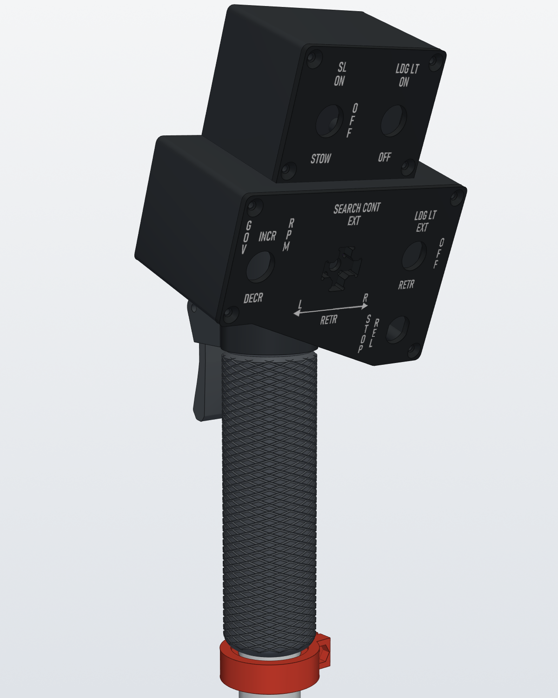
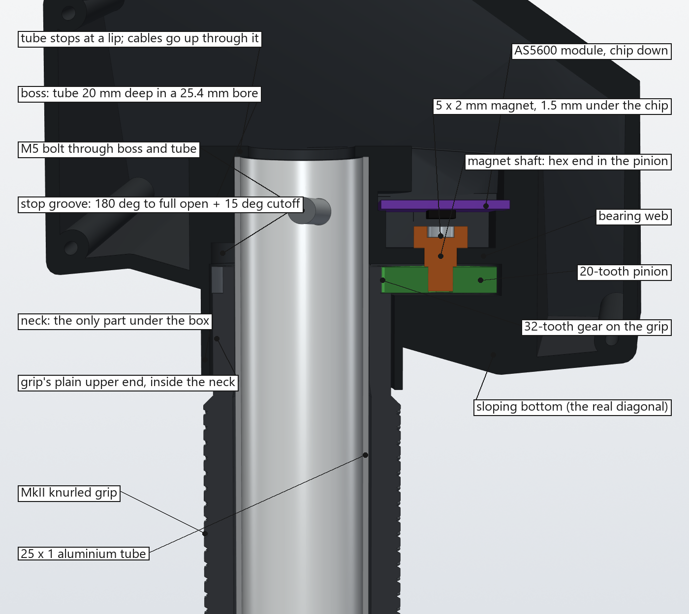
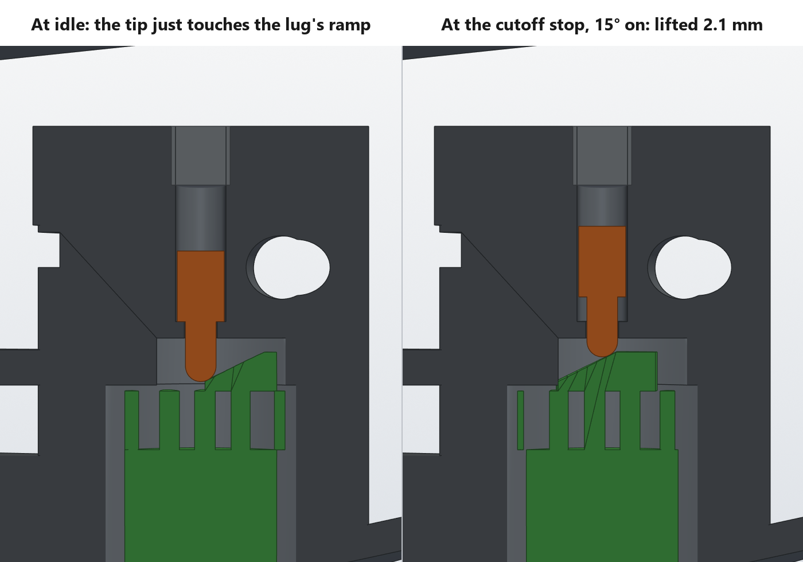
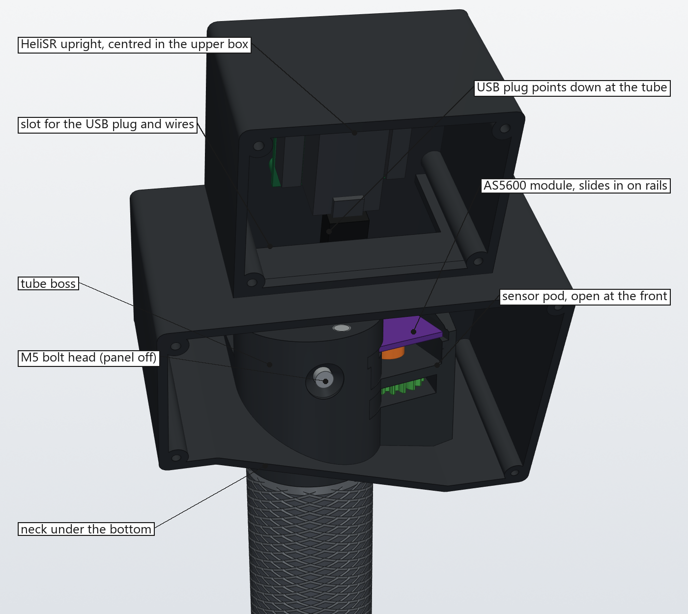
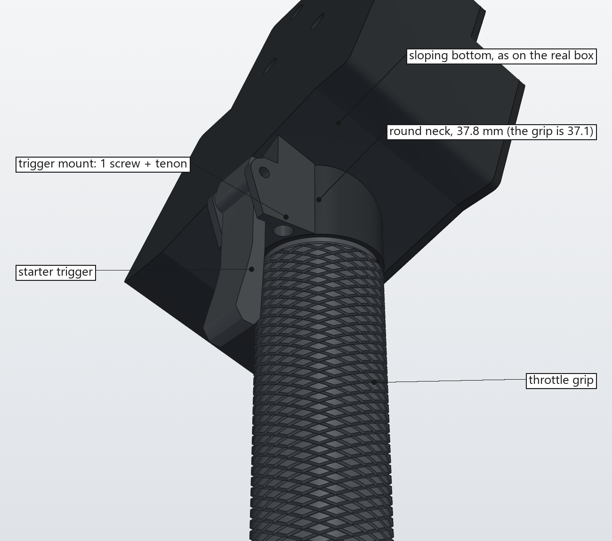
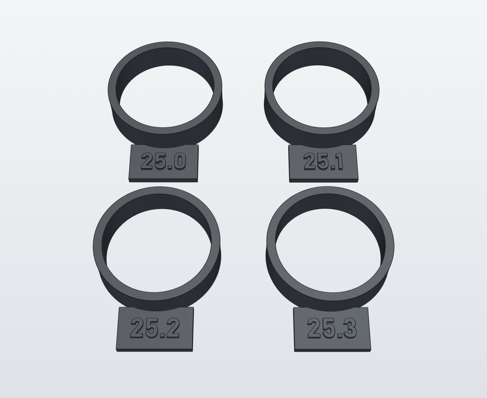

# UH-1 "Huey" head, Rev 2: the real box, straight onto the tube

A UH-1H style collective switch box with the twist-grip throttle, for the MkIII base (`../Base`). Like the real one, the switch box is tilted up 20° from the tube.

In Rev 1 the whole head hung on the MkII tube top's two small printed posts and two M3 screws, through a neck adapter that added a box section the real head doesn't have. Rev 2 goes back to the real box:

- **The real outline.** The lower box follows the real lower panel all the way round, so its bottom is the panel's diagonal edge. There's no box section under the diagonal, no head pot and no extra push buttons. The box is 55 mm deep, which leaves room inside it for everything that joins the head to the tube.
- **The tube goes straight into the head.** The 25 mm tube (the MkIII Rev 3 base's 25 × 23 mm carbon tube) runs up through the throttle grip and a short round neck into a boss inside the box. It goes 20 mm into the boss, and an **M5 bolt goes right through boss and tube**.
- **Only the neck shows under the box.** The neck is the grip's size (37.8 mm; the grip is 37.1). It shows 3 mm at the front right and 24 mm at the back left, where the bottom slopes up. The starter trigger hangs behind it.
- **The throttle is read by an AS5600 through a pair of gears, inside the box.** The grip turns on the tube itself. Its plain upper end runs up inside the neck into the box, and a 32-tooth gear on top drives a 20-tooth pinion beside the boss. The pinion turns the magnet under the AS5600 module.



`renders/HueyHead_Rev2_Assembly.glb` is the whole head with the grip, friction collar, gears, sensor, a stand-in for the HeliSR board and a length of tube, in place and coloured. It opens in Windows 3D Viewer or any glTF viewer.

## How it works



| | |
|---|---|
| **Box** | The lower box is the lower panel's outline carried straight back to the rear wall, 55 mm deep. The upper box sits on it, 20 mm in from the left and set back 10 mm, and shares the rear wall. Each panel has a raised plug on its back that drops inside the box walls, so side knocks go into the walls rather than the screws. The panels sit flush with the box sides. |
| **Tube clamp** | The tube comes up through the neck into a 25.2 mm bore in the boss (`TUBE_BORE`, the 25.2 coupon's size: a press fit, so push the head on firmly), 20 mm deep, to a lip. An M5 × 40 countersunk bolt crosses boss and tube front to back, 10 mm below the tube's end. Its head sits in the boss's front face, which you reach with the lower panel off, and its nut drops into a slot from the top of the boss, behind the tube. The boss is moulded into the box's floor and rear wall, and solid behind the tube down to the floor. The boss prints on its side with supports in the bore, so it can come out a little tighter or oval compared with the upright coupons: clean it up until the tube presses in without forcing it. |
| **Cables** | The USB cable and the base sensor's lead come up the tube and out through a 20 mm opening in the lip. The bolt crosses the tube under them: route the cables before you fit it, one each side. |
| **Grip** | The whole 120 mm MkII grip, so your hand has the same length to hold as on Rev 1, ending 1 mm under the neck. Its old top cap (with the post slots and the spline socket) is bored out to the tube. Above it come a plain 33.4 mm section that runs up inside the neck, a 32-tooth module 1 gear and a 30° stop lug. The grip turns on the bare tube and, like your relieved MkII grip, bears on it only at its two ends: 21 mm at the bottom and the top 22 mm, under and through the gear. Both are bored to one size, `BEARING_D` in `throttle_r2.py`: 25.3 mm, which the bearing coupons below showed turns freely without rock on your tube. Everything between is relieved to 26.2 mm, so the MkII's old top bearing is now relief too. |
| **Travel** | As on the real UH-1: **180° from idle to full open**, rolling the grip away from you to open (clockwise looking down the tube from the head, counterclockwise seen from behind), and a **15° cutoff range past idle**. The lug runs in a 225° groove in the boss's underside, with hard stops at full open and at cutoff that bear on the boss, not the gears. |
| **Idle gate** | The real throttle's idle stop is held by a solenoid that the IDLE REL button releases. Here a spring-loaded plunger stands in the boss just past the lug at idle, its tip down in the groove. The lug's closing face is a ramp. Rolling past idle lifts the plunger against its spring, so you push through a firm gate into the cutoff range, and when you let go it pushes the grip back to idle. A pen spring and an M5 set screw above the plunger set how firm it is. STOP REL on the panel is the idle release button, wired to IN13. |
| **Friction** | A split collar under the grip, clamped with an M4 screw, carries a 25 × 3 mm O-ring in its top face that presses the grip up against the boss. To set the friction, slide the collar up and tighten the screw. |
| **Sensor** | The 20-tooth pinion sits in a pod beside the boss, 26 mm from the tube, and turns 1.6 times as far as the grip: the grip's 195° from cutoff to full open is 312° at the magnet. The magnet shaft drops through a bearing web over the pinion and presses into the pinion's hex hole. Its cap rests on the web and holds the 5 × 2 mm magnet 1.5 mm under the AS5600 module. The module lies chip-down on two rails in the pod, turned to face the tube, and slides in on them from the front through a 3 mm slot in the side of the boss. The pod is open above the module (outside the boss), so the magnet shaft drops in from above and the module's wires go straight up. |
| **AS5600 wires** | Up out of the pod's open top, across the back of the lower box, up through the wire slot and along the HeliSR's left edge to AX4 (J14). Slide the module in with its pin row on the edge away from the tube: that edge is clear above for 13 to 40 mm along most of its length. |
| **Trigger** | The trigger mount sits against the back of the neck, under the sloping bottom, and ends level with the neck's bottom edge, so it stays clear of the grip. A tenon on its top fits a mortise in the bottom, and one M3 screw from below holds it up into the body. The trigger hangs from it 8.5 mm behind the grip, where the index finger sits when the thumb is on the panel, and the tact switch's leads go up a channel into the box. A pen spring holds it released, and stops on both sides limit its swing. |
| **HeliSR board** | The board stands upright on the rear wall, centred in the upper box, with the USB end down: the Pro Micro's plug points down through the floor at the tube's top end. Seen from the front: J1, AX3 and AX4 up the left edge, J2, AX1 and AX2 up the right edge, PROG4, RST and PROG1 along the top. The Pro Micro sits between the upper box's two toggles, and the JST connectors are behind the toggles' solder tabs. Four M3 screws hold it from outside the rear wall, through 4 mm spacers. |
| **Wire slot** | One slot through the floor between the boxes, from the upper box's left panel-screw column to its right one and 25 mm forward from the rear wall. The USB plug and every wire from the lower box come up through it. |







**Backlash.** The gear teeth are thinned by 0.1 mm each, which leaves about 0.75° of play at the grip when you reverse direction. If your printer prints the teeth fat and they bind, raise `BACKLASH` in `throttle_r2.py`; if there's too much play, lower it.

## Controls

The labels follow the real panel.

| Panel | Control | Part | HeliSR input |
|---|---|---|---|
| Lower | GOV RPM INCR / DECR | APEM 637H/2 toggle, (ON)-OFF-(ON) | IN1 / IN2 |
| Lower | LDG LT EXT / OFF / RETR | APEM 639H/2 toggle, ON-OFF-ON | IN3 / IN4 |
| Lower | SEARCH CONT EXT / RETR / L / R | MkII 4-way hat (4 × TE 1825910-6) with the Huey search hat | IN9 – IN12 |
| Lower | STOP REL (the idle release) | Same Sky PB4-M-BK-D-67 push button | IN13 |
| Upper | SL ON / OFF / STOW | APEM 639H/2 toggle, ON-OFF-ON | IN5 / IN6 |
| Upper | LDG LT ON / OFF | APEM 636H/2 toggle, ON-ON | IN7 |
| Behind the grip | Starter trigger | TE 1825910-6 tact switch in the trigger mount | IN14 |
| Throttle | Twist grip | AS5600 module | AX4 |
| Base | Collective | AS5600 module in the MkIII base | AX1 |

IN8, IN15, IN16, AX2 and AX3 are spare.

The toggles are full-size APEM 600H switches in 12.2 mm holes. Fit them with the long side of the body upright so the levers throw up and down; the panel plugs have reliefs for the bodies. On the upper box's two toggles you can bend the ¼" tabs over 90°, flat against the body, for more room: straight, they clear the JST plugs' wires by about 2 mm; bent, by 8 mm.

## Parts

All STLs are in the head's own frame, so they open assembled. Turn each one to the print orientation below in the slicer (Bambu Studio: select it, press F, click the face).

| Part | File | Print on | Notes |
|---|---|---|---|
| Body | `HueyHead-Body.stl` | its rear wall (outside face) | **Supports, everywhere, tree:** inside the neck and the tube bore (with the body on its rear wall they lie about 20° off horizontal), under the back of the neck, and the wire slot's front edge (a 50 mm bridge). Everything else is open to the top or bridges a few mm. Clean the tube bore up so the tube slides in. |
| Lower panel | `HueyHead-LowerPanel-Black.stl` + `-WhiteText.stl` | front face (labels) | The real outline; 4 corner screws. Black and white: see below |
| Upper panel | `HueyHead-UpperPanel-Black.stl` + `-WhiteText.stl` | front face (labels) | 4 screws. Black and white: see below |
| Trigger mount | `HueyHead-TriggerMount.stl` | its flat bottom (the lugs point up) | Sits behind the neck |
| Trigger | `HueyHead-Trigger.stl` | either flat side | |
| Search hat | `HueyHead-SearchHat.stl` | its flat bottom ring | Ringed Huey-style knob that glues over the MkII thumbstick |
| Throttle grip | `HueyHead-ThrottleGrip.stl` | upright, bottom end down (gear and lug up) | No supports |
| Friction collar | `HueyHead-FrictionCollar.stl` | bottom face down (O-ring groove up) | |
| Pinion | `HueyHead-Pinion.stl` | flat | The hex hole is printed at size: the magnet shaft presses in |
| Magnet shaft | `HueyHead-MagnetShaft.stl` | cap face down (magnet pocket on the plate), shaft up | |
| Idle plunger | `HueyHead-IdlePlunger.stl` | body end down, tip up | 4 mm body, 2.6 mm round tip |
| Bearing coupons | `HueyHead-GripBearingCoupons.stl` | flat, labels up, as they lie | Print these first: see below |

Also print the MkII 4-way hat parts from the original project's head files: `4way_Cover`, `Bezel`, a `ThumbStick` and `StickRetainer`.

The printed screw holes are 2.5 mm pilots: tap them M3 before assembly.

### White labels on a P1S with AMS

The labels are recessed 0.6 mm into each panel's face. The `-WhiteText` file is a separate body that fills that recess exactly. Because the panels print face down, white is only needed for the first three layers.

1. In Bambu Studio, import the `-Black` and `-WhiteText` files for one panel together (select both files). When it asks whether to load them as a single object with multiple parts, choose **Yes**.
2. In the object list, right-click the text part and set its filament to the white slot. Leave the body on black.
3. Press **F** (lay on face) and click the panel's front face.
4. Use 0.2 mm layers with a 0.2 mm first layer. White then covers layers 1–3 and the rest is black. Leave the prime tower on.
5. The textured PEI plate gives the panels a crinkle finish like the real ones.

### Bought

The list for the whole collective, with part numbers and prices for the board, head and base, is `../BOM/Heli_Collective_Final_BOM.xlsx`.

| Item | Qty | Notes |
|---|---|---|
| 25 × 23 mm carbon tube, **470 mm** | 1 | The MkIII Rev 3 base's tube (`../Base`): buy 500 mm, roll-wrapped, and cut it to 470. Drill it 5.2 mm straight through, front to back, 10 mm below its top end (the base's README has the M4 lock hole at the bottom end). The grip bearing and boss bore were sized on a 25 mm aluminium tube: check them on the carbon tube with the bearing coupons. |
| M5 × 40 countersunk (DIN 7991) + M5 nut | 1 | Head in the boss's front face, nut in the slot at the back |
| M4 × 16 socket cap + M4 nut | 1 | Friction collar pinch screw |
| O-ring, 25 mm ID × 3 mm, nitrile | 1 | In the friction collar's groove; a felt washer also works |
| AS5600 module (WWZMDiB, Amazon B0CM3C8KFT) | 1 | The second one, for the throttle; its 5 × 2 mm magnet goes in the shaft's cap |
| M3 × 12 socket cap | 1 | Trigger mount, from below |
| M3 × 25 | 1 | Trigger pivot: through the left lug and the trigger into the right lug's tapped pilot. The lugs' outer faces are 22.5 mm apart, so its tip stands 2.5 mm out of the right lug (an M3 × 20 would reach only 0.5 mm into it) |
| M3 × 10 countersunk | 8 | Panels, 4 each |
| M3 × 12 countersunk + M3 nut (5.5 mm across flats), Bivar SRS-4-4MM spacers (Digi-Key SRS-4-4MM-ND) | 4 | HeliSR board, from outside the rear wall through a spacer and the board |
| Pen spring, up to 4 mm across | 2 | One for the trigger return: its pockets' ends are 9.6 mm apart, so cut it to about 13 mm. One for the idle gate: cut it to about 8 mm. |
| M5 × 5 set screw | 1 | Holds the idle plunger's spring; tap the top of the plunger's bore M5 (it's the 4.2 mm tap-drill size) |
| APEM 639H/2 toggle, ON-OFF-ON (Digi-Key 679-1223-ND) | 2 | LDG LT EXT / RETR and SL ON / STOW (IN3-IN6) |
| APEM 637H/2 toggle, (ON)-OFF-(ON) (679-1219-ND) | 1 | GOV RPM INCR / DECR (IN1, IN2) |
| APEM 636H/2 toggle, ON-ON (679-1217-ND) | 1 | LDG LT ON (IN7) |
| Same Sky PB4-M-BK-D-67 push button (2223-PB4-M-BK-D-67-ND) | 1 | STOP REL, the idle-gate release (IN13) |
| TE 1825910-6 tact switch, 6 × 6 mm (450-1650-ND) | 5 | SEARCH CONT hat (IN9-IN12) and starter trigger (IN14) |
| HeliSR Rev 3.0 board with its Pro Micro and JST cables | 1 | `../PCB/HeliSR_Rev3.0`; the throttle module goes on AX4 (J14) |
| Ballast, steel or lead | ~50 g | Only if the base's gas strut lifts too much: about 48 g for a 45 N strut, close to the middle of the box |

## Bearing coupons



The grip has to turn freely on the tube without wobbling, and how a printed bore comes out depends on your printer, filament and tube. The coupons are short rings with the grip's bearing bore, bored exactly as the grip is and printed upright the same way, with the same chamfer where the grip's bottom end meets the bed. Each ring is 8 mm long with 2 mm walls, and its size stands up in bold figures on a thin tab: four rings come to about 6.4 cm³ (8 g).

The first set, 25.4 to 26.0 mm, was all loose on the aluminium tube, so the second set was 25.0 to 25.3 mm. **25.3 was right**, and `BEARING_D` is now 25.3.

1. Print them with the filament and settings you'll use for the grip.
2. Slide each one onto your tube (deburr the tube's end first) and turn it. Pick the smallest that turns freely all along its length without binding and without noticeable rock.
3. Set `BEARING_D` in `throttle_r2.py` to that size and rebuild the grip (see [Regenerating](#regenerating)). Both bearings take the new size: the MkII's own bottom bearing is filled and re-bored, so the two ends always match. The relief between them stays at 26.2 mm.

The same rings set the tube boss's bore, `TUBE_BORE` in `huey_head.py`. 25.2 only went on with force, 25.3 touched the tube but turned easily, and 25.4 floated. The boss is 25.2: the tube is a press fit in it, and the M5 cross bolt locks it as well.

To make another set, change `COUPON_SIZES` in `throttle_r2.py` and run it again.

## Assembly

1. **Pinion and magnet shaft:** glue the magnet into the shaft's cap. With the head upside down, put the pinion up through the neck and slide it sideways into its pocket, toward the right and back, so its hex hole lines up under the web's bore. From above, through the pod's open top, push the magnet shaft down through the web into the pinion until the cap sits on the web. The pinion should spin freely.
2. **Idle gate:** from the top of the boss (lower panel off), drop the idle plunger tip-first into its bore in the top of the boss, front right of the cable opening, then the spring. Tap the top of the bore M5 and turn the set screw in until it's flush. Screw it in further for a firmer gate.
3. **Sensor module:** on the module, remove the 0 Ω R1, solder VCC, OUT and GND and tie DIR (see below). With the lower panel off, slide it chip-down onto the pod's rails from the front, pin row on the edge away from the tube, until it stops against the back wall. Fix it with a dab of hot glue, and run its wires up out of the pod and through the wire slot to AX4 (J14).
4. **Trigger:** put the tact switch in the mount's pocket, with its legs bent up into the lead channel. Drop the return spring into its pocket above the switch. Fit the trigger between the lugs, pressing it back against the spring, and push the M3 × 25 pivot screw through. Feed the switch leads up into the body, set the mount's tenon in the mortise behind the neck, and fit the M3 × 12 screw from below.
5. **Tube:** cut the carbon tube to 470 mm and drill the 5.2 mm cross hole (and the base's M4 lock hole at the other end). Slide the friction collar (O-ring up) and then the grip (gear up) onto it from the top.
6. **Head onto the tube:** route the USB cable and the base sensor lead up out of the tube, through the lip and into the box. Press the head down onto the tube (it's a press fit) until the tube stops at the lip, rocking the grip a few degrees so its gear slides into mesh with the pinion. With the lower panel off, drop the M5 nut into its slot on top of the boss, behind the cable opening (tip it slightly forward as it goes in: the rear wall leans over the slot), and fit the bolt from the front.
7. **Friction:** push the grip up against the head. Slide the friction collar up until the O-ring gives the feel you want, and tighten its screw.
8. **HeliSR board:** plug the Pro Micro into its sockets first. Put it upright in the upper box, components to the front, USB end down, on four M3 × 12 screws from outside through the rear wall and the spacers, and fit the nuts on the front. Bring the USB cable up through the wire slot and plug it in from below.
9. **Switches and wiring:** fit the switches into the panels (see [Controls](#controls)). Mount the 4-way hat in the lower panel's SEARCH CONT position exactly as in the MkII face. Wire everything to the board.
10. **Panels:** screw them on. Their plugs drop inside the box walls.
11. **Search hat:** glue it onto the top of the thumbstick; it centres itself on the thumbstick's cone.

If the starter reads as always pressed, sand the trigger's return stop slightly. If it rattles, put a layer of tape on the stop. If it doesn't click before the arm meets the pull stop, sand the pull stop's face slightly.

## Wiring and programming

The throttle AS5600 goes on **AX4 (J14)** of the HeliSR Rev 3.0 board and is programmed with **PROG4**, the same way the collective uses PROG1. **AX2, AX3, IN8, IN15 and IN16 are spare** (see [Controls](#controls)).

**DIR to GND.** The grip opens clockwise looking down the tube from the head, the pinion turns the other way, and the chip faces down at the magnet, so it sees the magnet turn clockwise from its own side as the throttle opens. This can't be checked before programming: until then AX4 reads full scale whatever the grip does.

**Programming** (upper panel off: PROG4 is at the top of the board, above the toggles):
1. Roll the grip past idle, through the gate, to the cutoff stop, hold it there and press PROG4 for about a second.
2. Roll it to full open and press PROG4 again.
3. AX4 should now follow the grip: 0 at cutoff, about 8% at the idle gate (15° of 195°), full scale at full open. Set the sim's idle point there.

## Balance

The MkIII Rev 3 base balances the collective with a gas strut. With a 45 N strut the head takes about 48 g of ballast, close to the middle of the box; with a 40 N strut, none. See [`../Base`](../Base/README.md).

## Checked in CAD

- A full mock assembly, every printed part plus stand-ins for the bought hardware (toggles with their nuts, levers and ¼" tabs, the PB4, the hat stack, the HeliSR board with its Pro Micro, JST plugs, USB plug, spacers, screws and nuts, the M5 bolt and nut, springs, the O-ring and the AS5600 module): none of the 780 part pairs overlap except where they're meant to touch (the starter switch's 0.15 mm preload, the USB plug in its socket, the shaft's hex press fit). Each part also goes in its own way without hitting anything: both panels with their switches, the HeliSR board, the AS5600 module along its rails, the magnet shaft from above, the M5 bolt, the idle plunger, the trigger mount, and the grip with the tube. An interactive 3D version of the mock is published as a private page.
- The toggles' bodies (14.65 mm) sit in 15.0 × 30.4 mm reliefs in the panels' plugs.
- Clearances:
  - pinion to the body: 0.5 mm;
  - AS5600 module to the LDG LT toggle's body: 1.0 mm;
  - pod to the LDG LT toggle and to the STOP REL button: 0.5 mm;
  - hat's switch legs to the body: 2.2 mm;
  - HeliSR board in the upper box: Pro Micro 3.4 mm from the toggles; JST plugs and their wires 1.9 mm from the toggles' tabs straight, 8 mm bent; USB plug 1.65 mm from the wire slot's front edge;
  - trigger to the body: 1.0 mm; trigger mount to the grip: 2.2 mm (it ends level with the neck, 1 mm above the knurl).
- The switch bodies are taken from their datasheets: APEM 600H 14.65 × 29.7 mm and 26 mm deep with straight lugs; PB4 11.85 mm across and 18.7 mm long overall; the hat's tact switches only put their legs a few mm behind the panel.
- The gears mesh cleanly all the way from cutoff to full open (pinion turned 32/20 of the grip's angle). The lug meets the hard stops at exactly 15° past idle and 180° open.
- The idle plunger touches the lug's ramp at idle, lifts steadily to 2.1 mm at the cutoff stop, and has 5.6 mm of bore above it.
- The pinion slides in through the neck into its pocket without touching, and the grip's gear end goes up the neck without touching.
- The trigger meets its pull stop after 0.25 mm of button travel and its return stop on release, and never touches the body or the grip.
- The body is one watertight part. The lower panel has two non-manifold edges in the copied MkII hat geometry; slicers repair them.

Not yet printed or test-fitted.

## Regenerating

```bash
cd Head
python huey_head.py "<path to MkII-HeadFront.stl>" stl
python throttle_r2.py source/MkII-Grip-bore-relieved-25mm.stl stl
```

`huey_head.py` needs `numpy`, `trimesh`, `manifold3d` and `fonttools`, and `throttle_r2.py` also needs `cadquery`. `MkII-HeadFront.stl` is in the original project's head files, and supplies only the 4-way hat cut-out. `source/MkII-Grip-bore-relieved-25mm.stl` is the relieved MkII grip that the throttle grip is built from. The labels use Windows' Bahnschrift font.

The box depth (`YB`), the tube position (`TX`, `TY`), the neck, gear, boss and pod constants (`NECK_*`, `GEAR_*`, `CEILING`, `TUBE_END`, `BOLT_Z`, `SPIN`, `MODULE_ROT`) and the trigger's are at the top of the "Rev 2: tube boss, neck and sensor pod" section in `huey_head.py`.
