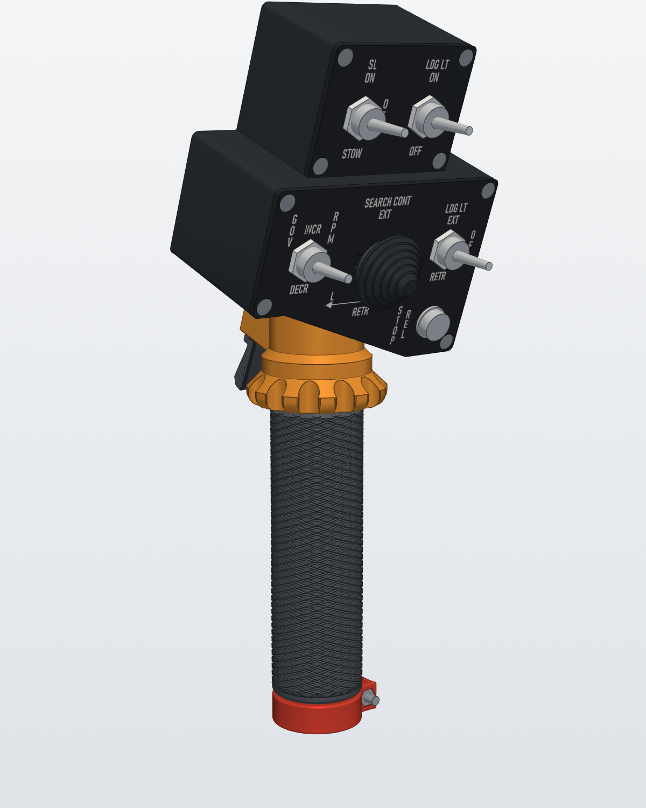
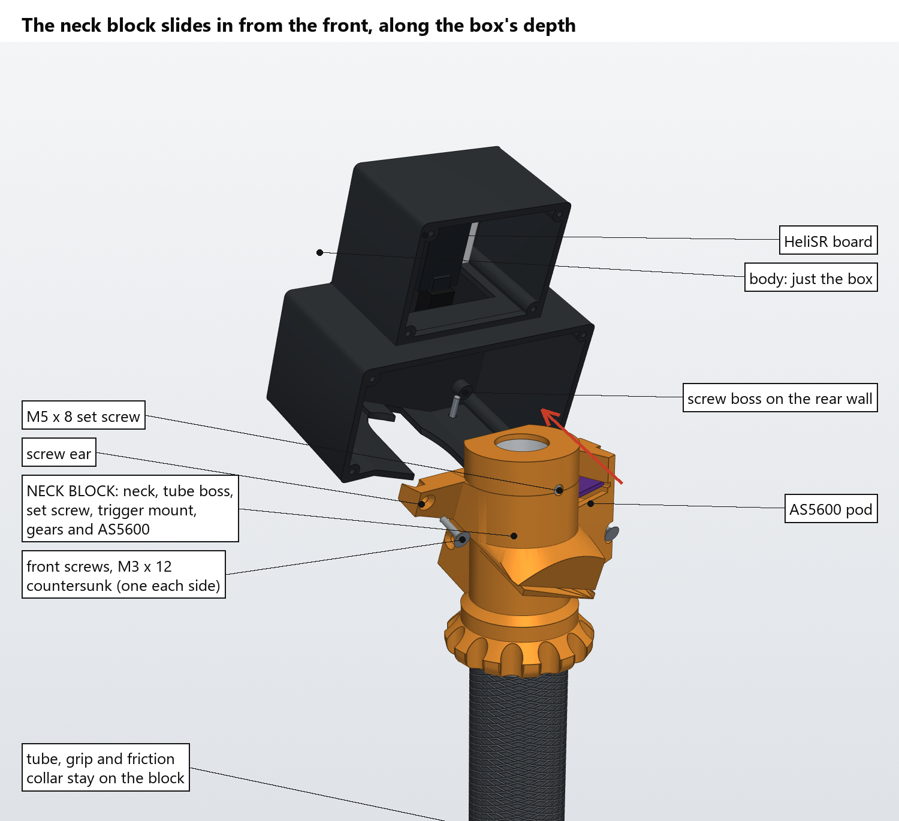
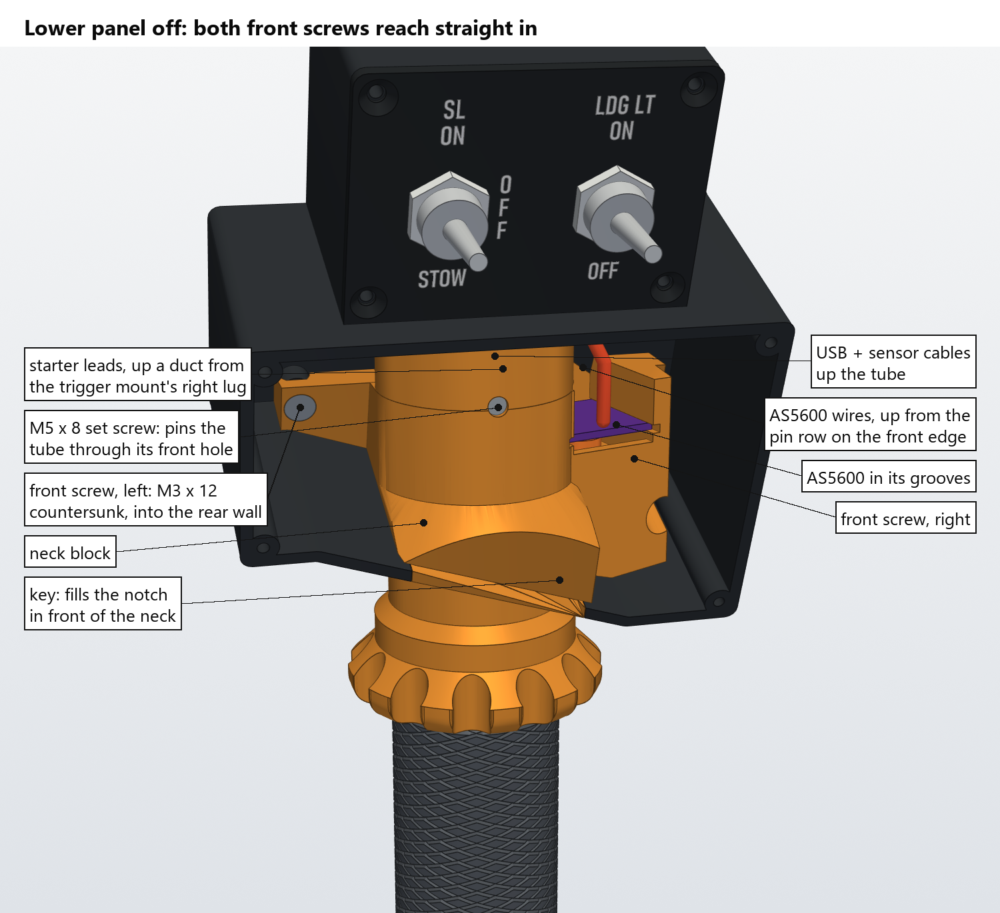
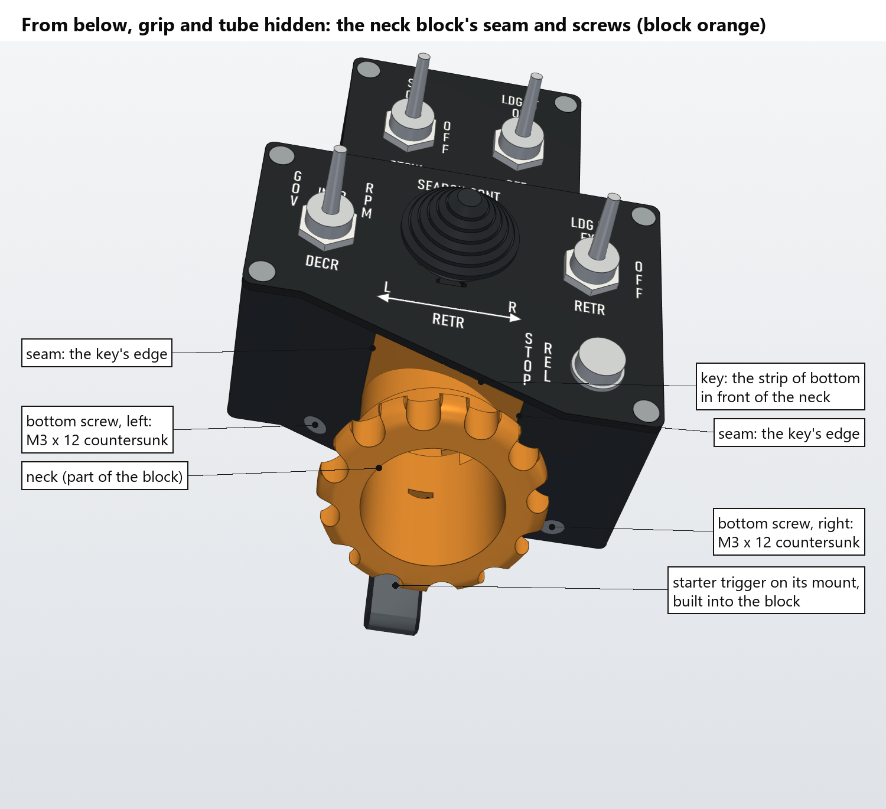
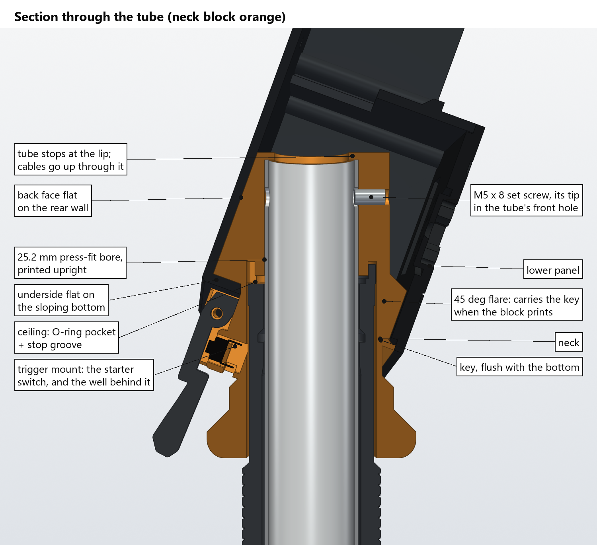
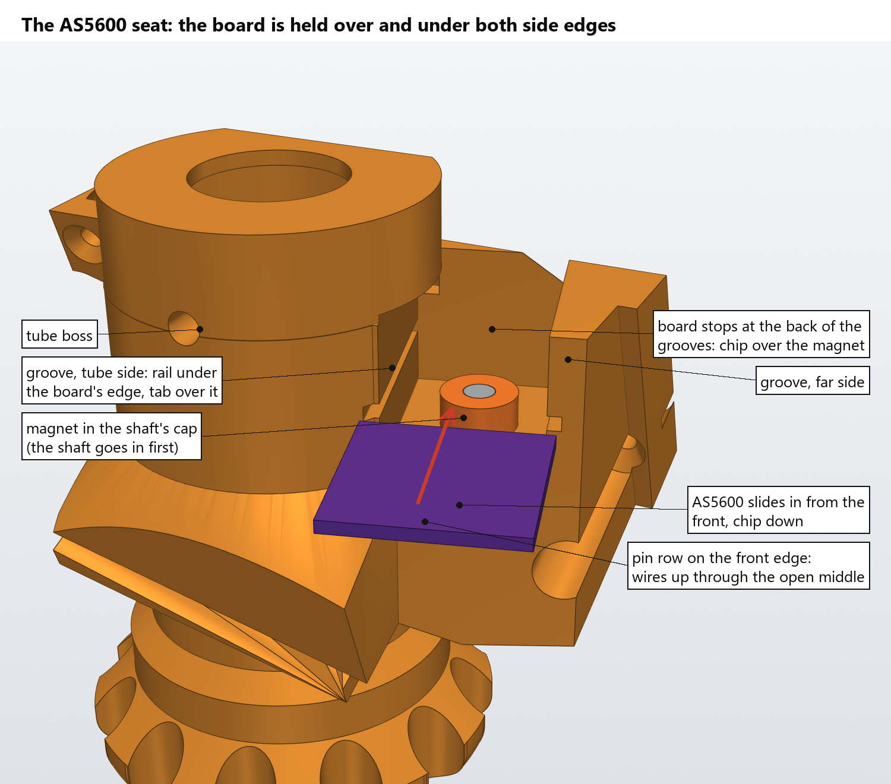
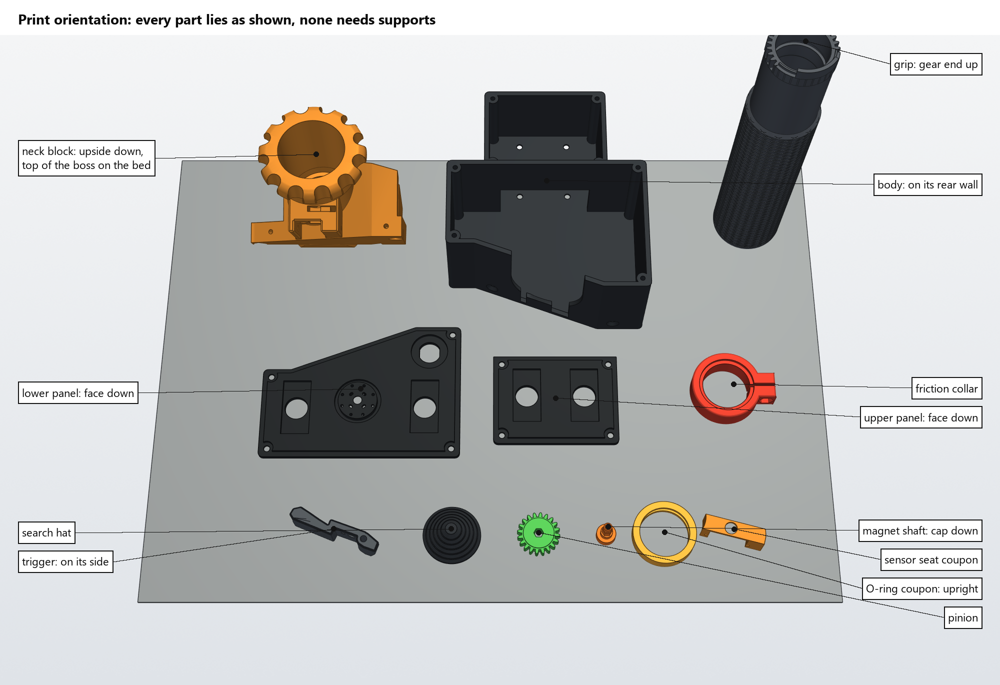

# UH-1 "Huey" head, Rev 3: the neck as its own part

Rev 3 is head Rev 2 (`..`) rebuilt so that every part prints cleanly, without support. The outline, switches, throttle and wiring are Rev 2's. What changes is how the head holds the tube:

- **The neck is now its own part, the neck block.** It holds:
  - the neck and the tube boss, with the 25.2 mm press-fit bore;
  - the M5 set screw that pins the tube;
  - the starter trigger's mount, built in (see below);
  - the ceiling's O-ring groove, stop groove;
  - the gear pocket and the AS5600 pod.

  It prints upside down with the tube axis vertical, so the tube bore prints the same way as the fit coupons did. The gear centre distance and the magnet's place under the chip are all inside this one part.
- **The body is now just the box.** It prints on its rear wall with no supports.
- **The AS5600 board sits in two grooves.** Each side edge has a rail under it and a tab over it. This fixes the two Rev 2 faults you found: the slot in the boss's side was too cramped and hidden to fit the board, and nothing held the board's far edge down. See [Rev 2's sensor seat](#rev-2s-sensor-seat).

Changes made since then (2026-10-22). The renders below show them:
- **The tube is centred across the box**, as on the real UH-1. It used to come in 7.3 mm left of centre. Everything that goes with the tube moved with it: the neck block's boss, pod and pinion, the throttle, and the trigger and its mount. It moved 7.3 mm right, and 2.9 mm down so every part keeps its height above the sloping bottom.
- **GOV RPM moved in**: it's now 19 mm from the panel's left edge, as LDG LT EXT is from the right, and its labels moved with it.
- **Faux friction knob, part of the neck block**, modelled on the UH-1's throttle friction knob. From the bottom up: a 56 mm fluted wheel, 12 deep round flutes between rounded lobes; a 45° flank in to a plain 44 mm band, 6 mm tall, where the real one carries its THROTTLE INCREASE / FRICTION INCREASE label; and a 45° chamfer up into the neck. It is 22 mm tall and doesn't turn. Every overhang is 45° or less with the block upside down, so it prints with the block without supports. The neck now runs 22 mm further down, and the grip sits 22 mm lower on the tube.

Changes made 2026-10-23, taking two things from Rev 4 (`../Rev4`):
- **The trigger mount is built into the neck block.** It is Rev 4's redesigned mount, no longer a separate part and no longer screwed on. It hangs from the block under the sloping bottom, behind the neck, and goes up through a slot in the bottom (the neck's notch carried back) into the solid behind the boss. The block's key now fills that slot too, flush with the bottom. So there is no mount screw, no tenon and no separate `TriggerMount.stl`.
  - It has Rev 4's trigger, with its adjustable M3 × 4 pull stop, its 0.6 mm rest gap, the switch's leg slots, a groove under the mount for the leads, and a straight duct up the right lug into the box. The trigger and its mount are Rev 4's, shifted 3 mm toward the front so the lugs end at the block's back (0.5 mm short of the rear wall's inside) instead of at the rear wall's outside. Pivot, arm, stop and duct moved with them.
  - The trigger no longer rakes back below its mount; it is Rev 4's straight arm with its finger pad in the same place (tip level with the grip's top).
  - The block prints upside down, so the mount stands up out of the bottom's plane with its faces 20° off vertical. Rev 4's widened lead groove would have been a 65° overhang that way, so the groove is straight-sided (3 mm wide).
- **Follow-up fixes (same day):**
  - A 0.25 mm sliver of the boss's cylinder poked past the flare's clip plane where it meets the key plate, and showed as a small arc on the flare's face. The boss is now clipped at that plane.
  - The starter's lead duct is bigger, 4.1 × 5 mm (was 3.1 × 4), and its groove is 3.5 mm wide (was 3).
  - Every edge outside the body has a 0.8 mm chamfer (`CHAMFER`): the trigger mount's bottom and back edges and the lugs' back corners, the trigger's two faces (in 0.15 mm steps, which prints as a 45° taper), and the friction knob's lobe edges along their straight part. The key's seams are left sharp so they stay tight against the bottom.
- **Magnet closer to the chip:** the magnet shaft's cap is 0.5 mm taller (`CAP_UP`), so the magnet is 1.0 mm from the chip instead of 1.5 mm. Reprint `HueyHeadR3-MagnetShaft.stl`; nothing else changes. The base's collective sensor got the same 1.0 mm (`MAGNET_GAP` in `Base/mk3_pivot.py`; reprint its sensor cover).
- **The tube is held by an M5 × 8 set screw**, as in Rev 4, instead of the M5 × 40 cross bolt. The screw is tapped into a 4.2 mm pilot in the boss's front and its tip goes through a hole in the tube's **front wall only**. The nut slot is gone, and the tube is drilled through one wall, not both.



`renders/HueyHeadR3_Assembly.glb` is the whole head in 3D, with all its parts in place and coloured: every printed part, plus stand-ins for the bought hardware and the wires. It opens in Windows 3D Viewer or any glTF viewer.

## The split



| | |
|---|---|
| **Neck block** | Everything that holds the tube and the throttle sensor:<ul><li>the neck;</li><li>the tube boss: 25.2 mm bore, 32.7 mm deep (20 mm + 1/2 in) to a lip, with the cable opening through the lip;</li><li>the M5 × 8 set screw's pilot in the boss's front;</li><li>the ceiling's O-ring groove, its 225° stop groove;</li><li>the pinion pocket and its bearing web;</li><li>the AS5600 pod;</li><li>the solid behind the boss, with the slot that takes the starter's leads up its back;</li><li>the faux friction knob round the neck's lower end;</li><li>the starter trigger's mount, hanging from the bottom behind the neck.</li></ul>It fills the lower box from the sloping bottom up to the top of the boss and back to the rear wall, and has a screw ear at each back corner. A **key** on it fills the notch in the bottom in front of the neck and the slot behind it that the mount comes through, flush with the bottom. It is 80 cm³. |
| **How it goes in** | With the lower panel off, it slides straight in from the front along the box's depth, square to the panel. The neck runs back along a notch in the sloping bottom, open to the front, until the block's back meets the rear wall. The trigger mount runs back through its own slot in the bottom, in line with the neck's notch. Nothing touches on the way in: the CAD check moves it the whole way. |
| **What locates it** | Three registers, each square to one direction:<ol><li>**Back face on the rear wall.** The rear wall is the face the body prints on, its flattest and most accurate surface. The front screws pull the block back against it.</li><li>**Underside on the sloping bottom.** The bottom screws pull it down onto it.</li><li>**Key in the notch and the mount's slot.** The key's sides run in the slot's sides with 0.15 mm a side, which sets it left to right.</li></ol> |
| **Screws from the front** | Two **M3 × 12 countersunk**, one through each ear, along the box's depth. They go into bosses on the rear wall's inside: tap them M3 for 6 mm of thread. Each ear has a pocket that fits over its boss. With the lower panel off, a screwdriver reaches both straight in from the front. |
| **Screws from the bottom** | Two **M3 × 12 countersunk**, square to the bottom, up into the block (9.5 mm of thread; tap M3). The left one goes through the sloping bottom, left of the trigger mount near the back. The right one goes through the level bottom at the back right corner. |
| **What shows** | The same outline as Rev 2: only the neck shows under the box. Under the box you'll see five new things:<ul><li>the friction knob round the neck;</li><li>two countersunk screw heads;</li><li>the key's edges, seams in the sloping bottom from the front edge back to the sides of the neck and on to the sides of the trigger mount;</li><li>the seam around the neck;</li><li>the trigger mount with its trigger behind it.</li></ul> |







## Sensor seat



| | |
|---|---|
| **Grooves** | The module (23 × 23 mm, chip down) runs in a groove along each side edge: a 1.5 mm rail under the edge and a 1.5 mm tab over it. The groove is 1.9 mm high for the 1.6 mm board, with 0.25 mm clearance at each side. Between the rails the pod is open from the bearing web up to the top. |
| **Fitting it** | Do this on the bench, before the block goes in the box. The module slides in from the front along its own axis, through the pod's open front, until it stops against the back of the grooves. That puts the chip over the magnet. A dab of hot glue at the front end keeps it there. |
| **Wires** | Solder the wires to the pin row, then slide the module in **with the pin row on its front edge** (in Rev 2 it was the far edge). The wires go straight up through the open middle, out of the top of the pod. They then run across the back of the lower box to the wire slot, and on to AX4 (J14). |
| **Magnet shaft** | It now has a 4.15 mm pin under its hex end. The pin goes through the pinion's hex hole into a 4.3 mm bearing hole in the floor of the pinion pocket. The pinion now turns on two bearings 10 mm apart, instead of one 3 mm web. |
| **Coupon** | `HueyHeadR3-SensorSeatCoupon.stl` is an 8 mm slice of the neck block across the grooves: 1.3 cm³, about 1.6 g. Print it upside down, like the block, and slide your AS5600 module through it before printing the whole block. If the module binds, raise `BOARD_CLR` or `GROOVE_H` in `huey_head_r3.py`. If it rattles, lower them. |

### Rev 2's sensor seat

The defects you marked were in Rev 2's body STL (`../stl/HueyHead-Body.stl`).
- **Red:** the module's near edge went in through a 3 mm slot in the boss's side, and thin flaps of the boss wall covered part of both openings. The pinion was meant to go up the neck, not in from the front, but the slot was cramped and hard to find.
- **Orange:** once the module was in, nothing held down either edge. The far edge was left open for the wires, and the near edge had 1.4 mm of play in its slot.

Rev 2's STLs still have both faults. Rev 3 doesn't.

## Throttle

They're as Rev 2's, except that the stop lug has moved outward:
- 180° from the idle stop to full open, rolling the grip away from you (181° with the lug's 1° of slack). There is no idle return and no cutoff range: the grip stays where you leave it, held by the friction collar;
- the grip's lug runs in a 255° groove, now in the neck block, and the groove's two ends are the hard stops. The lug is now 74° long, 15.5–17.15 mm out (moved out from 12.85–16.7 to clear the ceiling's O-ring and its lip) and 5.2 mm tall, and it stands on a solid part of the gear (see below);
- the gears are a 32-tooth grip gear and a 20-tooth pinion, 1.6:1, so the grip's 180° is 288° at the magnet.


**Filled teeth:** the grip only ever turns 181°, so only about 221° of its 32 teeth can reach the pinion (the 181° of travel plus 22° either side). The other 139° is filled solid out to the tooth tips. The stop lug stands on that solid. The filled part clears the pinion's tips by more than 1 mm at every angle. STOP REL on the panel is a plain button (IN13).

**Backlash:** the gear teeth are thinned by 0.1 mm each (`BACKLASH` in `throttle_r3.py`). That leaves about 0.75° of play at the grip.


### The grip floats on O-rings


The grip no longer touches the tube. It rides on four **24 mm ID × 2 mm** (28 mm OD) nitrile O-ring, ×4: FOCMKEAS, 50 for $6.89 ([Amazon B0BWWBTL4N](https://www.amazon.com/dp/B0BWWBTL4N)), each stretched slightly onto the 25 mm tube:
- **Two bearings** in grooves inside the grip's bore: one 4 mm above its bottom face, one in the neck about 6 mm under the gear. The bore round them is 25.8 mm, clear of the tube (it prints about 0.25 mm under size), so the plastic only catches the grip if it's pushed hard sideways. That keeps the gear's centre within 0.2 mm of the pinion's, inside the gears' backlash. The grooves squeeze their rings 3–8 %, depending on how the bore prints. Each groove's roof is a 45° cone, so the grip still prints upright with no supports.
- **One face seal under the grip**, in the friction collar's top: it pushes the grip up.
- **One face seal over the grip**, in a groove in the head's ceiling round the tube: it pushes the grip down.

Every groove is 2.1 mm wide: at this squeeze a 2 mm ring only spreads to about 2.05 mm. The face grooves are 1.75 mm deep, so each ring stands 0.2 mm proud and is squeezed at most 11 %, when the grip's top meets the ceiling. The ceiling's ring sits in a plain pocket round the tube (r 15.6 mm, 1.75 mm deep), with no thin walls in the head, which prints on its side. What keeps the ring from spreading outward into the lug's path is a 0.8 mm rim on the grip's top face (r 14.6–15.4 mm, 1.4 mm tall) that stands up into the pocket between the ring and the lug: it prints upright, on the grip. It runs only along the gear's filled arc (139°), where the lug is: that arc never comes near the pinion, in use or as the grip slides up past it into mesh, and it stands square on the filled teeth with nothing overhanging. The stop lug grows out of the rim: r 15.35–17.15 mm (0.25 mm inside the neck bore, so the grip still goes up through it), 74° long (was 44°) and 5.2 mm tall (was 3.7), in a 255°, 5.5 mm deep groove at r 15.15–17.45. The groove's solid 105° still leaves about 4 mm of wall to the pinion pocket and pod. Grease the rings lightly with silicone grease.

## Controls

The same as Rev 2.

| Panel | Control | Part | HeliSR input |
|---|---|---|---|
| Lower | GOV RPM INCR / DECR | APEM 637H/2 toggle, (ON)-OFF-(ON) | IN1 / IN2 |
| Lower | LDG LT EXT / OFF / RETR | APEM 639H/2 toggle, ON-OFF-ON | IN3 / IN4 |
| Lower | SEARCH CONT EXT / RETR / L / R | MkII 4-way hat (4 × TE 1825910-6) with the Huey search hat | IN9 – IN12 |
| Lower | STOP REL | Same Sky PB4-M-BK-D-67 push button | IN13 |
| Upper | SL ON / OFF / STOW | APEM 639H/2 toggle, ON-OFF-ON | IN5 / IN6 |
| Upper | LDG LT ON / OFF | APEM 636H/2 toggle, ON-ON | IN7 |
| Behind the grip | Starter trigger | TE 1825910-6 tact switch in the trigger mount | IN14 |
| Throttle | Twist grip | AS5600 module | AX4 |
| Base | Collective | AS5600 module in the MkIII base | AX1 |

IN8, IN15, IN16, AX2 and AX3 are spare.

## Printing



All STLs are in the head's own frame, so they open assembled. In the slicer, turn each one to its print orientation (Bambu Studio: select it, press F, and click the face named below). **No part needs supports.** Use Bambu Studio's 0.20 mm Standard profile unless the table says otherwise.

| Part | File | Lay it on | Notes |
|---|---|---|---|
| **Neck block** | `HueyHeadR3-NeckBlock.stl` | the **top of the boss** (upside down; the tube axis is vertical) | Use the same filament and settings you printed the grip bearing coupons with: the 25.2 mm press-fit bore is the 25.2 coupon's size, printed the same way up. 4 walls, 25 % infill. Inside there are two short flat bridges, about 21 mm over the module space and 23 mm over the pinion pocket, There's also a 2 mm overhanging lip along the key's front edge, hidden behind the panel. The friction knob is at the top as it prints: its chamfer and flank are 45° overhangs, and its flutes open upward. The trigger mount stands up from the key beside it, its faces 20° off vertical; its small pockets (the switch's, the spring's) bridge a few mm. **Not slicer-checked:** the 2.5 mm of each lug behind the key's end hangs over the bottom's plane, a small 28° overhang. If it prints badly, add a small support there. |
| **Body** | `HueyHeadR3-Body.stl` | its **rear wall** (outside face) | 3 walls, 15 % infill. Everything stands up from the rear wall. The only long bridge is the 50 mm one over the wire slot between the boxes, as in Rev 2. The notch for the neck is open at the top as it prints. |
| Lower panel | `HueyHeadR3-LowerPanel-Black.stl` + `-WhiteText.stl` | front face (labels) | As Rev 2: white labels on a P1S with AMS (see below). The MkII hat carrier has an 18 mm flat bridge 4 mm up, as on the MkII face. |
| Upper panel | `HueyHeadR3-UpperPanel-Black.stl` + `-WhiteText.stl` | front face (labels) | As Rev 2 |
| Trigger | `HueyHeadR3-Trigger.stl` | either flat side | Rev 4's. Tap the pull stop's 2.5 mm pilot M3 |
| Search hat | `HueyHeadR3-SearchHat.stl` | its flat bottom ring | Glues over the MkII thumbstick |
| Throttle grip | `HueyHeadR3-ThrottleGrip.stl` | upright, bottom end down (gear and lug up) | 25.8 mm bore, clear of the tube, with two O-ring grooves inside. Their roofs are 45°, so it needs no supports |
| Friction collar | `HueyHeadR3-FrictionCollar.stl` | bottom face down (O-ring groove up) | |
| Pinion | `HueyHeadR3-Pinion.stl` | flat | The magnet shaft slides into its hex (4.6 mm across flats, 0.15 over the shaft) |
| Magnet shaft | `HueyHeadR3-MagnetShaft.stl` | cap face down (magnet pocket on the bed) | New: the 4 mm pin on its end goes into the pocket floor |
| Sensor seat coupon | `HueyHeadR3-SensorSeatCoupon.stl` | upside down, like the block | Optional: try your AS5600 module in it first |
| Grip bearing coupons | `HueyHeadR3-GripBearingCoupons.stl` | flat, labels up | Rev 2's set (25.0–25.3 mm). The grip rides on O-rings now, so they only check the boss bore on the **carbon** tube |
| O-ring coupon | `HueyHeadR3-ORingCoupon.stl` | upright, like the grip | A 7 mm slice of the grip's bore with one O-ring groove, cut exactly as the grip's (about 2 g). Fit a greased O-ring and slide it on the carbon tube before printing the grip: it should turn with a light, even drag, with no plastic touching the tube |

Also print the MkII 4-way hat parts from the original project's head files: `4way_Cover`, `Bezel`, a `ThumbStick` and `StickRetainer`.

Every printed screw hole that a screw threads into is a 2.5 mm pilot: tap it M3 before assembly. They are:
- the panel columns;
- the two bosses on the rear wall;
- the two bottom-screw holes in the neck block;
- the set screw's pilot in the boss's front (4.2 mm, tap it M5);
- the trigger's pivot pilot, right through the right lug, and the pull stop's pilot through the trigger's arm.

### White labels on a P1S with AMS

The labels are recessed 0.6 mm into each panel's face. The `-WhiteText` file is a separate body that fills that recess exactly. Because the panels print face down, white is only needed for the first three layers.

1. In Bambu Studio, import the `-Black` and `-WhiteText` files for one panel together (select both files). When it asks whether to load them as a single object with multiple parts, choose **Yes**.
2. In the object list, right-click the text part and set its filament to the white slot. Leave the body on black.
3. Press **F** (lay on face) and click the panel's front face.
4. Use 0.2 mm layers with a 0.2 mm first layer. White then covers layers 1–3 and the rest is black. Leave the prime tower on.
5. The textured PEI plate gives the panels a crinkle finish like the real ones.

## Bought

The list for the whole collective, with part numbers and prices for the board, head and base, is `../../BOM/Heli_Collective_Final_BOM.xlsx`. Rev 3 adds four M3 countersunk screws to Rev 2's head hardware and swaps the M5 cross bolt for a set screw; everything else is the same.

| Item | Qty | Notes |
|---|---|---|
| 25 × 23 mm carbon tube, **491 mm** | 1 | The MkIII Rev 3 base's tube (`../../Base`). Cut it to 491 (470 + 12.7 mm for the deeper bore + 8 mm for the base's deeper socket) and drill a 5.2 mm hole through its **front wall only**, 10 mm below its top end (the set screw's tip goes in it) |
| M5 × 8 set screw (HIQTRADEBYJJ set-screw kit) | 1 | Tube pin: tapped into the boss's front, tip through the tube's front wall |
| M3 × 4 set screw (same kit) | 1 | The trigger's pull stop, in its arm |
| **M3 × 12 countersunk** | 4 | **New:** two front screws, through the neck block's ears into the rear-wall bosses, and two bottom screws, up through the bottom into the neck block |
| M3 × 25 countersunk (from the NIULUNBAO M3 set, Amazon B0BYXS4BTF; the kits stop at 20 mm) | 1 | Trigger pivot: through the left lug and the trigger into the right lug's tapped pilot (8 mm of thread; the lugs' outer faces are 20 mm apart) |
| M3 × 10 countersunk | 8 | Panels, 4 each |
| M3 × 12 countersunk + M3 nut, Bivar SRS-4-4MM spacers (Digi-Key SRS-4-4MM-ND) | 4 | HeliSR board, from outside the rear wall |
| M4 × 16 socket cap + M4 nut | 1 | Friction collar pinch screw |
| O-ring, 24 mm ID × 2 mm (28 mm OD), nitrile (FOCMKEAS, [Amazon B0BWWBTL4N](https://www.amazon.com/dp/B0BWWBTL4N), 50 for $6.89) | 4 | Two in the grip's bore, one in the friction collar, one in the ceiling's groove. See [The grip floats on O-rings](#the-grip-floats-on-o-rings) |
| Pen spring, up to 4 mm across | 1 | The trigger return (cut to about 13 mm) |
| AS5600 module (WWZMDiB, Amazon B0CM3C8KFT) | 1 | The throttle's; its ~4 × 2 mm magnet goes in the shaft's cap |
| APEM 639H/2 toggle, ON-OFF-ON (Digi-Key 679-1223-ND) | 2 | LDG LT EXT / RETR and SL ON / STOW (IN3–IN6) |
| APEM 637H/2 toggle, (ON)-OFF-(ON) (679-1219-ND) | 1 | GOV RPM INCR / DECR (IN1, IN2) |
| APEM 636H/2 toggle, ON-ON (679-1217-ND) | 1 | LDG LT ON (IN7) |
| Same Sky PB4-M-BK-D-67 push button (2223-PB4-M-BK-D-67-ND) | 1 | STOP REL (IN13) |
| TE 1825910-6 tact switch, 6 × 6 mm (450-1650-ND) | 5 | SEARCH CONT hat (IN9–IN12) and starter trigger (IN14) |
| HeliSR Rev 3.0 board with its Pro Micro and JST cables | 1 | `../../PCB/HeliSR_Rev3.0`; the throttle module goes on AX4 (J14) |
| Hot glue | a dab | Holds the AS5600 module at the front of its grooves |
| Ballast, steel or lead | ~50 g | Only if the base's gas strut lifts too much |

The four new screws are M3 × 12 because that's a size in the AvrestYPT kit. The kit has M3 × 8 and × 12 but no × 10, so the panels' M3 × 10s are bought separately, as in Rev 2.

## Assembly

Most of the head goes together on the bench, on the neck block, before the body goes on.

1. **Coupons (optional):**
   - Slide your AS5600 module through the sensor seat coupon.
   - Check the grip bearing coupons on the carbon tube (for the boss bore's fit).
2. **Tap** the M3 pilots (see [Printing](#printing)).
3. **Pinion and magnet shaft:**
   1. Glue the magnet into the shaft's cap.
   2. With the block the right way up, put the pinion up through the neck and slide it sideways into its pocket, toward the right and back, until its hex hole lines up under the web's bore.
   3. From above, through the pod's open middle, push the magnet shaft down through the web. Its pin goes through the pinion into the bearing hole below, and its hex slides into the pinion (a 0.15 mm clearance; a drop of glue or a wrap of tape takes up play). The cap ends up resting on the web.
   4. The pinion should spin freely.
4. **AS5600 module:**
   1. On the module, remove the 0 Ω R1, tie DIR to GND, and solder the VCC, OUT and GND wires to its pin row.
   2. Slide it chip-down into its grooves from the front of the pod, pin row on the front edge, until it stops.
   3. Put a dab of hot glue at the front, and lead the wires up out of the top.
5. **Throttle stops:** nothing to fit. The grip's lug runs between the groove's two end walls, which are the idle and full-open stops.
6. **Tube:**
   1. Cut the carbon tube to 491 mm and drill its 5.2 mm hole through the front wall only.
   2. From the top: Grease the four O-rings lightly. Roll one into each groove inside the grip. Slide the friction collar on (groove up), roll an O-ring down the tube into the collar's groove, then slide the grip on (gear up). Roll the fourth O-ring onto the tube just above the grip: the groove in the head's ceiling takes it as the head goes on.
   3. Route the USB cable and the base sensor's lead up through the tube.
7. **Block onto the tube:**
   1. Thread the cables through the lip.
   2. Press the block down onto the tube (it's a press fit) until the tube stops at the lip, rocking the grip a few degrees so its gear slides into mesh with the pinion.
   3. Tap the boss's front pilot M5 if you haven't, and drive the M5 × 8 set screw in from the front (lower panel off) until its tip is in the tube's hole. Don't let it bite the cables.
8. **Friction:** push the grip up until it meets the block. It stops softly on the ceiling's O-ring. Slide the friction collar up until the O-rings give the feel you want, and tighten its screw.
9. **Trigger, onto the block:**
   1. Fit the tact switch in the mount's pocket (button facing back) with its wires soldered on and bent into the well behind it, then the return spring, the trigger and the M3 × 25 pivot.
   2. Lay the wires along the groove under the mount to the right lug and up its duct. They come out of a window in the side of the boss, about 16–20 mm above the grip's gear, inside the box.
   3. Turn the M3 × 4 pull stop in from behind until the switch clicks just before the stop meets the mount.
10. **Block into the body:**
    1. With both panels off, hold the body behind the block and slide it forward over the block. The neck runs in its notch and the mount in its slot in the bottom, and the cables and AS5600 wires go up toward the wire slot. Keep going until the block's back meets the rear wall.
    2. Fit the two front screws through the ears, then the two bottom screws from below.
11. **HeliSR board:**
    1. Plug the Pro Micro into its sockets.
    2. Fit the board upright in the upper box, components to the front, USB end down, on four M3 × 12 screws from outside the rear wall and through the spacers. Nuts go on the front.
    3. Bring the USB cable up through the wire slot and plug it in from below.
12. **Switches and wiring:**
    1. Fit the switches into the panels and mount the 4-way hat in SEARCH CONT, as in Rev 2.
    2. Wire everything to the board: the AS5600 to AX4 (J14), the starter to IN14.
13. **Panels and search hat:** screw the panels on, then glue the search hat onto the thumbstick.

To take the head off the tube later, take out the bottom screws and the front screws and slide the body off backward. The neck block stays on the tube, with the trigger mount and its trigger.

## Wiring and programming

As Rev 2: the throttle AS5600 goes on **AX4 (J14)** of the HeliSR Rev 3.0 board, with **DIR to GND**, and is programmed with **PROG4**. Upper panel off; PROG4 is at the top of the board.
1. Roll the grip to the idle stop, hold it there and press PROG4 for about a second.
2. Roll it to full open and press PROG4 again.
3. AX4 should now follow the grip: 0 at the idle stop and full scale at full open. Set the sim's idle point a little above 0.

Until it's programmed, AX4 reads full scale whatever the grip does.

## Checked in CAD

- **A full mock assembly:** every printed part, plus stand-ins for the hardware, the HeliSR board and the wires (46 parts). Re-run after the 2026-10-22 changes above.
  - None of the pairs overlap, except where they're meant to touch: the starter switch's 0.15 mm preload, the USB plug in its socket, the shaft's hex in the pinion, and the hat parts in the panel's carrier.
  - The neck block touches the body only on its three registers.
- **Each part goes in its own way without touching anything:**
  - the pinion, up the neck and sideways into its pocket;
  - the magnet shaft, from above;
  - the AS5600 module, along its grooves;
  - the set screw, from the front;
  - the tube, grip and collar;
  - the whole neck block (with the tube, throttle, sensor, knob and trigger mount) into the body, the neck and the mount each through their slot;
  - each front screw, along the box's depth;
  - each bottom screw, along its own axis;
  - the trigger, its switch and spring and the pivot screw, onto the mount from the sides and below;
  - both panels with their switches;
  - the HeliSR board.
- **The wires clear everything along their routes:** the AS5600's wires up out of the pod, the starter's leads along the groove and up the duct, and the USB and sensor cables up the tube.
- **The AS5600 module is held** over and under both side edges along their whole length. In Rev 2's body it's 0 % over either edge.
- **The throttle through its travel**, from the idle stop to full open (181°): the grip and pinion mesh without touching, the filled part of the grip stays clear of the pinion, and nothing touches the neck block or the AS5600. The lug stays inside the groove and meets the hard stops at 0° and 181°.
- **Clearances** (the smallest shift along x, y or z that makes two parts touch, capped at 5 mm):
  - neck block to the lower panel: 0.1 mm; to the body: 0.1 mm;
  - neck block to the lower toggles and STOP REL: 5 mm or more (it was 3.1 mm before the tube moved); to the hat: 5 mm or more;
  - AS5600 module to the lower toggles: 5 mm or more;
  - pinion to the block: 0.6 mm; block to the grip: 0.4 mm;
  - the trigger swings clear of the block, the knob and the body through its pull (to about 6°; it meets the mount's face at about 8°, past the switch's click);
  - the mount is cut 1 mm clear of the friction knob;
  - trigger to the body: 1.5 mm.
- **Not re-run after the 2026-10-23 change:** the full 46-part mock and the wire sweeps, because their scripts live in Temp scratchpads. Checked instead, in the CAD script's own geometry: the block against the body (no overlap, assembled and along the whole slide-in) and the trigger's pull against both.
- **Printability:** every part was checked in its print orientation for faces steeper than 45° that aren't on the bed. Only short bridges and small holes are left, as listed in [Printing](#printing).
- **Meshes:** every STL is watertight, except the lower panel's two non-manifold edges in the copied MkII hat geometry, as in Rev 2; slicers repair them.

Not yet printed or test-fitted. The renders in `renders/` show the earlier design (separate mount, M5 cross bolt); they haven't been regenerated.

## Regenerating

```bash
cd Head/Rev3
python huey_head_r3.py "<path to MkII-HeadFront.stl>" stl
python throttle_r3.py ../source/MkII-Grip-bore-relieved-25mm.stl stl
```

Both scripts stand alone; they don't import Rev 2's.
- `huey_head_r3.py` needs `numpy`, `trimesh`, `manifold3d` and `fonttools`. `throttle_r3.py` also needs `cadquery`.
- `MkII-HeadFront.stl` is in the original project's head files; it supplies only the 4-way hat cut-out.
- The labels use Windows' Bahnschrift font.

The settings you're most likely to change are at the top of the "neck block" section in `huey_head_r3.py`:
- the module's grooves: `GROOVE_H`, `BOARD_CLR`;
- the key's fit in the notch and the mount's slot: `NOTCH_CLR`;
- the trigger mount: the "starter trigger" constants (`PIVOT`, `LUG_END`, `REST_GAP`, `LEAD_*`);
- the screws: `FRONT_SCREWS`, `BOTTOM_SCREWS`, `RW_BOSS_*`;
- the flare: `FLARE_Z`, `PLUG_GAP`;
- the magnet shaft's pin: `PIN_*`.

**Mount and knob (2026-10-23):** the trigger mount used to be cut 1 mm clear of the friction knob, leaving a thin air gap between them. It is now solid with the knob where they meet.

**Rear-face chamfer (2026-10-23):** every edge round the outline of the rear wall's outside face, the face the body prints on, has a 1 mm chamfer (`REAR_CHAMFER`), corners included. It also relieves the first layers' elephant foot against the bed.
