# UH-1 "Huey" head, Rev 4: one piece again

Rev 4 is head Rev 3 (no longer in the repository) with the neck block and the trigger mount built back into the box, so the head is **one print**. Everything else is Rev 3's as it stands now:
- the tube centred across the box;
- GOV RPM 19 mm in from the left edge;
- the faux friction knob under the box;
- the starter trigger's finger pad, raked back 20°.

The switches, gears, AS5600 seat and wiring are unchanged. The throttle has no idle return any more: see [Controls](#controls-throttle-and-wiring). The starter trigger's mount and action are new: see [Starter trigger](#starter-trigger).

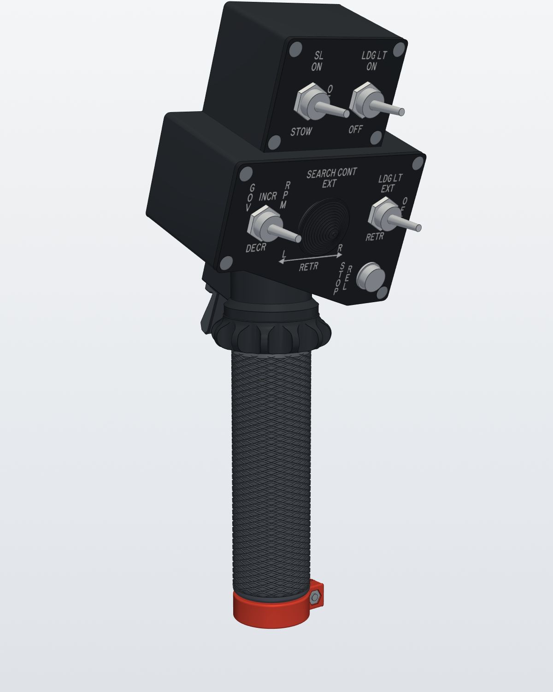

`renders/HueyHeadR4_Assembly.glb` is the whole head in 3D, with every part in place and coloured, plus stand-ins for the bought hardware and the wires. It opens in Windows 3D Viewer or any glTF viewer.

## What changes from Rev 3

| | |
|---|---|
| **One piece** | The box, the neck, the friction knob, the tube boss with its 25.2 mm press-fit bore and the tapped hole for the tube's set screw, the ceiling's O-ring groove, stop groove, the pinion pocket, the AS5600 pod and the trigger mount are all one part, `HueyHeadR4-Body.stl` (166 cm³). |
| **Gone** | Everything that held the neck block in the box: its two ears and front screws, the rear-wall bosses, the two bottom screws, the key and the notch in the bottom. The trigger mount's tenon and screw are gone too. That's five M3 × 12 screws fewer than Rev 3. |
| **Tube depth** | The tube bore is 32.7 mm deep (20 mm + 1/2 in), up a column that carries the boss on up, so the press fit has 63 % more length. The tube is the whole 500 mm, uncut: 12.7 mm longer than before for this bore, and 17.3 mm more for the base's deeper socket, so the head sits at the same height. The cross hole is still 10 mm below the tube's top end. |
| **Tube set screw** | The screw kit has no M5 longer than 20 mm, so the M5 × 40 cross bolt and its nut slot are gone. An M5 × 8 set screw, in a tapped hole in the boss's front, pins the tube through the front wall of its 5.2 mm cross hole. It goes in from the front with the lower panel off. |
| **Screws** | Every screw and nut but one is from the two kits: see [Screws](#screws). The trigger's M3 × 25 pivot comes from the NIULUNBAO M3 countersunk set ([Amazon B0BYXS4BTF](https://www.amazon.com/dp/B0BYXS4BTF): M3 × 20–40). |
| **Starter trigger** | Its mount is laid out square to the rear wall, so it prints with the head, standing on the bed. Nothing reaches past the rear wall's plane. The switch's leads drop into a groove under the mount and go up one straight round hole into the box. An adjustable stop makes sure the switch always clicks. See [Starter trigger](#starter-trigger). |
| **Printing** | The head prints on its rear wall, like Rev 2's body. That leaves the neck, the knob and the tube bore about 20° off horizontal, so they need tree supports, and the press-fit bore needs a test fit (see [Printing](#printing)). |

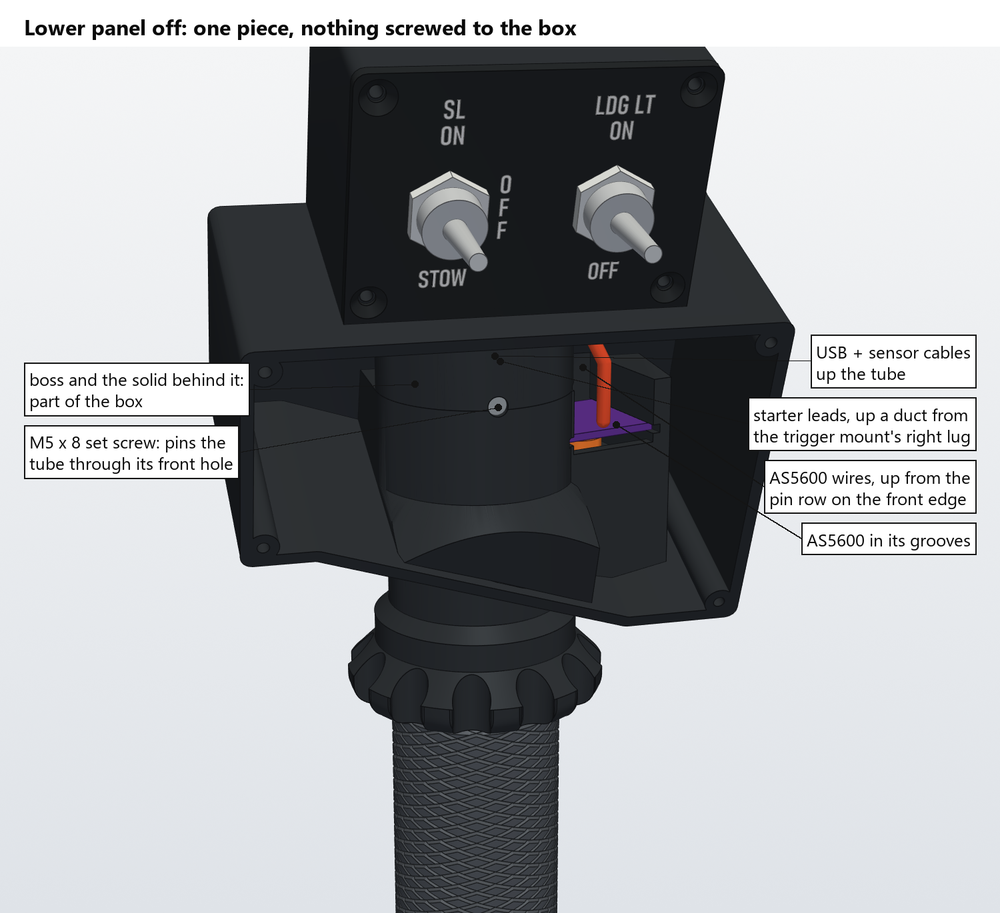

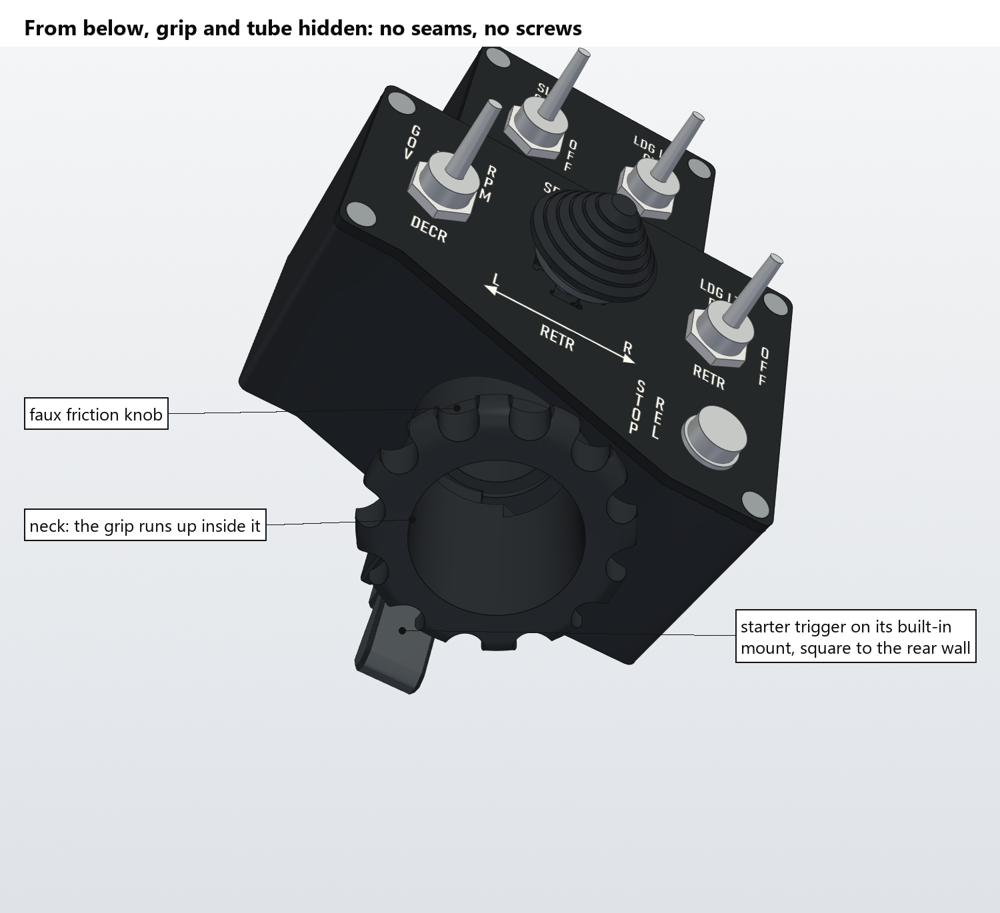

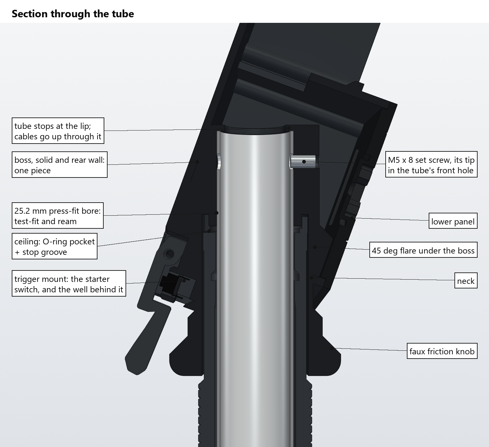

## Friction knob

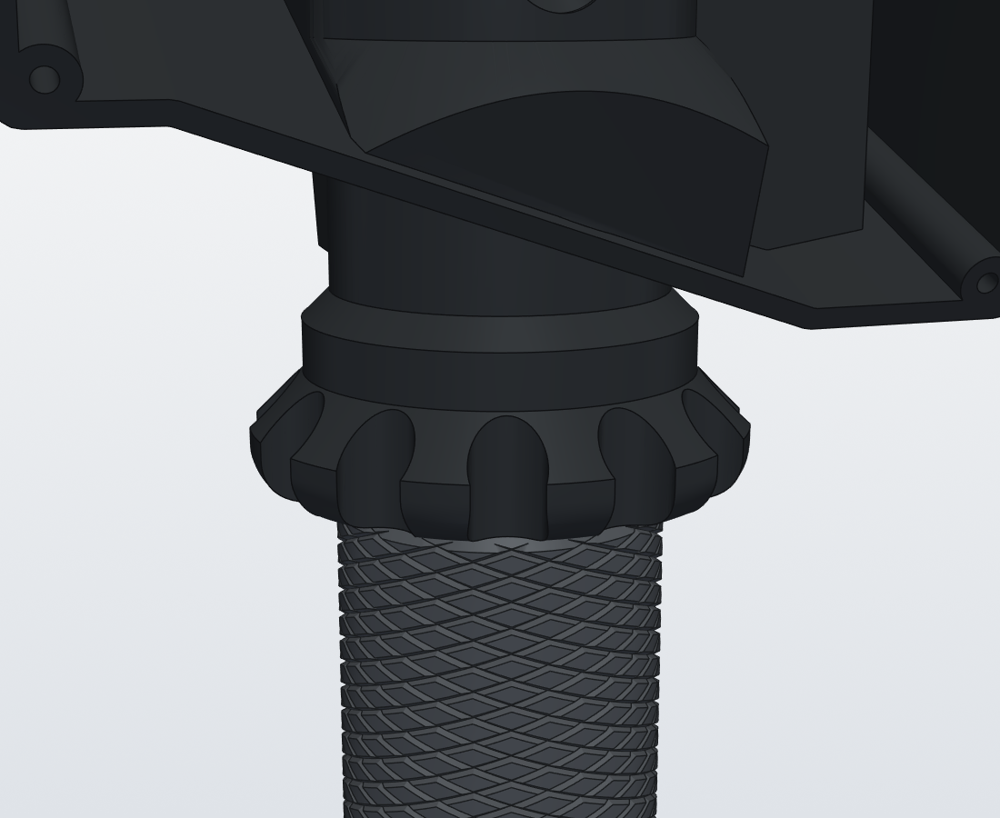

The knob is modelled on the UH-1's throttle friction knob. Its wheel profile and flutes are measured off `throttle_friction_knob.stl` from [UH-1 Huey Helicopter Collective](https://www.thingiverse.com/thing:4284120) by **hotpretzel**, licensed under [Creative Commons Attribution-NonCommercial](https://creativecommons.org/licenses/by-nc/4.0/). So the knob, and `HueyHeadR4-Body.stl`, which carries it, are for non-commercial use only. From the bottom up:
- a 56 mm bulging wheel with 12 round flutes (11.2 mm wide, 22.35 mm radius at the bottom) cut straight down its side, leaving narrow lands between them;
- the wheel runs out into a plain 44 mm band, 4.7 mm tall, where the real one carries its THROTTLE INCREASE / FRICTION INCREASE label;
- a 45° chamfer up into the neck.

It is 22 mm tall and doesn't turn. Its top sits 1.5 mm under the sloping bottom where they come closest, at the front right. The grip sits 22 mm lower on the tube than it did before the knob.

## Starter trigger

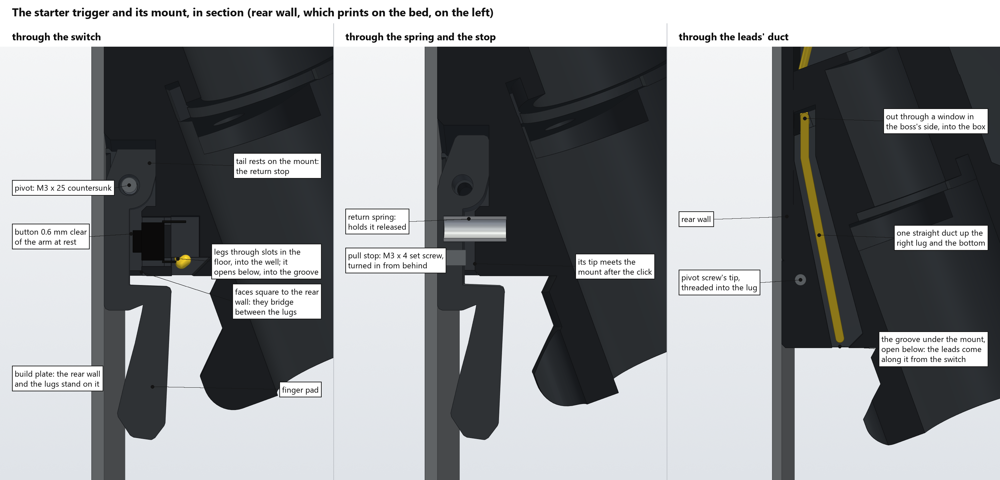

**It prints with the head.** The head prints on its rear wall, so the trigger mount is laid out square to the rear wall:
- Its two lugs run back to the rear wall's plane and stand on the bed beside it.
- The faces the trigger works against are flat and bridge between the lugs.
- Nothing reaches past the rear wall, so the head lies flat.

The first Rev 4 mount was Rev 3's turned 20° with the box: its lug ends stuck 1.3 mm out past the rear wall, and the faces it bridged were tilted overhangs.

**How it works.** The TE 1825910-6 tact switch sits in a pocket in the mount's back face, button facing back, its cover flush with the face. The trigger hangs from its pivot just behind it.
- **Released:** the return spring holds the trigger's tail against the mount above the pivot. That's the return stop. The button is then 0.6 mm clear of the trigger's arm, so the switch can't be held on.
- **Pulled:** the arm takes up that gap and presses the button. TE's drawing gives 0.25 mm of travel to the click, +0.20 / −0.10 mm, so anywhere from 0.15 to 0.45 mm.
- **The stop:** an M3 × 4 set screw through the arm then meets the mount. It's adjustable, so it can be set to stop just after the click, whatever your switch's travel and however the print came out. A hard squeeze then bears on the mount, not on the switch.
- **At the finger:** the pad moves about 3 mm to the click and about 4.5 mm to the stop.

The first Rev 4 trigger rested on the button with 0.15 mm preload and stopped 0.25 mm further on. With TE's tolerance, a short-travel switch could read on at rest, and a long-travel one might never click.

**Setting the stop.** Wire the switch to the HeliSR (or put a meter on its leads), then:
1. Turn the set screw in from behind the arm (1.5 mm hex key) until a full pull no longer clicks the switch.
2. Back it out until every pull clicks, then a quarter turn more (0.125 mm).

That leaves it about 0.4–0.7 mm proud of the arm. In CAD:

| Set screw out of the arm's front | Button pressed when the trigger stops | |
|---|---|---|
| 0.4 mm | 0.75 mm | every switch clicks |
| 0.6 mm | 0.58 mm | every switch clicks |
| 0.7 mm | 0.50 mm | every switch clicks, just (0.45 mm at most) |
| 0.9 mm | 0.33 mm | only switches that click by 0.28 mm |
| 1.1 mm or more | 0.16 mm or less | may never click |

Backed right out, the trigger stops on the switch itself, bottomed out.

If the starter reads on with the trigger released, the tail's front face has printed long: file it back a little.

**The leads.** The switch's legs go through two slots in the pocket's floor into a well behind it, and the well is open below. Under the mount, a groove, 3 mm wide at its mouth, runs from the well along to the right-hand lug. The groove is open along its length, and its roof slopes at 45° so it prints without supports. The right-hand lug is wider than the left to carry the hole. From the groove's end, one straight, round 4 mm hole goes up through the lug, the sloping bottom and the solid behind the boss, and comes out inside the box, beside the rear wall. It leans 8° toward the rear wall as it climbs, which keeps at least 1.2 mm of wall to the neck's bore, the AS5600 seat, the pinion pocket and the rear wall's outside all the way. It has no bends, so three 30 AWG silicone wires push straight through, and a 3.5 mm drill bit goes the whole way to clean it out (it lies nearly flat when the head prints, so its roof may sag a little).

The only bend in the route is in the open, where the leads turn from the groove into the hole. The leads can't go straight up behind the switch: the neck's bore is in front of it and the trigger behind.

## Controls, throttle and wiring

### Throttle

- **Travel:** 180° from the idle stop to full open, rolling the grip away from you (181° with the lug's 1° of slack). There is no idle return and no cutoff range: the grip stays where you leave it, held by the friction collar.
- **Stops:** the grip's 74° stop lug (15.35–17.15 mm out, 5.2 mm tall) runs in a 255° groove in the ceiling, and the groove's two ends are the hard stops.
- **Gears:** a 32-tooth grip gear drives a 20-tooth pinion, 1.6:1, so the grip's 180° is 288° at the AS5600's magnet.
- **Filled teeth:** the grip only ever turns 181°, so only about 221° of its 32 teeth can reach the pinion: the travel plus 22° either side. The other 139° is filled solid out to the tooth tips, and the stop lug stands on that. The filled part clears the pinion's tips by more than 1 mm at every angle.
- **Backlash:** each gear tooth is thinned by 0.1 mm (`BACKLASH` in `throttle_r4.py`), which leaves about 0.75° of play at the grip.

### Controls

| Panel | Control | Part | HeliSR input |
|---|---|---|---|
| Lower | GOV RPM INCR / DECR | APEM 637H/2 toggle, (ON)-OFF-(ON) | IN1 / IN2 |
| Lower | LDG LT EXT / OFF / RETR | APEM 639H/2 toggle, ON-OFF-ON | IN3 / IN4 |
| Lower | SEARCH CONT EXT / RETR / L / R | The 4-way hat ([`Hat/README.md`](Hat/README.md)): 4 × TE 1825910-6 tact switches | IN9 – IN12 |
| Lower | STOP REL | Same Sky PB4-M-BK-D-67 push button | IN13 |
| Upper | SL ON / OFF / STOW | APEM 639H/2 toggle, ON-OFF-ON | IN5 / IN6 |
| Upper | LDG LT ON / OFF | APEM 636H/2 toggle, ON-ON | IN7 |
| Behind the grip | Starter trigger | TE 1825910-6 tact switch in the trigger mount | IN14 |
| Throttle | Twist grip | AS5600 module | AX4 |
| Base | Collective | AS5600 module in the MkIII base | AX1 |

IN8, IN15, IN16, AX2 and AX3 are spare.

### Wiring and programming

The throttle AS5600 goes on **AX4 (J14)**, with **DIR to GND** either way. The module's pads are in two columns of through-holes on opposite edges: **VCC, OUT, GND** along one, **DIR, SCL, SDA, GPO** along the other. The pod is open above the whole board between its side rails, so wires from either column, and the DIR jumper across the back, go straight up and out of the top.

**HeliSR Rev 4.0 (I²C):** four wires, **VCC, GND, SDA and SCL**, to the AX4 port (pin 1 SDA, 2 GND, 3 VCC, 4 SCL). Also remove the module's R4 (1 kΩ from GPO to GND) so the chip isn't in its OUT-pin programming mode, and measure its SDA and SCL pull-ups first (see [`PCB/HeliSR_Rev4.0`](../../PCB/HeliSR_Rev4.0/README.md)). The firmware sets the idle and full-open angles over I²C; nothing is burnt into the chip.

**HeliSR Rev 3.0 (analog):** three wires, **VCC, OUT and GND**, keeping R4, and the range is programmed with **PROG4**. With the upper panel off, PROG4 is at the top of the board.
1. Roll the grip to the idle stop, hold it there and press PROG4 for about a second.
2. Roll it to full open and press PROG4 again.
3. AX4 should now follow the grip: 0 at the idle stop and full scale at full open. Set the sim's idle point a little above 0.

Until it's programmed, AX4 reads full scale whatever the grip does.


### The grip floats on O-rings

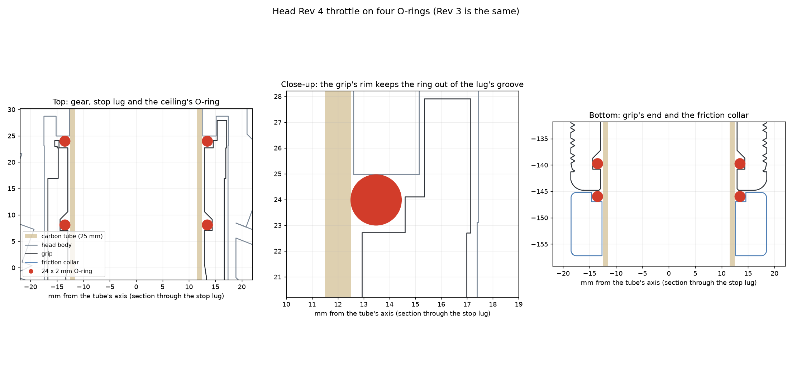

The grip no longer touches the tube. It rides on four **24 mm ID × 2 mm** (28 mm OD) nitrile O-ring, ×4: FOCMKEAS, 50 for $6.89 ([Amazon B0BWWBTL4N](https://www.amazon.com/dp/B0BWWBTL4N)), each stretched slightly onto the 25 mm tube:
- **Two bearings** in grooves inside the grip's bore: one 4 mm above its bottom face, one in the neck about 6 mm under the gear. The bore round them is 25.8 mm, clear of the tube (it prints about 0.25 mm under size), so the plastic only catches the grip if it's pushed hard sideways. That keeps the gear's centre within 0.2 mm of the pinion's, inside the gears' backlash. The grooves squeeze their rings 3–8 %, depending on how the bore prints. Each groove's roof is a 45° cone, so the grip still prints upright with no supports.
- **One face seal under the grip**, in the friction collar's top: it pushes the grip up.
- **One face seal over the grip**, in a groove in the head's ceiling round the tube: it pushes the grip down.

Every groove is 2.1 mm wide: at this squeeze a 2 mm ring only spreads to about 2.05 mm. The face grooves are 1.75 mm deep, so each ring stands 0.2 mm proud and is squeezed at most 11 %, when the grip's top meets the ceiling. The ceiling's ring sits in a plain pocket round the tube (r 15.6 mm, 1.75 mm deep), with no thin walls in the head, which prints on its side. What keeps the ring from spreading outward into the lug's path is a 0.8 mm rim on the grip's top face (r 14.6–15.4 mm, 1.4 mm tall) that stands up into the pocket between the ring and the lug: it prints upright, on the grip. It runs only along the gear's filled arc (139°), where the lug is: that arc never comes near the pinion, in use or as the grip slides up past it into mesh, and it stands square on the filled teeth with nothing overhanging. The stop lug grows out of the rim: r 15.35–17.15 mm (0.25 mm inside the neck bore, so the grip still goes up through it), 74° long (was 44°) and 5.2 mm tall (was 3.7), in a 255°, 5.5 mm deep groove at r 15.15–17.45. The groove's solid 105° still leaves about 4 mm of wall to the pinion pocket and pod. Grease the rings lightly with silicone grease.

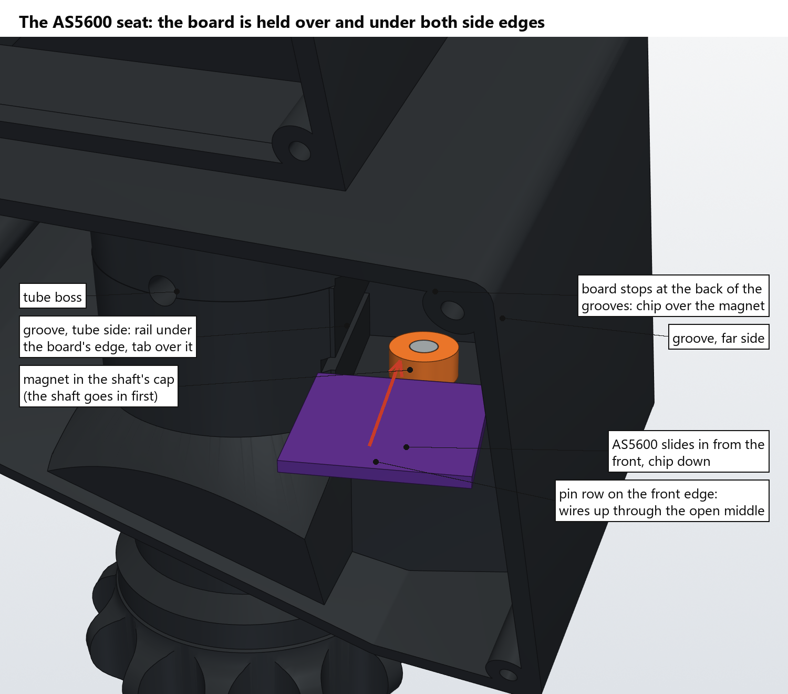

## Printing

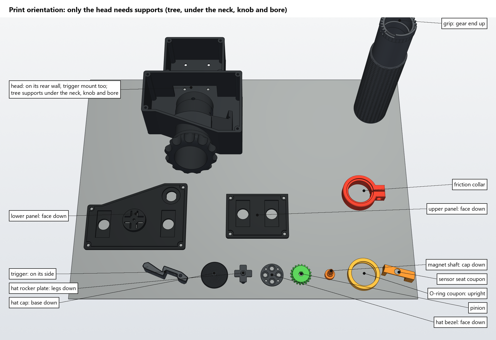

All STLs are in the head's own frame, so they open assembled. In the slicer, turn each one to its print orientation (Bambu Studio: select it, press F, and click the face named below). Use Bambu Studio's 0.20 mm Standard profile unless the table says otherwise.

| Part | File | Lay it on | Notes |
|---|---|---|---|
| **Head** | `HueyHeadR4-Body.stl` | its **rear wall** (outside face) | **Tree supports**, on build plate and on the model, for the neck, the friction knob, the inside of the neck and the tube bore (they lie about 20° off horizontal), and the 50 mm bridge over the wire slot. Paint them on with support enforcers if you'd rather leave the rest bare. The trigger mount needs none: its lugs stand on the bed and its faces are bridges. Keep supports out of the switch's pocket, the groove under the mount and the leads' hole. 4 walls, 25 % infill, in the filament you printed the grip bearing coupons with. |
| Lower panel | `HueyHeadR4-LowerPanel-Black.stl` + `-WhiteText.stl` | front face (labels) | White labels on a P1S with AMS (see below) |
| Upper panel | `HueyHeadR4-UpperPanel-Black.stl` + `-WhiteText.stl` | front face (labels) | As the lower panel |
| Trigger | `HueyHeadR4-Trigger.stl` | either flat side | Tap the hole through its arm M3, for the pull stop |
| Hat cap | `HueyHeadR4-Hat-Cap.stl` | its flat base | Terraced Huey knob; glued onto the rocker plate's legs |
| Hat rocker plate | `HueyHeadR4-Hat-RockerPlate.stl` | legs down, boss up | Its 4 legs are part of it |
| Hat bezel | `HueyHeadR4-Hat-Bezel.stl` | front face down | |
| Throttle grip | `HueyHeadR4-ThrottleGrip.stl` | upright, bottom end down (gear and lug up) | Built from the MkII grip of [DIY Helicopter Collective Hall Effect](https://www.thingiverse.com/thing:5226353) by **Gazmac52** ([CC BY 4.0](https://creativecommons.org/licenses/by/4.0/)) (`../source/MkII-Grip-bore-relieved-25mm.stl`). 25.8 mm bore, clear of the tube, with two O-ring grooves inside. Their roofs are 45°, so it needs no supports |
| Friction collar | `HueyHeadR4-FrictionCollar.stl` | bottom face down (O-ring groove up) | |
| Pinion | `HueyHeadR4-Pinion.stl` | flat | The magnet shaft slides into its hex (4.6 mm across flats, 0.15 over the shaft) |
| Magnet shaft | `HueyHeadR4-MagnetShaft.stl` | cap face down | |
| Sensor seat coupon | `HueyHeadR4-SensorSeatCoupon.stl` | the same way round as it sits in the head printed on its rear wall | Optional: try your AS5600 module in it first |
| Grip bearing coupons | `HueyHeadR4-GripBearingCoupons.stl` | flat, labels up | Optional: the 25.2 ring checks the head's tube bore on the carbon tube. The grip rides on O-rings now |
| O-ring coupon | `HueyHeadR4-ORingCoupon.stl` | upright, like the grip | A 7 mm slice of the grip's bore with one O-ring groove, cut exactly as the grip's (about 2 g). Fit a greased O-ring and slide it on the carbon tube before printing the grip: it should turn with a light, even drag, with no plastic touching the tube |

### White labels on a P1S with AMS

The labels are recessed 0.6 mm into each panel's face. The `-WhiteText` file is a separate body that fills that recess exactly. Because the panels print face down, white is only needed for the first three layers.

1. In Bambu Studio, import the `-Black` and `-WhiteText` files for one panel together (select both files). When it asks whether to load them as a single object with multiple parts, choose **Yes**.
2. In the object list, right-click the text part and set its filament to the white slot. Leave the body on black.
3. Press **F** (lay on face) and click the panel's front face.
4. Use 0.2 mm layers with a 0.2 mm first layer. White then covers layers 1–3 and the rest is black. Leave the prime tower on.
5. The textured PEI plate gives the panels a crinkle finish like the real ones.
6. **Wall generator: Arachne** (Quality, with the Advanced switch on) and a **first-layer line width of 0.42 mm** (default 0.5). The labels are thin: with the default Classic generator the slicer drops pieces of the letters and they print garbled. Arachne prints each stroke as one line. Confirmed on a P1S: with Arachne and the Rev 5 panels, whose letters are grown 0.1 mm (0.5-0.6 mm strokes), every label prints legibly. Rev 4's panels have 0.4 mm strokes; they print better with Arachne than without, but the small labels stay marginal.

The 4-way hat is new in Rev 4 and needs no MkII parts: see [`Hat/README.md`](Hat/README.md) for how it goes together.

**The tube bore.** It's drawn at 25.23 mm, the 25.2 coupon's size. The coupon printed with its axis vertical, but here the bore prints lying down, so it comes out less round and has support scars. Clean the supports out, then try the carbon tube. Ream or sand the bore until the tube presses in firmly. If it's loose, a wrap of tape on the tube's end takes up the play, and the M5 set screw holds it either way.

Tap these 2.5 mm pilots M3:
- the panel columns;
- the trigger mount's right-hand lug, for the pivot: the pilot runs right through the lug, so tap it from the outside, at least 8 mm deep;
- the hole through the trigger's arm, for the pull stop.

Tap M5: the 4.2 mm pilot in the boss's front, for the tube's set screw.

## Screws

Every screw and nut but one is from two kits: the AvrestYPT countersunk kit ([Amazon B0FMD5TMSH](https://www.amazon.com/dp/B0FMD5TMSH): M2–M4 × 8, 12, 16, 20 and M5 × 10, 12, 16, 20, with nuts) and the HIQTRADEBYJJ set-screw kit ([Amazon B0DG33R714](https://www.amazon.com/dp/B0DG33R714)). The exception is the trigger's pivot: an **M3 × 25 countersunk hex-socket screw (ISO 10642 / DIN 7991), bought separately**. The kits stop at 20 mm, and the longer screw threads 8 mm into the lug. The renders call out every hole, with the hardware in red.

| Where | Screw | Into | Qty |
|---|---|---|---|
| Lower and upper panels | M3 × 12 countersunk | M3 thread tapped in the corner columns (50 mm deep pilots) | 8 |
| HeliSR board | M3 × 12 countersunk, from outside the rear wall | through a 4 mm spacer and the board, M3 nut on the board's front | 4 |
| Tube | M5 × 8 set screw, from the boss's front | M5 thread tapped in the boss; the tip goes through the tube's front hole | 1 |
| Trigger pivot | M3 × 25 countersunk, **from the NIULUNBAO M3 set (the kits stop at 20 mm)**, from the left-hand lug's countersink | through the trigger, 8 mm into M3 thread tapped through the right-hand lug; the tip stays inside | 1 |
| Trigger pull stop | M3 × 4 set screw, from behind the trigger's arm | M3 thread tapped through the arm; its tip meets the mount (see [Setting the stop](#starter-trigger)) | 1 |
| Pull stop seat | M2 × 8 countersunk, from the kit, head flush with the mount's face under the spring pocket | M2 thread tapped by hand in a 1.6 mm pilot (8.5 mm deep) behind a 90° countersink; the stop screw's tip bears on its head, not on plastic | 1 |
| Friction collar | M4 × 12 countersunk, head 2 mm into the ear | M4 nut in the other ear's pocket | 1 |

Not screws, but bought with them: the throttle's four O-rings, **24 mm ID × 2 mm** (28 mm OD) nitrile O-ring, ×4: FOCMKEAS, 50 for $6.89 ([Amazon B0BWWBTL4N](https://www.amazon.com/dp/B0BWWBTL4N)). See [The grip floats on O-rings](#the-grip-floats-on-o-rings).

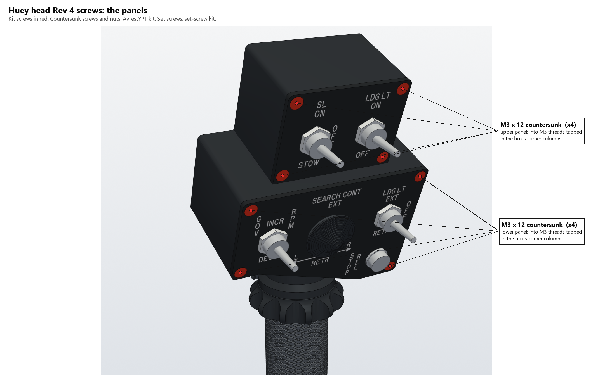

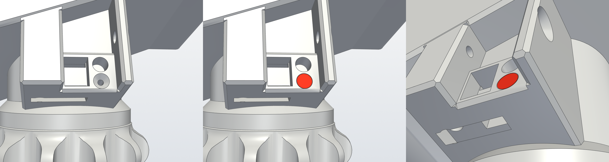

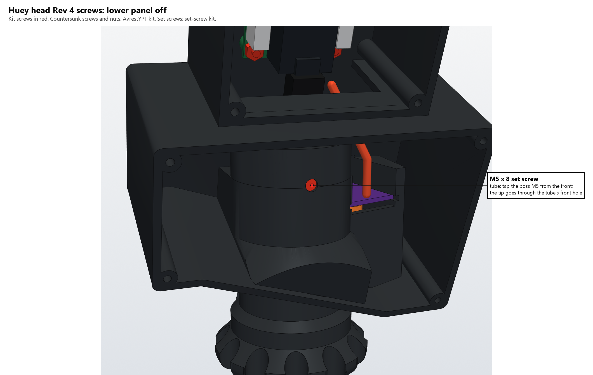

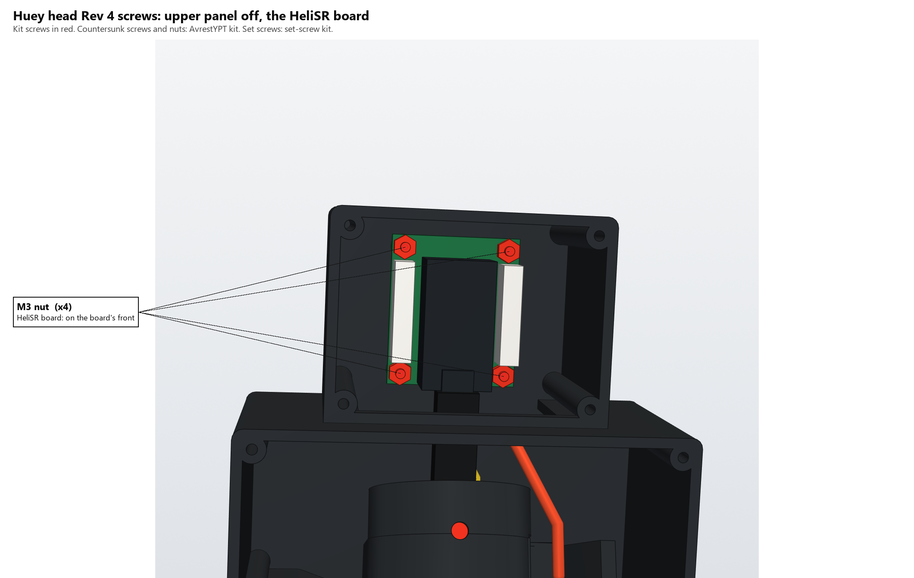

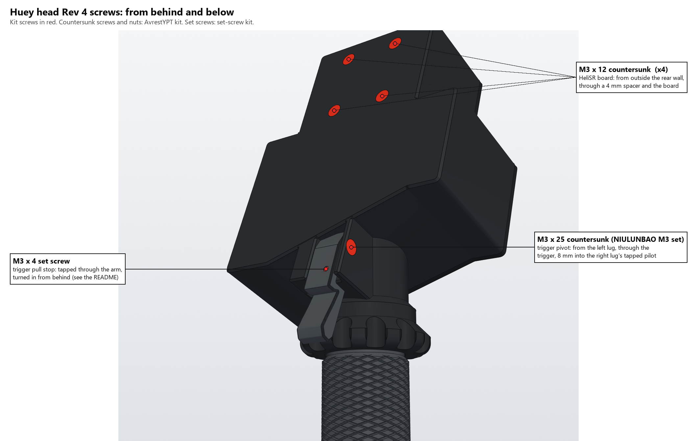

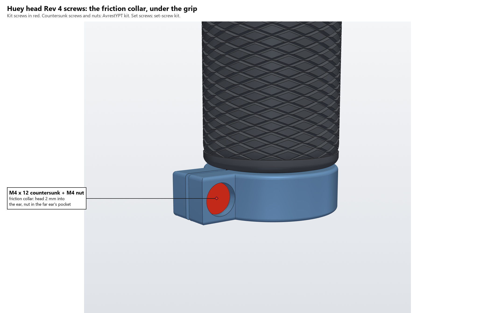

## Bought

The list for the whole collective, with part numbers and prices for the board, head and base, is `../../BOM/Heli_Collective_Final_BOM.xlsx` (it now lists head Rev 5). Every screw and nut is from the two kits above, apart from the trigger's M3 × 25 countersunk pivot.

| Item | Qty | Notes |
|---|---|---|
| 25 × 23 mm carbon tube, **500 mm** | 1 | The MkIII base's tube (`../../Base`). Use it whole, uncut, and drill a 5.2 mm hole through its **front wall only**, 10 mm below its top end, for the set screw's tip |
| Screws and nuts | | See [Screws](#screws) |
| O-ring, 24 mm ID × 2 mm (28 mm OD), nitrile (FOCMKEAS, [Amazon B0BWWBTL4N](https://www.amazon.com/dp/B0BWWBTL4N), 50 for $6.89) | 4 | Two in the grip's bore, one in the friction collar, one in the ceiling's groove. See [The grip floats on O-rings](#the-grip-floats-on-o-rings) |
| Bivar SRS-4-4MM spacers (Digi-Key SRS-4-4MM-ND) | 4 | Between the rear wall and the HeliSR board |
| Pen spring, up to 4 mm across | 1 | The trigger return (cut to about 13 mm) |
| AS5600 module (WWZMDiB, Amazon B0CM3C8KFT) | 1 | The throttle's; its ~4 × 2 mm magnet goes in the shaft's cap |
| APEM 639H/2 toggle, ON-OFF-ON (Digi-Key 679-1223-ND) | 2 | LDG LT EXT / RETR and SL ON / STOW (IN3–IN6) |
| APEM 637H/2 toggle, (ON)-OFF-(ON) (679-1219-ND) | 1 | GOV RPM INCR / DECR (IN1, IN2) |
| APEM 636H/2 toggle, ON-ON (679-1217-ND) | 1 | LDG LT ON (IN7) |
| Same Sky PB4-M-BK-D-67 push button (2223-PB4-M-BK-D-67-ND) | 1 | STOP REL (IN13) |
| TE 1825910-6 tact switch, 6 × 6 mm (450-1650-ND) | 5 | SEARCH CONT hat (IN9–IN12) and starter trigger (IN14) |
| HeliSR board (Rev 4.0, or Rev 3.0) with its Pro Micro and JST cables | 1 | `../../PCB/HeliSR_Rev4.0`; the throttle module goes on AX4 (J14) |
| Hot glue | a dab | Holds the AS5600 module at the front of its grooves |
| Ballast, steel or lead | ~50 g | Only if the base's gas strut lifts too much |

## Assembly

With the lower panel off, everything inside the box goes in through its open front.

1. **Clean up and fit:**
   1. Remove the supports.
   2. Test-fit the tube in its bore and ream the bore to a press fit (see [Printing](#printing)).
   3. Tap the M3 pilots and the tube set screw's pilot.
2. **Pinion:** put it up through the neck and slide it sideways into its pocket, toward the right and back, until its hex hole lines up under the web's bore.
3. **Magnet shaft:**
   1. Glue the magnet into its cap.
   2. Bring the shaft in through the front, over the pod.
   3. Lower it through the pod's open middle and the web. Its pin goes into the bearing hole below the pinion, and its hex slides into the pinion (a 0.15 mm clearance; a drop of glue or a wrap of tape takes up play).
4. **AS5600 module:**
   1. Remove the 0 Ω R1, tie DIR to GND with a jumper across the back of the board, and solder the wires in from the back: VCC, GND, SDA and SCL for HeliSR Rev 4.0 (also remove R4), or VCC, OUT and GND for Rev 3.0 (see [Wiring and programming](#wiring-and-programming)).
   2. Slide it chip-down into its grooves from the front of the pod, one pad column on the front edge and the other at the back, until it stops.
   3. Put a dab of hot glue at the front, and lead the wires up out of the top.
5. **Throttle stops:** nothing to fit. The grip's lug runs between the groove's two end walls, which are the idle and full-open stops.
6. **Starter trigger** (the mount is open at the back until the trigger goes on):
   1. Solder a 26–28 AWG lead, about 25 cm long, to the tips of two diagonally opposite legs of the tact switch. Diagonal legs are always the switched pair: 1 and 4, or 2 and 3, on TE's drawing. Leave the other two legs as they are.
   2. Push the switch into its pocket from behind, legs first, button out. The legs go through the slots in the pocket's floor. Draw the leads out through the open bottom of the well as it goes in. A dab of hot glue at the pocket's edge holds the switch.
   3. Lay the leads in the groove under the mount, along to the right-hand lug. Tin their ends so they're stiff, and push them up the hole at the groove's end. The hole runs straight into the box, about 60 mm. Run a 3.5 mm drill bit through it by hand first, from the groove's end, to clear any printing sag: its top end comes out right against the rear wall's inside, so a bit can't go in straight from the box side. The leads come out there and run up along the rear wall.
   4. Turn the M3 × 4 set screw into the trigger's arm from behind, until it's flush with the arm's front.
   5. Drop the return spring into its pocket in the mount. Any pen spring up to 4 mm across will do; trim it to about 13 mm if it's long.
   6. Slide the trigger in from behind between the lugs, pressing the spring in. Fit the M3 × 25 countersunk pivot from the left, through the trigger, into the right-hand lug.
   7. Set the stop: see [Setting the stop](#starter-trigger).
7. **Tube:**
   1. Use the carbon tube whole (500 mm, uncut) and drill its 5.2 mm cross hole.
   2. Grease the four O-rings lightly. Roll one into each groove inside the grip. Slide the friction collar on (groove up), roll an O-ring down the tube into the collar's groove, then slide the grip on (gear up). Roll the fourth O-ring onto the tube just above the grip: the groove in the head's ceiling takes it as the head goes on.
   3. Route the USB cable and the base sensor's lead up through the tube.
8. **Head onto the tube:**
   1. Thread the cables through the lip.
   2. Press the head down onto the tube until the tube stops at the lip, rocking the grip a few degrees so its gear meshes with the pinion. Turn it until the tube's cross hole lines up with the hole in the boss's front.
   3. Turn the M5 × 8 set screw into the boss's front until its tip is in the tube's hole, about 1.4 mm under the boss's surface. Keep the cables clear of the hole inside the tube.
9. **Friction:** push the grip up until it meets the head. It stops softly on the ceiling's O-ring. Slide the friction collar up until the O-rings give the feel you want, and tighten its M4 × 12.
10. **HeliSR board:**
    1. Plug the Pro Micro into its sockets.
    2. Fit the board upright in the upper box, components to the front, USB end down, on four M3 × 12 screws from outside the rear wall and through the spacers. The nuts go on the front.
    3. Bring the USB cable up through the wire slot and plug it in from below.
11. **Switches and wiring:**
    1. Fit the toggles and the STOP REL button into the panels, and build the 4-way hat into the lower panel's carrier (see [`Hat/README.md`](Hat/README.md)).
    2. Wire everything to the board (see [Controls](#controls)): the AS5600 to AX4 (J14), the starter to IN14.
12. **Panels:** screw them on, M3 × 12 countersunk into the corner columns, then glue the hat's cap onto the rocker plate's legs.

## Checked in CAD

- **A full mock assembly:** every printed part, plus stand-ins for the hardware, the HeliSR board and the wires (41 parts). The tact switch's stand-in has its legs, from TE's drawing.
  - None of the pairs overlap, except where they're meant to touch: the USB plug in its socket, the hat parts in the panel's carrier, and the starter's leads soldered to the switch.
- **The head lies flat on its rear wall:** nothing of it reaches past the plane of the rear wall's outside face, and the trigger mount's lugs end on it.
- **Each part goes in its own way without touching anything:**
  - the pinion, up the neck and sideways into its pocket;
  - the magnet shaft, in from the front and down 25 mm into the pod;
  - the AS5600 module, along its grooves;
  - the tube's set screw, from the front;
  - the tube, grip and collar;
  - the trigger's pivot, from the left;
  - the pull stop's set screw, out of the arm backward;
  - the trigger with its spring, straight back out from between the lugs;
  - the starter switch, back out of its pocket, its legs out of their slots;
  - both panels with their switches;
  - the HeliSR board.
- **The wires clear everything along their routes:** the AS5600's wires, the starter's leads and the USB and sensor cables.
- **The starter's leads' route** has at least 1.2 mm of wall all round, from the well to where the hole comes out into the box, except where it's open on purpose: the well into the groove, and the groove's mouth. It stays clear of the neck's bore, the stop groove, the pinion pocket, the AS5600 pod and the pivot's pilot.
- **The trigger's action**, turning it about its pivot:
  - released, its tail rests on the mount and holds it, and the button is clear of the arm;
  - pulled, the arm meets the button after 0.5 mm, and presses it 0.15, 0.25 and 0.45 mm at 4.0°, 4.6° and 5.6° of pull;
  - the set screw stops it where the table under [Setting the stop](#starter-trigger) says, and nothing else touches the mount on the way;
  - its top stays 1.1 mm or more under the sloping bottom up to the stop;
  - even backed right off, it ends 5.9 mm short of the grip and the friction collar.
- **The throttle through its travel**, from the idle stop to full open (181°): the grip and pinion mesh without touching, the filled part of the grip stays clear of the pinion, and nothing touches the head or the AS5600. The lug stays inside the groove and meets the hard stops at 0° and 181°.
- **Clearances** (the smallest shift along x, y or z that makes two parts touch, capped at 5 mm):
  - head to the lower panel: 0.1 mm;
  - head to the lower toggles and STOP REL, and to the hat: 5 mm or more;
  - AS5600 module to the lower toggles: 5 mm or more;
  - pinion to the head: 0.6 mm; head to the grip: 0.4 mm;
  - trigger to the head: touching, where its tail (the return stop) rests on the mount;
  - trigger to the grip: 5 mm or more.
- **Meshes:** every STL is watertight, except the lower panel's two non-manifold edges in the copied MkII hat geometry, as in Rev 2 and Rev 3. Slicers repair them.

Not yet printed or test-fitted.

## Regenerating

```bash
cd Head/Rev4
python huey_head_r4.py stl
python throttle_r4.py ../source/MkII-Grip-bore-relieved-25mm.stl stl
```

Both scripts stand alone. `huey_head_r4.py` needs `numpy`, `trimesh`, `manifold3d` and `fonttools`. The labels use Routed Gothic Narrow, bundled in `../../fonts/routed-gothic` (SIL OFL 1.1). `throttle_r4.py` also needs `cadquery`.

Settings you're likely to change in `huey_head_r4.py`:
- the friction knob: `KNOB_*`;
- the module's grooves: `GROOVE_H`, `BOARD_CLR`;
- the tube bore: `TUBE_BORE`;
- the starter trigger: `REST_GAP` (button to arm, released), `TACT_*`, `LEAD_*`.

**Mount and knob (2026-10-23):** the trigger mount used to be cut 1 mm clear of the friction knob, leaving a thin air gap between them. It is now solid with the knob where they meet.

**Rear-face chamfer (2026-10-23):** every edge round the outline of the rear wall's outside face, the face the body prints on, has a 1 mm chamfer (`REAR_CHAMFER`), corners included. It also relieves the first layers' elephant foot against the bed.
