# SEARCH CONT hat, Rev 2 (head Rev 5)

A new bezel, rocker plate and cap for the 4-way hat, plus a spring. It fits the carrier that's already printed into the lower panel (`hat_r5.py`). The panel, the four TE 1825910-6 switches and the bezel's four M2 holes stay as they are. `python hat2_r5.py ../stl` writes the parts, `python hat2_r5.py --check` runs the check below, and `python render_hat2.py renders` draws the pictures.

Rev 1 is described in [Rev 4's hat README](../../Rev4/Hat/README.md).

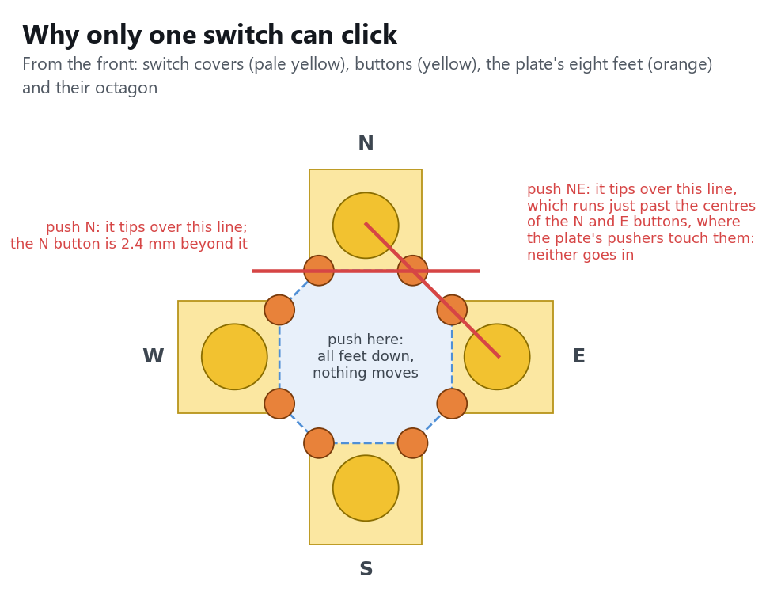

## What was wrong with Rev 1

Rev 1 rocks on one point: the tip of its set screw, against the underside of the bezel.

- **A straight push clicks all four.** The only thing that stops the plate moving straight back is the set screw's rear end, 0.1 mm off the hub's floor. A print can't hold 0.1 mm, and the screw's chamfered end can drop into the 2.4 mm key hole behind it.
- **A push at an angle clicks two.** A point pivot tips as freely toward a diagonal as toward a side. A push at 45° moves both neighbouring buttons 0.71 × as far as a straight push does, so your thumb has to be within a few degrees of the axis to get only one.

## How Rev 2 works

The plate stands on **eight feet**, two on each switch's metal cover, one either side of its button. A pen spring holds it down on them.

- **Push the middle:** nothing moves. All eight feet are already down, so the plate has nowhere to go.
- **Push toward a switch:** the plate tips over the two feet on that switch. The line through them is 4.6 mm out from the centre; the button is 7 mm out, so it goes in. The opposite side lifts. The button clicks at about 7° of tilt. The cap's rim lands on the bezel at 13°, by which time the button has gone 0.58 mm, more than even the stiffest switch needs (0.45 mm).
- **Push toward a diagonal:** the plate tips over the line through the two feet nearest that diagonal. That line runs just past the centres of both neighbouring buttons, and the plate only touches each button at its centre, through a small domed pusher. So neither button goes in: at most 0.02 mm, against a 0.15 mm minimum click.

The feet stand on the switches themselves, so the gap between the plate and each button depends only on the switch and this one printed part. It doesn't depend on the carrier's faces, which print as bridges.

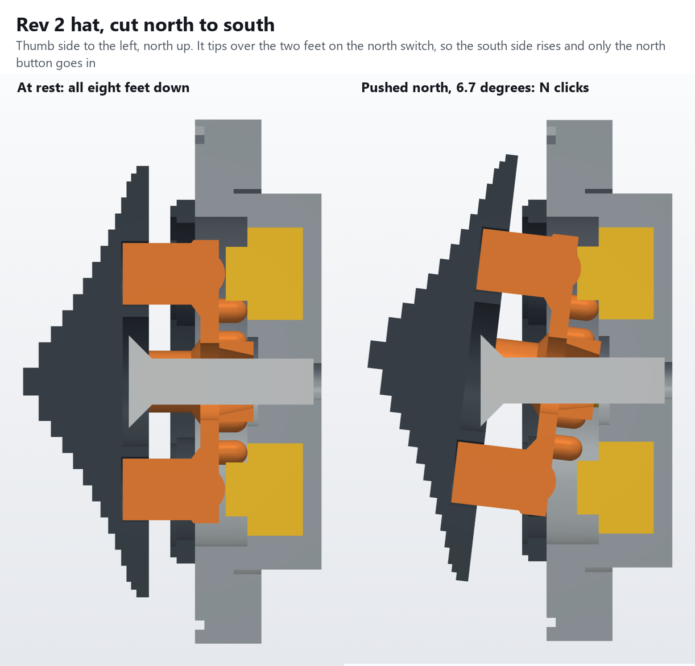

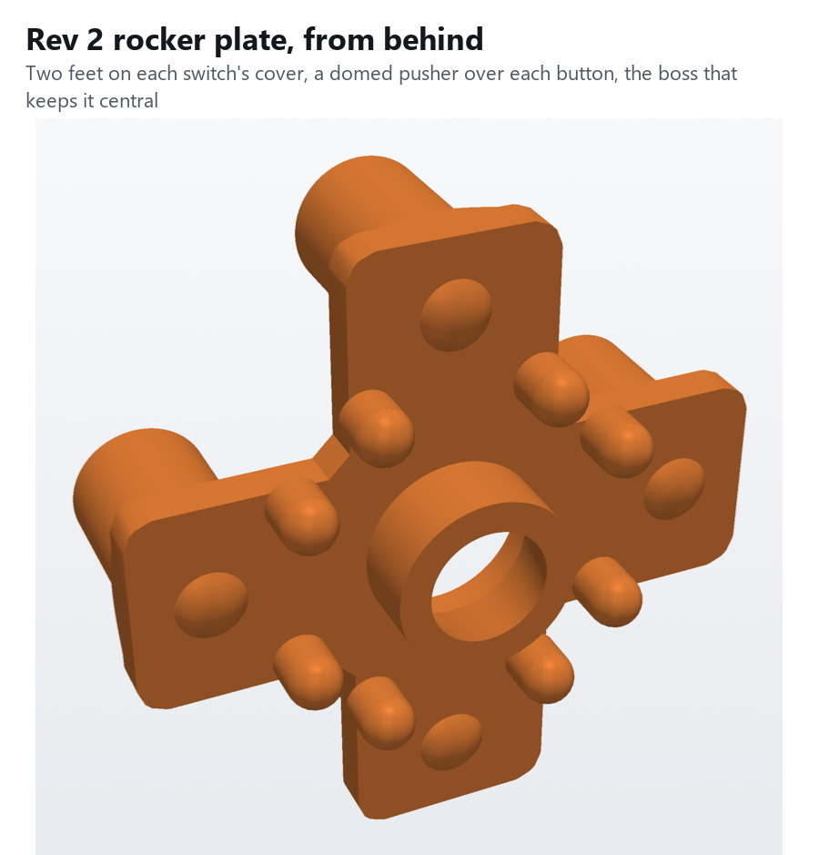

## Parts

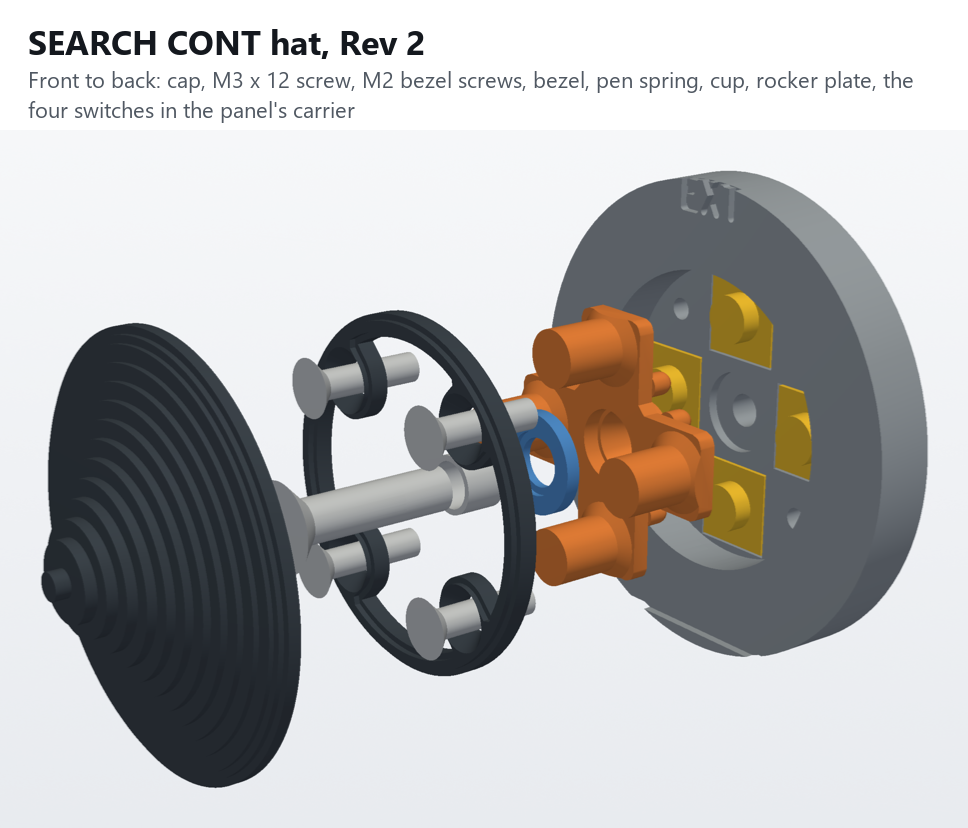

| Part | Print | Notes |
|---|---|---|
| `HueyHeadR5-Hat2-RockerPlate.stl` | legs down on the bed, as Rev 1; no supports | A 1.2 mm plus, with 4 legs forward to the cap, and behind it 8 feet, 4 domed pushers and a boss that sits in the carrier's hub bore to keep it centred |
| `HueyHeadR5-Hat2-SpringCup.stl` | flat, as it comes | A 7 mm washer that the spring sits in, on the plate's face |
| `HueyHeadR5-Hat2-Bezel.stl` | front face down | Now a ring with four ears to the M2 screws, so the plate's far arms can rise past it as it tips |
| `HueyHeadR5-Hat2-Cap.stl` | base down | Rev 1's cap, 1.4 mm over the bezel, with an 8.4 mm pocket underneath for the screw head |

Hardware:
- **M3 × 12 countersunk** (AvrestYPT kit, the same as the HeliSR board's). It goes from the front, through the spring, cup and plate, into the carrier's 2.4 mm key hole, where it cuts its own thread. It doesn't move: it's the spring's anchor.
- **Pen spring**, cut to 4 or 5 coils. It must fit over the M3 screw (3.1 mm or more inside) and in the cup's 4.4 mm seat (4.2 mm or less outside). It's 2.85 mm long as fitted and gets 1.1 mm shorter at full tilt, so it must not close up solid above 1.7 mm.
- **4 × M2 × 8 countersunk**, Rev 1's bezel screws, in the same holes.

Rev 1's M3 × 4 set screw isn't used.

## Fitting it

1. Take Rev 1 out: the 4 bezel screws, then the bezel, and the cap and plate come out together (the cap is glued to the plate's legs). Leave the switches where they are.
2. Run the M3 × 12 into the key hole in the middle of the carrier, then back it out, to cut the thread.
3. Lay the plate on the switches, legs toward you, with its boss in the hub bore and its feet on the switches' covers.
4. Put the cup on the plate's face, seat outward. Put the spring in the seat.
5. Put the screw through the spring, cup and plate, and turn it in until its head's top is about 4.6 mm in front of the plate's face (2.7 mm in front of the bezel's face, once the bezel is on). The plate should sit firm on its feet, with no rattle.
6. Screw the bezel on with the 4 M2 screws.
7. With a meter on the leads, check that no switch reads closed at rest, that each direction clicks only its own switch, and that pushing the middle or the diagonals clicks none.
8. Dry-fit the cap on the legs. It must go all the way down without touching the screw head; if it doesn't, turn the screw in a little. Then glue it on.

## If a switch misbehaves

The one setting is `BTN_GAP` in `hat2_r5.py`: the gap between each pusher and its button at rest (0.05 mm). Change it, reprint only the plate, and move the cap over.

- **A switch reads closed at rest:** the plate is pressing it. Raise `BTN_GAP` by 0.1.
- **A direction won't click before the cap's rim lands:** lower `BTN_GAP` by 0.05.

Anything from −0.10 to +0.15 mm still works.

- **Below 0:** the plate rides on the buttons, up to 0.1 mm off its feet. A straight push then moves the buttons that 0.1 mm, still short of a click.
- **At +0.15:** a straight push toward a switch still reaches 0.48 mm at the stop.

The spring's force sets how heavy the hat feels. For a lighter push, use a softer spring or a piece with more coils (but mind its solid length).

## Checked in CAD

`hat2_r5.py --check` builds the parts in place with the panel's carrier, the switches and the screws.

- **At rest,** nothing overlaps.
- **Tipping:** it then tips the plate and cap every way it can go. That's over each of the octagon's 8 edges and over each foot, with the tipping line turned 25 %, 50 % and 75 % of the way between that foot's two edges. Each one runs until something hits, and the check records how far each button has gone.

| Tipped over | Stops at | Pressed button | Neighbours |
|---|---|---|---|
| the two feet on a switch (N, E, S, W) | 13.2°, cap on bezel | 0.58 mm | 0 |
| a foot, 11° off the axis | 11.5° | 0.39 mm | 0 |
| a foot, 22° off | 11.7° | 0.27 mm | 0 |
| a foot, 34° off | 12.3° | 0.15 mm | 0 |
| the two feet nearest a diagonal (NE, ...) | 14.2° | — | 0.02 mm each |

So a push within about 25° of a switch's axis clicks that switch alone. A push closer to a diagonal clicks nothing, and no push can click two.

## Not checked

Nothing is printed yet. Still to try:
- the pen spring you have: its size, its force, and how heavy the hat feels;
- whether the M3 screw holds in the key hole;
- the real switches' button heights, which set the gap (see `BTN_GAP` above);
- how the feet sit on the covers' metal.

# Rev 3: a separate pod, and a plain hole in the panel

`python hat3_r5.py ../stl` writes the panel and the hat's parts, `python hat3_r5.py --check` runs the tilt check, and `python render_hat3.py renders` draws the pictures. `../check_r5.py` now checks the whole head with this panel and the pod.

Rev 1 and 2 put the switch carrier in the lower panel, so the panel needed supports there and the faces that set the hat's fit came out rough. In Rev 3 the lower panel (`HueyHeadR5-LowerPanel-Hat3-Black` / `-WhiteText`) has only a 23 mm round hole and three 2 mm pins on its back. The pins are unevenly spaced, so the pod fits one way only. The panel prints face down with **no supports**. The hat is a separate pod, glued on over the pins.

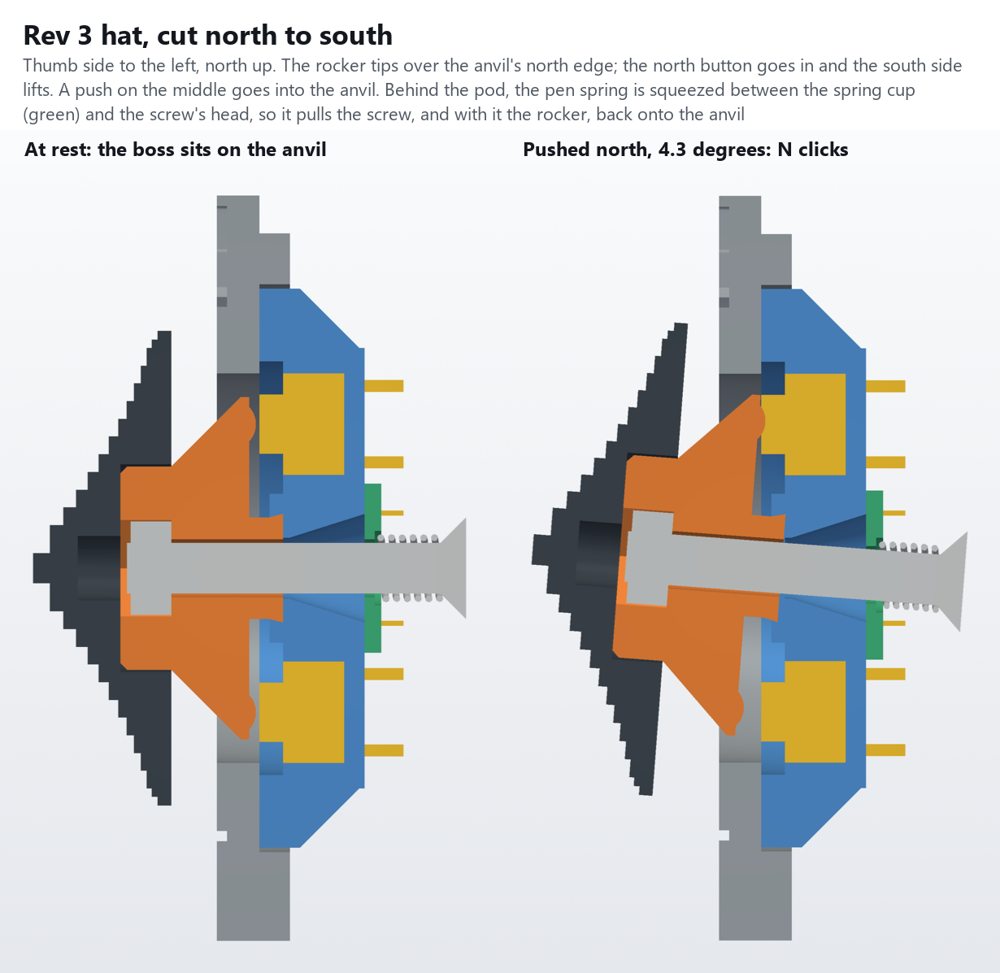

- **A straight push moves nothing.** A fixed octagonal anvil, 2.6 mm out to its edges, stands in the pod's middle. The rocker's square boss sits on it, so a push on the middle goes straight into the anvil.
- **8-way.** A push toward a switch tips the rocker over that edge of the anvil, and that switch, 8.5 mm out, clicks. A push toward a diagonal tips it over a diagonal edge, and both neighbours (6.0 mm out along it) click. Opposite buttons can't go in together, and nor can three.
- **No slop.** The boss is square, in a 6.6 mm square bore, so the rocker can't slide or turn and its pushers stay on the buttons. The boss is 6.4 mm where it sits on the anvil, 0.1 mm inside the bore all round. That lets the rocker turn 1.8°, which moves each pusher 0.27 mm across its 3.5 mm button. It narrows to 6.0 mm at the bore's mouth so its sides still clear the bore's wall at full tilt (by 0.05 mm at the least). The first print had a straight 6.0 mm boss: it could turn 6°, about 0.9 mm at the pushers in CAD, and further in print.
- **Feel.** An M3 × 20 countersunk screw comes from behind, through a cup, a pen spring and the anvil, into an M3 nut in the rocker's stem. The spring holds the rocker on the anvil and centres it, and the tact switch gives the click. The pressed buttons bottoming are the stop; the cap's rim on the panel face is the backstop at 13°.
- **Accurate where it matters.** Every gap that sets the click (anvil, pocket floors, pushers) is a top surface of either the pod or the rocker, and each is a whole number of 0.2 mm layers. The panel doesn't set any of it.
- **Serviceable.** The rocker goes in and out through the panel's hole from the front.

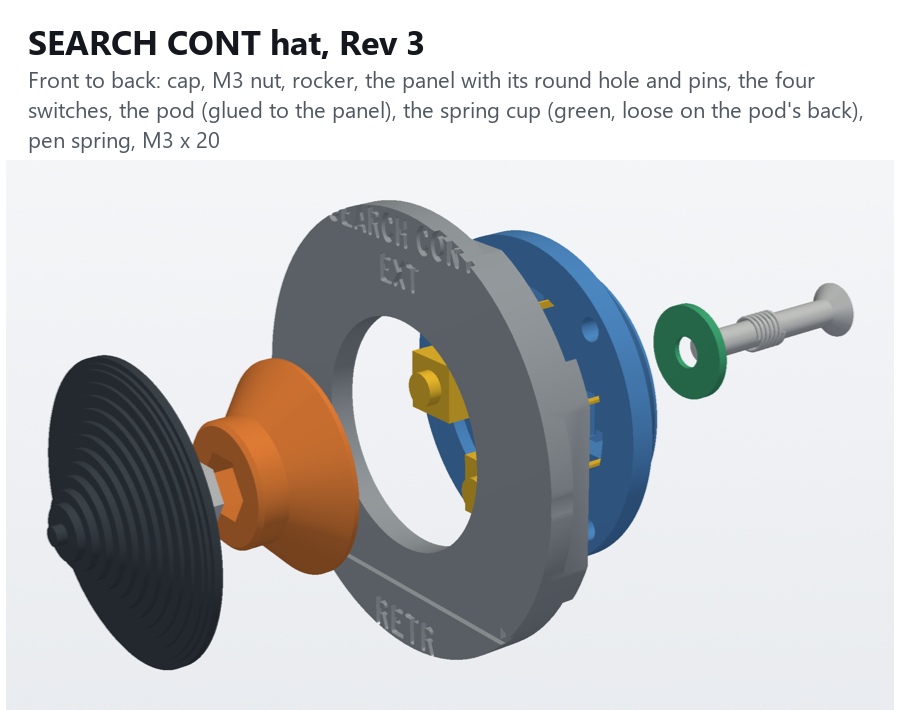

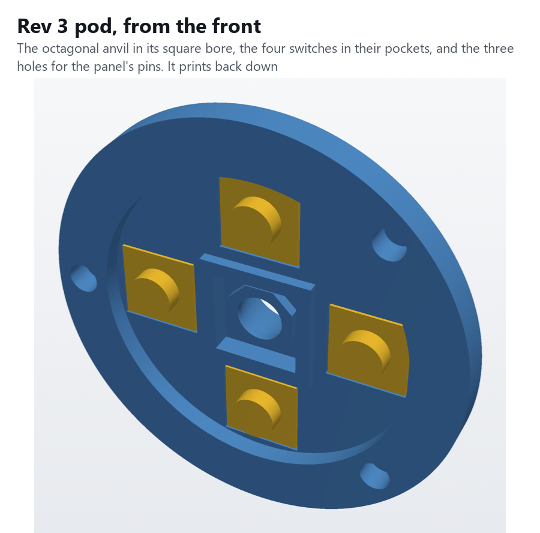

| Part | Print |
|---|---|
| `HueyHeadR5-LowerPanel-Hat3-Black` / `-WhiteText` | face down, as before (Arachne, 0.42 mm first layer); no supports |
| `HueyHeadR5-Hat3-Pod.stl` | back down, as it comes; no supports |
| `HueyHeadR5-Hat3-Rocker.stl` | stem down, as it comes: the cone is 45°; no supports |
| `HueyHeadR5-Hat3-SpringCup.stl` | flat. A 10 mm washer with a shallow seat for the spring. It goes on the pod's back, round the screw hole, seat outward, and isn't glued |
| `HueyHeadR5-Hat3-Cap.stl` | base down |

Print the pod and rocker with 0.2 mm layers (or 0.1 mm): their heights are whole layers.

Hardware: 4 × TE 1825910-6 (the ones you have), an **M3 × 20 countersunk + M3 nut** (kit), and a **pen spring** from the trigger's pack, cut to about 6 coils. It fits 4.2 mm long and closes another 0.6 mm at full tilt, so it must not go solid above 3.5 mm.

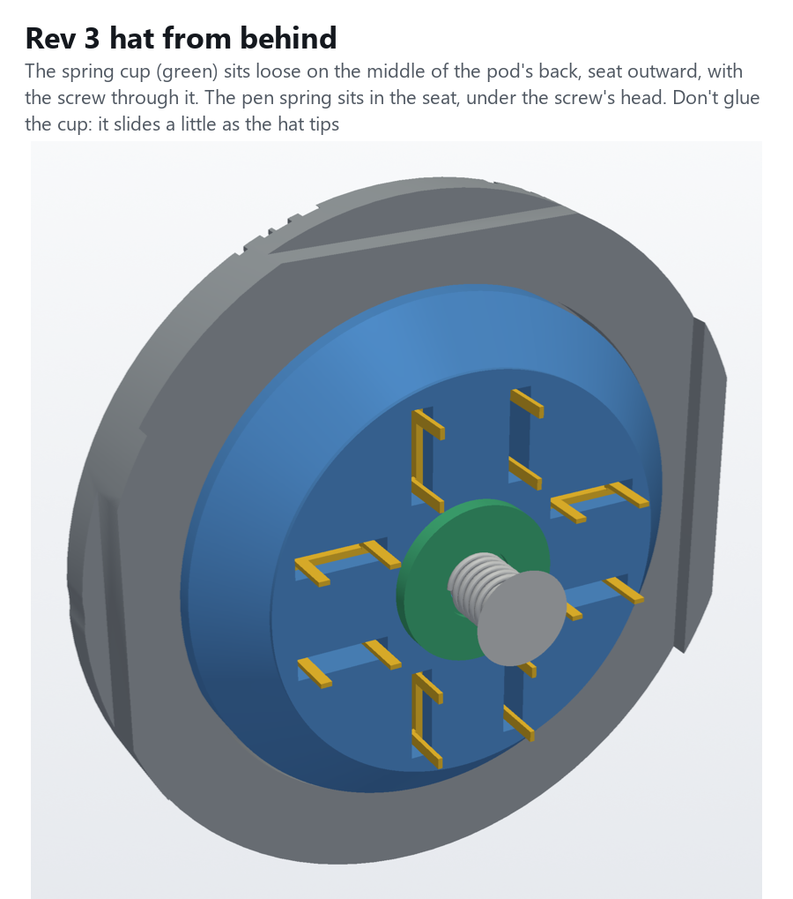

Fitting it:
1. Put the four switches in the pod's pockets from the front, legs out the back, and wire them.
2. Glue the pod to the panel's back over the pins.
3. Press the M3 nut into the hex pocket in the rocker's stem. Put the rocker in through the panel's hole, boss first, into the square bore.
4. From behind: the screw through the spring, then the cup (seat toward the spring), then the pod, into the nut. The cup ends up flat on the middle of the pod's back, with the spring between it and the screw's head. Don't glue it: as the hat tips, the screw swings and drags the cup up to 1.3 mm across the pod's back. Hold the stem and turn the screw until the head's top is about 6 mm behind the pod's back. The rocker should sit firm, with no rattle.
5. With a meter, check that no switch reads closed at rest, that each side clicks only its own switch, and that each diagonal clicks its two.
6. Glue the cap on the stem.

Checked in CAD (`--check`): nothing overlaps at rest, and the pod, switches and spring stack clear the head's body (`check_r5.py`, all clear). With a 0.2 mm gap at rest:

| Push | Clicks at (nominal / stiffest switch) | Buttons in | Backstop |
|---|---|---|---|
| N, E, S, W | 4.3° / 6.2° | that one | 13.0° |
| NE, SE, SW, NW | 7.2° / 10.2° | both neighbours | 12.9° |
| anywhere between | 4.6–5.8° / 6.5–8.3° | one, the second partly | 13.1° |

No third button ever moves. Slid to wherever the screw drags it, the cup still covers the pod's screw hole and clears the switch legs. Printed once: the boss turned out loose and is now bigger (see **No slop** above). If a switch reads closed at rest, raise `BTN_GAP` by 0.2 and reprint only the rocker. If a diagonal won't click, lower it by 0.2.

If the rocker still turns too far in the bore, raise `BOSS` (half the boss's width at the anvil, now 3.2) by 0.025 to 0.05 and reprint only the rocker; keep it below 3.25, or the boss's corners rub the bore at full diagonal tilt. If it binds or won't come back to centre, lower it.

# Rev 4: an ALPS 8-way stick on a breakout board

`python hat4_r5.py ../stl` writes the panel and the cap, `python hat4_r5.py --check` runs the checks below, and `python render_hat4.py renders` draws the pictures. `../check_r5.py` now checks the whole head with this panel and the board.

Rev 3 made its 8-way action from four tact switches, a printed rocker, an anvil, a spring and a screw, in a pod glued to the panel. Rev 4 buys the action instead. The **ALPS RKJXM1015004** is a sealed 8-direction stick switch with its own stops: 10° toward a side, 12° toward a diagonal. It also has a centre push. It sits on a small breakout board, [**SearchHat Rev 1.0**](../../../PCB/SearchHat_Rev1.0/README.md), which screws to four bosses printed on the panel's back. Nothing is glued. The panel still prints face down without supports, because the bosses grow straight up off its back. The cap is the only other printed part.

- **8-way:** a push toward a side joins one direction, a push toward a diagonal joins its two neighbours. Opposite sides can't go in together, and nor can three: the switch can't lean two ways at once.
- **No slop:** the stick is metal, in the switch's own bearing. The board is held by four screws, and the switch's peg places it on the board.
- **Feel:** from the catalog, it takes 30 ± 20 mN·m to tilt toward a side (25 ± 20 toward a diagonal). That is about 3 N with your thumb 10 mm out from the middle, with a click. The centre push takes 3 ± 1.5 N.
- **Strength:** the stick takes 0.3 N·m. That's about 20 N on the cap's rim, so press it, don't lean on it.

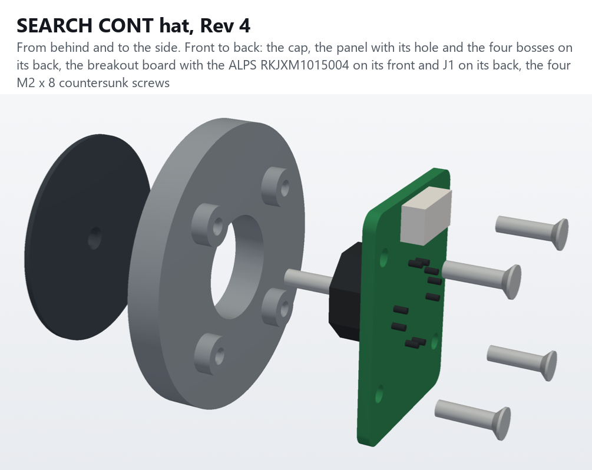

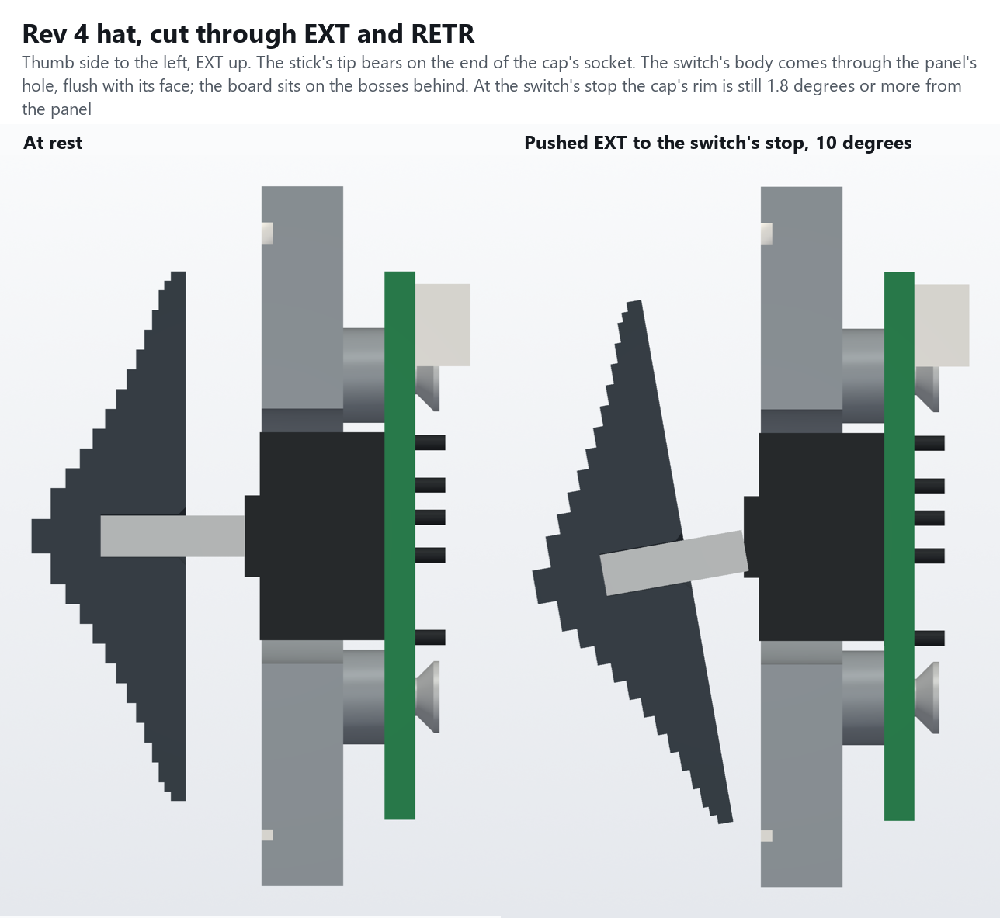

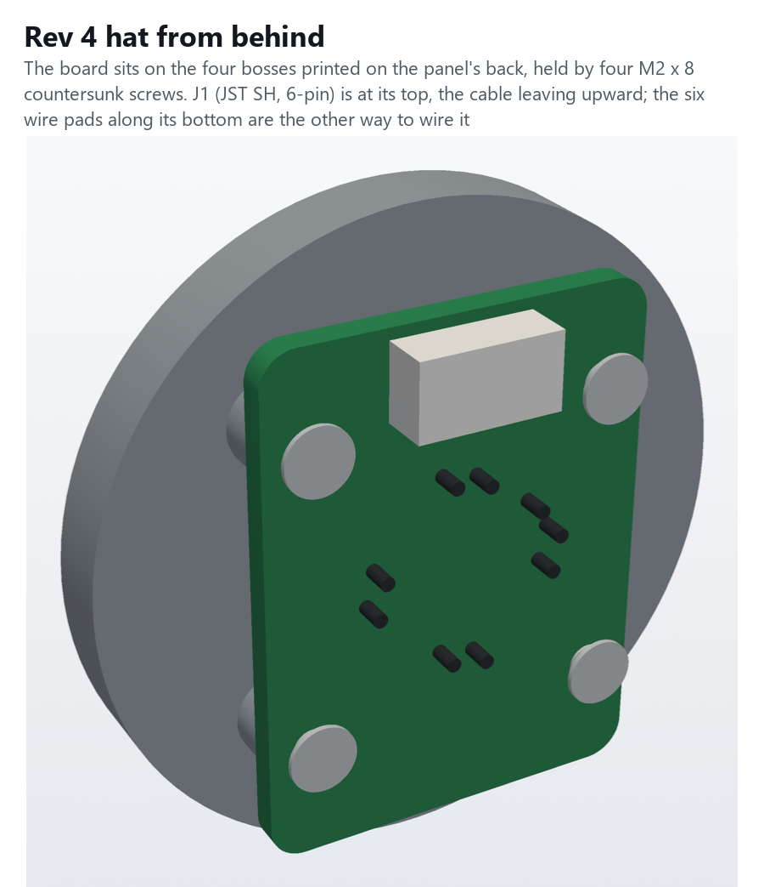

## How it fits

Measured from the panel's back (its face is 2.5 mm in front):

| | |
|---|---|
| Cap | Rev 1's 28 mm knob, its underside 4.0 mm in front of the panel's face (Rev 3: 2.7). Its socket is 2.3 mm across and 4.5 mm deep, and the stick's tip bears on its end |
| Stick | 2.2 mm, its tip 11.0 mm in front of the panel's back. The catalog gives 15 ± 0.4 mm from the switch's mounting face, so the cap sits 3.6–4.4 mm off the face |
| Switch | Its 11 mm body comes through the panel's 13.5 mm hole, its front flush with the face (0.1 mm proud) |
| Board | Its front on the four bosses, 4.0 mm behind the panel's back; its back at 5.6. J1 ends at 8.5 and the switch's pins at 7.2. The neck is cut to 13.5 there |
| Bosses | Four, 5 mm across, on the board's 17 mm square, part of the panel. Each has a 1.6 mm pilot down to 1 mm short of the face |
| Screws | M2 × 8 countersunk, from behind through the board. Each has 5.1 mm of thread in its boss and the panel |

## Parts

| Part | Print |
|---|---|
| `HueyHeadR5-LowerPanel-Hat4-Black` / `-WhiteText` | Face down, as before (Arachne, 0.42 mm first layer); no supports |
| `HueyHeadR5-Hat4-Cap.stl` | Base down, as it comes: the stick's socket opens on the bed, with a lead-in for the first layer's squash |

To buy:
- **ALPS RKJXM1015004** (Mouser 688-RKJXM1015004).
- **The SearchHat Rev 1.0 board**: `PCB/SearchHat_Rev1.0/SearchHat_Rev1.0_Gerbers.zip`. Its own README covers building it.
- **JST SM06B-SRSS-TB** for J1, and a 6-pin JST SH jumper to cut in half for the lead. Or leave J1 off and solder the wires to the board's J2 pads.
- **4 × M2 × 8 countersunk** (the AvrestYPT kit).

Wiring: the same inputs as the tact-switch hats, so the profiles don't change. The centre push is extra.

| Signal | Board J1 pin | HeliSR J2 pin | Input |
|---|---|---|---|
| EXT (up) | 5 | 2 | IN9 |
| RETR (down) | 3 | 3 | IN10 |
| L | 6 | 4 | IN11 |
| R | 1 | 5 | IN12 |
| GND | 2 | 1 or 10 | |
| CTR (centre push) | 4 | 8 | IN15 (spare; optional) |

## Fitting it

1. Build the board ([its README](../../../PCB/SearchHat_Rev1.0/README.md#building-it)) and check it with a meter.
2. Run an M2 × 8 into each boss's pilot and back it out, to cut the thread.
3. Plug the lead into J1. Lay the board on the bosses, switch first through the panel's hole, with the "EXT" arrow on its front pointing up toward the SEARCH CONT label. Put the four screws in, and tighten them gently: they're in plastic.
4. With the panel on, route the lead straight back over the board's top edge and up into the slot to the upper box. The end of the plug is 2.2 mm below the lower box's top wall.
5. Push the cap onto the stick until the stick bottoms in the socket. If it's too tight, open the socket with a 2.2 mm drill, by hand. If it's loose, use a drop of CA glue, but then the cap won't come off again.
6. In the Configurator, check each direction, each diagonal (two buttons at once) and the centre push.

## Checked in CAD

`hat4_r5.py --check` puts the panel, the board, the switch, J1, the screws and the cap in place.
- **At rest:** nothing overlaps. The M2s overlap only their pilots, where they cut the thread.
- **Tipping:** the drawing doesn't say where the stick's pivot is. So it tries three places: the body's front, its middle and the mounting face. It also tries the stick at its shortest, 14.6 mm, which brings the cap 0.4 mm nearer the panel. For each, it tips the cap all 8 ways until its rim meets the panel's face:

| Pivot | Stick 15.0 | Stick 14.6 |
|---|---|---|
| The body's front | 16.1° | 14.5° |
| The body's middle | 15.6° | 14.1° |
| The mounting face | 15.2° | 13.8° |

The switch stops at 12° at most, so the rim never reaches the panel: there's 1.8° to spare at the worst. At 12° every way, the stick also clears the panel's hole and the cap clears the switch's body.

`check_r5.py`: all clear, with the board, the switch, J1 and its plug and wires in place against the body, the toggles and the HeliSR board.

## Not checked

Nothing is printed or built yet. Still to check:
- the switch's real dimensions: everything here comes from the ALPS catalog's drawing, including the 0.8 mm collar in front of its body, which is read off the drawing;
- that A is EXT, as the catalog's lever drawing reads. If not, swap the inputs in the profile;
- the cap's socket on the stick: snug, loose or tight as printed;
- the M2s in the bosses' pilots.
