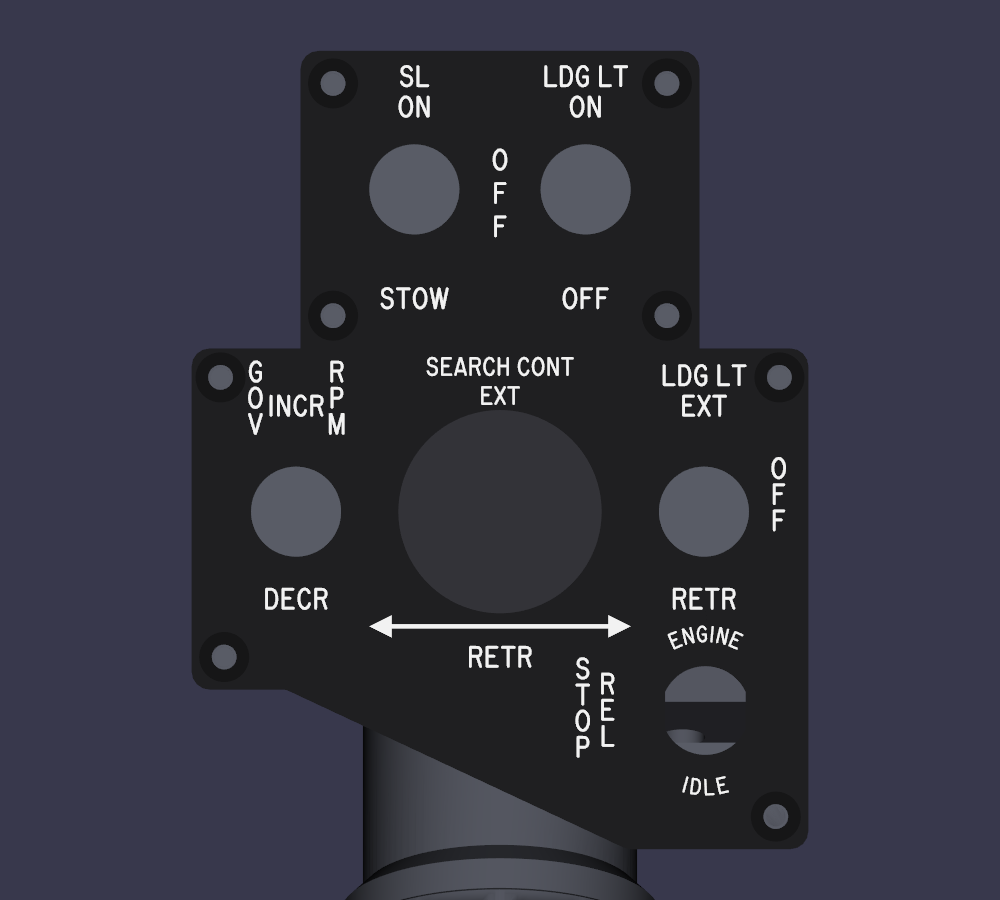
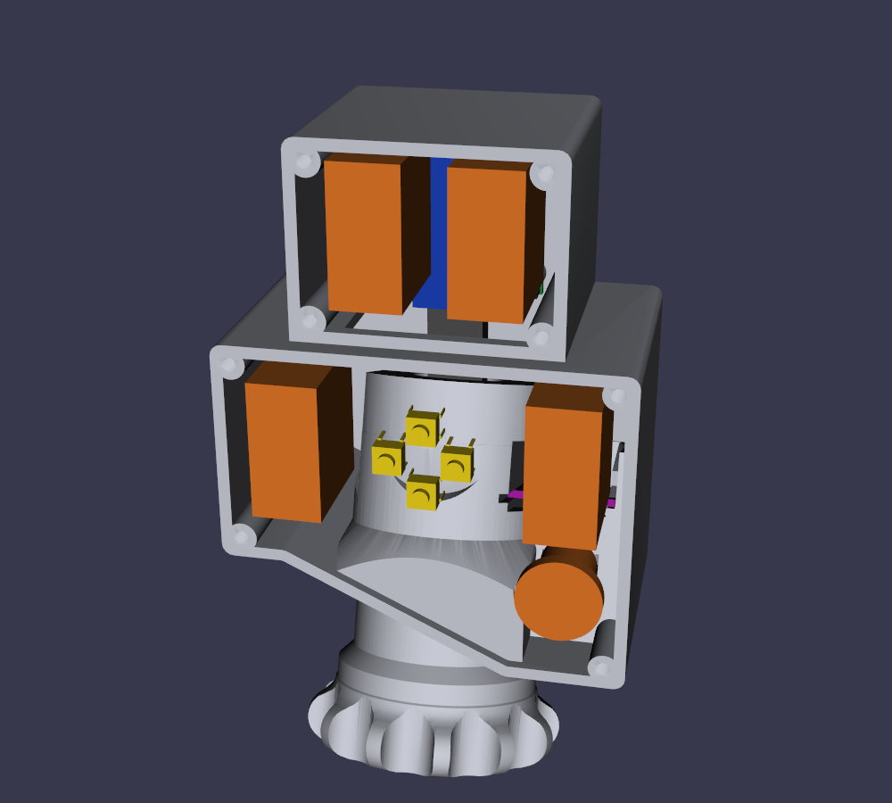
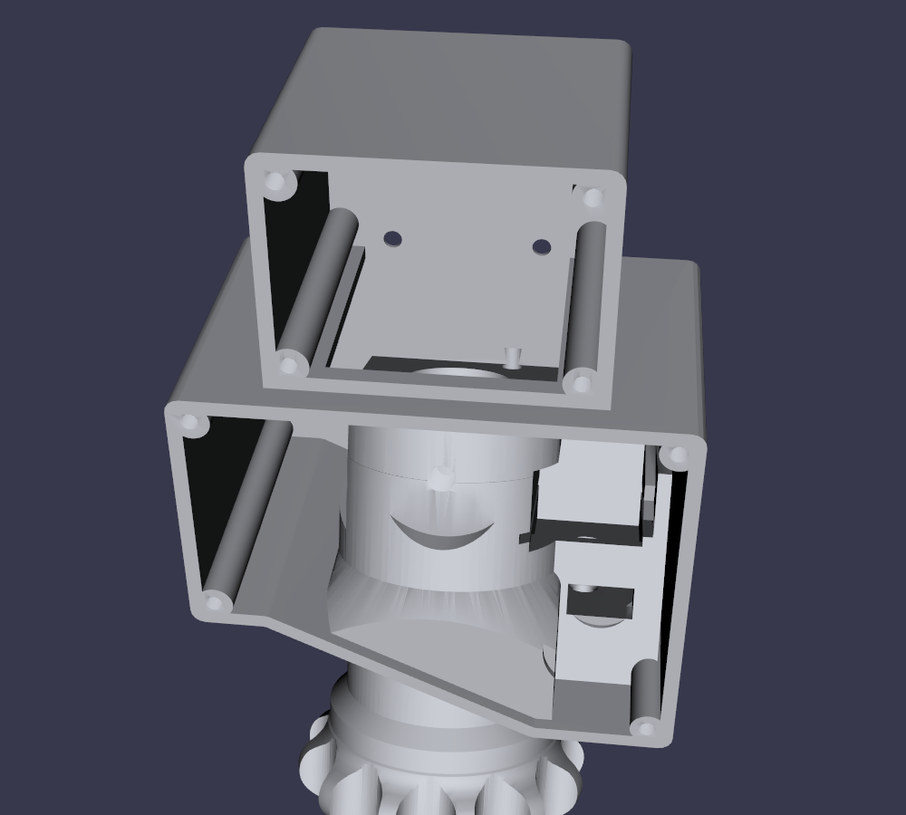
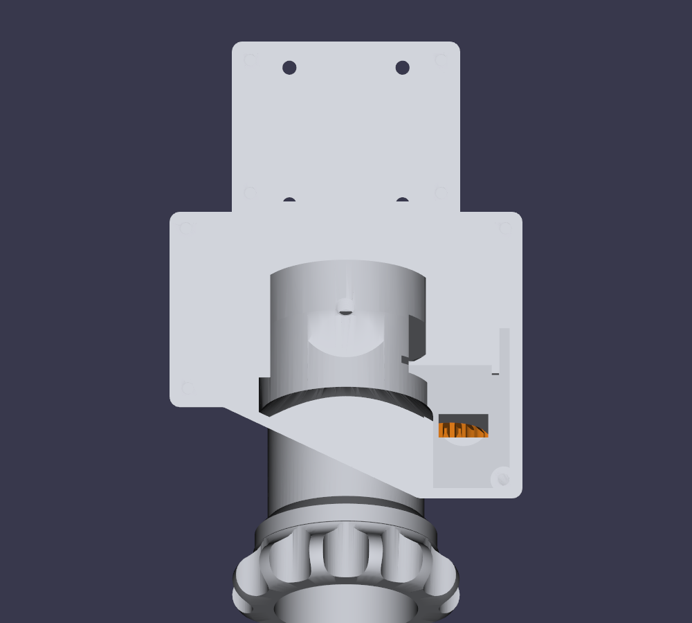

# UH-1 "Huey" head, Rev 5: the real panel dimensions

Rev 5 is head Rev 4 ([`../Rev4`](../Rev4/README.md)) with the box and both panels cut to the real UH-1 panels' dimensions. The dimensions come from **dcval**'s scaled drawing of the panels, and the switch and label layout from **Kornskydiver**'s photos of a real UH-1 head. Both were posted in the ED Forums thread [Huey Collective Measurements](https://forum.dcs.world/topic/152333-huey-collective-measurements/); copies, with credits, are in [`../reference`](../reference/README.md). The switches are moved to where the drawing has them, and everything is checked for collisions. The throttle (its grip built from the MkII grip of [DIY Helicopter Collective Hall Effect](https://www.thingiverse.com/thing:5226353) by **Gazmac52** ([CC BY 4.0](https://creativecommons.org/licenses/by/4.0/))), the friction knob (its shape measured off hotpretzel's knob, [CC BY-NC](https://www.thingiverse.com/thing:4284120): it and `HueyHeadR5-Body.stl` are for non-commercial use only), the starter trigger and its mount (with the M2 pull-stop seat), the leads' hole, the AS5600 pod and the 4-way hat work as in Rev 4. For them, and for the assembly steps, see Rev 4's README.

**Status:** designed and checked in CAD only. Nothing has been printed. The BOM in [`../../BOM`](../../BOM) still lists Rev 4.



## Dimensions

| | Rev 4 | Rev 5 (real panels) |
|---|---|---|
| Lower panel | 107 × 75 mm, 50 mm on the left | **85 mm wide, 69.01 mm tall on the right, 47.03 mm on the left** |
| Its bottom edge | 15 mm flat, diagonal, 25 mm flat | **13 mm flat, a 51.8 mm diagonal, 25 mm flat** |
| Upper panel | 67 × 50 mm, 20 mm in from the left | **55 × 41 mm, 15 mm in from each side** |
| Upper box set back from the lower panel | 10 mm | 5 mm (see below) |
| Box depth | 55 mm | 55 mm |

The tube stays centred across the lower box, at the same x as in Rev 4. The box is set at the height that puts the diagonal bottom under the tube where Rev 4's was, within 0.16 mm. So the neck, the knob, the grip, the gears and the trigger keep their places on the tube, and the tube (now the whole 500 mm, as the base takes it) is unchanged.

## Switches

Positions are from the drawing, measured from each panel's top-left corner (u across, v down), in mm, with three rules:
- each panel's two toggles mirror each other about the panel's centre line: same height, same distance from each side;
- the search hat is centred between the lower two;
- the upper panel's screws are in its four corners.

| Switch | Drawn | Rev 5 | Why |
|---|---|---|---|
| GOV RPM INCR / DECR toggle | 13.4, 22.5 | 14.4, 22.5 | The drawing's 13.4 and 15.4 mm from the sides, averaged |
| LDG LT FWD / DOWN toggle | 69.6, 22.5 | 70.6, 22.5 | Its mirror image: 14.4 mm in from the right |
| SEARCH CONT hat | 42.7, 14.2 | 42.5, 22.5 | Centred between the two toggles: midway across, and at their height |
| STOP REL button (in the ENGINE IDLE ring) | 70.8, 49.9 | 70.8, 49.9 | |
| SL ON / STOW toggle (upper) | 11.2, 19.1 | 15.7, 19.1 | The LDG LT ON toggle's 15.7 mm from its side, mirrored. Nearer the side, its body hits the corner screws' columns: the bodies are 29.7 mm tall, the box is 36 mm inside, and a column fills each corner |
| LDG LT ON / OFF toggle (upper) | 39.3, 19.1 | 39.3, 19.1 | |

The labels are laid out as on the real head (the user's photo). Each one belongs to its switch, at a fixed offset from it, so it moves with the switch (`*_LABELS` in `huey_head_r5.py`):
- **GOV toggle:** GOV stacked, INCR, and RPM stacked, in a row across the top over the switch; DECR under it.
- **LDG LT toggle:** LDG LT and EXT over it, in line with GOV's row; OFF stacked down its outer side; RETR under it, level with DECR.
- **Search hat:** SEARCH CONT and EXT over its 28 mm cap; a double-headed arrow under it, from side to side; RETR below.
- **STOP REL button:** STOP and REL stacked to its left; ENGINE and IDLE round it, 0.6 mm outside the button's 17.6 mm bezel (Same Sky PB4 datasheet), so the bezel doesn't cover them.
- **Upper toggles:** SL / ON over the left one, STOW under it; LDG LT / ON over the right one, OFF under it. OFF is stacked on the centre line between them.

The labels are cut from Routed Gothic Narrow (bundled in `../../fonts/routed-gothic`, SIL Open Font License 1.1), a digitized Leroy lettering template like the engraved lettering on the real panels. They are 3 mm tall (Rev 4: 3.6 mm). SEARCH CONT and EXT are 2.6 mm, and ENGINE IDLE is 2.3 mm. `check_r5.py` checks that every label clears the screw heads, the switches' nuts, the hat's bezel, the STOP REL button's bezel and the panel's edge.

The lower panel's top two screws are 4 mm in from their corners (Rev 4: 4.5 mm), clear of GOV and LDG LT.

## What else changed to make it fit

| | |
|---|---|
| **Upper box** | Set back 5 mm instead of 10, so the upper toggles' 26 mm bodies end 2 mm in front of the HeliSR's Pro Micro. |
| **Upper panel screws** | In the four corners, as in Rev 4, on columns that run back to the rear wall either side of the HeliSR board. The toggles are spaced to clear them. |
| **Panel screws** | All eight are **M3 × 16 countersunk** (kit; an M3 × 20 fits too), in the same 6.4 mm columns, threaded M3 20 mm deep from the panel's back (`PANEL_THREAD`) and solid behind that. |
| **Printed threads** | Every hole a screw of M3 or larger threads into is printed with its ISO metric thread, opened 0.15 mm for FDM (`thread_cut`), so nothing needs tapping: the panel columns (M3), the tube's set screw (M5), the trigger pivot in the right lug and the pull stop in the trigger's arm (M3), and the hat's pivot set screw in the rocker plate (M3). The M2 holes (the hat's bezel, the pull stop's seat) are still 1.6 mm pilots to tap by hand. The HeliSR's four M3 screws go through clearance holes into nuts, as before. |
| **No air behind the neck** | The head prints on its rear wall, so any air between the neck block and that wall would print on supports, which are weaker than infill. Every piece of the neck block (the boss, the AS5600 pod, the flare, the neck and the tube's column) is carried straight back to the rear wall and capped again at its own top, square to the tube, and only then are the switches' room, the AS5600's way in, the pinion pocket's window and the leads' hole cut out of it. The USB cable goes into the tube through the 20 mm round opening in the column's lip, which is the tube's stop. |
| **HeliSR board** | The upper box is 38.5 mm tall inside, which is less than the board's 39.3 mm. The board's USB end now sits 1.4 mm down in the wire slot through the floor. It is still centred across the upper box. |
| **AS5600 module** | It is square to the box (Rev 4 turned it 15°, with the pinion). Turned, its way in from the front would come out through the narrower box's right wall. The chip is still centred over the magnet. |
| **Search hat** | Rev 4's hat, unchanged: 28 mm cap, bezel, rocker plate, tact switches and carrier. The changes: the rocker plate's M3 pivot hole is a printed thread, and the legs go 1.8 mm into the cap's sockets (Rev 4: 2.4), so there is at least 0.8 mm of cap over them, in sockets opened to 4.25 mm (Rev 4: 4.1, too tight). Its labels sit round the cap: SEARCH CONT and EXT over it, the arrow and RETR under it. |
| **Tube set screw** | Straight ahead, as in Rev 4: drill the tube's 5.2 mm hole through its front, 10 mm below its top end. The hat's recess opens in front of the screw's hole, so the screw goes in through the hat's opening with the lower panel off. All 7.75 mm of its thread is in solid boss, with at least 2 mm of wall all round. |
| **Slot between the boxes** | 37.6 × 40.5 mm: across the upper box between its screw columns, and from the rear wall forward to 1.5 mm behind the rib the upper panel bears on (Rev 4: 25 mm deep). |
| **Lower box's upper-box joint** | The upper box reaches 1 mm down into the lower box's top wall, so the HeliSR's lower screw holes don't cut through a seam (that left the body's mesh open). |

## Room behind the switches

The neck block is cut back behind each lower-panel switch, so its body clears and its soldered wires have room. Measured from the back of the panel:

| Switch | Its body ends | Neck cut to | Room for the wires |
|---|---|---|---|
| GOV and LDG LT toggles | 26 mm (APEM 600H, lugs straight) | the rear wall: each cut runs straight back from the panel to the face the head prints on, 2.5 mm clear of the GOV toggle's sides and 1.5 mm of LDG LT's (`TOGGLE_CLR`) | all the way back. Behind LDG LT the cut starts 2 mm higher (`LDG_BACK_LIFT`), keeping 1.2 mm over the AS5600 module's hold-down tabs; at the front it takes the first 6 mm off those tabs, leaving 17 mm of their 23 |
| STOP REL (Same Sky PB4) | 15.6 mm (11.5 mm body, 4.1 mm terminals) | 17.0 mm (`PB4_DEPTH`) | 1.4 mm: any deeper comes within 1.2 mm of the pinion's pocket, right behind it. Bend the terminals over, or run the wires off them sideways |
| Search hat | 8.0 mm (the tact switches' legs, through the carrier) | 13.5 mm (`HAT_DEPTH`) | 5.5 mm |

Every cut keeps at least 1.2 mm of wall to the tube bore, the set screw's hole and the AS5600 module.

**Window into the pinion pocket.** A 12 mm wide rectangular window (`POCKET_WINDOW_W`) runs from the bottom of the STOP REL recess back into the pinion's pocket, the pocket's full height. The head prints on its rear wall, so that wall is the pocket's roof on the bed. Through the window you can pick out the pocket's supports and see the pinion. It leaves the pocket's floor, its bearing hole and the web over the pinion untouched.

## Collision check

`check_r5.py` builds every part in place and tests every pair that shouldn't touch:
- the body, both panels (with the hat's carrier), the trigger;
- the five toggles' and the STOP REL button's bodies, from their datasheets;
- the hat's four tact switches;
- the HeliSR board, its spacers, the parts on its face, the Pro Micro and its USB-C plug.

It also checks three more things:
- no cut in the neck block breaks out through a wall (only the bores' open bottom and the AS5600's way in out of the open front leave the solid);
- the AS5600 module board clears every switch by 1 mm;
- every label clears the screw heads, the switches' nuts, the hat's bezel and the panel's edge;
- the starter leads' 4 mm hole is open from the groove to the box, keeps 1.2 mm of wall all round, and comes out in the box's open inside.

All of it passes:

```
body x lower_panel                      0.00 mm3 OK
body x upper_panel                      0.00 mm3 OK
neck cuts outside the solid            -0.00 mm3 OK
lower panel labels clear                0.00 mm2 OK
upper panel labels clear                0.00 mm2 OK
leads hole open, groove to end     OK
leads hole 1.2 mm walls            OK
leads hole comes out in the box    OK
all clear
```

The throttle grip, friction collar, pinion and magnet shaft don't overlap the body either. The trigger swings clear the same way as in Rev 4.

Closest clearances:
- every toggle body to the box: at least 1.0 mm (to the panel screws' columns and the side walls); to the neck block: 2.5 mm for GOV, 1.5 mm for LDG LT, and 0.5 mm for the STOP REL button and the hat (cut clear of them, as in Rev 4);
- the LDG LT FWD / DOWN toggle to the AS5600 module board: 1 mm (the module's wires are soldered straight into its holes, with no pins);
- the upper toggles to the HeliSR board and Pro Micro: 1.5 mm;
- the hat drum: well clear of the lower box's top wall, now that the hat sits level with the toggles.







## Parts

`stl/` has the same parts as Rev 4, named `HueyHeadR5-*`. They print the same way: the body on its rear wall, with tree supports for the neck, the knob and the tube bore, and the panels face down. See [Rev 4's printing table](../Rev4/README.md#printing). The body is 147 cm³ (Rev 4: 166 cm³), the lower panel 16.6 cm³ and the upper panel 6.2 cm³.

The screws are Rev 4's, from the same two kits, except the panels' M3 × 16s (see above).

## Regenerating

From this folder, with the same Python packages as Rev 4:

```
python huey_head_r5.py stl
python throttle_r5.py ../source/MkII-Grip-bore-relieved-25mm.stl stl
python check_r5.py
```

The outline is set by `PANEL_W`, `PANEL_HR`, `PANEL_HL` and `DIAG_U`, and the upper box by `UX0`, `UX1`, `UZ1` and `UY`, at the top of `huey_head_r5.py`. The switch positions are `GOV`, `SEARCH`, `LDG_EXT`, `STOP_REL`, `SL` and `LDG_ON`, and the labels are in `lower_labels()` and `upper_labels()`.

## Not done yet

- Nothing is printed. The press-fit bore, the O-ring fits and the sensor seat still need their Rev 4 coupons.
- The base's balance (`Base/mk3_rev3.py`) still assumes an older head. Rev 5's body is about 19 cm³ lighter than Rev 4's.
- No 3D assembly model (`.glb`) yet. The friction knob is Rev 4's as of 2026-10-25. If Rev 4's knob changes again, copy `friction_knob()` across.
