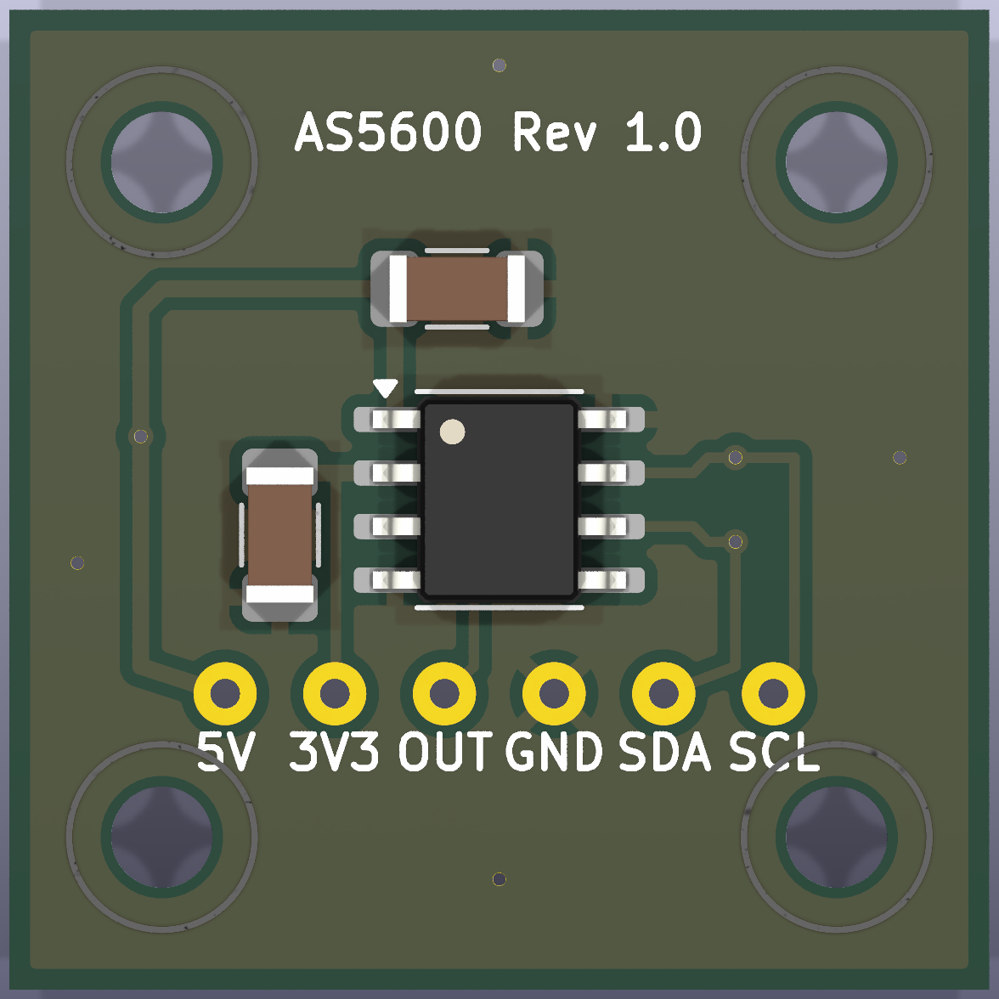
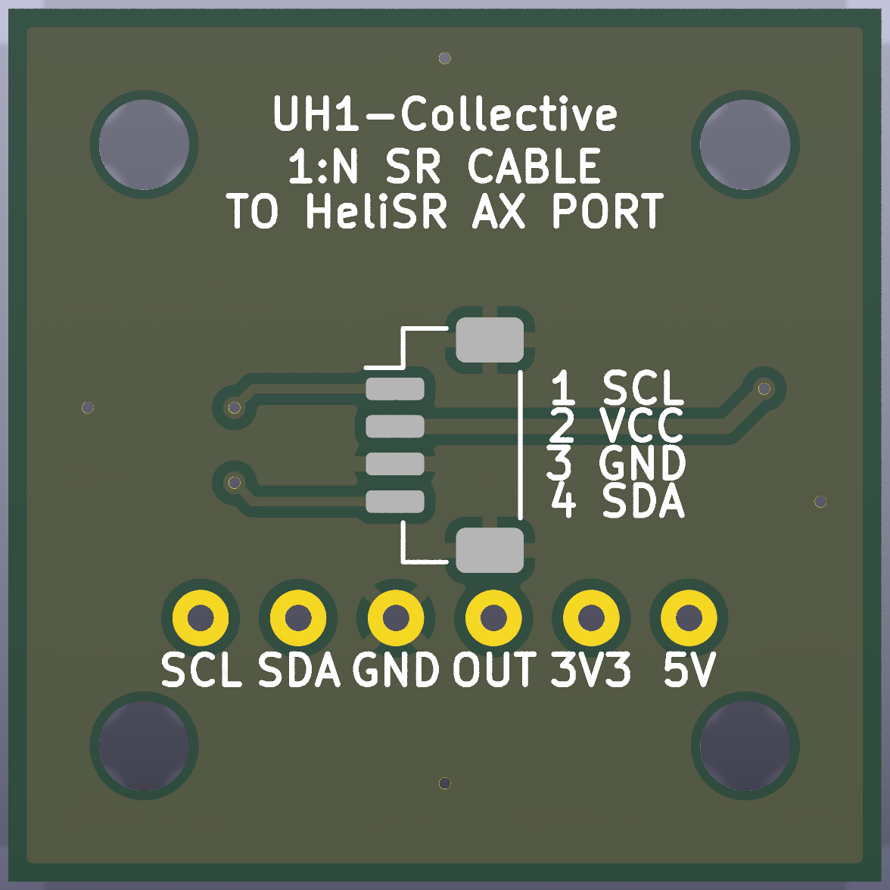

# AS5600 sensor board Rev 1.0

A small board for the AS5600 magnetic angle sensor, made to take the place of the Amazon AS5600 module (WWZMDiB). It's the same 23.24 mm square, 1.6 mm thick, with the same four M2 holes, so it drops into the base lever's sensor pocket and the head's sensor pod with no reprints. It plugs straight into a HeliSR Rev 4.0 AX port with a JST SR jumper: there's nothing to remove, measure or jumper.

| Front (chip side, faces the magnet) | Back |
|---|---|
|  |  |

The back render shows J1's pads only: the KiCad install has no 3D model for it.

> **Not built yet.** The board passes KiCad's DRC and the netlist check below, but none has been made or tried.

## Circuit

The AS5600 runs in 5 V mode, wired as its datasheet asks (ams v1-06, page 3, Pin Description):

| AS5600 pin | Name | Goes to |
|---|---|---|
| 1 | VDD5V | VCC (5 V from the HeliSR), with C1 100 nF to GND |
| 2 | VDD3V3 | C2 1 µF to GND only: in 5 V mode it's the chip's own regulator output |
| 3 | OUT | the OUT test point only |
| 4 | GND | GND |
| 5 | PGO | not connected: the chip's internal pull-up holds it high, so OUT can't burn anything into the chip |
| 6 | SDA | J1 pin 4 |
| 7 | SCL | J1 pin 1 |
| 8 | DIR | GND: the angle rises clockwise, seen from the chip's face |

There are no pull-ups on this board: each HeliSR port has its own 2.2 kΩ pair.

**Test points:** one row under the chip, 2.6 mm apart: plated through-holes (1.5 mm pads, 0.7 mm holes), so a meter or scope probe, or a wire, reaches them from either side. Each is labelled underneath on both sides. Left to right, seen from the front:
- **3V3:** the chip's own regulator output. The board runs on 5 V; this reads about 3.3 V when the chip is powered and working.
- **OUT:** the AS5600's analog output, a voltage that follows the angle, unless something sets it to PWM.
- **GND**, **5V**, **SDA**, **SCL**. Nothing is burnt into the chip; the HeliSR writes the start and stop angles every time it starts.

## Connector and cable

J1, on the back in the middle, is the same JST SH 4-pin header as the HeliSR's AX ports (BM04B-SRSS-TB). Its pins are labelled on the back:

| J1 pin | 1 | 2 | 3 | 4 |
|---|---|---|---|---|
| Signal | SCL | VCC | GND | SDA |

That's the HeliSR port's order (1 SDA, 2 GND, 3 VCC, 4 SCL) turned end for end, to suit the **JST A04SR04SR30K254B** jumper, which is wired **1:N** (pin 1 to pin 4, 2 to 3, 3 to 2, 4 to 1; Mouser lists it as "1:N"). With that jumper, each signal lands on its own pin:

| HeliSR AX port | 1 SDA | 2 GND | 3 VCC | 4 SCL |
|---|---|---|---|---|
| through the 1:N jumper to J1 | 4 SDA | 3 GND | 2 VCC | 1 SCL |

**Don't use a 1:1 jumper** (A04SR04SR30K254**A**): it would put 5 V on the sensor's ground.

- **Throttle (head, AX4):** one whole jumper, sensor to AX4.
- **Collective (base, AX1):** cut a jumper in half and splice the 4-wire ribbon between the halves, each wire to the wire in the same position, so the lead stays 1:N. One plug goes on the sensor, the other on AX1.

## How it fits

- **Front:** U1 sits on the board's centre, where the module's chip was, so it stays centred over the magnet. The test points are flush with the board; leave them empty (no wires or pins) when it goes in, as the base's cover is close. C1 and C2 sit within 7 mm of the centre, clear of the head's rails (the outer 1.5 mm of two edges) and the base's M2 screw heads (at the corners). The tallest part is the AS5600 itself, the same chip as on the module; C2 is 1.15 mm and C1 0.85 mm. The base's cover is 2.0 mm off the board face, and the head's way in is 1.9 mm deep under the board.
- **Back:** only J1 (a 7.9 × 5.3 mm footprint), in the middle.
  - **In the base**, J1 and the plug sit in the 13 mm axial bore behind the pocket, and the lead runs on down the bore. The pocket's four posts and two ledges bear on the board's corners and edges, well away from J1.
  - **In the head**, the board goes in chip down, so J1 faces up into the pod's open top. Plug the jumper in after the board is in its grooves.
- **Holes:** four 2.4 mm holes on a 16.00 mm square, centre to centre, for the base's M2 × 8 screws, so the board goes in any way round. The base's posts are 16.26 mm apart one way (the module's spacing); the 2.4 mm holes take the 0.13 mm each side, with 0.07 mm to spare round an M2.

## Parts

Per board. The AS5600 and the magnet come off a WWZMDiB module: lift the chip off with hot air. Mouser stock checked 2026-11-14.

| Ref | Part | Manufacturer part | Mouser | Notes |
|---|---|---|---|---|
| U1 | AS5600, SOIC-8 | AS5600-ASOM | | From a module |
| C1 | 100 nF, 50 V, X7R, 1206 | Samsung CL31B104KBCNNNC | 187-CL31B104KBCNNNC | The HeliSR's C1/C2/C4 part, 0.85 mm thick |
| C2 | 1 µF, 16 V, X7R, 1206, low profile | Walsin 1206B105J160CT | 791-1206B105J160CT | 1.15 mm thick. Any 1 µF X7R 1206, 10 V or more, no taller than 1.25 mm will do |
| J1 | JST SH header, 4 pins, 1.0 mm, top entry | BM04B-SRSS-G-TB(LF)(SN) | 306-4BSRSSGTBLP | The HeliSR's AX port part (tin-plated, like every stock SH header). BM04B-SRSS-TB fits too but was backordered to mid-2027 |
| | JST SR jumper, 4 positions, 10 in, **1:N** | A04SR04SR30K254B | 306-A04SR04SR30K254B | One per sensor |
| | Bare PCB, 2 layers, 1.6 mm, 23.24 mm square | | | Upload `AS5600_Rev1.0_Gerbers.zip` to a board maker (OSH Park makes 3) |

`AS5600_Rev1.0_BOM.csv` has the same list.

## Assembly

1. **U1** on the front: pin 1 at the triangle on the silkscreen, by C1.
2. **C1** (above U1) and **C2** (left of U1). Neither has a polarity.
3. **J1** on the back, in the middle, its pins toward the labels.
4. **Check with a meter** (unplugged): VCC to GND not shorted (J1 pin 2 to pin 3), and U1's pins 1 and 2 not joined.
5. Fit it like the module: in the base, chip out, screwed down with the four M2 × 8; in the head, chip down into the grooves, a dab of hot glue at the front.

## Direction

DIR is tied to GND, so the angle rises clockwise as seen from the chip's face. The firmware handles either direction:

- **Throttle (head, AX4):** rises from idle to full open, as before.
- **Collective (base, AX1):** the angle falls as the lever lifts. When you set the range, the helper notices this and sets it the other way round; tick **Inverted** on the collective's axis (see `Software/docs/as5600.md`).

## Checks done

- **KiCad DRC:** 0 violations, 0 unconnected (0.2 mm clearance, 0.25 mm signal and 0.4 mm power tracks, 0.6 / 0.3 mm vias).
- **Vias:** seven, only where a net has to change sides (SCL, SDA and VCC to J1) and four to tie the ground pours together. Each is at least 1 mm clear, edge to edge, of every other via, every pad and every part's courtyard on both sides, and none is under a part. `tools/verify_as5600.py` checks this on every build.
- **Netlist:** `tools/verify_as5600.py` checks every pad, the test points included, against tables written out by hand from the AS5600 datasheet and the HeliSR port's pinout through a 1:N cable, not from the generator. It also checks the outline (23.24 mm), the holes, U1 and J1 on the centre, and C1, C2 within 7 mm of it.

## Rebuilding

```bash
.venv/Scripts/python.exe PCB/AS5600/tools/build.py
```

`build.py` runs `gen_as5600.py` (KiCad 9's python) to make `AS5600_Rev1.0.kicad_pcb` with its tracks and ground pours, runs the DRC and `verify_as5600.py`, and writes the Gerbers, the two renders and the BOM. `kicad_run.py` finds KiCad.
