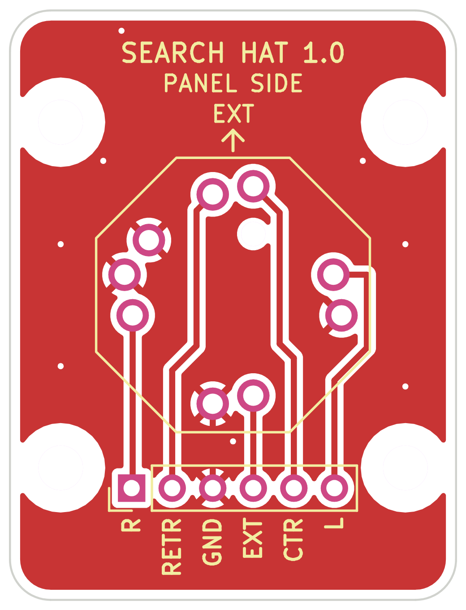
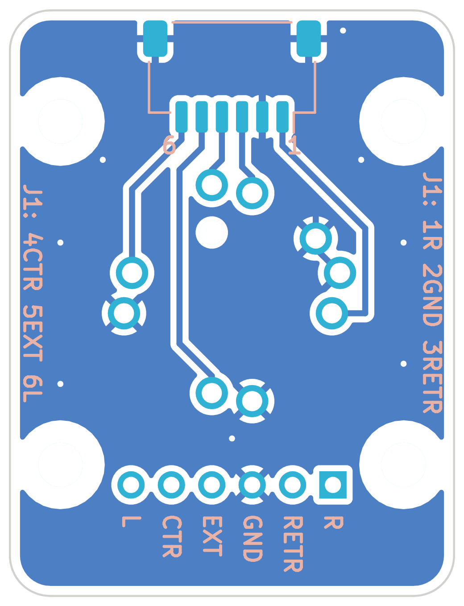

# SearchHat Rev 1.0: breakout board for the SEARCH CONT hat

A small board for hat Rev 4 in the Huey head Rev 5 ([`Head/Hat`](../../Head/Hat/README.md)). It carries an **ALPS RKJXM1015004** 8-direction stick switch with a centre push, and screws to four bosses printed on the back of the lower panel. The switch's body comes through the panel's 13.5 mm hole and the cap goes on its stick.

| Front: faces the panel | Back, mirrored: as you see it from behind |
|---|---|
|  |  |

| | |
|---|---|
| Size | 22 × 29 mm, 2 layers, 1.6 mm FR4, 2 mm corners |
| Holes | Four 2.2 mm holes for M2 × 8 countersunk screws, 8.5 mm from the switch's centre each way (17 mm apart). Every track and both ground pours stop 2.2 mm from each hole's centre, clear of the 3.8 mm screw head |
| Switch | SW1, on the front, centred 11 mm from each long side and 14 mm below the top edge |
| Connector | J1, a 6-pin JST SH 1.0 mm side-entry header (SM06B-SRSS-TB), on the back at the top. The plug goes in from the top edge and the cable leaves upward |
| Wire pads | J2, six 2 mm-pitch plated holes (0.8 mm) along the bottom, to solder wires to instead of J1 |
| Ground | Pours on both sides, joined by eight vias |

## The switch

The RKJXM1015004 has nine pins on two circles (9.9 and 10.7 mm) and a 1.1 mm locating peg. The footprint (`SearchHat.pretty/SW_ALPS_RKJXM1015004`) takes its pin centres from JLCPCB/EasyEDA's footprint for the part (LCSC C97432), which match the ALPS catalog's mounting-hole drawing: 1.0 mm holes for the pins, here with 1.6 mm pads, and a 1.2 mm unplated hole for the peg.

How it's wired inside, from the catalog's circuit diagram:
- **PUSH** (three pins, joined inside) is the common of the four directions. Tilting the stick joins PUSH to A, B, C or D; a diagonal joins two neighbours, so it's an 8-way switch.
- The **centre push** joins COM to PUSH.
- **GND** is the metal frame.

So the board ties PUSH and GND to ground. A–D are the four directions and COM is the centre push. Seen from the front (as you look at the panel), and going by the catalog's lever drawing: **A is up (EXT), C down (RETR), B left (L) and D right (R)**. The silkscreen on the front has an arrow marked EXT pointing up.

## Pinout

| Signal | Switch pin | J1 pin | J2 pad | HeliSR J2 pin | HeliSR input |
|---|---|---|---|---|---|
| R (right) | D | 1 | 1 | 5 | IN12 |
| GND | PUSH ×3, GND | 2 (and the mounting tabs) | 3 | 1 or 10 | |
| RETR (down) | C | 3 | 2 | 3 | IN10 |
| CTR (centre push) | COM | 4 | 5 | 8 | IN15 (spare; leave it off if you don't want a centre button) |
| EXT (up) | A | 5 | 4 | 2 | IN9 |
| L (left) | B | 6 | 6 | 4 | IN11 |

These are the inputs the tact-switch hats used (IN9–IN12 as EXT, RETR, L, R), so the existing profiles work as they are. The centre push is new. IN15 is spare, so bind it in a profile if you want it.

The pin order isn't GND first. On J1 the signals follow the order their switch pins come round the ring, so every track on the back runs without a crossing; on J2 the same goes for the front. The silkscreen names them:
- **J1:** "1" and "6" mark its ends on the back. Up the long edges, "J1: 1R 2GND 3RETR" and "J1: 4CTR 5EXT 6L". Seen from behind, pin 1 is on the right.
- **J2:** each pad's name is under it, on both sides.

**The lead:** cut a 6-pin JST SH jumper (A06SR06SR30K203A) in half, as for the HeliSR's ports. Plug one end into J1 and splice its wires into the HeliSR's J2 loom as in the table. Check pin 1 with a meter: cut jumpers come in both "same side" and "reversed" versions. Or leave J1 off and solder five or six wires to J2.

## Building it

1. **J1 first**, on the back, while the board is flat. Line its pins up on the pads, then tack and solder the two mounting tabs.
2. **SW1** on the front: its peg goes in the 1.2 mm hole, so it only fits one way. Hold it flat against the board and solder its nine pins on the back. It must sit flat: it is what places the stick in the panel's hole.
3. Check with a meter, with nothing pressed: no direction or CTR is joined to GND. Tilt each way and press the middle: each joins its own signal to GND, and each diagonal joins two.

Fitting it to the panel and the cap: [the hat](../../Head/Hat/README.md).

## Checks

- **DRC:** `kicad-cli pcb drc` reports no violations and nothing unconnected. The rules are the HeliSR boards' cheap-fab rules: 0.127 mm minimum track and clearance, with this board's net class at 0.3 mm tracks and 0.2 mm clearance. Two exceptions are written into `SearchHat_Rev1.0.kicad_dru`, each limited to the parts it names:
  - The lower M2 holes' library courtyards overlap J2's by about 0.5 mm. The screw head itself is 0.9 mm from the nearest pad.
  - The left PUSH pin gets one thermal spoke on the back, where R runs past it. A ground track on the back and the front pour join it as well.
- **Fit in the head:** `Head/check_r5.py` places the board, the switch, J1 and a plug with its wires against the body, the toggles and the HeliSR board: all clear. The tightest spot is the end of J1's plug, 2.2 mm below the lower box's top wall. From about 12 mm behind the panel the slot up to the upper box is open, so the wires turn straight back and go up to the HeliSR.

## Not checked

Nothing is ordered or built yet. Still to check on a real part:
- the footprint, against the switch itself: the pin centres come from two sources that agree, but neither is ALPS's own PCB drawing;
- that A is really up, as the catalog's lever drawing reads. If a direction comes out wrong, swap its inputs in the profile, or swap the wires;
- whether a countersunk M2 head sits well on the board's plain 2.2 mm hole. A small washer under each head is fine if it doesn't.

## Files

| File | What it is |
|---|---|
| `SearchHat_Rev1.0.kicad_pcb`, `.kicad_pro`, `.kicad_dru` | The board, its project and its rules (KiCad 9) |
| `SearchHat.pretty/` | The switch's footprint |
| `SearchHat_Rev1.0_Gerbers.zip` | Gerbers with Protel extensions and a job file, plus the PTH and NPTH drill files: send it to any PCB maker |
| `SearchHat_Rev1.0_Top.png`, `_Bottom_mirrored.png` | The pictures above |
| `SearchHat_Rev1.0_mech.json` | The outline, holes and parts' places, measured from the switch's centre. `Head/Hat/hat4_r5.py` reads it, so the panel's bosses always match the board |
| `tools/gen_searchhat.py` | Builds the board from scratch: parts, hand-placed tracks, pours, silkscreen, rules and the JSON |
| `tools/export_searchhat.py` | Writes the Gerbers and the pictures (the HeliSR's export script, sized for this board) |

## Rebuilding

From this folder:

```bash
"$LOCALAPPDATA/Programs/KiCad/9.0/bin/python.exe" tools/gen_searchhat.py .
```

```bash
"$LOCALAPPDATA/Programs/KiCad/9.0/bin/kicad-cli.exe" pcb drc --severity-all --format json -o drc.json SearchHat_Rev1.0.kicad_pcb
```

```bash
python tools/export_searchhat.py SearchHat_Rev1.0.kicad_pcb .
```

Then, in `Head/Hat`, run `python hat4_r5.py ../stl` so the panel's bosses follow any change.
