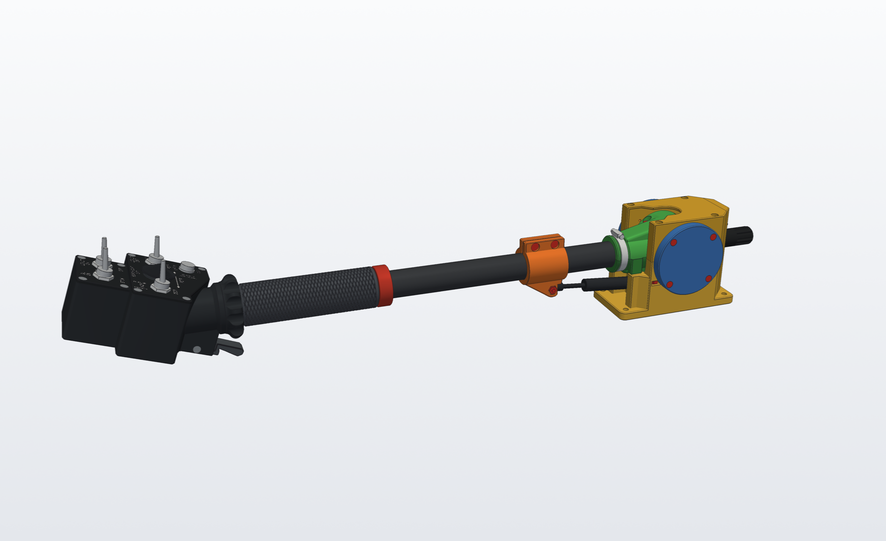

# Heli Collective

A 3D-printed, desk-mounted collective for helicopter flight simulators, modelled on the UH-1 "Huey". It plugs into a PC by USB and shows up as an ordinary game controller, so any sim can use it.

- **The lever** is a 25 mm carbon-fibre tube in a printed base that screws to the desk. It pivots on two ball bearings, a gas strut balances the head's weight, and a knob sets the friction. It travels 32° to a fixed stop. The lever is two-thirds as long as the real one and starts level, so your hand rises about as far as on a real Huey (9.4 in against 9.25 in).
- **The head** is the Huey's collective switch box: GOV RPM, landing light and search light toggles, the SEARCH CONT hat (an 8-way stick), the STOP REL button and the starter trigger. Under it, the twist-grip throttle turns 181° between two hard stops, idle and full open, and stays where you leave it.
- **Sensors:** two AS5600 magnetic angle sensors, one for the lever in the base and one for the throttle in the head. There are no potentiometers to wear out.
- **Electronics:** the HeliSR board, a small PCB that carries a Pro Micro, sits in the head. It reads 16 switch inputs, and the AS5600s over I²C on four sensor ports. Only the USB cable comes out of the base.
- **Software:** the HeliSR firmware and a Windows app, HeliSR Configurator. The app flashes the board, assigns each switch position to a game button and calibrates the axes. Both are based on FreeJoy.

**Interactive exploded views** (point at any part to see what it is): [the base](https://htmlpreview.github.io/?https://github.com/genbean/UH1-Collective/blob/main/Base/renders/rev4_exploded.html), [the base's lever](https://htmlpreview.github.io/?https://github.com/genbean/UH1-Collective/blob/main/Base/renders/rev4_lever_exploded.html), [the head](https://htmlpreview.github.io/?https://github.com/genbean/UH1-Collective/blob/main/Head/renders/HueyHeadR5_Exploded.html), [the head from behind](https://htmlpreview.github.io/?https://github.com/genbean/UH1-Collective/blob/main/Head/renders/HueyHeadR5_Exploded_Rear.html).

More pictures: [from the side](renders/HeliCollective_side.png) and [at the 32° stop](renders/HeliCollective_32deg.png). [`renders/HeliCollective_Assembly.glb`](renders/HeliCollective_Assembly.glb) is the whole collective in 3D; it opens in Windows 3D Viewer or any glTF viewer.

## The parts

Each folder has its own README with the details: how it works, printing, the parts it needs, assembly, and how to rebuild the files.

| Folder | What's in it |
|---|---|
| [`Base/`](Base/README.md) | **MkIII base, Rev 4.** 73 mm (2.87 in) wide, the lever centred on the tube: the pivot on thin-section bearings, the split lever, a shell that encloses it, the gas strut, the brake behind the hub, the stops and the collective's AS5600. Ready-to-print STLs, fit-test coupons, a STEP assembly, renders with every screw labelled, and the scripts that make them. |
| [`Head/`](Head/README.md) | **Huey head, Rev 5.** The switch box in one print, cut to the real UH-1 panels' dimensions, with the throttle grip and its gears, the throttle's AS5600, the starter trigger and the search light hat, and a collision check (`check_r5.py`). STLs and scripts. The BOM lists it. |
| [`PCB/HeliSR/`](PCB/HeliSR/README.md) | **HeliSR Rev 4.0 board.** Sixteen switch inputs, and four I²C ports for the AS5600s, through a PCA9546A switch, in place of the analog inputs. KiCad files, Gerbers, connector pinouts, how to prepare the AS5600 modules, and the assembly order. |
| [`PCB/SearchHat/`](PCB/SearchHat/README.md) | **SearchHat Rev 1.0: the SEARCH CONT hat's breakout board.** An ALPS RKJXM1015004 8-direction stick switch on a 22 × 29 mm board that screws to the lower panel's back, with a JST SH socket or wire pads. KiCad files, Gerbers, the pinout and how to build it. |
| [`BOM/`](BOM) | **The bill of materials for the whole collective:** [`Heli_Collective_Final_BOM.xlsx`](BOM/Heli_Collective_Final_BOM.xlsx) (one parts list, plus sheets for the printed parts, dropped parts and sources), the only BOM in the repo. [`tools/make_bom.py`](tools/make_bom.py) rewrites it (and checks the board's parts against the board file). It lists the Rev 4.0 board, and counts the Digi-Key order already placed for Rev 3.0 as bought. |
| [`Software/`](Software/README.md) | **HeliSR firmware and HeliSR Configurator**, with their documentation in [`Software/docs/`](Software/docs) and example profiles, including one for this collective. |
| [`renders/`](renders) | Pictures and a 3D model of the complete collective: head Rev 5 on base Rev 4. [`Base/make_renders_r4.py`](Base/make_renders_r4.py) builds them, and base Rev 4's renders, exploded view and screw chart. [`make_diagrams.py`](renders/make_diagrams.py) draws the head's exploded views, screw maps and screw chart from that model. |

## What you need

The full list, with quantities, part numbers, links and prices, is the [BOM spreadsheet](BOM/Heli_Collective_Final_BOM.xlsx). In outline:

**Electronics**
- The HeliSR Rev 4.0 PCB: send [`HeliSR_Rev4.0_Gerbers.zip`](PCB/HeliSR/HeliSR_Rev4.0_Gerbers.zip) to any PCB maker (2 layers, 39.3 × 33.6 mm).
- The SearchHat Rev 1.0 PCB, for the SEARCH CONT hat: send [`SearchHat_Rev1.0_Gerbers.zip`](PCB/SearchHat/SearchHat_Rev1.0_Gerbers.zip) the same way (2 layers, 22 × 29 mm). Its ALPS switch and JST socket are in the BOM.
- The parts that solder onto it, from Digi-Key: filter the BOM's Supplier column to Digi-Key; Packs to order shows what's still needed (most were bought with the Rev 3.0 order).
- A **5 V / 16 MHz Pro Micro** (ATmega32U4). This build uses a USB-C clone; the 3.3 V / 8 MHz version isn't supported.
- Two AS5600 magnetic angle sensor modules, with their magnets.
- JST SR 1.0 mm cables for the board, a 4-core lead for the base's sensor (SDA, GND, VCC, SCL), and a USB-A to USB-C cable. The USB cable runs up through the base and the tube and is spliced inside the head; the BOM's notes explain how.

**Head**
- Four APEM 600H toggle switches, a Same Sky PB4 push button a TE 6 × 6 mm tact switch for the starter trigger, and an ALPS RKJXM1015004 8-way stick switch for the SEARCH CONT hat.
- Four 24 × 2 mm nitrile O-rings, which the throttle grip turns on, a pen spring and four 4 mm board spacers.

**Base**
- Two 6808-2RS thin-section ball bearings (40 × 52 × 7 mm), a 6 in (152 mm), 45 N gas strut with eyelet ends, and a 25 × 23 mm roll-wrapped carbon tube, 500 mm long, used whole.

**Screws, consumables and tools**
- Nearly every screw and nut comes from two Amazon kits, a countersunk screw kit and a set-screw kit. The lever's four M4 socket head screws come from an M4 × 30–50 kit, the brake's M5 × 30 hex bolt from any hardware store, and the head's trigger pivot is an M3 × 25 from a separate set. The BOM and each part's README list them.
- Grease for the bearings and the O-rings, CA glue, hot glue and blue thread-locker; M2, M3, M4 and M5 taps, and 4 mm and 5.2 mm drills for the tube; a soldering iron that can handle 1.0 mm pitch SMD parts.
- The spreadsheet's main sheet leaves out a few things it expects you to supply yourself: a 25–40 mm hose clamp, 1.5 mm felt tape, a 10 mm compression spring, four #10 × 1-1/2 in wood screws for the desk, and the glues, thread-locker, taps and drill. Its Dropped sheet names them.

**Printing and a PC**
- An FDM printer with about 180 mm of build height. The tallest part, the throttle grip, is 173 mm printed upright. The head's panel labels are white, printed in a second filament for the first three layers (an AMS, or a filament change).
- A PC with 64-bit Windows 10 or 11 to set the board up. After that it's a standard USB game controller.
- Python, only if you change the CAD. The STLs are ready to print, and each part's README lists what its scripts need.

## Build order

Each step points to the README that covers it.

1. **Order the parts** from the [BOM](BOM/Heli_Collective_Final_BOM.xlsx), and the PCBs from the Gerbers.
2. **Print the fit-test coupons first**, with the filament and settings you'll use, and try them on your carbon tube, bearings, sensor modules and printed lever dowels: [the base's coupons](Base/README.md#fit-test-coupons) (the 6808 bearing fits, the lever's dowel holes and the tube socket), and the head's O-ring and sensor seat coupons (printed as in [Head, Printing](Head/README.md#printing)). If a fit is off, change its setting in the script and rebuild the STLs.
3. **Build the HeliSR board** ([assembly order](PCB/HeliSR/README.md#assembly-order)) and fit the Pro Micro.
4. **Flash and test it** with HeliSR Configurator: the [quick start](Software/docs/quick-start.md) goes from a bare Pro Micro to a working controller. Check every input now, before it goes into the head. The app picks the HeliSR firmware for you.
5. **Prepare the two AS5600 modules:** remove R1 and R4, wire DIR (to VCC on the base's sensor, to GND on the throttle's), check for about 1 µF on VDD3V3, and measure the module's pull-ups. See the Rev 4.0 board's [AS5600 modules](PCB/HeliSR/README.md#as5600-modules).
6. **Print and assemble the base** ([Base Rev 4, Assembly](Base/README.md#assembly)). The USB cable and the sensor lead go into the lever halves before you close them, the brake strap goes in before the lever, and the tube is drilled, notched and fitted at the end.
7. **Print and assemble the head** ([Head, Assembly](Head/README.md#assembly)): the throttle parts, the starter trigger, the grip on the tube, the head pressed onto the tube, then the board, switches and panels.
8. **Set the two AS5600s' ranges** in HeliSR Configurator's AS5600 helper ([AS5600 guide](Software/docs/as5600.md#setting-the-start-and-stop)): the collective on AX1, the throttle on AX4. The firmware writes each range to its sensor over I²C at every start-up and burns nothing, so it can be set again whenever you like.
9. **Balance and set the friction** ([Base Rev 4, Balance](Base/README.md#balance) and [Brake](Base/README.md#brake)).
10. **Load the UH-1 profile** in HeliSR Configurator, calibrate the axes, and bind the buttons in your sim ([Profiles](Software/docs/profiles.md#uh-1-collective-helisr-head)).

## Status

As of November 2026 the current design is **head Rev 5, base Rev 4 and HeliSR Rev 4.0**.

- **First build:** the first collective was printed and assembled on base Rev 3. What it taught us went into base Rev 4:
  - **Bearings:** the bearing seats fitted perfectly, and the races pressed onto the trunnions a hair too tight.
  - **Strut:** the 45 N strut lifted the lever. Its anchor has since moved, in Rev 4.
  - **Width:** at 130 mm, the base was wider than it needed to be.
- **Base Rev 4:** its first frame, shell and lever were printed and assembled (2026-11-08), and the bearing coupons fitted. Since then it has changed (split lever, brake strap, covers, cable path, lever opening), checked in CAD for collisions and fits through the whole travel and the assembly order; reprint all of it but the strut collar.
- **Head Rev 5:** designed, and checked in CAD for collisions and fits. Earlier head fits were tuned with coupons on an aluminium tube, so check them on the carbon tube.
- **HeliSR Rev 4.0 board:** designed and checked (design rules, and every pad's net against the chips' datasheets), not built yet.
- **Software:** the firmware and HeliSR Configurator in [`Software/`](Software/README.md) support the Rev 4.0 board, with its I²C sensors and their ranges set in the app. They are tested on the PC and a bare Pro Micro only; the Rev 4.0 sensor code against a model of the I²C switch and the AS5600. The software hasn't run on a built board with real switches and sensors.

Expect more changes as the build goes on.

## Credits and licence

- This repository is under the **GNU General Public License v3.0** ([LICENSE](LICENSE)), except where a folder says otherwise.
- **The software in `Software/`** is under the **GNU GPL v3 or later**. It is a modified version of [FreeJoy](https://github.com/FreeJoy-Team/FreeJoy) and [FreeJoyConfiguratorQt](https://github.com/FreeJoy-Team/FreeJoyConfiguratorQt) by the FreeJoy team, ported to the Pro Micro, and isn't made or supported by them. [`Software/NOTICE.md`](Software/NOTICE.md) lists the changes and the third-party components.
- **The original collective: Gazmac52.** This project grew out of [DIY Helicopter Collective Hall Effect](https://www.thingiverse.com/thing:5226353) by **Gazmac52** on Thingiverse, the "MkII" in this project's file names, licensed under [Creative Commons Attribution 4.0](https://creativecommons.org/licenses/by/4.0/). Several components are borrowed from it: the head's throttle grip is built from its grip, modified (`Head/source/MkII-Grip-bore-relieved-25mm.stl`), the HeliSR board reads its switches through 74HC165 shift registers, as Gazmac52's board does, and the head and base are modelled in the MkII's coordinate frames.
- **hotpretzel.** Some components are borrowed from [UH-1 Huey Helicopter Collective](https://www.thingiverse.com/thing:4284120) by **hotpretzel** on Thingiverse, licensed under [Creative Commons Attribution-NonCommercial](https://creativecommons.org/licenses/by-nc/4.0/). The head's faux throttle friction knob is built from hotpretzel's friction knob STL: its wheel profile and flutes were measured off it. So the knob, and the head bodies that carry it (`HueyHeadR4-Body.stl`, `HueyHeadR5-Body.stl` and the scripts' `friction_knob()`), are for **non-commercial use only**, whatever the licence of the folder they're in.
- **Font:** the panels' labels are cut from **Routed Gothic Narrow** by Darren Embry ([webonastick.com/routed-gothic](https://webonastick.com/routed-gothic/)), a digitized Leroy lettering template and the closest free match to the engraved lettering on the real UH-1 panels. It's bundled in [`fonts/routed-gothic/`](fonts/routed-gothic) under the [SIL Open Font License 1.1](fonts/routed-gothic/LICENSE.md), so the panels rebuild on any system.
- **The real UH-1's dimensions:** **Kornskydiver**'s caliper photos of a real UH-1 head (2017) and **dcval**'s scaled drawing of its panels (2025), from the ED Forums thread [Huey Collective Measurements](https://forum.dcs.world/topic/152333-huey-collective-measurements/). Head Rev 5 is built to them. Copies are in [`Head/reference/`](Head/reference/README.md), with credit; they belong to their authors and aren't covered by this repository's licence.
