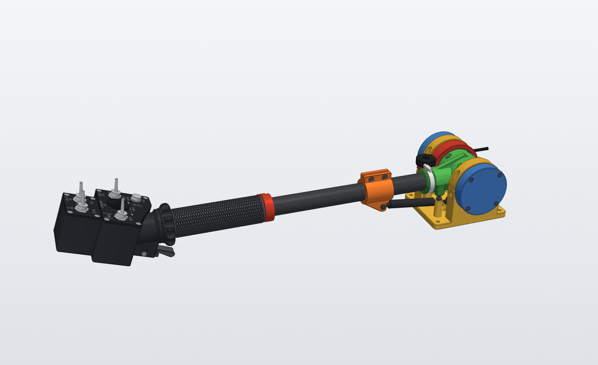

# Heli Collective

A 3D-printed, desk-mounted collective for helicopter flight simulators, modelled on the UH-1 "Huey". It plugs into a PC by USB and shows up as an ordinary game controller, so any sim can use it.

- **The lever** is a 25 mm carbon-fibre tube in a printed base that screws to the desk. It pivots on two ball bearings, a gas strut balances the head's weight, and a knob sets the friction. It travels 32° to a fixed stop. The lever is two-thirds as long as the real one and starts level, so your hand rises about as far as on a real Huey (9.4 in against 9.25 in).
- **The head** is the Huey's collective switch box: GOV RPM, landing light and search light toggles, the 4-way search light hat, the STOP REL button and the starter trigger. Under it, the twist-grip throttle turns 181° between two hard stops, idle and full open, and stays where you leave it.
- **Sensors:** two AS5600 magnetic angle sensors, one for the lever in the base and one for the throttle in the head. There are no potentiometers to wear out.
- **Electronics:** the HeliSR board, a small PCB that carries a Pro Micro, sits in the head and reads 16 switch inputs and 4 analog inputs. Only the USB cable comes out of the base.
- **Software:** the HeliSR firmware and a Windows app, HeliSR Configurator. The app flashes the board, assigns each switch position to a game button and calibrates the axes. Both are based on FreeJoy.

More pictures: [from the side](renders/HeliCollective_side.png) and [at the 32° stop](renders/HeliCollective_32deg.png). [`renders/HeliCollective_Assembly.glb`](renders/HeliCollective_Assembly.glb) is the whole collective in 3D; it opens in Windows 3D Viewer or any glTF viewer.

## The parts

Each folder has its own README with the details: how it works, printing, the parts it needs, assembly, and how to rebuild the files.

| Folder | What's in it |
|---|---|
| [`Base/`](Base/README.md) | **MkIII base, Rev 3.** The pivot, bearings, split lever, gas strut, friction knob, stops and the collective's AS5600. Ready-to-print STLs, fit-test coupons, a STEP assembly and the Python script that makes them. |
| [`Head/Rev4/`](Head/Rev4/README.md) | **Huey head, Rev 4: the current head.** The switch box in one print, with the throttle grip and its gears, the throttle's AS5600, the starter trigger and the search light hat. STLs and scripts. |
| [`Head/Rev3/`](Head/Rev3/README.md) | Head Rev 3: the same head with the neck as a separate part, so that every part prints without supports. Rev 4's README refers to it for the controls, the wiring, the parts list and some assembly steps. The grip's source mesh is in `Head/source/`. |
| [`PCB/HeliSR_Rev3.0/`](PCB/HeliSR_Rev3.0/README.md) | **HeliSR Rev 3.0 board.** KiCad files, Gerbers, connector pinouts, AS5600 notes and the board's assembly order. This revision is frozen: changes go into a new revision folder. Its "MMJoy2 setup" section is out of date; use the software below instead (MMJoy2 is no longer in this repository). |
| [`BOM/`](BOM) | **The bill of materials for the whole collective:** [`Heli_Collective_Final_BOM.xlsx`](BOM/Heli_Collective_Final_BOM.xlsx) (sheets for everything to buy, the Digi-Key order, the printed parts, dropped parts and sources), [`Heli_Collective_DigiKey.csv`](BOM/Heli_Collective_DigiKey.csv) to upload to Digi-Key's cart, and [`make_final_bom.py`](BOM/make_final_bom.py), the script that writes both. |
| [`Software/`](Software/README.md) | **HeliSR firmware and HeliSR Configurator**, with their documentation in [`Software/docs/`](Software/docs) and example profiles, including one for this collective. |
| [`renders/`](renders) | Pictures and a 3D model of the complete collective. |

## What you need

The full list, with quantities, part numbers, links and prices, is the [BOM spreadsheet](BOM/Heli_Collective_Final_BOM.xlsx). In outline:

**Electronics**
- The HeliSR Rev 3.0 PCB: send [`HeliSR_Rev3.0_Gerbers.zip`](PCB/HeliSR_Rev3.0/HeliSR_Rev3.0_Gerbers.zip) to any PCB maker (2 layers, 39.3 × 33.6 mm).
- The parts that solder onto it, from Digi-Key: [`Heli_Collective_DigiKey.csv`](BOM/Heli_Collective_DigiKey.csv) loads them into the cart.
- A **5 V / 16 MHz Pro Micro** (ATmega32U4). This build uses a USB-C clone; the 3.3 V / 8 MHz version isn't supported.
- Two AS5600 magnetic angle sensor modules, with their magnets.
- JST SR 1.0 mm cables for the board, a 3-core lead for the base's sensor, and a USB-A to USB-C cable. The USB cable runs up through the base and the tube and is spliced inside the head; the BOM's notes explain how.

**Head**
- Four APEM 600H toggle switches, a Same Sky PB4 push button and five TE 6 × 6 mm tact switches (four for the hat, one for the starter trigger).
- Four 24 × 2 mm nitrile O-rings, which the throttle grip turns on, a pen spring and four 4 mm board spacers.

**Base**
- Two 6006-2RS ball bearings, a 6 in (152 mm), 45 N gas strut with eyelet ends, and a 25 × 23 mm roll-wrapped carbon tube, 500 mm long, cut to length.

**Screws, consumables and tools**
- Nearly every screw and nut comes from two Amazon kits, a countersunk screw kit and a set-screw kit; a few M3 × 25s come from a separate set. The BOM and each part's README list them.
- Grease for the bearings and the O-rings, CA glue, hot glue and blue thread-locker; M2, M3, M4 and M5 taps, and 4 mm and 5.2 mm drills for the tube; a soldering iron that can handle 1.0 mm pitch SMD parts.
- The spreadsheet's main sheet leaves out a few things it expects you to supply yourself: a 25–40 mm hose clamp, 1.5 mm felt tape, a 10 mm compression spring, four #10 × 1-1/2 in wood screws for the desk, and the glues, thread-locker, taps and drill. Its Dropped sheet names them.

**Printing and a PC**
- An FDM printer with about 180 mm of build height. The tallest part, the throttle grip, is 173 mm printed upright. The head's panel labels are white, printed in a second filament for the first three layers (an AMS, or a filament change).
- A PC with 64-bit Windows 10 or 11 to set the board up. After that it's a standard USB game controller.
- Python, only if you change the CAD. The STLs are ready to print, and each part's README lists what its scripts need.

## Build order

Each step points to the README that covers it.

1. **Order the parts** from the [BOM](BOM/Heli_Collective_Final_BOM.xlsx), and the PCBs from the Gerbers.
2. **Print the fit-test coupons first**, with the filament and settings you'll use, and try them on your carbon tube, bearings and sensor modules: the [base's coupons](Base/README.md#fit-test-coupons-print-these-before-the-big-parts), and the head's O-ring and sensor seat coupons ([Head Rev 4, Printing](Head/Rev4/README.md#printing)). If a fit is off, change its setting in the script and rebuild the STLs.
3. **Build the HeliSR board** ([assembly order](PCB/HeliSR_Rev3.0/README.md#assembly-order)) and fit the Pro Micro.
4. **Flash and test it** with HeliSR Configurator: the [quick start](Software/docs/quick-start.md) goes from a bare Pro Micro to a working controller. Check every input now, before it goes into the head.
5. **Prepare the two AS5600 modules:** remove R1, keep R4 and wire DIR (to VCC on the base's sensor, to GND on the throttle's). See the [AS5600 guide](Software/docs/as5600.md).
6. **Print and assemble the base** ([Base, Assembly](Base/README.md#assembly)). The USB cable and the sensor lead go into the lever halves before you close them, and the tube is cut, drilled and fitted at the end.
7. **Print and assemble the head** ([Head Rev 4, Assembly](Head/Rev4/README.md#assembly)): the throttle parts, the starter trigger, the grip on the tube, the head pressed onto the tube, then the board, switches and panels.
8. **Program the two AS5600s** with the board's PROG1 (collective) and PROG4 (throttle) buttons. Each sensor can only be programmed once, so read the [AS5600 guide](Software/docs/as5600.md) first.
9. **Balance and set the friction** ([Base, Setting it](Base/README.md#setting-it)).
10. **Load the UH-1 profile** in HeliSR Configurator, calibrate the axes, and bind the buttons in your sim ([Profiles](Software/docs/profiles.md#uh-1-collective-helisr-head)).

## Status

As of October 2026 this is a complete design that hasn't been built yet.

- **Base (Rev 3) and head (Rev 4):** designed, and checked in CAD for collisions and fits through the whole travel. Neither has been printed yet. Earlier head fits were tuned with coupons on an aluminium tube, so check them on the carbon tube.
- **HeliSR Rev 3.0 board:** bare PCBs are ordered, but no board has been built or tested yet.
- **Software:** complete, and tested on a bare Pro Micro only. It hasn't run on a built board with real switches and sensors yet.

Expect changes once the first one is built.

## Credits and licence

- This repository is under the **GNU General Public License v3.0** ([LICENSE](LICENSE)), except where a folder says otherwise.
- **The software in `Software/`** is under the **GNU GPL v3 or later**. It is a modified version of [FreeJoy](https://github.com/FreeJoy-Team/FreeJoy) and [FreeJoyConfiguratorQt](https://github.com/FreeJoy-Team/FreeJoyConfiguratorQt) by the FreeJoy team, ported to the Pro Micro, and isn't made or supported by them. [`Software/NOTICE.md`](Software/NOTICE.md) lists the changes and the third-party components.
- **The original collective:** this project grew out of [DIY Helicopter Collective Hall Effect](https://www.thingiverse.com/thing:5226353) by Gazmac52 on Thingiverse, the "MkII" in this project's file names, licensed under [Creative Commons Attribution 4.0](https://creativecommons.org/licenses/by/4.0/). The head's throttle grip is built from its grip, modified (`Head/source/MkII-Grip-bore-relieved-25mm.stl`).
